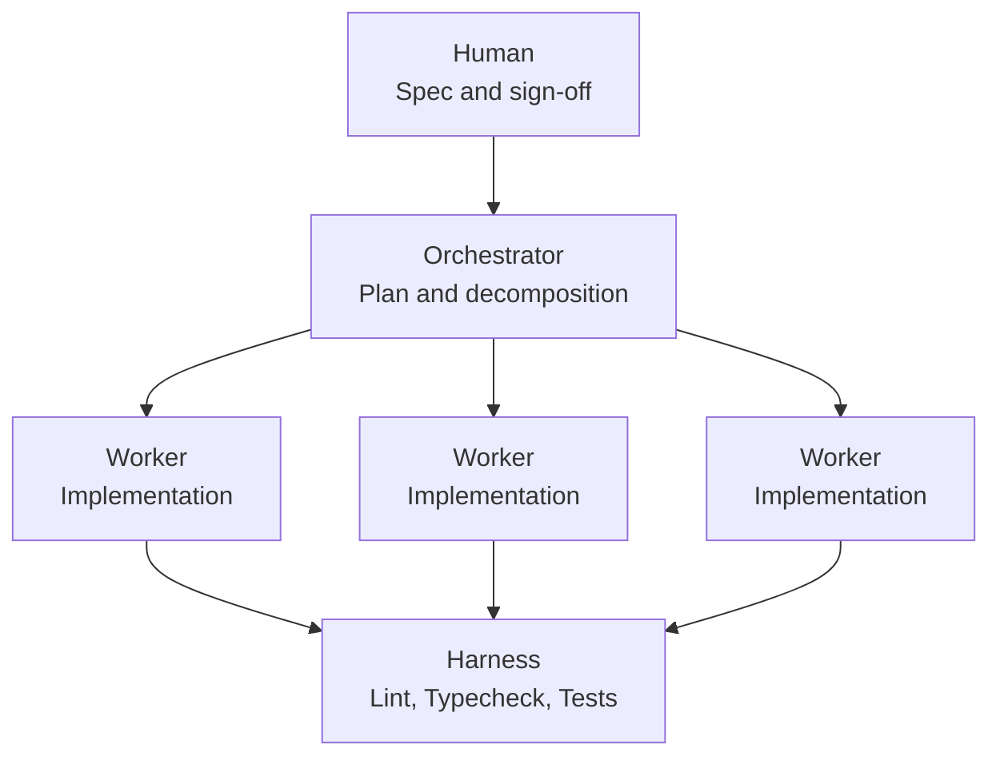
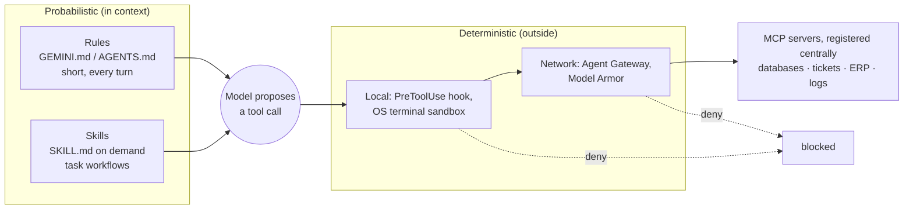
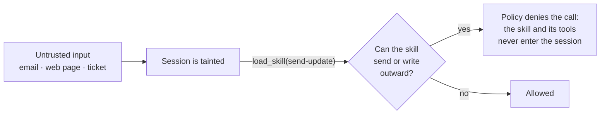
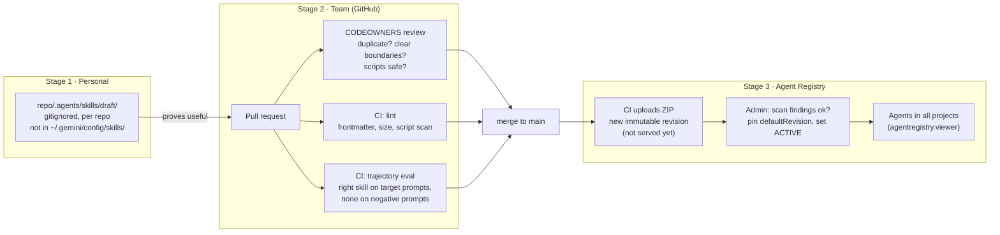
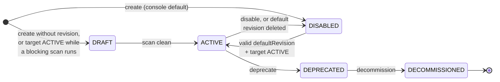
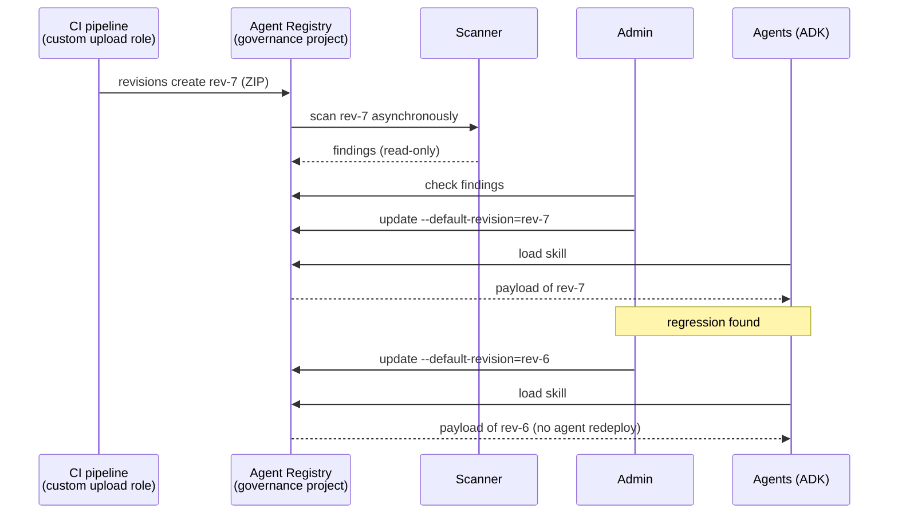
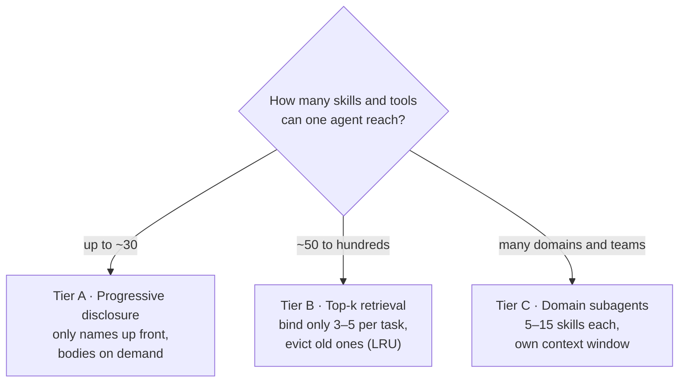
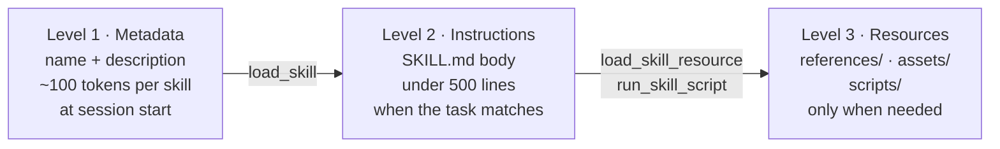
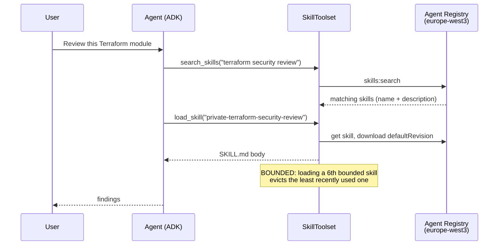
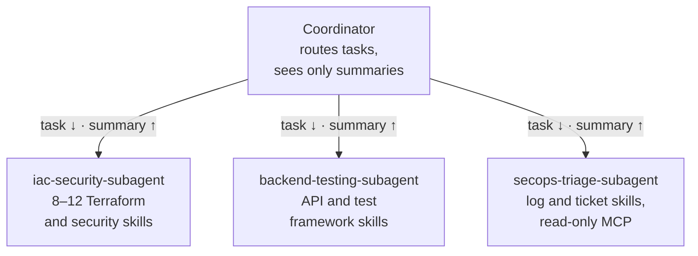

# Machine Learning: Agents und generative KI

Architecture notes for agentic systems on Google Cloud: low-code agents, coding agents, agents built in code, and how to evaluate, secure and operate them. The software engineering practices that agents depend on are condensed in the last part.

> **"Verification beats model size."**
> An agent is a model plus a harness: instructions, tools, checks, boundaries and gates. Most quality problems are solved in the harness, not by a bigger model.

## Contents

**Part 1: Foundations**
- [Module 1 · Agent anatomy and design patterns](#module-1--agent-anatomy-and-design-patterns)

**Part 2: Low-code agents and enterprise data**
- [Module 2 · Low-code agents: CX Agent Studio](#module-2--low-code-agents-cx-agent-studio)
- [Module 3 · Grounding on enterprise data: Agent Search and access control](#module-3--grounding-on-enterprise-data-agent-search-and-access-control)

**Part 3: Coding agents**
- [Module 4 · Context engineering & spec-driven development](#module-4--context-engineering--spec-driven-development)
- [Module 5 · Building the agent harness](#module-5--building-the-agent-harness)
- [Module 6 · Skills at scale: registries, governance and retrieval](#module-6--skills-at-scale-registries-governance-and-retrieval)

**Part 4: Building agents in code**
- [Module 7 · Choosing and serving models](#module-7--choosing-and-serving-models)
- [Module 8 · Agents in code with ADK: workflows, callbacks, sessions, memory](#module-8--agents-in-code-with-adk-workflows-callbacks-sessions-memory)
- [Module 9 · Protocols and identity: MCP, A2A, Agent Identity](#module-9--protocols-and-identity-mcp-a2a-agent-identity)

**Part 5: Evaluate, secure, operate**
- [Module 10 · Evaluating models and agents](#module-10--evaluating-models-and-agents)
- [Module 11 · Reviewing AI code critically: security & verification debt](#module-11--reviewing-ai-code-critically-security--verification-debt)
- [Module 12 · Deploying, scaling and operating agents](#module-12--deploying-scaling-and-operating-agents)
- [Module 13 · Scaling in the team & measuring impact](#module-13--scaling-in-the-team--measuring-impact)

**Part 6: Engineering foundations**
- [Module 14 · Software engineering essentials for agent work](#module-14--software-engineering-essentials-for-agent-work)

Agent authentication and authorization on Google Cloud (access vs. ID tokens, ADC, Agent Identity, Auth Manager) is in [pca.md, sections 4.16 and 4.17](pca.md#416-authentifizierung-für-agents-bausteine-oidc-und-google-managed-oauth).

---

## Part 1 · Foundations

### Module 1 · Agent anatomy and design patterns

#### 1. What an agent is

An agent is a model in a loop: it reads the context, decides on an action (usually a tool call), observes the result and repeats until it answers or a limit stops it.

```
Agent  =  Model                +  Harness
          predicts tokens,        instructions, tools, memory, checks,
          reasons                 boundaries, gates
```

The same model behaves very differently in different harnesses (Module 10, section 1). Three consequences for architecture:

- **Every step can fail.** With a per-step success rate p, a run of n dependent steps succeeds with about pⁿ: 0.95 per step gives 0.95²⁰ ≈ 36% over 20 steps. Fewer steps, checks between steps and bounded loops matter more than a marginally better model.
- **Instructions are probabilistic, mechanisms are deterministic.** A sentence in a prompt is usually followed; a workflow step, a permission or a gateway is always enforced (Module 5).
- **Context is a budget.** Tool schemas, history and tool outputs compete for the same window (Module 4).

#### 2. Design patterns

| Pattern | Control flow | Use when | ADK building block (Module 8) |
|---|---|---|---|
| Single agent | one model, a few tools | one domain, short tasks | `LlmAgent` |
| Sequential | fixed order of steps | a pipeline whose order never changes | `SequentialAgent` |
| Parallel | independent steps at once | fan-out research, independent checks | `ParallelAgent` |
| Loop (generator-critic) | repeat until approved or a limit is hit | drafting against rules, refinement | `LoopAgent` with `max_iterations` |
| Coordinator / hierarchy | a model routes to specialists | several domains, each with its own tools | `sub_agents`, `AgentTool` |
| Human in the loop | a person approves a step | irreversible or outward-acting actions | tool confirmation, approval step |

Two ways to connect agents:

- **Workflow agents** (sequential, parallel, loop) decide the order in code. The order is deterministic and auditable.
- **Model-driven delegation** lets a model decide which sub-agent or tool runs next. More flexible, less predictable.

Choose the most deterministic pattern that solves the task. A mandatory order (verify identity, then change the address) belongs in a workflow or a state machine, not in a prompt.

#### 3. Three ways to build

| Path | Tool | Fits |
|---|---|---|
| Low-code | CX Agent Studio, Agent Designer in Gemini Enterprise (Module 2) | conversational agents for customer service, business teams, fast iteration in a console |
| Coding agent | Antigravity, Gemini CLI, Claude Code (Modules 4 to 6) | software work in a repository: refactoring, migrations, tests |
| Code | ADK and other open-source frameworks (Module 8) | custom agents with their own orchestration, tools, memory and deployment |

Where a coded agent runs decides its identity and scaling: Agent Runtime (managed, sessions and memory built in), Cloud Run (containers, scale to zero) or GKE (full control, GPUs for self-hosted models). The identity each runtime gives an agent is listed in [pca.md, section 4.17](pca.md#417-agent-authentifizierung-in-der-praxis-identitäten-tokens-auth-manager).

[↑ Back to top](#machine-learning-agents-und-generative-ki)

---

## Part 2 · Low-code agents and enterprise data

### Module 2 · Low-code agents: CX Agent Studio

Customer Experience Agent Studio (CX Agent Studio) builds conversational agents in a console. It combines two ways of steering a conversation: generative agents driven by instructions, and deterministic flows driven by a state machine.

#### 1. Instructions

Instructions are natural language: goal, behavior, persona. They can reference `{variable}` values, other agents (`{@AGENT: name}`) and tools (`{@TOOL: name}`), and contain conditions and loops.

For multi-step tasks, the console's **Restructure instructions** button converts free text into XML:

```xml
<role>…</role>
<persona><primary_goal>…</primary_goal></persona>
<constraints>…</constraints>
<taskflow>
  <subtask name="Change address">
    <step name="Verify identity">
      <trigger>User asks to change the delivery address</trigger>
      <action>Ask for the customer number and verify the customer with {@TOOL: verify_customer}</action>
    </step>
    <step name="Update">
      <trigger>Identity is verified</trigger>
      <action>Call {@TOOL: update_address}</action>
    </step>
  </subtask>
</taskflow>
<examples>…</examples>
```

- A `taskflow` with `subtask`, `step`, `trigger` and `action` makes the order of steps explicit. This is the fix when an agent skips an intermediate step on long, multi-sentence requests.
- **Few-shot examples** go into `<examples>`. The docs advise using them sparingly and trying instructions first.
- **Chain-of-thought plus few-shot** fixes responses that drop required parts: tell the model to plan the parts before writing (for example affirmation, hint, follow-up question) and show two or three examples of the complete structure. Setting temperature and top-p to zero would also make the wording identical on every attempt; splitting the parts across pages produces several turns instead of one response.
- **Global instructions** (advanced application settings) are inherited by every agent and sent on every turn: brand tone, general do's and don'ts, shared variables. They do not order the steps of one workflow.
- Instructions are soft. For behavior that must always happen, the docs recommend tools or callbacks: chain several API calls inside one Python tool instead of asking the model to call them in order, and use an `after_model_callback` to force mandatory content such as a disclaimer.

#### 2. State-based flows

Flows model a conversation as a state machine (the Dialogflow CX model):

- A **flow** consists of **pages**; exactly one page is current. Each flow has a start page.
- A page can have a **form** with parameters to collect. Missing required parameters are prompted for; session parameters with the same name pre-fill them.
- **Transition routes** move to another page or flow. A route fires on an intent, on a condition over parameters (for example "form is complete and plan is enterprise"), or both.
- **Event handlers** react to events such as no-match or no-input, not to collected parameters.

Routing that depends on collected values is a condition route on the page that collects them. It needs no webhook and no custom code.

#### 3. Testing in the console

| Test case type | What it is |
|---|---|
| Golden | an ideal conversation path, for regression testing; expectations on messages, tool calls and agent handoffs |
| Scenario | an AI-simulated user pursuing a goal |
| Simulation | ordered goals with success criteria and a turn limit |

Metrics include tool correctness, user goal satisfaction, hallucinations (on turns with tool calls), semantic match (golden only) and task completion. The option **Find issues with AI** (Preview, single-agent apps) produces a downloadable loss report with high-level problems; it works best with three or more runs per case. General evaluation methods: Module 10.

#### 4. Diagnosing wrong answers

1. Inspect the raw response of the affected turn: which instructions, variables and tool outputs did the model see?
2. If the tool output was correct and the answer was not, the model answered from its own knowledge. Tighten the instructions (`<constraints>`: answer only from tool or data store output) and add the case as a golden test.
3. If the order of actions was wrong, move it from instructions into a taskflow, a Python tool or a flow.
4. Infrastructure monitoring (HTTP errors, latency) does not find these defects: a hallucinated answer follows a successful tool call.

#### 5. Workflow Builder

Workflow Builder (formerly Agent Designer) is the no-code, low-code builder inside the Gemini Enterprise web app for chat agents and workflows. An agent is created from a natural-language prompt or in a visual editor; a workflow consists of triggers, steps and actions and can run on a schedule. Agents can only use the data connectors, tools and permissions that the Gemini Enterprise administrator has provisioned.

Use it for employee-facing assistants on connected enterprise data; use CX Agent Studio for customer-facing conversations with flows and telephony, and ADK when the orchestration needs code.

#### 6. Check before relying on it

- Node types, sub-agents and quotas of Workflow Builder are not documented on the overview page.
- The classification scheme of the loss report is not documented.

References: [Instructions](https://docs.cloud.google.com/gemini-enterprise-cx/cx-agent-studio/instruction) · [Evaluation](https://docs.cloud.google.com/gemini-enterprise-cx/cx-agent-studio/evaluation) · [Best practices](https://docs.cloud.google.com/gemini-enterprise-cx/cx-agent-studio/best-practices) · [Pages (Dialogflow CX)](https://docs.cloud.google.com/dialogflow/cx/docs/concept/page) · [Workflow Builder](https://docs.cloud.google.com/gemini/enterprise/docs/agent-designer/overview)

---

### Module 3 · Grounding on enterprise data: Agent Search and access control

#### 1. Grounding

A model answers from its weights unless the answer is put into its context. **Grounding** (retrieval-augmented generation, RAG) retrieves passages from your data first and lets the model answer from them, with citations. It reduces hallucination and keeps answers current without retraining.

```
Question → Retrieve (search index over the data store) → Top passages into the context → Answer with sources
```

Two properties decide the quality: whether retrieval finds the right passages (Module 10, section 4.4) and whether each user sees only what they are allowed to see.

#### 2. Data stores

Agent Search indexes data in **data stores**: Cloud Storage, BigQuery, Google Drive and third-party sources via connectors. Data is structured (rows with fields) or unstructured (documents), optionally with metadata. An agent queries a data store through a tool.

In the Gemini API the data store is attached as a retrieval tool; the model then retrieves and grounds its answer without custom code:

```python
from google.genai import types

tool = types.Tool(retrieval=types.Retrieval(vertex_ai_search=types.VertexAISearch(
    datastore="projects/PROJECT/locations/LOCATION/collections/default_collection/dataStores/DATA_STORE")))
```

- `google_search` grounds on the public web, not on private data.
- Pasting whole manuals into the system instructions fills the context window, raises cost on every call and does not scale with the corpus.
- A hand-written function tool that queries a database works, but repeats what the managed retrieval already does (ranking, chunk selection, citations).

#### 3. Parsing documents: tables, images, scans

Retrieval can only find what the parser extracted. The parser is set when the data store is created (`documentProcessingConfig.defaultParsingConfig`); a later change applies only to new documents.

| Parser | Extracts | Use for |
|---|---|---|
| **Digital parser** | machine-readable text only; no tables, lists or headings | plain text documents; fallback for unsupported file types |
| **OCR parser** | text from scanned PDFs and from images inside PDFs (first 500 pages) | scans |
| **Layout parser** | paragraphs, tables, lists, titles, headings and images, with the document hierarchy | table-heavy reports, slides, structured documents (PDF, HTML, DOCX, PPTX, XLSX) |

The layout parser enables layout-aware chunking (chunks of 100 to 500 tokens, optionally with their ancestor headings) and can annotate images and tables, so a chunk carries a description of the figure it contains. Chunking cannot be switched on or off after the data store is created. Flattening documents to plain OCR text loses the relation between rows and columns; a custom Document AI extractor into BigQuery bypasses the managed search and adds a pipeline to operate.

#### 4. Access control per document

Search results must respect the permissions of the user who asks. With **data source access control**, each document or row carries its readers, and results are filtered by the user's identity.

- **Enable it at creation.** The data store is created with `"aclEnabled": "true"` (console: "This data store contains access control information"). The setting cannot be turned on or off for an existing data store.
- **ACL schema**, the same for Cloud Storage metadata and BigQuery tables:

```
acl_info          RECORD, NULLABLE
└── readers       RECORD, REPEATED
    └── principals  RECORD, REPEATED
        ├── user_id   STRING
        └── group_id  STRING
```

```json
{"id": "doc-1", "jsonData": "…",
 "acl_info": {"readers": [{"principals": [{"group_id": "finance-emea"}, {"user_id": "ana@example.com"}]}]}}
```

- **BigQuery** sources use a predefined schema with `id`, `jsonData` and `acl_info` (plus `content` for unstructured data); the import sets `BigQuerySource.dataSchema` to `document`.
- **Identity provider:** Google Identity, a third-party IdP synced to Google Identity, or Workforce Identity Federation (Microsoft Entra ID, Okta, Ping) when identities are not synced. With federation, `google.subject` must map to the email address.
- **Limits:** up to 3,000 readers per document (a group counts as one), one identity provider per location. The feature is marked Preview.

The pattern to remember: permissions are part of the indexed data and are applied at query time for the end user. Controls that act on the service account that runs the import (IAM roles on the table, network perimeters) do not filter results per user.

#### 5. Building the retrieval yourself: RAG Engine and Vector Search

Agent Search is the managed path. When you need control over chunking, embeddings or the index, you assemble the pipeline:

```
Ingest → Transform (chunk) → Embed → Index (corpus) → Retrieve → Generate
```

| Step | Decision |
|---|---|
| **Chunking** | chunk size and overlap: small chunks retrieve precisely but lose context, large chunks the reverse |
| **Embedding model** | maps text (or images) to vectors; the query and the documents must use the same model, and changing it means re-embedding the corpus |
| **Similarity** | nearest neighbours by a distance between vectors (cosine, dot product or Euclidean distance) |
| **Hybrid search** | dense embeddings find meaning, sparse embeddings find exact keywords (product codes, names); combining both covers each one's blind spot |
| **Filtering** | restrict the search by numeric or text attributes (tenant, language, date) |
| **Reranking** | retrieve generously (for example 50 candidates), then let a stronger ranking model order them and keep the best few for the prompt |

- **RAG Engine** runs these steps as a managed service around a corpus; it supports VPC Service Controls and CMEK.
- **Vector Search** is the vector database, built on ScaNN, with hybrid search and filtering ("restricts").
- Operational stores in scope for agents: Cloud SQL and Firestore for application data and custom session stores (ADK `DatabaseSessionService`), Memorystore for Redis as a cache, BigQuery for analytics and as a data store source.

How to measure retrieval and generation separately: Module 10, section 4.4.

References: [Data source access control](https://docs.cloud.google.com/generative-ai-app-builder/docs/data-source-access-control) · [Parse and chunk documents](https://docs.cloud.google.com/gemini/enterprise/docs/parse-chunk-documents) · [Grounding](https://docs.cloud.google.com/gemini-enterprise-agent-platform/reference/models/grounding) · [RAG Engine](https://docs.cloud.google.com/vertex-ai/generative-ai/docs/rag-engine/rag-overview) · [Vector Search](https://docs.cloud.google.com/vertex-ai/docs/vector-search/overview)

[↑ Back to top](#machine-learning-agents-und-generative-ki)

---

## Part 3 · Coding agents

A coding agent works in a repository with a shell. Module 4 covers what goes into its context, Module 5 the harness around it, Module 6 how its know-how is shared across an organization as skills.

### Module 4 · Context engineering & spec-driven development

#### 1. From prompt engineering to context engineering

- **Prompt engineering:** finding the right wording for a single request.
- **Context engineering:** designing the *information environment* in which a model works. A system design task, and the decisive one for agents running hundreds of steps.

Mental model: the model is the CPU, the context window is working memory, and you do **memory management**: what to load when, how long to keep it, what to page out.

#### 2. The physics of the context window

```
Reliability with which information in the context is used

 high ▐█▌                                     ▐█▌
      ▐█▌ ▐█▌                             ▐█▌ ▐█▌
      ▐█▌ ▐█▌ ▐█▌                     ▐█▌ ▐█▌ ▐█▌
      ▐█▌ ▐█▌ ▐█▌ ▐█▌ ▐█▌ ▐█▌ ▐█▌ ▐█▌ ▐█▌ ▐█▌ ▐█▌
 low  ─────────────────────────────────────────────
      Start              Middle                End
                 what sits here is most likely to be missed
```

*Lost in the Middle: information in the middle of the context is most likely to be missed.*

- **Context is finite and shared:** system instructions, tool definitions, project context, history, files read, tool outputs and the answer compete for the same space.
- **Attention is uneven** (*Lost in the Middle*): put the most important things at the beginning or the end, not in the middle of a long dump.
- **More context is not better.** Irrelevant context measurably degrades performance: it dilutes the signal, creates competing patterns and distracts. An agent given half the repository works worse than one given the three relevant files. Ask what is necessary, not what could be useful.
- **Context has a cost structure.** Prefix caching makes stable leading portions much cheaper and faster, as long as they stay *unchanged*. Static content first (system instructions, tool definitions, project context), variable content last. A timestamp or changing ID in the system prompt invalidates the cache on every request; nothing breaks, it only costs money, so it goes unnoticed.

#### 3. What fills the context

| Component | Control | Typical size |
|---|---|---|
| System instructions | complete | small, stable |
| Tool definitions | complete | grows with the number of tools |
| Project context (`AGENTS.md`) | complete | small to medium |
| Conversation history | indirect | grows monotonically |
| Files read | indirect | medium to large |
| **Tool outputs** | **hardly any** | **unbounded** |

Tool outputs are the largest uncurated source: a `cat` on a 4,000-line file, a test run full of stack traces, a `grep` with 800 hits. They are the usual reason an agent forgets obvious things after twenty minutes. Build tools with *terse* output: `pytest -q --tb=short`, `ruff check --output-format=concise`, a script that returns relevant lines instead of whole files.

**Too many tools degrade tool selection:** each costs context, and the hit rate drops with thirty similar-sounding options. Fewer, clearly delineated tools win. The same holds for skills (Module 6).

#### 4. Techniques of context management

- **Progressive disclosure / just-in-time:** give the agent tools to load what it needs instead of loading everything up front. A directory tree plus a search tool beats the embedded repository. Skills apply this to know-how: only name and description sit in the context, the body loads when needed (Module 6).
- **Compaction:** summarize and replace a long history. Lossy; what survives is a design decision (decisions and their reasons yes, tool outputs no).
- **Externalization:** state belongs in files: the plan in `PLAN.md`, intermediate results in files, open items in a list. The file system is long-term memory, and a context loss does not destroy the work.
- **Sub-agents:** a sub-agent with its own window handles a delimited task and returns only the result; 40,000 tokens of research never reach the main context (Module 5).
- **Context hygiene:** start a new session when the topic changes. Remnants of a failed debugging session pull the next task in the same direction.

#### 5. Engineering is context

> **Well-structured code is compressed context.**

- **Type annotations (Module 14):** `def process(orders: list[Order]) -> Invoice` answers in one line what `def process(data)` forces the model to read the whole file for.
- **Precise names and ubiquitous language (Module 14):** `manager`, `handle`, `result` carry almost no information.
- **Layered structure (Module 14):** consistent patterns in what is read produce consistent patterns in what is written, without a rule.
- **Tests (Module 14):** the only specification that checks itself.
- **Small, cohesive modules:** fit into the window; a 3,000-line module forces either completeness or guessing.
- **Conventions and a clean `AGENTS.md`:** reduce the freedom in which a model can drift.

Code that is hard for humans to read is harder still for models, which lack the experience a senior developer uses to fill gaps. Structure is the condition for AI writing the code well.

#### 6. Spec-driven development

**The specification is the primary artifact; the code is derived from it.** Earlier attempts (MDA, UML code generation) failed because translating spec to code was expensive and the reverse impossible. The translation is now cheap, so the valuable artifact moves up a level.

The chain: **Intent → Spec → Plan → Tasks → Implementation → Verification.** GitHub Spec Kit formalizes it; three Markdown files are enough.

A good spec contains:

- **Problem and context:** why at all, which constraints
- **Non-goals:** keep the agent from turning an endpoint into a framework
- **Acceptance criteria, phrased testably:** "returns 422 with field names on invalid input", not "handles errors cleanly"
- **Constraints:** existing patterns, libraries to use, performance requirements, what must *not* be touched
- **Open questions:** explicit, so they get answered instead of guessed

It does not contain implementation details you leave to the agent; a spec that describes the code in prose gives away the advantage. A spec is a design doc (Module 14) addressed to a machine, which does not complain about unclear passages but invents something plausible.

#### 7. The working cycle: Explore → Plan → Implement → Verify

> **Plan first, code second.**

A misunderstanding costs 200 tokens to correct in planning and 2,000 lines plus a review round afterwards (Module 14).

- **Explore:** have it read, not write: "Read these four files and explain how the order process works." You check the *understanding*, where misunderstandings cost a paragraph to fix.
- **Plan:** the plan as a visible artifact. Models usually propose something too complicated (one abstraction layer too many, a pattern where a function suffices, configuration for one case); simplifying is your most valuable intervention. In Claude Code this is *plan mode* (Shift+Tab, or `claude --permission-mode plan`): the agent can read and search but not edit until you approve. Sub-agents can be told to plan only, and the plan can be written to a file (externalization).
- **Implement:** small steps, each verified; the harness from Module 14 runs throughout.
- **Verify:** check against the acceptance criteria of the spec, not only "tests green".

#### 8. Task sizing

The right size for an agent task is **what you can still seriously review in one pull request**, not what the agent can manage. Larger tasks get disproportionately worse: error probability multiplies across steps, the context fills during the work, and beyond a certain diff size review stops happening (Module 14).

**Cut vertically, not horizontally.** A thin end-to-end slice (API to database, with a test) is runnable, testable and individually rollbackable; "all data models first, then all services" is only verifiable at the end.

#### 9. What context does not solve

- No context makes a model an expert on *your* domain: rules that live in three people's heads, the special case a major customer pushed through four years ago.
- No context replaces verification; better context raises the hit rate, it does not remove the need to check.
- On a bad result, the usual reflex is more context. The problem is usually the **clarity of the task**; more context only produces a longer wrong answer. Sharpen the spec instead.

#### 10. Anti-patterns

- Dumping the whole repository into the context
- Placing important things in the middle of a long dump
- Variable content in the system prompt that invalidates the cache on every request
- Tools that return unfiltered raw output
- Thirty tools of which five are needed
- Continuing the same session for hours although the topic has changed three times
- Letting it implement without having seen the plan
- A spec that describes the code in prose
- Acceptance criteria without testability ("should be robust")
- Sizing tasks by agent capacity instead of review capacity
- Shoveling in context on a bad result instead of sharpening the task

#### 11. Glossary

Context engineering vs. prompt engineering · Context window as working memory · Lost in the Middle · Context rot · Signal dilution · Prefix caching · Tool definitions as context cost · Progressive disclosure / just-in-time context · Compaction · Externalization · Sub-agent · Context hygiene · Spec-driven development · Non-goals · Acceptance criteria · Constraints · Plan mode · Explore–Plan–Implement–Verify · Vertical vs. horizontal slicing

#### 12. Exercises

**E1: Signal dilution.** Give an agent the same task with the three relevant files and with fifteen files of which twelve are irrelevant; compare.

**E2: Position effect.** Place an unusual rule ("amounts are always rounded commercially") at the beginning, middle and end of a long context; check each output.

**E3: Tame tool outputs.** Compare context length with full test output and with `-q --tb=short`; write a wrapper that returns only failed tests and their key lines.

**E4: Externalization.** Let an agent keep plan and progress in `PLAN.md`, end the session midway, and check whether a new session continues from the file alone.

**E5: Write a spec** for a feature: problem, non-goals, testable acceptance criteria, constraints, open questions. Give it to an agent without explanation; every question or guess marks a gap.

**E6: Plan first.** Build one feature by direct prompt and once via Explore → Plan (with your correction) → Implement; compare diff size, touch-ups and review effort.

**E7: Simplify the plan.** Strike everything unnecessary from a generated plan and note what you struck. After five rounds you have a list of typical overcomplications for your `AGENTS.md`.

**E8: Slicing.** Split a feature into three vertical slices, each runnable and rollbackable, and compare the review effort with one large PR.

---

### Module 5 · Building the agent harness

The synthesis of the engineering practices in Module 14, and the justification of "*verification beats model size*".

#### 1. What a harness is

A *test harness* is the environment in which a subject under test runs, is driven and is observed. An **agent harness** is the set of instructions, tools, checks, boundaries and gates within which an agent works.

Technically it is a **control loop**. Without feedback the agent runs open-loop: it acts and never learns whether it worked. With feedback it runs closed-loop: every action produces a measurable signal that corrects the next. The harness sets the **strength and speed of the coupling between action and consequence**. A strong model in an open loop guesses well; a weaker model in a closed loop iterates, and iteration with feedback beats one-shot guessing. Model quality matters, but without feedback it optimizes the wrong degree of freedom. Module 10 shows the same in benchmarks: the harness changes scores as much as the model.

#### 2. The five layers

| Layer | Answers | Building blocks | From module |
|---|---|---|---|
| **Instructions** | What applies here? | `AGENTS.md`, conventions | new |
| **Tools** | What can it do? | MCP, Makefile, scripts | 4, 14 |
| **Verification** | What gets checked? | hooks, lint, type check, tests | 14 |
| **Boundaries** | What may it not do? | permissions, sandbox, deny list | 12, 14 |
| **Gates** | What is binding? | CI, branch protection, review | 14 |

Instructions act **probabilistically**: they are mostly followed. Boundaries and gates act **deterministically**: they cannot be bypassed. This difference runs through the module. Skills (Module 6) add a sixth building block between instructions and tools: know-how loaded on demand.

#### 3. Writing `AGENTS.md`

`AGENTS.md` is read at the start of every session and has become a cross-tool open standard; `CLAUDE.md` and `GEMINI.md` are tool-specific variants. Check per tool what it reads: Claude Code reads `CLAUDE.md` at three levels (user-wide in `~/.claude/`, project root, per subdirectory, plus an unversioned `CLAUDE.local.md`) and supports `@path` imports. The robust cross-tool pattern is a one-line `CLAUDE.md` containing `@AGENTS.md`, so one source serves every tool. `/init` generates a starting `CLAUDE.md` from the repository; prune it.

**Commands, not prose:** a line is worth something if it determines an action unambiguously.

```markdown
## Verification
Before finishing any task: `make lint && make test`
Both must return exit code 0. No exceptions.

## Forbidden
- Changing tests or marking them @skip/@xfail to make them pass
- `# noqa` or `# type: ignore` without an error code and justification
- Changes to `.github/`, `Makefile`, `.pre-commit-config.yaml`
- `git add -A`, `git commit --no-verify`, `git push --force`
- Schema migrations without expand-migrate-contract (see docs/adr/0012)

## Structure
src/domain/    pure business logic, imports nothing from infra/
src/infra/     adapters for DB, HTTP, external APIs
tests/unit/    no I/O, run in milliseconds
```

Not in it:

- Anything visible in the code (a folder structure the agent can list costs context and adds nothing).
- Generic quality prose: "write clean, maintainable code" changes nothing measurable.
- Knowledge that goes stale: an unmaintained line becomes a false statement that actively harms.

**`AGENTS.md` is expensive:** it sits in *every* context of *every* session. A 400-line file competes with the working context (signal dilution, Module 4). Keep it small; growth signals that rules should become checks (section 9) or skills (Module 6).

- In monorepos use a **hierarchy**: a root file for shared rules, a small file per package.
- **`AGENTS.md` is code:** versioned, reviewed, in CODEOWNERS. A rule the agent may add itself is not a rule.
- Every rule should come from an *observed* failure. Invented rules fill context and protect against nothing.

#### 4. Tools

**MCP** (Model Context Protocol) is the standard for connecting tools and data sources, an adapter protocol in the sense of ports and adapters (Module 14): the agent knows the interface, not the implementation. Design rules from Module 4:

- **Terse outputs.** A tool returning 3,000 lines destroys the context.
- **Few, clearly delineated tools.** Selection quality drops with similar-sounding options.
- **A script often beats a server.** `make check-migrations` is deterministic, versioned, runs locally and is identical for human and agent.

An MCP server is foreign code with access to your data and tools; choosing one is a supply chain decision (Module 11). Authenticating agents to MCP servers, other agents and external APIs on Google Cloud (ID vs. access tokens, Agent Identity, Auth Manager) is covered in [pca.md, sections 4.16 and 4.17](pca.md#416-authentifizierung-für-agents-bausteine-oidc-und-google-managed-oauth).

#### 5. Verification

| Station | Budget | What runs | Effect |
|---|---|---|---|
| Agent hook | 1–10 s | format, lint, type check on changed files | probabilistic |
| Agent test run | 10–60 s | fast unit tests | probabilistic |
| Pre-commit | under 5 s | format, lint, secret scan | bypassable |
| CI pipeline | minutes | everything, complete | **binding** |
| Review | hours | design, business logic, test diff | **binding** |

One command for everyone (Module 14): `make lint && make test`, called by you, the hook, the agent and CI. Speed matters more than with humans: a human runs the suite five times a day, an agent thirty times a session. Two minutes of test runtime are a coffee break for you and an hour for the agent.

#### 6. Boundaries: the underrated layer

Each deny-list entry is an evasive maneuver that is a solution from the agent's point of view:

| Prohibition | Why | Module |
|---|---|---|
| Adapting tests to make them pass | destroys the termination criterion | 14 |
| Loosening lint rules, scattering `noqa` | destroys the signal | 14 |
| Changing `.github/` or `Makefile` | deletes the gate itself | 14 |
| `git add -A`, `--no-verify`, `--force` | commits secrets, bypasses checks | 14 |
| Migration without expand-migrate-contract | prevents rollback, creates downtime | 12 |
| Creating flags without expiry dates | state space grows silently | 12 |

**These prohibitions belong in mechanisms, not only in `AGENTS.md`.** An instruction competes with the agent's goal: if the task is "make the tests green" and the honest path is hard, adapting the test is rewarded by the stated goal. Under enough pressure an agent bypasses every rule that is only a rule.

Enforcement: CODEOWNERS on `tests/`, `.github/` and migration directories; branch protection that also binds bot tokens; tool permissions that do not offer certain commands; and for autonomous runs **sandboxing** (containers with limited file system access, a dedicated worktree, restricted network). *The more autonomy you grant, the more isolation you must build.*

Where the agent runs decides what it can damage:

| Sandbox | Isolates | Managed by |
|---|---|---|
| OS-level terminal sandbox of the coding agent (Antigravity) | the agent's shell commands from the rest of the machine | each developer |
| Local container on the laptop | file system, partly | each developer; no central control |
| **Cloud Workstations** | the whole development environment: it runs on a VM in your project and VPC, from a container image and configuration the administrators define | centrally (workstation configurations, IAM) |
| Code execution sandbox (Agent Platform) | code an agent generates at runtime: limited file system, no network access | the platform |

A coding agent that reads credentials from the home directory or changes host files is contained by moving the environment off the laptop, not by a non-privileged local user or a prompt.

In Claude Code, tool permissions and hooks live in the same file. A minimal project `.claude/settings.json` (check the current documentation for exact rule syntax before copying):

```json
{
  "permissions": {
    "deny": [
      "Bash(git push --force*)",
      "Bash(git add -A*)",
      "Bash(git commit --no-verify*)",
      "Edit(.github/**)",
      "Edit(Makefile)",
      "Read(./.env)"
    ]
  },
  "hooks": {
    "PostToolUse": [
      {
        "matcher": "Edit|Write",
        "hooks": [
          {
            "type": "command",
            "command": "f=$(jq -r .tool_input.file_path); case \"$f\" in *.py) ruff check \"$f\" && mypy \"$f\" || exit 2;; esac"
          }
        ]
      }
    ]
  }
}
```

The `deny` entries are deterministic (layer 4): the call is refused before it runs. The hook is the verification loop (layer 3): exit code 2 feeds the linter output back to the model. A deny rule on `Edit(tests/**)` would stop the agent from writing tests at all, so protecting tests stays with CODEOWNERS and review (layer 5).

#### 7. Sub-agents and the orchestrator-worker pattern

The orchestrator plans *within* a frame a human sets: specification, non-goals, constraints (Module 4) and sign-off. Without this frame it plans plausibly in the wrong direction, because the design-loop decisions (Module 14) need knowledge of the domain's future.



*Orchestrator-worker with the human at the top and the harness as the verification stage. Failures go back to the responsible worker, not to the human.*

- **The main benefit is context isolation:** 40,000 tokens of research return as three paragraphs (Module 4).
- **The handover is lossy:** the sub-agent does not know what the main agent knows. "Continue from there" fails; write the task completely, as for a new colleague, to the standard of a spec.
- **Parallelism has follow-on costs:** three agents in three worktrees do not collide on files, but semantic merge conflicts (Module 14) become more frequent; a merge queue becomes necessary.

Claude Code defines sub-agents as Markdown files with frontmatter in `.claude/agents/` (project) or `~/.claude/agents/` (user), each with its own tool allowlist, model and system prompt. A "reviewer" sub-agent can get read-only tools and a "security" sub-agent a fresh context without the implementation history, the separation Module 11, section 6 asks for. Domain sub-agents with their own skill sets are the scaling pattern in Module 6.

#### 8. Multi-model routing and tokenomics

**The metric is cost per successfully completed task, not cost per token.** A cheap model that needs five iterations and still fails review costs more than an expensive one that delivers in one pass.

- **A large model pays off** for planning, architecture decisions, hard bugs with unclear causes, and code review: few tokens, high cost of error (the left side of the loops in Module 14).
- **A small model suffices** for mechanical implementation against a clear spec, boilerplate, tests from a template, formatting and migrations across many files: many tokens, immediately verifiable.
- **In the inner loop latency counts more than cost:** a model that takes 40 seconds for a small change breaks the loop like a slow build.
- **Provisioned throughput** (reserved capacity at a fixed price) fits the steady, high volume of the worker model in the implement-test-debug loop: cost control and stable latency. The planning model is called selectively; per-token billing suffices.
- **Prefix caching** (Module 4) is the cheapest lever: static content first, variable content last.

Which model to route where is an eval question (Module 10), not a leaderboard lookup.

#### 9. The feedback loop on the harness itself

Regularly (every sprint or week) ask which failures occurred *repeatedly*, and for each: rule, check or boundary?

1. **Best: an automatic check** that makes the failure impossible (lint rule, test, pipeline script).
2. **Second best: a boundary** that prevents it (permission, CODEOWNERS, sandbox).
3. **Worst: a rule** in `AGENTS.md`.

Rules act probabilistically and cost context permanently; checks act deterministically and cost only when they fire.

> **Every rule in `AGENTS.md` is an admission that you could not build a check.**

Design conventions often remain rules. But a rule violated three times needs a check, not bolder letters.

#### 10. When the harness is too much

A harness costs maintenance, latency in every loop, context and onboarding effort. A prototype, throwaway script or exploratory analysis does not need it. The question from Module 14: **how often does this loop run, and what does a failure cost?** A one-off script whose output you check needs no gate; a service with users needs all five layers.

On-ramp from zero: formatter and linter in the hook → fast test suite with one entry command → `AGENTS.md` with check commands and a deny list → CI with branch protection → the rest as needed. The first three steps deliver most of the effect.

#### 11. Anti-patterns

- `AGENTS.md` as an essay on code quality instead of a command list
- An `AGENTS.md` that grows to 500 lines over time instead of rules becoming checks
- Prohibitions only as instruction, without a mechanism behind them
- A bot token with more rights than a human
- The agent being allowed to change its own verification infrastructure
- Rules born from imagination instead of observed failures
- Optimizing cost per token instead of cost per completed task
- Sub-agents with vague task descriptions ("continue")
- Parallel agents without worktrees and without a merge queue
- Autonomy without corresponding isolation
- A harness that is never revised although the same failures recur

#### 12. Glossary

Agent harness · Open vs. closed control loop · `AGENTS.md` / `CLAUDE.md` / `GEMINI.md` · Hierarchical instruction files · MCP · Tool output discipline · Probabilistic rule vs. deterministic check · Deny list · Sandboxing · Worktree isolation · Sub-agent · Context handover · Orchestrator-worker · Multi-model routing · Cost per completed task · Provisioned throughput · Prefix caching · Harness retrospective

#### 13. Exercises

**E1: Minimal `AGENTS.md`.** At most 40 lines: check commands, structure in three lines, deny list, nothing visible in the code. Count the tokens.

**E2: Rules from observation.** Write three rules, each traced to a failure you observed an agent make in your project. Could each be a check?

**E3: From rule to check.** Turn one rule into an automatic check (lint plugin, test, Makefile script), remove the rule from `AGENTS.md`, and verify the failure is still caught.

**E4: Arm the boundaries.** CODEOWNERS on `tests/`, `.github/` and the migration directory. Give an agent a task where changing a test is easiest and watch what the PR process does.

**E5: Trim tool outputs.** Build `make test-agent` that prints only failed tests with short tracebacks; compare context length over a full agent run.

**E6: Orchestrator-worker.** A planning model splits a feature into three tasks, a fast model implements them in three worktrees in parallel; merge them and note where it snags.

**E7: Cost per task.** Run one task with a large and a small model; record tokens, iterations, wall-clock time and whether the result passes review; compute cost per *successful* task.

**E8: Harness retrospective.** For one week, list every agent failure in your project, map each to the ranking in section 9, and implement the three most frequent fixes.

---

### Module 6 · Skills at scale: registries, governance and retrieval

How an engineering organization keeps agent skills from sprawling, and how an agent finds the right skill among hundreds without flooding its context window. Module 5 built the harness for one repository; this module shares its know-how across teams.

> **"Skills guide, hooks enforce."**
> A skill changes what the model is *likely* to do. Only hooks, sandboxes and gateways change what it *can* do. Almost every design decision below follows from keeping these two apart.

> **Preview.** Skill Registry (Agent Platform) and Semantic Governance Policies are Preview (Pre-GA terms, limited support). Check the launch stage of Agent Registry skills before you build production processes on them.

**Quick reference**

- **Against skill sprawl, three stages:**
  1. **Personal:** draft skills inside the repo (`<repo>/.agents/skills/`, gitignored), never globally in the home directory.
  2. **Team:** share through a pull request with Tech Lead review (CODEOWNERS), automated `SKILL.md` linting and short ADK trajectory evals in CI.
  3. **Organization:** CI publishes an immutable revision into a central governance project in Google Cloud Agent Registry (`eu` or `europe-west3`). Nothing is served until an admin pins a revision and sets the skill `ACTIVE`; production agents get a fixed revision; duplicates are retired via `DEPRECATED` → `DECOMMISSIONED`. A central GitHub skills monorepo is the second-best option and the natural GitOps source for this stage.
- **Four primitives, strictly separated:** rules (always loaded), skills (on demand), MCP servers (live access), hooks/sandbox/gateway (deterministic, outside the model); section 3.
- **Finding the right skill, three tiers by catalog size:** up to ~30 skills progressive disclosure; ~50 to hundreds top-3–5 retrieval with LRU eviction; organization-wide domain subagents with 5–15 skills each; section 6.

#### 1. The two problems

Teams adopt local coding agents (Antigravity, Gemini CLI, Claude Code) and build their own agents with ADK. Two problems follow.

**Skill sprawl (organizational).** Engineers prototype workflows on their laptops, copy `SKILL.md` files between repositories and keep duplicate API helper scripts. Nobody reviews them or scans the scripts, no version is pinned, and there is no central switch to turn a bad skill off.

**Runtime scaling (technical).** Binding dozens of MCP tool schemas or hundreds of skills statically into the system prompt causes three failures at once:

1. **Token cost:** every turn pays for every schema, used or not.
2. **Latency:** a longer prompt means a later first token (TTFT).
3. **Selection accuracy:** with many similar schemas the model picks the wrong tool or invents parameters (Module 4, section 3).

Chaining tools sequentially does not shorten the schemas, and a bigger thinking budget adds thinking tokens on top of a bloated prompt. The fix is changing *what is in the prompt* (sections 3 to 6).

#### 2. What a skill is

A skill follows the open, vendor-neutral [Agent Skills specification](https://agentskills.io/specification): a plain, Git-versionable directory that runs unchanged in Antigravity (IDE and CLI), ADK, Gemini CLI, Claude Code and Agent Registry.

```
terraform-security-review/
├── SKILL.md        # required: YAML frontmatter + Markdown instructions
├── references/     # optional: API specs, standards, schemas (read on demand)
├── scripts/        # optional: deterministic checks the agent runs instead of rewriting them
└── assets/         # optional: templates, JSON schemas, config boilerplate
```

**Frontmatter rules** (from the spec):

| Field | Required | Constraint |
|---|---|---|
| `name` | yes | 1–64 characters, lowercase `a-z`, `0-9` and hyphens; no hyphen at the start, at the end or doubled; must match the folder name |
| `description` | yes | 1–1024 characters; says *what* the skill does and *when* to use it |
| `metadata` | no (yes for Agent Registry) | flat map from string to string |
| `license`, `compatibility` (≤ 500 chars), `allowed-tools` (experimental) | no | |

**Trigger hygiene.** At scale the typical failure is not "no skill matches" but "two skills match". A description needs both halves, *Use when …* and *Don't use for …*; the negative half separates a skill from its neighbours.

```yaml
---
name: terraform-security-review
description: >-
  Audits Terraform modules (.tf) for least-privilege IAM, CMEK encryption,
  VPC Service Controls and regional guardrails (eu / europe-west3).
  Use when creating, reviewing or refactoring Terraform infrastructure modules
  or GCP IAM bindings. Don't use for Kubernetes runtime debugging, application
  unit tests or live production deployments.
metadata:
  owner: platform-security
---
```

**Packaging for Agent Registry.** Zip the directory with `SKILL.md` at the archive root. Upload validation: at most 8 directory levels; the frontmatter must define `name`, `description` and `metadata`; the compressed ZIP may be up to **1 MB**. With security scanning enabled, the limits of 10 MB uncompressed in total and 1 MB per file also apply; otherwise revision creation fails with `INVALID_ARGUMENT` or the scan status becomes `UNSUPPORTED_FORMAT`.

Because the spec requires `metadata` to be a flat string map (Agent Registry stores `map<string, string>`), ADK-specific list fields such as `metadata.adk_additional_tools` only work for skills ADK loads locally, not for skills published to Agent Registry. ADK 2.13 validates that `adk_additional_tools` is a list of strings.

#### 3. The four primitives

Most skill sprawl, and almost every accidental safety incident with agents, starts with something put into `SKILL.md` or the global prompt that belongs in another layer. This maps onto the five harness layers of Module 5: rules are instructions, MCP servers are tools, hooks/sandbox/gateway are boundaries.



*Everything on the left can be ignored by the model. Everything on the right cannot.*

| Primitive | Put here | Typical misuse |
|---|---|---|
| **Rules** | build and test commands, language standards, module boundaries | a 300-line incident runbook in `GEMINI.md` that every prompt pays for |
| **Skills** | playbooks, review checklists, templates, helper scripts | a skill as a security boundary ("never call DELETE") |
| **MCP servers** | live, authenticated access to systems | the same REST wrapper script copied into twenty team skills |
| **Hooks, sandbox, gateway** | hard rules: block destructive calls, scan for secrets, lint after every edit | a safety rule written as a sentence in a prompt |

1. **Rules** load into every session in the repository; reserve them for short, universally valid conventions. Antigravity truncates a single rule file above 24,000 bytes (after `@`-includes are expanded); global and `always_on` rules share a budget of 20,000 tokens, above which the largest files are replaced by pointers. Besides `GEMINI.md` and `AGENTS.md`, Antigravity reads `.agents/rules/*.md` with a `trigger` in the frontmatter: `always_on`, `model_decision` (only path and description up front, the full rule when the task matches), `glob` (when matching files are touched) or `manual` (only when `@`-mentioned). A `model_decision` rule is progressive disclosure for rules, close to a skill. A missing or invalid trigger silently discards the rule.
2. **Skills** hold task-specific procedures loaded on demand. They steer the model *probabilistically* and are never a hard security boundary.
3. **MCP servers** give live, authenticated access to databases, Cloud Logging, issue trackers and wikis (Jira, Confluence) or ERP systems. Instead of copying wrapper scripts across skills, register vetted MCP servers centrally in Agent Registry, control access with IAM (`roles/mcp.toolUser` for Google Cloud MCP servers) or Agent Gateway authorization policies (for third-party and custom servers), and default to **read-only modes** for analysis and triage. See [mcp.ipynb](mcp.ipynb) and [gateway.ipynb](gateway.ipynb).
4. **Hooks, sandbox and gateway** run outside the model, which cannot talk its way around them: block `DELETE` calls or space and table drops in Confluence and databases, screen prompts and responses for secrets and PII (Model Armor), run the linter after every edit (`PostToolUse`). Locally in Antigravity: the OS-level terminal sandbox plus hooks in `.agents/hooks.json` (workspace) or `~/.gemini/config/hooks.json` (global), with the events `SessionStart`, `PreToolUse`, `PostToolUse`, `PreInvocation`, `PostInvocation`, `Stop`; a `PreToolUse` hook blocks a call by printing JSON with `"decision": "deny"` on stdout. Claude Code blocks with exit code 2 instead ([Module 14](#module-14--software-engineering-essentials-for-agent-work)). Centrally, for all MCP and agent traffic: Agent Gateway with Model Armor.

##### Semantic governance: protecting tainted sessions

A session becomes *tainted* when it has taken in untrusted content (an email, a web page, an uploaded document, an issue ticket) that can carry injected instructions. Semantic Governance Policies then stop the agent from loading skills that can act outward:



The policy intercepts the ADK skill tools (`list_skills`, `load_skill`, `load_skill_resource`, `run_skill_script`) and checks each call against constraints written in natural language. This applies the lethal-trifecta defense from [Module 11](#module-11--reviewing-ai-code-critically-security--verification-debt): cut the outward-acting leg once untrusted content is in the context. An LLM evaluates the policy, and the docs say its verdicts "may not be accurate"; it is a probabilistic layer that adds to hooks and gateways but does not replace them.

#### 4. Where skills live: two registries

Google Cloud has two services with "skill registry" in the description, for different problems:

| | **Agent Registry** (skills) | **Skill Registry** (Agent Platform) |
|---|---|---|
| Purpose | governance and distribution catalog for the whole organization | runtime repository with semantic retrieval |
| API | `agentregistry.googleapis.com` | `aiplatform.googleapis.com/v1beta1` |
| Discovery | `skills:search` (used by ADK's `GCPSkillRegistry`) | `skills:retrieve` with `top_k`, over display name and description |
| Versioning | immutable `SkillRevision`, `defaultRevision` pointer, five lifecycle states | skill plus immutable revisions, default revision |
| EU locations | `eu` multi-region, `europe-west3` (Frankfurt), `europe-west10` (Berlin) and more | `europe-west4` (Netherlands); also `us-central1`, `us-east5` |
| Notes | malware and vulnerability scanning of uploads; `constraints/gcp.resourceLocations` enforced on regional create | data residency US and EU supported; CMEK and VPC-SC not supported |

**Agent Registry** knows two kinds of skills:

- **Standalone skills:** versioned ZIP bundles (instructions plus scripts) that an agent downloads into its own context; governed across projects, independent of any agent deployment.
- **Inline A2A skills:** the `skills` array in a remote agent's `agent-card.json`. They advertise what a remote agent can do so another agent can delegate to it over A2A (see [a2a.ipynb](a2a.ipynb)); versioned with the Agent Card.

Skill IDs show the publisher. Google-managed skills come from verified publishers (`FIRST_PARTY`, e.g. `urn:skill:cloud.google.com:…`) and are visible in every project. Your own skills get the prefix `private-` automatically (`private-terraform-security-review`) so they cannot collide with verified ones; use the prefixed ID in all later commands.

The organization policy `constraints/gcp.resourceLocations` is enforced when you create regional `Skill` and `SkillRevision` resources. It is not retroactive, and the docs do not say whether it applies to `eu` or `global`.

**Skill Registry** provisions a built-in system skill, `gcp-skill-registry`, with which agents create, search and manage skills. It appears from the second API call on; the first response does not list it.

**For strict in-country requirements (Frankfurt):** use Agent Registry in `europe-west3` as the catalog and let ADK search it lazily (section 6.2). Skill Registry is not offered in `europe-west3`.

#### 5. Governance: the three-stage pipeline

Experimentation stays fast while unreviewed skills cannot spread; each stage adds a gate. This is CI/CD (Module 14) and release engineering (Module 12) applied to skills.



*Each arrow to the right is a promotion; each gate is a place where a bad skill stops.*

##### Stage 1: personal sandbox

Draft and test skills in the project repository under `<repo>/.agents/skills/`, excluded from Git while they are personal experiments. **Scope project skills to the repository**, never install them in `~/.gemini/config/skills/`: global skills are visible in every project on the machine, pile up and compete for the model's attention everywhere. Antigravity also reads `.agents/skills/` in every parent folder up to the repository root, so a monorepo can hold shared skills at the root and package-specific ones further down.

##### Stage 2: team review in Git

A useful skill goes into the repository through a pull request. Engineering standards that span repositories go into a central skills repository (e.g. `company-agent-skills`), which each repo installs, for example with `npx skills add <org>/company-agent-skills` or as an Antigravity plugin from the marketplace (`agy plugin install <plugin>`).

Tech Leads review via CODEOWNERS: duplicate of an existing skill? Clear boundaries in the description? Safe scripts? CI adds two gates before the merge:

1. **Schema and security lint:** valid frontmatter (`skills-ref validate ./my-skill` checks the spec), size limits, static analysis of `scripts/`.
2. **Trajectory evaluation:** a short eval set (`trajectory.evalset.json`) checks that the agent calls `load_skill` for the right skill on target prompts, ignores it on neighbouring prompts, and that nothing regressed. In `adk eval` the metric is `tool_trajectory_avg_score`; the Gen AI Evaluation Service has an equivalent tool-use metric. Evaluation methods in general: Module 10.

Run these evals against a model endpoint that satisfies your residency requirement; Gemini 3.x models were served only on `global` (see [a2a.ipynb](a2a.ipynb)), so check the model's location table first (section 6.2).

##### Stage 3: organization-wide publishing

On merge to `main`, a pipeline zips the skill and uploads it as a new immutable revision into a central **governance project** in Agent Registry. The point is an IAM split, so the pipeline that uploads cannot put anything into production:

| Who | Role | May |
|---|---|---|
| CI pipeline | **custom role** with only create and read permissions on skills and skill revisions | create skills (not served) and upload revisions (not served until pinned) |
| Platform and security admins | `roles/agentregistry.editor` or `roles/agentregistry.admin` | review scan findings, move `defaultRevision`, set `ACTIVE`, retire skills, curate MCP servers |
| Consuming teams and agent service accounts | `roles/agentregistry.viewer` | discover and load approved skills, nothing else |

The predefined `roles/agentregistry.user` can also update skills, change their lifecycle state and delete them; a pipeline with it could activate its own upload, and the four-eyes principle would be gone. Hence the custom role.

##### Lifecycle: five states



| State | Served at runtime? | Meaning |
|---|---|---|
| `DRAFT` | no | being prepared; also the waiting state while the initial revision's blocking scan runs |
| `DISABLED` | no, resolution and download fail immediately | kill switch; reached automatically when the default revision is deleted |
| `ACTIVE` | yes | requires `defaultRevision` to point to an active revision |
| `DEPRECATED` | yes, still resolvable and downloadable | signals retirement after a grace period |
| `DECOMMISSIONED` | no, permanently | terminal and irreversible; only reachable from `DEPRECATED` |

Scanning has three modes: `DISABLED`, `ENABLED_NONBLOCKING` and `ENABLED_BLOCKING` (the default). Under blocking scanning, a skill created with target `ACTIVE` stays in `DRAFT` until the scan of its initial revision is clean, and pinning a revision with findings or a pending scan fails with `FAILED_PRECONDITION`.

##### Release, pin, roll back



*Rollback is just moving a pointer. ADK's `GCPSkillRegistry` always loads the skill's `defaultRevision`, so every agent picks up the change on its next load.*

The same workflow with `gcloud` against a central governance project in Frankfurt. The GA group `gcloud agent-registry skills` needs gcloud 591.0.0 or later; instead of `--payload`, `--gcs-source-uri=gs://…` uploads from Cloud Storage.

```bash
PROJECT=agent-governance-prod   # central governance project
LOCATION=europe-west3
SKILL=terraform-security-review # stored as private-terraform-security-review

# 1. Package: SKILL.md must sit at the archive root
(cd skills/$SKILL && zip -r ../../$SKILL.zip .)

# 2a. First release only (CI service account): create the skill, not served yet
gcloud agent-registry skills create $SKILL \
    --project=$PROJECT --location=$LOCATION \
    --display-name="Terraform Security Review" \
    --description="Audits .tf modules for IAM, CMEK, VPC-SC and EU guardrails." \
    --target-state=DISABLED \
    --payload=./$SKILL.zip

# 2b. Every later release: a new immutable revision (the default does not move)
gcloud agent-registry skills revisions create REVISION_ID \
    --skill=private-$SKILL \
    --project=$PROJECT --location=$LOCATION \
    --payload=./$SKILL.zip

# Revision IDs, including the one created in step 2a
gcloud agent-registry skills revisions list \
    --skill=private-$SKILL --project=$PROJECT --location=$LOCATION

# 3. Admin, after checking the scan findings: pin the revision, then activate
gcloud agent-registry skills update private-$SKILL \
    --project=$PROJECT --location=$LOCATION \
    --default-revision=FULL_REVISION_NAME   # projects/…/skills/private-…/revisions/REVISION_ID, as listed

gcloud agent-registry skills update private-$SKILL \
    --project=$PROJECT --location=$LOCATION \
    --target-state=ACTIVE

# Rollback: the same --default-revision update with an older revision
```

#### 6. Runtime: finding the right skill among hundreds

The approach depends on how many skills and tools one agent can reach. The tiers build on each other: Tier C agents use Tier B search, and Tier B still loads skills through Tier A's levels.



##### 6.1 Tier A (up to ~30 skills): progressive disclosure

Antigravity and ADK never inject full skill files up front. They disclose in three levels (Module 4, section 4):



1. **Metadata:** at the start the agent sees only name and description of each skill; unused skills cost almost nothing.
2. **Instructions:** when a task matches, the agent pulls the `SKILL.md` body into context. Keep it focused (the spec recommends under 500 lines and under ~5,000 tokens) and move long reference tables into separate files.
3. **Resources:** detailed docs and scripts are read or run on demand. A script's source never has to enter the context, only its short stdout.

- **Antigravity** shows the list of names and descriptions on every turn and reads the full `SKILL.md` when a skill looks relevant; tool names are not exposed.
- **ADK** (`SkillToolset`) has two discovery modes. `LAZY` (default) offers a `list_skills` tool: one extra model turn before the first `load_skill`, but no skill names in the system instruction; better for large or changing catalogs. `EAGER` injects the catalog into the system instruction as XML and drops `list_skills`; better for small, stable catalogs. Registry skills are reachable only through `search_skills` in both modes. `run_skill_script` is offered only if scripts can run: a `code_executor` or an `environment` on the `SkillToolset`, or a `code_executor` on the agent.

##### 6.2 Tier B (~50 to hundreds): top-k retrieval, lazy search, eviction

From about 50 tools, or with hundreds of skills across the organization, even the Level 1 list no longer belongs in the system prompt. The pattern is **RAG for skills and tools**: before the reasoning loop, match the request against an index, take the top 3 to 5 skills or tools, and bind only those for the turn. Token use and latency stay small and predictable, and all capabilities remain reachable.

**ADK with Agent Registry (works in `europe-west3`).** `SkillToolset` plus `GCPSkillRegistry` puts **no** registry skill into the base prompt, so the prompt prefix stays stable and the prefix cache keeps working (Module 4, section 2). The agent calls `search_skills` (backed by Agent Registry's `skills:search`), loads only what it needs, and old skills are evicted:



Skill lifecycle modes in ADK (`SkillLifecycleConfig`):

| Mode | Stays active | Counts against `max_active_skills` |
|---|---|---|
| `PERSISTENT` (default) | for the rest of the session, unless unloaded | no |
| `BOUNDED` | like persistent, but the least recently loaded one is evicted beyond the cap | yes (default cap 5) |
| `EPHEMERAL` | until the end of the turn that loaded it | no (under `run_live` it behaves like persistent) |

The lifecycle feature is **experimental**: `ADK_ENABLE_SKILL_LIFECYCLE=1` enables the `unload_skill` tool and prunes evicted `SKILL.md` bodies from the request; without it, eviction only deactivates the skill's dynamic tools.

For locally loaded skills, `metadata.adk_additional_tools` activates skill-specific tools only when the skill loads. That changes the tool declaration list and invalidates the prefix cache once at activation; grouping related steps keeps cache hit rates high.

```python
# Names checked against google-adk 2.13.0. Environment:
#   GOOGLE_GENAI_USE_VERTEXAI=TRUE
#   GOOGLE_CLOUD_PROJECT=agent-governance-prod
#   GOOGLE_CLOUD_LOCATION=global   # model endpoint (see the note below)
#   ADK_ENABLE_SKILL_LIFECYCLE=1   # experimental: unload_skill + pruning of evicted bodies

from google.adk.agents import Agent
from google.adk.integrations.skill_registry.gcp_skill_registry import GCPSkillRegistry
from google.adk.tools.skill_toolset import (
    SkillDiscoveryMode,
    SkillLifecycleConfig,
    SkillLifecycleMode,
    SkillToolset,
)

# 1. The governance catalog in Frankfurt; its location is independent of the model's
registry = GCPSkillRegistry(
    project_id="agent-governance-prod",
    location="europe-west3",
)

# 2. Lazy discovery (no registry skill in the base prompt) + LRU cap of 5 bounded skills
skill_toolset = SkillToolset(
    registry=registry,
    discovery_mode=SkillDiscoveryMode.LAZY,  # default; registry skills are always searched on demand
    lifecycle_config=SkillLifecycleConfig(
        enabled=True,
        default_mode=SkillLifecycleMode.BOUNDED,
        max_active_skills=5,  # also the default
    ),
)

engineering_agent = Agent(
    name="platform_engineering_assistant",
    model="gemini-3.5-flash",
    instruction=(
        "Use search_skills to discover approved enterprise skills matching the "
        "current task, and load only the specific reference files required."
    ),
    tools=[skill_toolset],
)
```

`GCPSkillRegistry` takes its location as a parameter, so catalog and model endpoint can differ, and here they must: Gemini 3.x ran only on `global`. The docs warn: "Don't use the global endpoint if you have ML processing requirements." A catalog in Frankfurt is easy; fully in-country processing also needs a model served on a regional or `eu` endpoint. Check the model's location table before promising it.

**Custom router with Skill Registry (`europe-west4`).** A self-built pre-loop router gets the top-k skills directly. `RetrieveSkills` searches over display name and description, so trigger hygiene (section 2) also drives retrieval quality.

```python
import agentplatform

client = agentplatform.Client(project="sandbox-project", location="europe-west4")

# Only the 5 best-matching skills for the current request
response = client.skills.retrieve(
    query=user_prompt,
    config={"top_k": 5},
)
selected_skills = [s.skill_name for s in response.retrieved_skills]
```

##### 6.3 Tier C (organization-wide): domain subagents instead of a "God agent"

Even with top-k search, one agent should not do Terraform audits, SecOps triage, ERP finance queries and frontend unit tests at once. Split broad workflows into **domain subagents**:



- **Small search space:** each subagent searches only its own 5–15 skills, so selection is precise.
- **Context isolation:** long logs, tool traces and loaded `SKILL.md` bodies stay in the subagent's disposable context; the coordinator gets a short structured summary (Module 5, section 7).
- **Least privilege per agent:** each subagent runs under its own identity (SPIFFE-based Agent Identity, see [identity.ipynb](identity.ipynb) and [pca.md, section 4.17](pca.md#417-agent-authentifizierung-in-der-praxis-identitäten-tokens-auth-manager)) with IAM grants only for its domain's skills and MCP servers.

In ADK, subagents are `LlmAgent`s with `include_contents="none"`, wired via `sub_agents=[...]` or wrapped in `AgentTool`. In Antigravity, subagents start without the parent's conversation history and run asynchronously in the background; the parent chooses the workspace when it calls `invoke_subagent`: `inherit` (the parent's workspace), `branch` (an isolated Git worktree, for concurrent code edits) or `share` (shared directory storage).

#### 7. Chat-first SaaS vs. GitOps plus registry

Chat-first SaaS platforms for "AI employees" optimize skills for non-technical users. Both sides solve a real problem:

| Dimension | Where chat-first SaaS excels | Where GitOps plus Agent Registry is stronger |
|---|---|---|
| **Authoring** | zero boilerplate: "turn this workflow into a skill" in the chat, no `SKILL.md`, YAML or ZIP | engineers also generate skills by prompt, but get Git-versioned artifacts, runnable `scripts/` and CI evals; for business users a no-code agent builder inside the same governed cloud boundary can close the gap |
| **Sharing** | one click between personal, team and organization tabs, no IAM setup | team skills only via pull request (CODEOWNERS, no shadow sprawl); org skills via a governance project, pinned revisions and IAM roles |
| **Write protection** | read vs. write separated per connector, one-click approval requests | defense in depth: OS sandbox and `PreToolUse` hooks, script scanning, read-only MCP modes, Agent Gateway and Model Armor, semantic governance for tainted sessions |
| **Residency and portability** | multi-tenant SaaS, often a US or EU region per tenant; skills stored in the platform; model processing wherever the model is hosted | catalog in `eu` or `europe-west3`, VPC Service Controls, CMEK where the service supports it; the same open `SKILL.md` runs in Antigravity, ADK, Gemini CLI and Agent Registry |

SaaS workspaces optimize for fast, click-based sharing among business teams. GitOps plus registry treats skills like production software: review, pinned revisions, automated evals, data residency and an open format without lock-in.

#### 8. Glossary

Skill sprawl · Agent Skills specification · `SKILL.md` · Frontmatter · Trigger hygiene ("Use when / Don't use for") · Progressive disclosure · Standalone skill vs. inline A2A skill · `SkillRevision` · `defaultRevision` · Lifecycle states (`DRAFT`, `DISABLED`, `ACTIVE`, `DEPRECATED`, `DECOMMISSIONED`) · Governance project · Four-eyes principle · Trajectory evaluation · Rules vs. skills vs. MCP vs. hooks · `PreToolUse` · Tainted session · Semantic governance · Top-k retrieval · Lazy vs. eager discovery · LRU eviction · Prefix cache · Domain subagent · Context isolation

#### 9. Exercises

**E1: Write one skill (~20 minutes).** Turn a task you repeat (e.g. "set up a new agent notebook in this repo") into a skill under `.agents/skills/<name>/` and validate it with `skills-ref validate ./<name>`. Does `name` match the folder, and does the description have both halves?

**E2: Test the trigger.** Write five prompts that should load the skill and five neighbouring prompts that should not; run them in Antigravity or Claude Code and count hits and false hits. Rewrite the description until both are right. This is the manual version of the stage-2 CI gate.

**E3: Lazy vs. eager in ADK.** Build a `SkillToolset` with three local skills in `SkillDiscoveryMode.LAZY` and `EAGER`; compare the system instruction (eager contains the catalog as XML) and the model turns until the first `load_skill`.

**E4: Lifecycle in a sandbox project.** In a throwaway project: create a skill, upload two revisions, pin the first and set it `ACTIVE`, pin the second, roll back to the first, then deprecate. Do not decommission anything you still need; it is irreversible.

**E5: A hook that says no.** Write an Antigravity `PreToolUse` hook that denies `rm -rf` and any `DELETE` request to an API, test it, and compare with the Claude Code variant from [Module 14](#module-14--software-engineering-essentials-for-agent-work).

#### 10. Checkpoint

1. A team puts its 300-line incident runbook into `GEMINI.md`. Which two costs does that cause, and where does the runbook belong?
2. "Never call DELETE on Confluence" is written into a skill. Why is that not a safety control, and which layer should enforce it?
3. A skill is `DEPRECATED`. Can agents still load it? What must happen before it can be `DECOMMISSIONED`, and what can never happen afterwards?
4. The CI service account has `roles/agentregistry.user`. Why does that break the four-eyes principle, and what is the fix?
5. An agent can reach 400 skills. Why does neither a bigger thinking budget nor tool chaining help, and what does?
6. Why does activating a skill's `adk_additional_tools` cause one prefix-cache miss, and how do you keep such misses rare?
7. The skill catalog is in `europe-west3` and the agent uses a Gemini 3.x model. Is the workload processed entirely in Frankfurt?

#### 11. Check before relying on it

- Launch stage of Agent Registry skills (Preview or GA).
- `roles/mcp.toolUser` as the role for Google Cloud MCP servers.
- The name of the tool-use metric in the Gen AI Evaluation Service.
- The response fields of `client.skills.retrieve` (`retrieved_skills`, `skill_name`); the docs show the call but not the response.
- The `npx skills add` syntax for installing skills from a central repository.
- Which Gemini models are served in `europe-west3` or `eu` when you read this.

#### 12. References

**Agent Registry (central governance catalog)**

- [Overview and governance projects](https://docs.cloud.google.com/agent-registry/overview)
- [Skills architecture: standalone vs. inline A2A skills, lifecycle](https://docs.cloud.google.com/agent-registry/skills-architecture)
- [Register standalone skills (console, gcloud, REST)](https://docs.cloud.google.com/agent-registry/register-skills)
- [Manage skills: lifecycle, default revision, IAM](https://docs.cloud.google.com/agent-registry/manage-skills)
- [Manage skill revisions](https://docs.cloud.google.com/agent-registry/manage-skill-revisions)
- [Locations](https://docs.cloud.google.com/agent-registry/locations)
- [IAM roles and permissions](https://docs.cloud.google.com/agent-registry/roles-permissions)

**Gemini Enterprise Agent Platform (Skill Registry, governance, evaluation)**

- [Skill Registry overview](https://docs.cloud.google.com/gemini-enterprise-agent-platform/build/skill-registry)
- [Create, manage and retrieve skills (`skills:retrieve`)](https://docs.cloud.google.com/gemini-enterprise-agent-platform/build/skill-registry/create-manage)
- [Govern agent skills: semantic governance policies](https://docs.cloud.google.com/gemini-enterprise-agent-platform/govern/policies/govern-agent-skills)
- [Agent evaluation](https://docs.cloud.google.com/gemini-enterprise-agent-platform/optimize/evaluation/agent-evaluation)
- [Model locations (global, multi-region, regional)](https://docs.cloud.google.com/vertex-ai/generative-ai/docs/learn/locations)

**Antigravity, ADK and open standards**

- [Antigravity: skills](https://antigravity.google/docs/skills) · [rules](https://antigravity.google/docs/rules) · [hooks](https://antigravity.google/docs/hooks) · [sandbox](https://antigravity.google/docs/sandbox) · [subagents](https://antigravity.google/docs/subagents) · [MCP](https://antigravity.google/docs/mcp)
- [Admin settings for AI developer tools](https://docs.cloud.google.com/gemini/enterprise/docs/ai-developer-tools-settings)
- [ADK: skills and `SkillToolset`](https://adk.dev/skills/) · [function tools](https://adk.dev/tools-custom/function-tools/)
- [Dynamic tool search in ADK (Google Cloud Community, Medium)](https://medium.com/google-cloud/implementing-anthropic-style-dynamic-tool-search-tool-f39d02a35139)
- [Agent Skills specification](https://agentskills.io/specification)
- [Google's open-source skills (google/skills)](https://github.com/google/skills) · [agents-cli (google/agents-cli)](https://github.com/google/agents-cli)

**In this repo:** [mcp.ipynb](mcp.ipynb) (MCP server, Agent Registry) · [identity.ipynb](identity.ipynb) (Agent Identity) · [gateway.ipynb](gateway.ipynb) (Agent Gateway, Model Armor) · [a2a.ipynb](a2a.ipynb) (A2A, Agent Card)

[↑ Back to top](#machine-learning-agents-und-generative-ki)

---

## Part 4 · Building agents in code

### Module 7 · Choosing and serving models

Model choice is an architecture decision per subtask, not one choice per system. Four questions decide it: how hard is the subtask, how often does it run, where may the data go, and how predictable is the load.

#### 1. Tier models by subtask

A typical agent system mixes cheap high-frequency steps (intent classification, JSON extraction, routing, safety checks) with rare hard steps (multi-step planning, tool orchestration, analysis).

| Subtask | Model tier | Why |
|---|---|---|
| classify, extract, format, route | small and fast (Flash-Lite class, or a small open model) | runs on every turn; latency and cost per call dominate |
| plan, orchestrate tools, reason over long context | large (Pro class) | few calls, high cost of an error |

One frontier model for everything pays the highest price and latency on the simplest steps. One small model for everything fails on the hard steps. A router or a fixed assignment per sub-agent sends each subtask to its tier; the hard cases escalate to the large model.

Raising the **thinking level** of a small model does not turn it into a large one: it adds thinking tokens, so latency and cost rise.

The metric is cost per successfully completed task, not cost per token (Module 5, section 8); which model is good enough for a subtask is an eval question (Module 10).

#### 2. Small models: tune or distill

A small language model (SLM) with a few billion parameters is fast and cheap but weaker out of the box. Two ways to close the gap on a narrow task:

- **Fine-tuning:** train the small model on labeled examples of the task. Parameter-efficient tuning (adapters such as LoRA) trains a small set of extra weights instead of the whole model. For Gemini, the platform documents supervised fine-tuning, preference tuning and reinforcement-learning fine-tuning.
- **Distillation:** a large *teacher* model labels many inputs (for example your production logs), and a small *student* model is trained on those outputs. The student approaches the teacher's quality on that task at the student's serving cost.

LoRA on the large model keeps accuracy but also keeps the large model's serving cost and latency. To make serving cheaper, the served model must get smaller.

#### 3. Managed API or self-hosted

| | Managed API (Gemini, partner models as a service) | Self-hosted open model (e.g. Gemma) |
|---|---|---|
| Cost structure | per token, nothing when idle | per GPU hour, whether used or not |
| Fits | bursty or unpredictable load, frontier capability, multimodal, long context | steady high volume around the clock, small models |
| Data path | request leaves your network to the provider's endpoint (within Google Cloud for Gemini) | stays in your VPC |
| Operations | none | model server, GPUs, scaling, upgrades |

- **Steady 24/7 volume on a simple task:** a self-hosted small model has a fixed cost that per-token billing would exceed.
- **Intermittent, complex workload:** a managed API costs nothing between bursts and offers capability a small open model lacks. Dedicated GPUs would sit idle.
- **Strict data perimeter:** keep the high-volume sensitive steps on a model inside the perimeter (private endpoint or GKE, VPC Service Controls) and send only the steps that need it to a managed model. A zero-data-retention agreement with an external API does not change the fact that data crosses the boundary.
- **Shared model-as-a-service endpoints** are multi-tenant: under peak load requests can queue. A dedicated endpoint isolates the traffic; client-side retries only add latency.
- **Hosting options for Gemma** in the docs: the Agent Platform (Model Garden deployment to an endpoint), GKE with vLLM, TGI, Triton with TensorRT-LLM or JetStream, and Dataflow for pipelines. A function-as-a-service runtime without GPUs is not a model server: cold starts and timeouts follow.

#### 4. Capacity: Provisioned Throughput and pay-as-you-go

**Provisioned Throughput (PT)** reserves model capacity for a fixed fee. **Pay-as-you-go (PayGo)** bills per token on shared capacity without assured throughput; a 429 there signals temporary contention.

By default a request that exceeds the remaining PT quota is processed as PayGo ("spillover"). Two request headers control this:

| Header | Value | Effect |
|---|---|---|
| `X-Vertex-AI-LLM-Request-Type` | `dedicated` | PT only; requests above the order fail with 429 |
| | `shared` | bypass PT, go straight to PayGo |
| | (absent) | PT first, spillover to Standard PayGo |
| `X-Vertex-AI-LLM-Shared-Request-Type` | `priority` | PayGo traffic uses **Priority PayGo**: more consistent performance than Standard PayGo, at a higher per-token rate |

Typical setup with one latency-sensitive agent and one batch agent on the same model:

- The interactive agent keeps the default PT-first behavior and adds the `priority` header, so overflow goes to Priority PayGo instead of Standard PayGo.
- The batch agent sends `X-Vertex-AI-LLM-Request-Type: shared` without the priority header, so it never consumes the reserved capacity and pays the standard rate.
- `dedicated` on a customer-facing agent turns every overflow into an error.

Priority PayGo has org-level token-per-minute limits; above them traffic is served at priority when capacity exists and otherwise as Standard PayGo. The response field `trafficType` shows what was used (`ON_DEMAND_PRIORITY`, `ON_DEMAND`).

#### 5. Check before relying on it

- Distillation for open models as a managed tuning method: the concept is standard, the documentation page for it was not found.
- The price premium of Priority PayGo and the exact 429 message.
- Which Gemini models are served in a given region (Module 6, section 6.2).

References: [Use Provisioned Throughput](https://docs.cloud.google.com/vertex-ai/generative-ai/docs/provisioned-throughput/use-provisioned-throughput) · [Priority PayGo](https://docs.cloud.google.com/vertex-ai/generative-ai/docs/priority-paygo) · [Standard PayGo](https://docs.cloud.google.com/vertex-ai/generative-ai/docs/standard-paygo) · [Tune models](https://docs.cloud.google.com/vertex-ai/generative-ai/docs/models/tune-models) · [Use Gemma open models](https://docs.cloud.google.com/vertex-ai/generative-ai/docs/open-models/use-gemma) · [models.ipynb](models.ipynb) (Gemini, open and partner models, latency benchmark)

---

### Module 8 · Agents in code with ADK: workflows, callbacks, sessions, memory

The Agent Development Kit (ADK) is Google's open-source framework for agents in code. Names below were checked against google-adk 2.13.0. A deployed example is in [agents.ipynb](agents.ipynb).

#### 1. Agent types

| Class | Control flow |
|---|---|
| `LlmAgent` (alias `Agent`) | a model decides: which tool, which sub-agent, when to answer |
| `SequentialAgent` | runs its sub-agents once, in order |
| `ParallelAgent` | runs its sub-agents concurrently |
| `LoopAgent` | repeats its sub-agents until one escalates or `max_iterations` is reached |

Agents pass data through **session state**: `output_key="draft"` stores an agent's answer under `state["draft"]`, and another agent's instruction reads it as `{draft}`.

Two ways to use another agent:

- `sub_agents=[…]`: the parent hands the conversation over (delegation).
- `AgentTool(agent=…)`: the parent calls the agent like a function and gets the result back.

#### 2. Generator, critic, refiner

A draft is reviewed against rules and revised until the critic approves or a limit stops the loop:

```python
from google.adk.agents import LlmAgent, LoopAgent, SequentialAgent
from google.adk.tools import exit_loop

generator = LlmAgent(name="generator", model="gemini-3.5-flash",
                     instruction="Modernize the code in the request.", output_key="draft")

critic = LlmAgent(name="critic", model="gemini-3.5-flash",
                  instruction="Check {draft} against the security rules. "
                              "If it passes, call exit_loop. Otherwise list the violations.",
                  tools=[exit_loop], output_key="review")

refiner = LlmAgent(name="refiner", model="gemini-3.5-flash",
                   instruction="Revise {draft} to fix: {review}", output_key="draft")

review_loop = LoopAgent(name="review_loop", sub_agents=[critic, refiner], max_iterations=5)
pipeline = SequentialAgent(name="refactor", sub_agents=[generator, review_loop])
```

- `exit_loop` is a built-in tool; calling it ends the loop. `max_iterations` bounds the loop when the critic never approves.
- A `SequentialAgent` runs once and cannot repeat. A `ParallelAgent` cannot express "refine depends on the review". Retry options on the model handle transient API errors, not workflow iterations.
- ADK 2.13 marks `SequentialAgent` and `LoopAgent` as deprecated in favor of `Workflow` (a graph of nodes); they still work, and a `Workflow` cannot yet be a sub-agent of an `LlmAgent`.

**Graph workflow.** The same deterministic control flow as a graph: edges from `START` fan out, a `JoinNode` waits for all its predecessors, and the next node runs on the combined result.

```python
from google.adk.agents import LlmAgent
from google.adk.workflow import START, JoinNode, Workflow

prices = LlmAgent(name="prices", model="gemini-3.5-flash", instruction="Collect price data.", output_key="prices")
news = LlmAgent(name="news", model="gemini-3.5-flash", instruction="Collect market news.", output_key="news")
join = JoinNode(name="join")
synthesis = LlmAgent(name="synthesis", model="gemini-3.5-flash", instruction="Summarize {prices} and {news}.")

research = Workflow(name="market_research",
                    edges=[(START, prices), (START, news), (prices, join), (news, join), (join, synthesis)])
```

Exposing the three agents as `AgentTool`s of a root `LlmAgent` would leave it to the model whether and when each one runs. A graph fixes the order; `output_key` on the research agents writes their results to session state for the synthesis step.

#### 3. Callbacks

Callbacks are functions that run at fixed points and can observe or replace a step:

| Callback | Runs | Typical use |
|---|---|---|
| `before_agent_callback` / `after_agent_callback` | around an agent's turn | setup, skip an agent, logging |
| `before_model_callback` / `after_model_callback` | around each model call | input guardrail, cached answer, forcing mandatory output |
| `before_tool_callback` / `after_tool_callback` | around each tool call | argument validation, authorization, result filtering |
| `on_model_error_callback` / `on_tool_error_callback` | on failure | fallback |

A callback that returns a value replaces the step; returning `None` lets it proceed. Callbacks are deterministic, so they are the place for rules that must always hold. They run on every call: heavy logic in `before_model_callback` adds latency to every turn.

#### 4. Sessions, state and memory

| | Scope | ADK service |
|---|---|---|
| **Session** | one conversation: its events and temporary `state` (short-term memory) | `InMemorySessionService`, `DatabaseSessionService`, `VertexAiSessionService` |
| **Memory** | knowledge that persists across sessions (long-term) | `InMemoryMemoryService`, `VertexAiMemoryBankService`, `VertexAiRagMemoryService` |

The agent reads memory through tools: `load_memory` retrieves when the model decides to, `preload_memory` retrieves on every turn.

**Sessions in production.** `InMemorySessionService` keeps events and state in the RAM of one process. Behind a load balancer with several instances, the next request lands on another instance and the conversation is gone. Session affinity only hides this until an instance restarts or scales down. The fix is a shared session service:

```python
from google.adk.sessions import VertexAiSessionService

session_service = VertexAiSessionService(project="PROJECT_ID", location="LOCATION", agent_engine_id="AGENT_ENGINE_ID")
```

Managed Sessions belong to an Agent Runtime instance (the ID is in `GOOGLE_CLOUD_AGENT_ENGINE_ID` for deployed agents); sessions expire after a TTL, 365 days by default. `DatabaseSessionService` is the self-managed alternative; a hand-written Redis session service adds infrastructure and code to maintain. Memory tools do not replace the session: they recall facts from earlier conversations, not the turns of the current one.

**Memory Bank** (Agent Platform) extracts facts from conversations, consolidates them with existing memories (add, update, delete) and retrieves them by similarity search. Each memory belongs to a scope such as `{"user_id": "123"}`.

Memories are generated in two ways:

- **Explicit:** `GenerateMemories` runs immediately, typically at the end of a session.
- **Automatic:** `IngestEvents` buffers events and generates when a trigger in `generation_trigger_config` fires.

| Field of the generation rule | Trigger |
|---|---|
| `event_count` | after this many buffered events |
| `idle_duration` | after this much inactivity (e.g. `"300s"`) |
| `fixed_interval` | on a fixed schedule |
| `overlap_event_count` | not a trigger: carries the last N processed events into the next window for continuity |

Constraints: `idle_duration` and `fixed_interval` are mutually exclusive and each a multiple of 60 seconds; `event_count` can be combined with one of them, and the first condition met fires; `overlap_event_count` must be smaller than `event_count`. Pending events flush automatically 24 hours after the last event.

Generating on every turn (`event_count` of 1) costs tokens on every turn and stores facts before the conversation has settled. The usual configuration combines `idle_duration` (generate when the conversation pauses) with a larger `event_count` (generate anyway when many events have accumulated).

#### 5. Many tools

Binding dozens of tool schemas to one agent raises token cost and latency and lowers selection accuracy. The fix is retrieval: match the request against an index of tool descriptions, bind only the top few for the turn (Module 6, section 6.2), or split the tools across domain sub-agents (Module 6, section 6.3).

#### 6. Agents CLI

`agents-cli` is a command-line tool and a set of skills for building, evaluating and deploying agents on Google Cloud; it works with any coding agent (Antigravity, Claude Code and others). `agents-cli setup` installs the CLI and its skills for the detected coding agents, globally by default or into the project with `--workspace`; `--interactive` enables prompts for human use. `agents-cli run --url <service-url> --mode a2a "prompt"` tests a deployed agent.

A coding agent drives the same commands a human would; commands that deploy or delete should keep their confirmation prompts instead of auto-approve flags, so a person approves the step.

Check before relying on it: the documentation pages read for this note do not describe an "agent mode" and a "human mode" by those names.

References: [ADK agents](https://adk.dev/agents/) · [ADK workflows](https://adk.dev/workflows/) · [Managed Sessions with ADK](https://docs.cloud.google.com/gemini-enterprise-agent-platform/scale/sessions/manage-with-adk) · [agents-cli](https://github.com/google/agents-cli) · [ADK memory](https://adk.dev/sessions/memory/) · [Memory Bank](https://docs.cloud.google.com/gemini-enterprise-agent-platform/scale/memory-bank) · [Generate memories](https://docs.cloud.google.com/gemini-enterprise-agent-platform/scale/memory-bank/generate-memories)

---

### Module 9 · Protocols and identity: MCP, A2A, Agent Identity

Two open protocols connect agents to the outside: MCP connects an agent to tools and data, A2A connects an agent to another agent. MCP means "use a tool" (run this query); A2A means "delegate a task" (find out how healthy this repository is), and the other agent decides how. In a layered design A2A is the horizontal protocol between agents, MCP the vertical one from an agent down to tools and data; using MCP for delegation between agents or wrapping a database in A2A inverts the two.

#### 1. MCP

The Model Context Protocol is a client-server protocol. The application that runs the model (the host) opens one client connection per MCP server; servers never talk to each other or to the model directly, so every exchange passes through the host, where it can be approved, logged and limited.

| Side | Feature | Purpose |
|---|---|---|
| Server | **tools** | functions the model can call |
| Server | **resources** | data the application can read |
| Server | **prompts** | reusable prompt templates |
| Client | **elicitation** (`elicitation/create`) | the server asks the user for input through the client |
| Client | **sampling** (`sampling/createMessage`) | the server asks the client for a model completion; the client chooses the model and a human should be able to deny the request |
| Client | **roots** (`roots/list`) | the client tells the server which directories or files are relevant |

- **Transports:** `stdio` for a local server started as a subprocess of the client, and Streamable HTTP for remote servers. `stdio` cannot reach a remote server.
- **Sampling** keeps model access with the host: a server that needs a completion (for example to draft a SQL query) does not get its own model credentials.
- **Roots are guidance, not access control.** A server is expected to stay inside them, but enforcement needs a sandbox or file permissions.
- The specification revision of 2026-07-28 marks sampling and roots as deprecated; elicitation remains. Check the current revision before designing on them.

In practice: register vetted servers centrally, prefer read-only modes, filter tools (`tool_filter`), and treat server output as untrusted content (Module 11). A server on Cloud Run with OIDC and the Agent Registry is built in [mcp.ipynb](mcp.ipynb).

#### 2. A2A

The Agent2Agent protocol lets agents on different frameworks and runtimes work together. An agent publishes an **Agent Card** (`/.well-known/agent-card.json`) with its skills and endpoint; a client agent resolves the card and sends a task as a JSON-RPC message. In ADK the client side is `RemoteA2aAgent`.

Authentication is not part of the protocol; it depends on where the target runs (access token for Agent Runtime, ID token for private Cloud Run). A worked example with two engines is in [a2a.ipynb](a2a.ipynb), the credential rules in [pca.md, section 4.17](pca.md#417-agent-authentifizierung-in-der-praxis-identitäten-tokens-auth-manager).

#### 3. Agent Identity and least privilege

In a multi-agent system each agent should act under its own identity, so that permissions are minimal and every action is attributable.

- A shared service account gives all agents the same rights and one audit trail.
- **Agent Identity** gives each agent on Agent Runtime its own SPIFFE-based principal (`principal://agents.global.org-…`). IAM roles are granted to that principal, the Agent Registry shows which agent runs as whom, and logs name the agent.
- API keys in the agent's environment or credentials kept in session state are not identity: they are shared secrets that anyone holding them can use.
- External credentials (API keys, OAuth client secrets) belong in the Auth Manager, which releases them to an agent identity at call time.
- **Agent Gateway** adds a control point in the data path: which agent may call which target, with Model Armor screening.

- A **Principal Access Boundary (PAB)** policy limits which resources a principal is *eligible* to access, whatever roles it has been granted. It is attached to a principal set, not to a resource, and cannot grant access itself. Agent identities are a supported principal set (`//agents.global.org-ORGANIZATION_ID.system.id.goog/attribute.container/projects/PROJECT_NUMBER`), so one policy can fence in all agents of a project; it is evaluated on their outbound calls.

#### 4. Agent Gateway

Agent Gateway is the governance and enforcement layer for agent traffic. It understands MCP (including the tool name inside the JSON-RPC message), A2A, REST and gRPC, which a load balancer, a web application firewall or a network proxy does not.

| Mode (`governedAccessPath`) | Governs |
|---|---|
| `CLIENT_TO_AGENT` (ingress) | clients reaching agents or MCP tools |
| `AGENT_TO_ANYWHERE` (agent egress) | outbound calls from agents to tools, MCP servers, SaaS APIs and other agents |

- Each gateway is associated with the regional **Agent Registry** of its project; agents, MCP servers and endpoints are registered there. The registry is the catalog (what exists, who may use it); the gateway is in the data path (what actually happens). Audit logs on the registry show catalog lookups, not request traffic.
- **Egress is default-deny:** an `AGENT_TO_ANYWHERE` gateway without an authorization policy blocks all outbound traffic. Access is authorized through IAP for the agent's identity (permission `iap.resources.egressViaIAP`).
- **Dry run first:** `iamEnforcementMode: "DRY_RUN"` on the authorization extension (console: Audit-only) evaluates the policy and logs what would be denied without blocking. Review the logs, then enforce. Starting with strict enforcement breaks agents whose calls nobody listed.
- **Model Armor** templates can be attached for requests and responses; they also cover tool payloads.
- **Monitoring:** request logs with the allow or deny decision and fields for the MCP call and the registry resource (`gateway_requests`), IAP audit logs, latency metrics, and Cloud Trace through a telemetry policy that honors incoming `traceparent` headers, so a multi-hop call through the gateway becomes one trace without changing the tools.

A fleet of agents built by different teams on different runtimes gets uniform telemetry and identity-based tracking by routing through the gateway, not by asking every team to instrument its code the same way.

Worked through in [identity.ipynb](identity.ipynb) and [gateway.ipynb](gateway.ipynb); details in [pca.md, sections 4.16 and 4.17](pca.md#416-authentifizierung-für-agents-bausteine-oidc-und-google-managed-oauth).

References: [Agent Gateway overview](https://docs.cloud.google.com/gemini-enterprise-agent-platform/govern/gateways/agent-gateway-overview) · [Set up Agent Gateway](https://docs.cloud.google.com/gemini-enterprise-agent-platform/govern/gateways/set-up-agent-gateway) · [Principal access boundary policies](https://docs.cloud.google.com/iam/docs/principal-access-boundary-policies) · [MCP specification](https://modelcontextprotocol.io/specification/latest) · [sampling](https://modelcontextprotocol.io/specification/latest/client/sampling) · [roots](https://modelcontextprotocol.io/specification/latest/client/roots) · [transports](https://modelcontextprotocol.io/specification/latest/basic/transports)

[↑ Back to top](#machine-learning-agents-und-generative-ki)

---

## Part 5 · Evaluate, secure, operate

### Module 10 · Evaluating models and agents

Module 14 made "done" machine-checkable for deterministic code. Model output and agent trajectories vary from run to run, so tests become **evals**: the same idea (an executable specification, deterministic where possible) plus statistics. This module covers reading public leaderboards and building your own evaluation.

#### 1. Agent = model + harness

The **model** is the trained network: it predicts tokens and reasons. The **harness** (Module 5) is everything that steers the model and connects it to the outside world.

```
Agent  =  Model                           +  Harness
          weights: token prediction,         system prompt, loaded instructions (AGENTS.md, skills),
          reasoning                          tools and MCP servers, context compaction, retries,
                                             output parsers, sandbox, guardrails
```

The same model scores very differently in different harnesses. Vendor numbers with their own scaffold are therefore not comparable with a leaderboard that runs all models in one harness (e.g. SWE-bench Pro at Scale, where every model runs with mini-swe-agent).

#### 2. Four levels of evaluation

| Level | What is fixed, what varies | Examples |
| --- | --- | --- |
| 1. Model in isolation | one prompt → one answer, no tools, no loop | HLE, MathArena, LiveBench, GPQA |
| 2. Model in a fixed harness | harness fixed, model varies | SWE-bench Pro (SEAL), SWE-rebench, τ-Bench, MCP-Atlas, HAL |
| 3. Harness ablation | model fixed, exactly one harness part varies (system prompt, tool schema, skill) | no public leaderboard; work on your own agent |
| 4. Agent end-to-end | the whole run: planning, tool calls (trajectory), grounding, final state of the environment | Terminal-Bench, OSWorld, own agent evals |

Level 1 says little about agents: a model with top single-prompt scores can fail a 25-step run by filling tool parameters wrongly, guessing on after an error, or editing files in the wrong place.

**Rule:** once tools are involved, it is technically always an agent evaluation. Whether it becomes a model or a harness evaluation depends on which knob you hold fixed and which you turn.

#### 3. Five questions for every number

**1. Is the model ranked, or model plus harness?** Vendor numbers often use their own scaffold, more attempts or a higher thinking level. Only numbers from the same harness are comparable.

**2. pass@1, pass@k or pass^k?** Agents are stochastic; one run per task says little. If each task runs n times and c runs succeed (success rate p = c/n), there are two different questions:

- `pass@k`: does **at least one** of k attempts succeed? Measures what the system can do in principle, e.g. generating several patches and picking the best by test. Approximation `pass@k ≈ 1 − (1 − p)^k`; unbiased estimator `1 − C(n−c, k) / C(n, k)` (Codex paper).
- `pass^k`: do **all** k attempts succeed? Measures reliability in operation, where every single run must work. Approximation `pass^k ≈ p^k`; estimator `C(c, k) / C(n, k)` (introduced with τ-Bench).

Example with p = 0.75 and k = 3:

- `pass@3 = 1 − 0.25³ = 0.984`, i.e. 98.4%: almost every task is solvable for the system.
- `pass^3 = 0.75³ = 0.422`, i.e. 42.2%: in more than half of the series of three, at least one run fails.

pass@k matters for research and best-of-n; pass^k for agents in production.

**3. What does it cost?** Compare cost, latency and step count only over **successful** runs (cost per solved task, as in Module 5). Otherwise an agent that gives up after one second looks cheap and fast. A higher thinking level does not always pay off; the cost-performance plot (Pareto front) shows where it does.

**4. Is the difference larger than the noise?** The standard error of a success rate p over n tasks is `√(p·(1−p)/n)`; the 95% interval spans about ±1.96 standard errors (pp = percentage points):

| Tasks n | Success rate p | Standard error | 95% interval |
| --- | --- | --- | --- |
| 10 | 0.8 | 12.6 pp | ±24.8 pp |
| 50 | 0.7 | 6.5 pp | ±12.7 pp |
| 500 | 0.7 | 2.0 pp | ±4.0 pp |

To check: HLE has 2,500 questions. At 54.8% that gives ±1.96·√(0.548·0.452/2500) = ±1.95 pp, practically the ±1.94 shown on the leaderboard. Ranks with overlapping intervals are a tie. Infrastructure adds noise: tight timeouts, container memory limits or rate limits lower scores by several points, and a crashed container looks like a model failure in the report.

**5. Is the benchmark contaminated or saturated?** Contaminated: tasks or solutions were in the training data (e.g. SWE-bench Verified). Saturated: the top is so close to 100% or to the human baseline that differences mean nothing (MMLU, GPQA Diamond, AIME). Remedies: tasks created after the training cutoff (LiveBench, SWE-rebench, MathArena, LiveCodeBench) and private test sets.

#### 4. Your own evaluation

Leaderboards say how good a model is in general. Whether it fits your case only an evaluation with your own harness and your own tasks shows (levels 2 to 4).

##### 4.1 Grading in three stages

1. **Deterministic first.** Check the result, not the path, wherever possible: do the unit tests pass, is the JSON or SQL valid, is the right record in the database, was no forbidden endpoint called? Such checks are free, fast, reproducible, and do not punish an agent for finding a smarter path than expected. This is Module 14 applied to agents.
2. **Tool trajectory.** For runs with mandatory steps, check the sequence of tool calls. In ADK, `tool_trajectory_avg_score` has three modes:
   - `EXACT` (default): exactly these calls in exactly this order, nothing extra. Fits mandatory protocols such as preview → human approval → delete.
   - `IN_ORDER`: the expected calls in this order, others allowed in between (e.g. extra search and read). The best default for real workflows.
   - `ANY_ORDER`: all expected calls, order irrelevant. Fits parallel information gathering.
3. **LLM judge with rubrics.** Where language, completeness or grounding must be graded: no vague 1-to-5 scale, but individual yes/no questions ("Does the answer contain the order number from the tool result?"). Do not average mandatory and safety criteria; multiply them as gates:
   `score = (g₁ · g₂ · …) × (w₁·r₁ + w₂·r₂ + …)` with gates gₘ ∈ {0, 1} and rubrics rᵢ ∈ {0, 1}. A safety violation sets the score to 0 instead of disappearing in the average.

##### 4.2 Calibrating the judge

Example: an agent is correct in 95% of cases. A lazy judge that always says PASS has 95% accuracy and misses every single error. So test a judge on 50 to 100 hand-graded cases (split into a development part and a held-out part) with three numbers:

- **TPR** (sensitivity) = TP / (TP + FN): what share of the truly good runs does the judge mark PASS?
- **TNR** (specificity) = TN / (TN + FP): what share of the faulty runs does it mark FAIL? The most important number for safety and regression tests.
- **Cohen's κ** = (pₒ − pₑ) / (1 − pₑ): agreement with the human, corrected for chance (pₒ = observed, pₑ = chance-expected agreement). In the example pₒ = 0.95 and pₑ = 0.95·1 + 0.05·0 = 0.95, so κ = 0: the 95% accuracy is worthless. Rule of thumb: usable from κ ≈ 0.6, good from 0.8.

Every judge prompt needs three outcomes: `PASS if …`, `FAIL if …` and `INSUFFICIENT` when the evidence for a verdict is missing. A judge from the same model family grading its own output repeats the circular reasoning of Module 14; calibration against humans is what breaks it.

##### 4.3 Applied to models.ipynb

In [models.ipynb](models.ipynb) the cells "Model Benchmark" (speed and LLM-as-a-judge) and "Model Evaluation" (Gen AI Evaluation Service with the rubric `GENERAL_QUALITY`) compare Gemini 3.8 Flash with DeepSeek V4.1 Flash on 10 prompts with one run each. What follows:

- **Two prompts have a fixed answer** and need no judge:
  - Train problem: at 10:00 train A has already covered 60 miles, 220 miles remain. The trains close at 60 + 80 = 140 mph, so it takes 220 / 140 = 1.571 h ≈ 94 minutes. They meet at about **11:34**.
  - Fibonacci debugging: the term `fibonacci(n-3)` is wrong, correct is `fibonacci(n-1) + fibonacci(n-2)`; plus the exponential runtime without memoization.

  Both can be checked deterministically (time by regex, code by unit test).
- **10 prompts with one run each detect only large differences** (95% interval about ±25 pp, table in section 3). Better: more prompts and 3 to 5 runs per prompt, which also gives pass^k and the spread.
- **Check the judge first** (4.2) on a small hand-graded sample.
- **Compare latency and cost** only over passed answers.

Docs: [Gen AI Evaluation Service](https://docs.cloud.google.com/vertex-ai/generative-ai/docs/models/evaluation-overview), [ADK Evaluation](https://adk.dev/evaluate/) and [ADK criteria](https://adk.dev/evaluate/criteria/).

##### 4.4 Evaluating retrieval (RAG)

A grounded agent (Module 3) can fail in two places, and they need separate metrics. The test set is a **golden dataset**: questions with the reference documents and reference answers.

| Stage | Metric | Question |
|---|---|---|
| Retrieval | **context precision** | what share of the retrieved passages is relevant? |
| Retrieval | **context recall** | what share of the relevant passages was retrieved? |
| Generation | **faithfulness / groundedness** | is every claim in the answer supported by the retrieved context? |
| Generation | **answer relevance** | does the answer address the question? |

Low recall means the answer cannot be right however good the model is; low faithfulness with good retrieval means the model answered from its weights. Lexical overlap (BLEU, ROUGE) and raw embedding similarity between answer and reference measure neither: a fluent, similar-sounding answer can be unsupported.

What the tools offer by name:

- **ADK:** `hallucinations_v1` (LLM-judged groundedness of the answer against the context), `final_response_match_v2` (LLM-judged semantic match with the reference answer), `response_match_score` (ROUGE-1) and the trajectory and rubric criteria; no built-in metric is called context precision, context recall or faithfulness.
- **Gen AI Evaluation Service:** the rubric `GROUNDING`, plus agent metrics such as `hallucination`, `final_response_quality` and `tool_use_quality`.
- **CX Agent Studio:** a hallucinations metric on turns with tool calls (Module 2, section 3).

Retrieval precision and recall are computed from the retrieved document IDs against the golden dataset, a deterministic check in the sense of 4.1.

##### 4.5 Test sets and tooling

A test set needs more than the common questions:

| Source | Gives | Misses |
|---|---|---|
| Hand-written golden cases | the behavior you care about, with reference answers and expected tool calls | breadth |
| Production logs | what users really ask | edge cases, adversarial and out-of-domain input, because users rarely send them |
| Synthetic generation | many consistent examples from a prompt template, including ambiguous, adversarial and out-of-domain cases | realism; review a sample by hand |

Raw document chunks are not test prompts: they do not look like user questions and have no expected answer.

| Tool | Use for |
|---|---|
| **ADK evaluation** (`adk eval`, eval sets) | agent behavior in development and CI: tool trajectory, response match, rubric and hallucination criteria (4.1, 4.4) |
| **Gen AI evaluation service** | model and agent output at scale: adaptive rubrics (`GENERAL_QUALITY`, `INSTRUCTION_FOLLOWING`), static rubrics (`GROUNDING`, `SAFETY`), computation-based metrics (`rouge_1`, `bleu`, `exact_match`), agent metrics (`tool_use_quality`, `hallucination`), synthetic data generation |
| **Custom LLM metric** (your own rubric as a judge prompt, `types.LLMMetric`) | criteria only you can define, such as a brand voice; calibrate it like any judge (4.2) |
| **Custom function metric** | anything computable in code |

Prebuilt rubrics score general qualities; lexical overlap scores wording. Neither knows a proprietary style guide, and deterministic assertions cannot grade free text.

#### 5. Evals across the lifecycle

| Where | What the eval does | Module |
| --- | --- | --- |
| Inner loop | a small, fast eval set run by the agent or developer after a prompt, tool or skill change | 14 |
| CI gate | the eval suite as a required check for changes to prompts, tool schemas, skills and model IDs; a regression blocks the merge | 14 |
| Release | a new model version or skill revision rolls out like code: shadow traffic or canary, compared with the baseline on the same eval set, old version kept for rollback | 12 |
| Production | online evaluation on sampled traffic, eval scores as SLIs with distributions instead of yes/no | 12 |
| Harness work | level-3 ablations: change one harness part, keep the model fixed, measure | 5 |
| Skills | trajectory evals check that the right skill loads on target prompts and none on neighbouring prompts | 6 |
| Team | eval results next to DORA and rework rate when judging whether AI helps | 13 |

#### 6. Map of the comparison sites

What each site measures, what it is good for, and its limits. Numbers are in section 8.

##### 6.1 Human preference and everyday quality

- **Arena** (formerly LMArena / LMSYS Chatbot Arena), https://arena.ai/leaderboard. Users compare two answers blind; a Bradley-Terry rating (similar to Elo) results. Large data base, hard to manipulate, many sub-boards (text, WebDev/Code Arena, agent, vision, documents, search, image, video); the WebDev board is useful for coding taste. Measures style, formatting and perceived helpfulness, hardly factual correctness; confidence intervals of the top models overlap heavily; new models are marked "preliminary" until enough votes exist.

##### 6.2 Reasoning and knowledge, contamination-resistant

- **LiveBench**, https://livebench.ai. Monthly renewed tasks (math, code, data analysis, instruction following), graded objectively without an LLM judge. Low contamination, broad. Short tasks, hardly agentic; tight at the top.
- **Humanity's Last Exam (HLE)**, https://lastexam.ai, leaderboard https://labs.scale.com/leaderboard/humanitys_last_exam. 2,500 expert-level questions from over 100 fields (Scale AI and CAIS). Still discriminating; the leaderboard also shows calibration error (how well a model judges its own uncertainty). Closed questions with fixed answers; some answers in the dataset are disputed. Variants exist (HLE-Rolling, a continuously renewed fork since 2026-09-17; "HLE-Diamond" in the Artificial Analysis index); do not mix their values.
- **GPQA Diamond**, legacy: Artificial Analysis lists it only under "Legacy Evaluations" because frontier models have practically solved it, like MMLU.
- **ARC Prize (ARC-AGI-1/2/3)**, https://arcprize.org/leaderboard. Fluid intelligence on novel patterns; ARC-AGI-3 is interactive: agents must adapt to unknown environments instead of solving static grid puzzles. Shows cost per task, has a human baseline, hard to memorize. ARC-AGI-3 scores squared efficiency relative to humans, not the share of solved tasks, so values are not comparable with v1/v2; they also vary strongly with scaffolding.

##### 6.3 Mathematics and science

- **Epoch AI Benchmarking Hub** (with FrontierMath and the Epoch Capabilities Index), https://epoch.ai/benchmarks, https://epoch.ai/eci. Collects results of many meaningful benchmarks, partly measured by Epoch, in one searchable database. FrontierMath holds research mathematics in tiers 1–4. The **ECI** puts many benchmarks on one scale (Claude 3.5 Sonnet = 130, GPT-5 = 150), with confidence interval. Independent, with trend analyses and downloadable raw data (ECI as CSV). Epoch disclosed that OpenAI funded FrontierMath and had access to most tasks and solutions: a conflict of interest.
- **MathArena** (ETH Zürich), https://matharena.ai. Competition problems published after each model's training cutoff, plus proof grading (e.g. USAMO) and ArXivMath, a final-answer benchmark for research-level mathematics. Practically contamination-free, tests proof writing, full reasoning traces on Hugging Face. The classic final-answer competitions (AIME) are exhausted; only the harder boards still discriminate.
- **CritPt** (in the Artificial Analysis index as "CritPt v2 (Hard Subset)"): research-level physics reasoning; worth checking on its own for physics-related use, e.g. quantum dynamics.

##### 6.4 Coding agents

- **SWE-bench (Verified / Pro)**, https://www.swebench.com, Pro https://labs.scale.com/leaderboard/swe_bench_pro_public. Solving real GitHub issues in complete repos. Pro is multilingual (Python, Go, TypeScript, JavaScript); Scale's SEAL board runs all models in the same scaffold (mini-swe-agent), so it is fair. Verified is considered contaminated, and many of the hardest unsolved tasks had faulty test cases; according to secondary sources OpenAI no longer reports Verified and recommends Pro. Vendor numbers with their own scaffold are not comparable with SEAL.
- **SWE-rebench** (Nebius), https://swe-rebench.com. Coding agents on tasks from fresh GitHub pull requests, scored over a current time window. Same scaffold for all models and tasks newer than many training cutoffs: the counterpart to contaminated SWE-bench Verified, with error bars. Python-heavy and a small window (111 tasks from 65 repos), hence large uncertainty; not always updated promptly.
- **Terminal-Bench**, https://www.tbench.ai. Can an agent work in a real terminal instead of only producing patches? Realistic DevOps, sysadmin and scientific computing tasks in Docker, with cost and tokens. Ranks agent harness plus model, not the model alone; top-10 confidence intervals overlap heavily; major versions (2.x, 3.0, 4.0) are not comparable.
- **Aider Polyglot**, https://aider.chat/docs/leaderboards/. Code editing in several languages in the Aider workflow; practical for pair programming, with costs. Tied to one tool workflow; tight at the top.
- **LiveCodeBench**, https://livecodebench.github.io. Competition problems (LeetCode, AtCoder, Codeforces) with publication dates; evaluate only problems published after a model's cutoff. Low contamination; short self-contained tasks without repo context, little about agents.

##### 6.5 Tool use, MCP and customer agents

- **Berkeley Function-Calling Leaderboard (BFCL)**, https://gorilla.cs.berkeley.edu/leaderboard.html. Reliable tool and API calls with correct parameters, also multi-step. Directly relevant for agents calling APIs; tests single calls, not whole workflows (for those: τ-Bench, MCP-Atlas).
- **τ-Bench (τ², τ³)** (Sierra), https://taubench.com. Customer-service agents: the model talks to a simulated user, calls tools (APIs of an airline, retailer, telco, bank) and must follow policies; the final database state is graded. τ³ adds banking with knowledge retrieval and voice. Measures reliability over repetitions (pass^k) and policy adherence. The simulated user is itself an LLM and adds noise; domains were corrected (retail and airline in February 2026), so do not compare values across a correction.
- **MCP-Atlas** (Scale), https://labs.scale.com/leaderboard/mcp_atlas. Tool use over real MCP servers: 36 servers, 220 tools, 1,000 tasks (500 public, 500 private); the model must find suitable tools, combine them across servers and answer from the results. Closer to real agent applications than BFCL. Graded by an LLM judge; the methodology changed in April 2026 (new judge, retry on transient tool errors, budget of 100 tool calls instead of 20 rounds) and everything was re-graded, so older values are not comparable.

##### 6.6 Computer use and web research

- **OSWorld (Verified, 2.0)**, https://os-world.github.io. A computer-use agent operates real programs in a VM via screen, mouse and keyboard (369 tasks in the original). Checks the final state by script; human baseline 72.36% (original paper). According to secondary sources the top of OSWorld-Verified is above the human baseline, so it is nearly saturated; OSWorld 2.0 (since 2026-06-26) is not comparable with Verified; results depend strongly on the step limit (e.g. 100 steps).
- **BrowseComp / BrowseComp-Plus**, https://openai.com/index/browsecomp/, Plus https://tevatron-browsecomp-plus.hf.space. Research agents finding hard-to-find facts on the open web (1,266 questions with short, checkable answers). Answers are easy to verify but hard to find. Results depend heavily on search tool and product, many top values come from products rather than open harnesses; the top is around 90% according to secondary sources. BrowseComp-Plus uses a fixed document corpus and allows fair comparison of model and retriever.

##### 6.7 Agents in real knowledge work

- **SemiAnalysis GDPx**, https://gdpx.semianalysis.com. General agentic capability in 11 economically valuable domains, built with specialized partners; live leaderboard, results per domain, cost per task. 206 tasks from 14 partners, including chip design, cybersecurity, biology, quant trading, materials science and recursive self-improvement. Very high bar (top around 12%), cost-performance Pareto plot, rollouts visible. v1.0 with few tasks per domain, so rankings within a domain are statistically shaky; tasks are partner-curated.
- **GDPval** (OpenAI), https://arxiv.org/abs/2510.04374. Tasks from 44 occupations; experts compare model output blind with human work. Primary source behind GDPval-AA, which earlier versions of the Artificial Analysis index contained. Economically relevant tasks with real work products (documents, spreadsheets, presentations). Human grading is expensive and slow; the vendor measures its own models.
- **METR Time Horizons**, https://metr.org/time-horizons. The only major metric in human working time: the task length at which a model succeeds 50% of the time. An intuitive measure of the long-term trend. METR warns that measurements above 16 hours are unreliable with the current task set, so the metric is effectively at its limit; the page states that it is no longer actively maintained.
- **Vals AI**, https://www.vals.ai. Domain-specific benchmarks for legal, finance, medicine and tax, plus mirrors of Terminal-Bench and SWE-bench with cost and latency. Industry-relevant, good for enterprise conversations; partly private datasets, less reproducible.
- **HAL – Holistic Agent Leaderboard** (Princeton), https://hal.cs.princeton.edu. Runs the same agent harnesses with different models across many benchmarks (coding, web, science, customer service) and measures cost. Separates model and harness most cleanly, shows cost against accuracy, logs visible. Lags behind new models because its own runs are expensive.

##### 6.8 Factuality and hallucination

- **FACTS** (Google DeepMind, Google Research, Google Cloud and Kaggle), https://www.kaggle.com/benchmarks/google/facts. Factuality in four parts: Grounding (answer only from a given document), Parametric (knowledge without tools), Search (with web search) and Multimodal (images); the total is the mean of the four. Grounding is directly relevant for RAG; Kaggle holds back private test sets and grades itself. Graded by LLM judges; co-developed by Google, a conflict of interest (as with FrontierMath and OpenAI).
- **AA-Omniscience** in the Artificial Analysis index measures knowledge and hallucination tendency; wrong answers cost points, abstaining does not.

##### 6.9 ML research and ML engineering

- **MLE-bench** (OpenAI), https://github.com/openai/mle-bench: 75 Kaggle competitions; the agent prepares data, trains models and produces a submission, scored in medals as on Kaggle.
- **PaperBench** (OpenAI), https://github.com/openai/preparedness: reproduce 20 ICML 2024 papers from scratch (write code, run experiments), graded with detailed rubrics.

##### 6.10 Production: price, speed, meta-indices

- **Artificial Analysis**, https://artificialanalysis.ai. Intelligence Index plus independent measurements of price, tokens per second and time to first token per provider. The index combines a handful of evaluations, a large part on private held-out test sets (composition in section 8), with views on token efficiency and cost per task. Frequent version changes (most recently v4.2 → v5.0) make time series difficult; the aggregate hides special strengths.
- **BenchLM**, https://benchlm.ai. Aggregates dozens of benchmarks with category weighting and marks which ones enter the total and which are shown for information only. One place for many leaderboards, dated per snapshot; mirrors third-party data with a delay; the weighting is an editorial decision.
- **Stanford HELM**, https://crfm.stanford.edu/helm/. Academic standard for transparent, reproducible evaluation, including safety, bias and robustness, with full disclosure of prompts and outputs; often lags the newest frontier releases.
- **OpenRouter Rankings**, https://openrouter.ai/rankings. Which models developers actually use, by token volume. Shows real adoption, biased by prices and OpenRouter's user base; says nothing about quality.
- **MTEB** (embeddings), https://huggingface.co/spaces/mteb/leaderboard. Embedding models for retrieval, clustering and RAG; the standard for choosing RAG components. Results transfer only partly to domain-specific corpora; your own evaluation remains necessary.

#### 7. Which site for which question?

| Question | First stop |
| --- | --- |
| Which model feels best in chat? | Arena |
| What can the frontier really do, across domains? | GDPx, Artificial Analysis, Epoch (ECI) |
| How good is the model at mathematics and physics? | MathArena (ArXivMath), FrontierMath, CritPt |
| Which model for coding agents? | SWE-bench Pro (SEAL), SWE-rebench, Terminal-Bench, Arena WebDev |
| Which model for tool calling, MCP or customer agents? | BFCL, τ-Bench, MCP-Atlas |
| Which model for computer use and web research? | OSWorld, BrowseComp (Plus) |
| How reliable on facts, how good for RAG? | FACTS (Grounding), AA-Omniscience, MTEB for embeddings |
| What does the model contribute, what the harness? | HAL, own evaluation (section 4) |
| What does it cost, and how fast is it in production? | Artificial Analysis |
| How does the long-term trend develop? | Epoch (ECI), METR |
| Does it fit my use case? | only your own evaluation |

Use the primary source rather than aggregator mirrors, and always check whether the model or the combination of model and harness is ranked.

#### 8. Snapshot (2026-11-02)

Read on 2026-11-02 from the primary page of each board, except where "secondary source" is noted; the ± values are as shown on the page. Only this table needs updating when new models appear.

| Board | Top | Score | Behind / note |
| --- | --- | --- | --- |
| Arena Text | Gemini 4 Carbon (High) | 1528 ± 9 (preliminary) | Gemini 4 Argon (High) 1520 ± 6, Claude Opus 5.5 (High) 1509 ± 7; page dated 2026-10-27 |
| Arena Agent | Claude Opus 5.5 (Max) | 20.94% | |
| Epoch ECI | GPT-6 Astra | 169.1 (CI 165.9–174.3) | Claude Opus 5.5 168.4, GPT-6.1 Terra 168.1; intervals overlap, so a tie. CSV from 2026-11-02 |
| Artificial Analysis | Index v5.0 | – | 9 evaluations: AA-Briefcase v1.1, AutomationBench-AA, GDP.pdf, FrontierCode 2.0, Terminal-Bench 4.0, AA-Omniscience v1.1, HLE-Diamond, CritPt v2 (Hard Subset), Terminal-Bench-Science 0.1.0; 60% of the weight private; ranking not read |
| HLE | GPT 6 Astra | 54.80 ± 1.94% | Fable 5.1 (xhigh) 46.50%, gemini-3.1-pro-preview (thinking high) 46.44% |
| GDPx v1.0 | Claude Opus 5.5 | 12.0% | Gemini 4 Carbon 10.9%, GPT-6 Astra 9.6% |
| SWE-bench Pro (SEAL, public) | Muse Spark 1.1 | 61.50 ± 3.10% | gpt-5.4 (xHigh) 59.10%; all with mini-swe-agent |
| SWE-rebench | Fable 5 [high] | 64.5 ± 1.41% | Grok 4.5 [high] 63.8%, Opus 5 [high] 63.4%; window 2026-05-15 to 2026-07-01, not updated since July |
| τ³-Banking (text) | Qwen 3.8 Max | 55.2% (pass^1) | Claude Opus 5 48.7%, Grok 4.5x 47.9% |
| MCP-Atlas | Muse Spark 1.1 | 88.10 ± 1.95% | Fable 5.1 87.20%, claude-opus-5 (xhigh) 85.80% |
| Terminal-Bench | – | – | leaderboard shows version 4.0; table loads dynamically, not read |
| METR | – | – | page no longer actively maintained; top value about 17.4 h according to a secondary source (Claude Mythos Preview, May 2026) |
| OSWorld-Verified | – | – | table loads dynamically; top around 85–86% according to secondary sources (human 72.36%). OSWorld 2.0 since 2026-06-26 |
| BrowseComp | – | about 92% | secondary source (BenchLM, 2026-10-29) |

#### 9. Staying current when new models appear

##### 9.1 Checklist for a new model

Timings are estimates.

1. **On release day:** read the model card, system card or tech report. Note which benchmarks, which scaffold, pass@1 or pass@k / best-of-n, which thinking level, notes on contamination. Record vendor numbers with their source.
2. **In the first days:** Artificial Analysis (index, price, tokens per second, time to first token), Vals AI, Epoch (ECI).
3. **After one to two weeks:** Arena (needs enough votes, "preliminary" until then), SWE-bench Pro (SEAL), Terminal-Bench, τ-Bench, MCP-Atlas, HLE, GDPx.
4. **After weeks to months:** METR (if still maintained), FrontierMath, the next MathArena competition, HAL.
5. **Own evaluation:** run the cells in [models.ipynb](models.ipynb) with the new model ID (latency, Model Evaluation). This is level 2 with your own harness.
6. **Update the snapshot table** (section 8) with the date.

##### 9.2 Automation options

**Machine-readable:** the ECI is available as CSV (`https://epoch.ai/data/eci_scores.csv`). The tables of HLE, MCP-Atlas and SWE-bench Pro (Scale), SWE-rebench, τ-Bench, GDPx and Arena Text are in the HTML and can be fetched as text. Only readable with a browser, because the data loads dynamically: Terminal-Bench, OSWorld, ARC Prize, METR. Artificial Analysis offers its data under its own terms of use; check them before automating.

| Stage | How | Effort | Benefit | Drawback |
| --- | --- | --- | --- | --- |
| 1. Reminder | monthly calendar entry with checklist 9.1; subscribe to the blogs or newsletters of the main leaderboards | minutes | nothing to maintain | all manual |
| 2. Scheduled script | Python script reads the ECI CSV and the text tables and rewrites the snapshot table with the date; scheduled via GitHub Actions (cron) or Cloud Scheduler with a Cloud Run job; result as a pull request | an afternoon | reproducible, primary sources only | breaks when a site changes its layout; dynamic pages missing |
| 3. Scheduled agent | a scheduled AI agent (e.g. a Claude Code routine or an ADK agent as a Cloud Run job) reads the primary pages with a browser, compares with the snapshot and proposes changes and new benchmarks as a pull request | about a day | covers dynamic pages and new benchmarks | can confuse or invent numbers, hence rules: every number with source and date, unconfirmed values marked, merge only after review |
| 4. Automatic own evaluation | detect a new model in Model Garden (query the model list via API), run the evaluation from models.ipynb as a job, results in BigQuery, comparison with the previous month | several days | answers the real question: does it fit my case? | cost per run, maintenance |

For stage 3: fetched web pages are data, not instructions (prompt injection, Module 11). The agent gets read-only web access and may only create a branch with a pull request, never write to `main` directly.

**Recommendation (own assessment):** start with stage 1 and checklist 9.1. If that becomes tedious, stage 2 for the machine-readable sources; stage 3 only with review before every merge. Stage 4 pays off once there is a fixed set of your own tasks.

#### 10. Glossary

Model vs. harness · Scaffold · Harness ablation · Trajectory · Grounding · pass@k vs. pass^k · Standard error · Confidence interval · Contamination · Saturation · Held-out / private test set · Pareto front · Deterministic check · `tool_trajectory_avg_score` (`EXACT`, `IN_ORDER`, `ANY_ORDER`) · LLM-as-a-judge · Rubric · Gate · TPR / TNR · Cohen's κ · Online evaluation

#### 11. Exercises

**E1: pass@k vs. pass^k.** Run five prompts from [models.ipynb](models.ipynb) five times each, compute p per prompt, then pass@3 and pass^3 with the estimators from section 3.

**E2: Noise check.** For your own eval set, compute the 95% interval of the success rate. How large must a difference between two models be before you believe it?

**E3: Calibrate a judge.** Hand-grade 50 outputs, run the judge, and compute TPR, TNR and Cohen's κ on the held-out half. Rewrite the rubric as yes/no questions with an `INSUFFICIENT` outcome and repeat.

**E4: Harness ablation.** Keep the model fixed and change exactly one harness part (system prompt, a tool description or a skill description); measure the difference with the same eval set.

#### 12. Sources

Primary sources (leaderboards, methodology, papers):

- Arena: https://arena.ai/leaderboard
- LiveBench: https://livebench.ai
- Humanity's Last Exam: https://lastexam.ai · paper https://arxiv.org/abs/2501.14249 · leaderboard https://labs.scale.com/leaderboard/humanitys_last_exam
- ARC Prize: https://arcprize.org/leaderboard · ARC-AGI-3 https://arcprize.org/arc-agi/3
- Epoch AI: https://epoch.ai/benchmarks · ECI https://epoch.ai/eci (data: https://epoch.ai/data/eci_scores.csv)
- MathArena: https://matharena.ai
- Artificial Analysis, index methodology: https://artificialanalysis.ai/methodology/intelligence-benchmarking
- SWE-bench: https://www.swebench.com · paper https://arxiv.org/abs/2310.06770
- SWE-bench Pro: https://labs.scale.com/leaderboard/swe_bench_pro_public · paper https://arxiv.org/abs/2509.16941
- SWE-rebench: https://swe-rebench.com · paper https://arxiv.org/abs/2505.20411
- Terminal-Bench: https://www.tbench.ai
- LiveCodeBench: https://livecodebench.github.io · paper https://arxiv.org/abs/2403.07974
- τ-Bench: https://taubench.com · paper https://arxiv.org/abs/2406.12045 · τ²-Bench https://arxiv.org/abs/2506.07982
- MCP-Atlas: https://labs.scale.com/leaderboard/mcp_atlas · paper https://arxiv.org/abs/2602.00933
- OSWorld: https://os-world.github.io · paper https://arxiv.org/abs/2404.07972
- BrowseComp: https://openai.com/index/browsecomp/ · paper https://arxiv.org/abs/2504.12516 · BrowseComp-Plus https://arxiv.org/abs/2508.06600
- GDPx: https://gdpx.semianalysis.com
- GDPval: https://arxiv.org/abs/2510.04374
- METR: https://metr.org/time-horizons · paper https://arxiv.org/abs/2503.14499
- HAL: https://hal.cs.princeton.edu
- FACTS: https://www.kaggle.com/benchmarks/google/facts · paper https://arxiv.org/abs/2512.10791
- MLE-bench: https://arxiv.org/abs/2410.07095 · PaperBench: https://arxiv.org/abs/2504.01848
- pass@k (Codex paper): https://arxiv.org/abs/2107.03374

Secondary sources, only for the marked values in section 8:

- OSWorld: https://www.developersdigest.tech/benchmarks/osworld
- BrowseComp: https://www.benchlm.ai/benchmarks/browsecomp
- METR: https://futuresearch.ai/app/p/a/frontier-metr-time-horizon-2029
- SWE-bench Pro vs. Verified: https://morphllm.com/swe-bench-pro

[↑ Back to top](#machine-learning-agents-und-generative-ki)

---

### Module 11 · Reviewing AI code critically: security & verification debt

A control loop reacts only to signals it measures. This module covers the defects that **produce no red signal**, which is why it follows the harness.

#### 1. Why these defects are invisible

A missing authorization check throws no exception, has no wrong type and breaks no test (the test checks that the authorized user gets access, and they do). Every harness signal checks **presences**: clean syntax, consistent types, specified behavior. The most dangerous defects in AI-generated code are **absences**.

```
 Linter green   Type check green   Tests green   CI green
┌──────────────────────────────────────────────────────────┐
│  Not checked: authorization, rate limiting, insecure     │
│  defaults. These defects are absences, which is why      │
│  they never produce a red signal.                        │
└──────────────────────────────────────────────────────────┘
```

*Green signals only check what is there, not what is missing.*

#### 2. The mental model

Treat AI output like code from a very fast, very self-confident developer who does not know your domain, feels no responsibility for the overall system, and learned from mostly public code. Public code is full of tutorials, examples and forum answers optimized for *comprehensibility*, not security: a FastAPI tutorial leaves out authorization because it distracts; a query example uses string formatting because it is shorter. The model generates from that distribution, not from production code. Result: **AI code is stylistically above average and security-wise at best average.**

#### 3. The review bias

With human code, style is a **correlate of care**: someone who names consistently and structures cleanly has usually thought things through. With AI code style is free and says nothing about the reasoning, so the learned heuristic misleads. **Automation bias** adds to it: people overestimate the correctness of machine output, more so the more fluent it is.

> Not: "Does this look right?" But: **"What would have to be true for this to be wrong, and is it?"**

#### 4. The defect classes

##### a) Missing access control

Number one in the OWASP Top 10 and the most frequent gap in AI-generated code:

- **Authentication:** who are you?
- **Authorization:** may you access *this* resource?

A generated endpoint usually checks the first and skips the second: `GET /orders/{id}` returns the order whenever a valid token is present, without checking that it belongs to the requester. This **insecure direct object reference** passes the test, which uses the user's own order.

> **For every "the authorized user can do X" there belongs an "the unauthorized user cannot do X."**

These **negative tests** turn an absence into a presence the harness can check. They are the most effective single remedy in this module; nobody, human or model, writes them unprompted.

##### b) The remaining classic gaps

- **Injection:** queries built by string concatenation instead of parameter binding, shell calls with interpolated user data, templates with unsanitized input. The linter sees nothing; the type checker sees a `str`.
- **Secrets in the wrong place:** API keys in the client, hard-coded credentials "for now".
- **Insecure defaults:** CORS wildcard, debug mode on, permissive file permissions, certificate verification off; often added because something failed locally.
- **Missing rate limiting:** almost never generated unless asked for.
- **Cryptography:** outdated password hashes, home-built encryption, insecure modes; models reproduce ten-year-old tutorials.
- **Server-side request forgery (SSRF):** fetching a user-supplied URL without restricting the target.

All are absences, which is why SAST (Module 14) belongs in the pipeline as a binding step: it checks patterns no functional test covers.

##### c) Supply chain

- **Hallucinated package names (slopsquatting):** models invent packages reproducibly, so attackers can register the names with malicious code (Module 14).
- **Typosquatting:** swapped letters.
- **Transitive dependencies:** one vetted package pulls twelve, which pull forty; the attack surface is the whole tree.
- **Install scripts** that run at installation time.

**A new dependency is a decision, not an implementation detail.** Put it on the deny list (Module 5) and behind human approval via CODEOWNERS on `pyproject.toml` and `package.json`, plus lock files, dependency review as a PR gate, and an SBOM (Module 14). The same applies to skills and MCP servers from outside your organization: they are code and instructions that run with the agent's rights (Module 6).

##### d) Prompt injection in agentic workflows

**A model does not reliably distinguish instructions from data.** Both are text in one context. A GitHub issue, a fetched web page, an error message from a third-party system, MCP server output or a third-party skill can all act as instructions.

Simon Willison's *lethal trifecta*: the danger is real when three conditions hold at once:

1. The agent has access to **private data** (repository, secrets, internal systems)
2. It processes **untrusted content** (external issues, web pages, third-party dependencies)
3. It can **act outward** (commit, push, send HTTP requests, write messages)

Remove one and the damage is substantially limited.

> **Prompt injection cannot be prompted away.** The countermeasures are architectural, not linguistic.

A CI workflow that starts an agent on an externally created issue, gives it repository access and commit rights combines all three, and teams build exactly this because it is convenient. Countermeasures:

- **Separate the factors:** an agent that processes untrusted content gets no write rights; an agent with write rights reads only curated inputs.
- **Human confirmation at points with outward effect:** push, network access, irreversible operations.
- **Minimal permissions** (Module 14) and sandboxing (Module 5).
- **MCP servers are a trust decision:** their output lands unfiltered in the context.

The OWASP *Top 10 for LLM Applications* (2025) lists prompt injection as LLM01, with "excessive agency" and "supply chain" covering the rest of this module; it is the reference for "is this a recognized risk class?". Acting outward does not require pushing code: rendering a Markdown image whose URL contains a secret, or fetching an attacker-controlled URL, already exfiltrates. Any tool that can make an outbound request counts.

##### e) Verification debt

**Verification debt** is the growing gap between code produced and code actually verified. Producing code has become much cheaper; verifying it has not (Module 14). Like the security gaps it **produces no signal**: a PR waved through with "LGTM" looks the same in every statistic as one examined carefully.

Symptoms:

- PRs get larger on average
- Time per reviewed line drops
- Approvals without a single comment accumulate
- Production defects rise while test coverage stays constant

If the tests are generated too, verification checks itself (Module 14), and the numbers keep looking good.

Countermeasures (all slow the pace, which is why they are often skipped):

- **Cap PR size**, hard; the most effective single measure.
- **Plan review capacity as the bottleneck**, not as an unbounded resource.
- **Mutation testing** periodically.
- **Separate test writer and implementer** (Module 14).

> A team's throughput is bounded by its **verification capacity**, not by its generation capacity. Ignoring this does not increase speed; it moves defects into production.

##### f) Licensing and intellectual property

Training corpora contain code under various licenses; larger adopted blocks, especially very specific algorithms, carry a residual risk. The legal situation is in flux. Operationally: a license scanner in the pipeline, a documented policy, and the legal department when in doubt. Not a formality for regulated or product-adjacent code.

##### g) Runtime guardrails: prompt, safety filters, Model Armor

Three layers are often confused. They protect against different things:

| Layer | Protects against | Limits |
|---|---|---|
| System instructions, role boundaries, few-shot refusals | ordinary off-topic or out-of-policy requests | soft: they sit in the same context as the user's text and can be overridden by a determined prompt; they cannot keep the prompt itself secret |
| Model safety filters | harmful content in four categories: hate speech, harassment, sexually explicit, dangerous content (thresholds from `BLOCK_LOW_AND_ABOVE` to `OFF`; console: block few, some, most) | no business rules and no prompt injection: a polite request for a discount the agent may not grant passes every threshold |
| **Model Armor** | prompt injection and jailbreaks, sensitive data (via Sensitive Data Protection), malicious URLs, the responsible-AI categories; screens prompts and responses separately, outside the model, for models on Google Cloud or elsewhere | documented limits: single-turn only, no audio or video, no decoding of Base64, hex or URL-encoded content |

Model Armor is configured with **templates** (a set of filters with confidence thresholds; separate templates for input and output are recommended) and **floor settings** (an organization-level minimum that every project template must meet). It can inspect only (log) or inspect and block. In the data path it sits in Agent Gateway ([gateway.ipynb](gateway.ipynb)). Because it is attached as a policy, it adds a guardrail such as PII filtering of responses without a change to the agent's code; a regex in a custom webhook is brittle, and a network perimeter does not read payloads.

**Indirect prompt injection** arrives in data the agent reads (logs with user comments, tickets, web pages), not in the user's prompt. Two controls belong together: screen the incoming content with Model Armor, and require **human approval (human in the loop)** before high-impact tools run. Approval after the tool has executed is too late, and an instruction to "ignore commands in the data" is the soft layer again.

None of the three enforces a workflow: a mandatory order of steps belongs in a taskflow, a tool or a state machine (Module 2), and what an agent may do at all belongs in permissions (Module 5, section 6).

References: [Model Armor overview](https://docs.cloud.google.com/model-armor/overview) · [Safety filters](https://docs.cloud.google.com/vertex-ai/generative-ai/docs/multimodal/configure-safety-filters)

#### 5. The review procedure for AI code

1. **Test diff first.** Were existing tests changed, weakened or skipped? (Module 14)
2. **Search for absences.** Authorization check, rate limiting, negative tests, input validation?
3. **Read the diff, not the files** (Module 14): the diff shows the silently removed error handling.
4. **Vet new dependencies.** Does the package exist, is it maintained, do we need it?
5. **Check the business logic against the spec** (Module 4): does it do the right thing?
6. **Review migrations and configuration separately:** harmless-looking, largest consequences (Module 12).

#### 6. AI as a defender

Models recognize known security patterns well *when asked specifically*. Use a **separate review pass with an explicit security role**, in its own session without the implementation context: *Check this diff for missing authorization, missing input validation, missing rate limiting, and insecure defaults. List what is missing, not what is there.* The missing implementation context partly breaks the circular reasoning. In Claude Code this is a sub-agent with read-only tools (Module 5).

The limit: it finds known patterns, not domain rules such as "a case worker of the North region must not see cases of the South region", which exist only in heads and specs.

#### 7. Anti-patterns

- Reading style quality as an indication of care
- Writing only positive test cases
- New dependencies without human approval
- An agent that reads untrusted inputs *and* has write rights
- Trying to "solve" prompt injection through wording in the system prompt
- Assuming review capacity is unbounded
- Leaving PR size uncapped because agents deliver fast
- Counting generated tests as evidence of verified code
- Security review in the same context as the implementation
- "Fixing" a leaked secret by deletion instead of rotation (Module 14)

#### 8. Glossary

Absence defect · Automation bias · OWASP Top 10 · Authentication vs. authorization · Insecure direct object reference · Negative test · Injection · SSRF · Insecure default · SAST · Slopsquatting · Typosquatting · Transitive dependency · SBOM · Dependency review · Prompt injection · Lethal trifecta · Instruction-data mixing · Verification debt · Circular reasoning with generated tests · Mutation testing · License scan

#### 9. Exercises

**E1: Find the absence.** Let an agent build an authenticated endpoint that returns a resource by ID. Is there an authorization check? Write the negative test yourself and see whether it fails.

**E2: Negative tests systematically.** Add a negative test to each positive test of three endpoints; count the real gaps found on the first run.

**E3: Add SAST.** Add `bandit` or `semgrep` to the pipeline, run it on AI-generated code from earlier exercises, and sort hits into real and false alarms.

**E4: Style bias.** Let an agent write a function twice, once with explicit instructions for extensive docstrings and clean structure. Have a colleague review both without context and compare the thoroughness.

**E5: Supply chain.** For each package an agent proposes: does it exist, when was the last commit, how many transitive dependencies? Then put CODEOWNERS on your dependency files.

**E6: The trifecta in your setup.** For each agent workflow, chart which of the three conditions hold; where all three do, which factor is cheapest to remove?

**E7: Security review in a separate context.** Have an earlier AI-generated PR reviewed in a fresh session with an explicit security assignment; compare with your normal review.

**E8: Measure verification debt.** For the last twenty PRs of a repo: average diff size, time to approval, review comments. Rising diff size with falling comments per line is the curve.

---

### Module 12 · Deploying, scaling and operating agents

#### 1. Deployment is not release

**Deployment** means the new version runs on the infrastructure; **release** means users get its behavior. Keeping the two apart makes a rollout reversible in seconds. For agents, "version" covers more than code: the model ID, the system instructions, tool schemas and skill revisions all change behavior.

- **Pin everything:** a fixed model version instead of an alias, a pinned skill revision (Module 6, section 5), container images tagged with the commit SHA. Build once and move the same artifact through all environments; configuration comes from outside.
- **Canary:** send a small share of traffic to the new version and compare it with the old one **in the same time window**, not against absolute thresholds. Watch error rate, latency as percentiles (p50, p95, p99; a mean hides the slow 1%), saturation, and for agents the eval scores on sampled traffic (Module 10, section 5). Size the observation window by event count, not minutes. Roll back automatically when a metric deviates.
- **Shadow traffic:** the new model or prompt runs alongside on real requests, its output is compared but never delivered. The safest way to test a model upgrade.
- **Feature flags** switch behavior without a deployment; each flag needs an owner and an expiry date.
- **Rollback is a capability:** practice it. A skill or prompt rollback is a pointer move; a database migration needs expand–migrate–contract (add the new column, write both, backfill, switch reads, remove the old one) so that the previous version keeps working.
- **Health checks:** liveness ("is the process alive?" → restart) and readiness ("can it take requests?" → remove from the load balancer) are different questions. A liveness check that probes a dependency restarts every instance when that dependency is slow.

#### 2. Choosing the runtime

| | Agent Runtime | Cloud Run | GKE |
|---|---|---|---|
| What it is | fully managed runtime for agents | serverless containers | Kubernetes |
| You manage | the agent code | a container image | cluster, nodes, scaling |
| Sessions and memory | managed Sessions and Memory Bank without a database of your own | bring your own store, or call the managed services | bring your own store |
| Fits | fastest path from ADK code to production; also LangGraph, LangChain, LlamaIndex, custom frameworks | custom containers, any language, scale to zero, existing Cloud Run estate | GPUs and self-hosted models, service mesh, full control |

Pick the most managed runtime that meets the requirements. Managed sessions and memory with minimal plumbing point to Agent Runtime; a self-hosted model next to the agent points to GKE.

#### 3. Capacity and cost

- Reserve capacity for the latency-sensitive path and keep batch work off it (Provisioned Throughput and PayGo tiers: Module 7, section 4).
- Tier models per subtask (Module 7, section 1) and keep the prompt prefix stable for caching (Module 4, section 2).
- Compare cost and latency only over successful runs (Module 10, section 3).

#### 4. Observability for agents

- **Traces** are the primary signal: one span per model call and tool call, with tokens, cost and latency. OpenTelemetry defines *Generative AI semantic conventions* (`gen_ai.*` attributes); they are still in development, so pin the version you emit. On Agent Runtime, ADK tracing is switched on with environment variables at deploy time (`GOOGLE_CLOUD_AGENT_ENGINE_ENABLE_TELEMETRY=true`) and viewed per session or per span in Cloud Trace; separate spans for model calls and tool calls show whether latency comes from reasoning or from a tool.
- **Logs** are structured and carry a correlation ID per request; no secrets or personal data in them.
- **Metrics** per agent: request rate, error rate, latency histogram (RED), plus tokens and tool-call counts. No high-cardinality labels such as user IDs.
- **SLOs:** define the indicator from the user's view and accept an error budget; 100% is the wrong target. An agent is not deterministic: its quality indicators are distributions (share of grounded answers, task success rate), and alerts fire on the rate, not on a single deviating answer.
- **Alert on symptoms** users feel, not on causes; link each alert to a runbook. In an incident, mitigate first (roll back, switch off the flag) and look for the cause afterwards.

#### 5. Troubleshooting

| Symptom | Likely cause | Where to look, what to change |
|---|---|---|
| Agent loops or never finishes | no exit condition, critic never satisfied | trace of the run; `max_iterations`, an explicit exit tool (Module 8, section 2), a cap on model calls per run (ADK `RunConfig.max_llm_calls`). An alert or a retry does not stop a loop |
| Wrong tool or invented parameters | too many similar tool schemas, vague descriptions | bind fewer tools per turn, sharpen descriptions (Module 6, sections 2 and 6) |
| Latency spikes at peak | shared capacity, spillover to Standard PayGo, queueing on a shared endpoint | `trafficType` in responses; Priority PayGo, dedicated endpoint, smaller model for simple steps (Module 7) |
| 429 errors | `dedicated` traffic above the PT order, or PayGo contention | request-type headers (Module 7, section 4), backoff |
| Answer not supported by the data | model answered from its weights, retrieval missed, tool output ignored | raw response of the turn; grounding constraint in the instructions, hallucination metric, retrieval check (Module 10, section 4.4) |
| Quality drifts over weeks | model alias moved, data changed, prompt edits | pinned versions, online evaluation, golden tests in CI (Module 10, section 5) |
| Works locally, 403 after deploy | the deployed agent runs under a different identity | grant the role to the runtime identity ([pca.md, section 4.17](pca.md#417-agent-authentifizierung-in-der-praxis-identitäten-tokens-auth-manager)) |
| Each step succeeds, the result is wrong | defect of absence or of logic | review procedure and negative tests (Module 11) |

Infrastructure monitoring (HTTP status, CPU) does not see semantic failures: a hallucinated answer follows a successful call. Those need evals and traces.

[↑ Back to top](#machine-learning-agents-und-generative-ki)

---

### Module 13 · Scaling in the team & measuring impact

The earlier modules were about your repo and your work; this one is about the organization and the question "**is AI actually getting us anywhere?**". Enthusiasts answer with adoption numbers, skeptics with anecdotes; both are worthless. Organization-wide skills (Module 6) are one half of scaling; measurement is the other.

#### 1. DORA: the four metrics

| Metric | What it measures | Dimension |
|---|---|---|
| **Deployment frequency** | How often does code go to production? | Throughput |
| **Lead time for changes** | How long from commit to production? | Throughput |
| **Change failure rate** | What share of deployments causes an incident? | Stability |
| **Failed deployment recovery time** | How quickly is the state restored? | Stability |

Two throughput and two stability metrics; only together do they say anything. The key finding of the DORA research (now at Google): **throughput and stability correlate positively.** Teams that deploy more often have fewer outages, because frequent deploys force small changes and the ability to deploy often comes from the same practices that produce stability (automated tests, trunk-based development, fast rollback, observability). "Fast or stable, pick one" is empirically wrong; the real trade-off is between both and the effort of building the practices. All four can be collected from Git and CI without asking anybody.

DORA has measured AI directly. The 2024 report found higher AI adoption associated with *lower* delivery throughput and stability (roughly −1.5% throughput and −7% stability per 25% increase in adoption), while individual flow and documentation quality improved. The 2025 report ("State of AI-assisted Software Development") describes AI as an amplifier: it improves outcomes where strong version control, small batches, fast feedback and platform capabilities exist, and worsens them where they are missing. Its seven-item "AI Capabilities Model" reads like a summary of Modules 4, 13 and 14. Cite these when someone presents adoption rate as success; check the reports for exact figures before quoting them.

#### 2. What AI actually shifts

The most valuable measurement is the **decomposition of lead time**:

```
Lead time: from commit to production

before    [ Coding ][   waiting for review   ][ Review ][ CI ][ Deploy ]

with AI   [Cod][   waiting for review   ][ Review ][ CI ][ Deploy ]

          only the coding segment shrinks; the total barely moves
```

If coding is 20% of lead time and gets halved, the total improves by 10%, within weekly noise. The largest block in most teams is **waiting for review**, which AI-assisted coding does not touch. The lever for lead time is review latency: smaller PRs, clear ownership, fixed review slots, a merge queue.

> **Rising deployment frequency with simultaneously rising change failure rate is not a success.** That is more scrap per week.

#### 3. Metrics you should not use

- **Lines of code:** always wrong, absurd now that code is free to produce.
- **Number of commits or PRs:** measures decomposition, not value.
- **Story points and velocity:** measure estimation behavior and rise once they become a target.
- **"Share of code written by AI":** measures **adoption, not value**, and rewards generating more instead of working better.
- **Acceptance rate of autocomplete suggestions:** measures convenience; a suggestion rewritten two minutes later still counts.
- **Self-assessed time savings:** the weakest data point.

METR, *Measuring the Impact of Early-2025 AI on Experienced Open-Source Developer Productivity* (July 2025): 16 experienced developers, 246 real issues on their own mature repositories, randomized per task. With AI allowed, tasks took **19% longer**. Beforehand they forecast 24% faster; afterwards they believed they had been 20% faster. The study is small and specific and does not show that AI slows people down in general. It robustly shows the **perception gap**: self-assessed speed is unusable as a measurement.

#### 4. What you should measure instead

**SPACE** explains why one number never suffices. Five dimensions: **S**atisfaction and well-being, **P**erformance (quality of outcomes), **A**ctivity (amount of output), **C**ommunication and collaboration, **E**fficiency and flow. Always measure at least three.

Complementing DORA:

- **The four baseline numbers from Module 14:** build time, test runtime, review latency, deploy time; the most direct measure of friction.
- **Rework rate / code churn:** share of code changed again within two to three weeks. Captures quickly produced code that turns out wrong; churn rising with output volume means speed was traded for rework.
- **Review thoroughness:** comments per changed line, share of approvals without comment; the measure of verification debt (Module 11).
- **Onboarding time:** time to a newcomer's first productive PR; an honest indicator of codebase and documentation quality, and the same quantity that matters for models (Module 4).
- **Eval results** for AI features and agent workflows, tracked like any quality metric (Module 10).

#### 5. A measurement design that cannot be gamed

- **Always pairs:** every throughput metric gets a quality counterweight (deployment frequency vs. change failure rate, output volume vs. rework rate). The only reliable guard against Goodhart's Law.
- **Team level, never individual:** a metric attributed to a person gets optimized instead of used. DORA measures the *delivery system*; carrying it into performance reviews is the most common abuse.
- **Baseline before the rollout:** otherwise only self-report remains.
- **Outcome over activity:** not "how much was generated" but how quickly value reaches users, at what failure rate, with how much rework.
- **Structured qualitative data:** a regular survey with the same questions explains the numbers.

#### 6. Golden paths and platform engineering

What works for you must be reproducible in the team without you. A **golden path** is the maintained, supported, documented way of doing something: not the only allowed way, the easiest.

> **Make the right way the easiest way.**

Governance through a friction gradient instead of prohibitions needs no enforcement. Concretely: a template repository with a ready-made harness (hooks, `make lint`, `make test`, pipeline, branch protection), shared `AGENTS.md` building blocks, uniform check commands, and a governed skill catalog (Module 6). A new project gets Modules 5 and 14 for free.

**Platform engineering** builds the internal platform as a *product* with developers as customers. Built as coercion, it gets bypassed when the golden path is less convenient than the detour, and you get governance theater.

#### 7. Standards and responsibility

Extend the **definition of done** explicitly: tests green including negative tests for new endpoints (Module 11); test diff read in review; no new dependencies without approval; migrations per expand–migrate–contract; flags with expiry dates; eval suite passed for AI features (Module 10).

> **Responsible for AI-generated code is the human who opens the pull request.**

Not the model, not the tool. Without this rule a zone of no responsibility appears, and verification debt accumulates there.

#### 8. The adoption curve

The typical trajectory: enthusiasm, disillusionment, differentiated use. Early gains are real (boilerplate, unfamiliar APIs, tests from a template); later it turns out the hard parts stay hard because they never depended on typing.

- **Benefit most robust:** new projects without legacy, unfamiliar languages and frameworks, boilerplate and glue code, mechanical migrations across many files, understanding foreign codebases, tests following an established pattern.
- **Benefit small or negative:** very large, very familiar codebases with high implicit quality requirements (the METR context), highly specialized domains, and tasks where the *specification* is the work and the implementation trivial.

#### 9. Answering the question

1. **What we measured:** the DORA foursome plus rework rate, with a baseline from before the rollout
2. **Where it worked:** with a number and context (which kind of work)
3. **Where it did not:** honestly, with the lead-time decomposition as explanation
4. **What the bottleneck is now:** usually review capacity, and what it costs
5. **What we do next:** the next lever, not more tool licenses

Point 3 earns credibility; a report with only successes is not believed.

#### 10. Anti-patterns

- Making a single metric the target
- Applying DORA indicators to individuals
- Measuring after the rollout, without a baseline before
- "Share of AI-generated code" as a success measure
- Self-assessed time savings as evidence
- Celebrating deployment frequency without putting change failure rate next to it
- Golden path as coercion instead of as an offer
- Introducing AI without touching the review process
- Not explicitly assigning responsibility for generated code
- Reporting only successes

#### 11. Glossary

DORA metrics · Deployment frequency · Lead time for changes · Change failure rate · Recovery time · Throughput vs. stability · Lead-time decomposition · Review latency · SPACE framework · Rework rate / code churn · Vanity metric · Goodhart's Law · Perception gap · Baseline · Golden path · Platform engineering · Internal platform as a product · Definition of done · CODEOWNERS · Adoption curve

#### 12. Exercises

**E1: Collect DORA.** Compute all four indicators from Git and CI data for a repository. Define change failure rate, if needed, as the share of deployments followed within 24 hours by a hotfix or rollback.

**E2: Decompose lead time.** Measure the five segments of the diagram for the last thirty PRs. The largest block is the bottleneck.

**E3: Rework rate.** Share of changed lines changed again within three weeks over two months; compare periods with more and less AI use.

**E4: Undermine a vanity metric.** Describe three ways to raise "share of AI-generated code" without creating value.

**E5: Measurement concept** for a team of eight following section 5, two pages: what, how collected, at what cadence, which pair against which.

**E6: Golden path.** A template repository containing your Module 5 harness; have someone start a project with it alone and time the first green PR.

**E7: Definition of done** for AI-assisted development, each line traced to a module; for each line: rule, check or boundary (Module 5, section 9)?

**E8: Rehearse the answer** to "is AI actually getting us anywhere?" following section 9, for a context you know, with real or plausibly estimated numbers. Five minutes of speaking time.

[↑ Back to top](#machine-learning-agents-und-generative-ki)

---

## Part 6 · Engineering foundations

### Module 14 · Software engineering essentials for agent work

Agents multiply whatever engineering discipline exists. This module condenses the practices the earlier modules rely on.

#### 1. The development loops

| Loop | Steps | Cycle time |
|---|---|---|
| Design | observe, analyze, design, deliberate, plan | hours to weeks |
| Inner | think, code, build, test | seconds to minutes |
| Submit | lint, pre-submit checks, code review, merge | minutes to days |
| Outer | post-submit tests, staging, canary, production, measure | hours to weeks |

- **Shift left:** the later a defect is found, the more it costs. A type error costs seconds in the editor, a review round in the pull request, an incident in production. Most practices below move one class of defects one stage earlier.
- **Baseline:** note build time, test runtime, review latency and deploy time before changing anything; they are the direct measure of friction.
- **The bottleneck moves right.** AI speeds up the inner loop; review, test runtime and deployment stay as they were. A team that produces five times as many changes with the same review capacity is not five times faster.

#### 2. Version control

- A commit is a self-contained, working change with a reason. Small atomic commits keep `git bisect`, `git revert` and review usable.
- Trunk-based development (short-lived branches, feature flags for unfinished work) fits agents; long-lived branches multiply merge conflicts.
- Start an agent only on a clean working tree, and review its **diff**, not the finished files: the diff shows a removed error handler or a weakened test.
- `git worktree` gives each parallel agent its own working directory on the same repository.
- A committed secret stays in the history; the only fix is rotation. `git add -A`, `--no-verify` and `git push --force` belong on the agent's deny list.

#### 3. Static analysis and hooks

- Formatter, linter and type checker read code without running it. Type annotations are checked documentation and machine-readable context for a model.
- Configuration and tool versions live in the repository, so the editor, the agent and CI apply the same rules. One command per check (`make lint`, `make test`) is called by everyone.
- **Git hooks** (pre-commit, pre-push) are a convenience: they run locally and can be skipped. Enforcement happens in CI.
- **Agent hooks** fire on agent events. In Claude Code they live under `hooks` in `.claude/settings.json`; events include `PreToolUse`, `PostToolUse`, `UserPromptSubmit`, `Stop`, `SubagentStop`, `SessionStart` and `PreCompact`. A hook receives the tool call as JSON on stdin and answers with its exit code: 0 lets the agent continue, **2 blocks and feeds stderr back to the model**, any other code is shown to the user only. A `PostToolUse` hook that runs the linter and type checker on each changed file closes the loop: the agent reads the error and fixes it.
- The agent must never loosen rules to get green (disabled rules, `# noqa`, `# type: ignore`).

```
Agent edits a file → hook runs lint and type check → exit code 2 with the error text
        ↑                                                      │
        └──────── the agent reads the error and fixes it ──────┘
```

#### 4. Tests as the definition of done

- A test is an executable specification of behavior, not of implementation. Fast, deterministic tests are what lets an agent iterate on its own: the task is done when the suite returns exit code 0.
- Four evasive maneuvers all end in exit code 0: adapting the test to the code, weakening the assertion, skipping the test, mocking until nothing real runs. Read the **test diff first** in every review.
- If the same agent writes test and implementation, a green test proves only self-consistency. Write the failing test yourself or with a separately tasked model.
- Coverage shows what is not tested, nothing more. Mutation testing checks whether tests would notice a change.
- A flaky test makes an agent "repair" correct code; quarantine and fix it.

#### 5. Design

- Low coupling and high cohesion: if changing A forces a change in B, they are coupled.
- Duplication is cheaper than the wrong abstraction; abstract at the third occurrence.
- Business logic depends on interfaces it defines; databases and APIs are adapters. Pure functions at the core, I/O at the edges.
- Operations that may be retried must be idempotent.
- An agent optimizes locally: duplicated helpers, drifting conventions, defensive `try/except`. **Architecture is context:** consistent structure, precise names and types make the agent's output consistent too. Decisions that are bets on the future of the domain stay with a human; record them as short architecture decision records.

#### 6. CI/CD and quality gates

- The pull-request pipeline runs cheap checks first and stays under ten minutes; slow suites run after the merge or nightly.
- Branch protection makes checks binding: required status checks, reviews, CODEOWNERS on `tests/`, `.github/` and migrations, no direct or force push. A merge queue tests pull requests against the combined state, which matters when agents open many at once.
- Pipeline security: pin third-party actions to commit SHAs, minimal token permissions, no secrets on fork pull requests, short-lived OIDC credentials instead of stored keys, lock files plus a delay before adopting new dependency versions.
- An agent may fix a failing pipeline from its log if the pipeline is reliable, the number of attempts is capped, and the agent can change neither the pipeline definition nor branch protection.
- AI code review finds mechanical problems; it does not replace a human reading the diff.

Release patterns and observability: Module 12. Review of AI-generated code: Module 11.

[↑ Back to top](#machine-learning-agents-und-generative-ki)
