# Machine Learning: Agents und generative KI

From AI engineer to AI-augmented software engineer: fourteen modules along the development lifecycle, from the development loop to impact measurement, with agent skills and the evaluation of models and agents built in.

> **"Verification beats model size."**
> Good code comes from the harness around the model, not from the model alone: linters, type checkers, tests, hooks, CI, review gates, feature flags, monitoring. That harness is classic software engineering; the gap this guide closes is engineering, not AI.

## Contents

**Phase 0: The map**
- [Module 0 · The development loop as a mental frame](#module-0--the-development-loop-as-a-mental-frame)

**Phase 1: The craft**
- [Module 1 · Version control as a thinking tool](#module-1--version-control-as-a-thinking-tool)
- [Module 2 · The inner loop: static analysis & hooks](#module-2--the-inner-loop-static-analysis--hooks)
- [Module 3 · Testing: the language in which you talk to agents about "done"](#module-3--testing-the-language-in-which-you-talk-to-agents-about-done)
- [Module 4 · Code design & architecture](#module-4--code-design--architecture)

**Phase 2: From repo to production**
- [Module 5 · CI/CD & quality gates](#module-5--cicd--quality-gates)
- [Module 6 · Release engineering](#module-6--release-engineering)
- [Module 7 · Observability & operations](#module-7--observability--operations)

**Phase 3: Building AI in, systematically**
- [Module 8 · Context engineering & spec-driven development](#module-8--context-engineering--spec-driven-development)
- [Module 9 · Building the agent harness](#module-9--building-the-agent-harness)
- [Module 10 · Skills at scale: registries, governance and retrieval](#module-10--skills-at-scale-registries-governance-and-retrieval)
- [Module 11 · Evaluating models and agents](#module-11--evaluating-models-and-agents)
- [Module 12 · Reviewing AI code critically: security & verification debt](#module-12--reviewing-ai-code-critically-security--verification-debt)
- [Module 13 · Scaling in the team & measuring impact](#module-13--scaling-in-the-team--measuring-impact)

**Closing**
- [Capstone · One feature from spec to production](#capstone--one-feature-from-spec-to-production)

Agent authentication and authorization on Google Cloud (access vs. ID tokens, ADC, Agent Identity, Auth Manager) is in [pca.md, sections 4.16 and 4.17](pca.md#416-authentifizierung-für-agents-bausteine-oidc-und-google-managed-oauth).

---

## Phase 0 · The map

### Module 0 · The development loop as a mental frame

Every later term in this guide hangs on this map.

#### The four loops

Development runs in four nested loops, not in sequence. You pass the inner loop 30–50 times for each pass of the submit loop.

| Loop | Steps | Cycle time | What matters |
|---|---|---|---|
| **Design** | Observe → Analyze → Design → Deliberate → Plan | hours to weeks | deciding *what* gets built; artifacts: design docs, RFCs, ADRs, tickets |
| **Inner** | Think → Code → Build → Test | seconds to minutes | **latency**, not correctness: a 4-minute build breaks the loop because you lose context while waiting |
| **Submit** | Lint → PreSubmit → Code Review → Submit | minutes to days | the step from *my* code to *our* code; the bottleneck is review latency, not the machine |
| **Outer** | Postsubmit → Staging → Canary → Production → Measure | hours to weeks | Measure feeds back into Observe, which is why these are loops and not a pipeline |

- **Design loop:** Observe collects signals (bug reports, metrics, support tickets, user feedback). Analyze separates the problem from the symptom. Design lists options with trade-offs. Deliberate validates the decision with others (design review, RFC). Plan breaks it into actionable pieces.
- **Inner loop:** "Build" exists in Python too: resolving dependencies, building containers, compiling assets.
- **Submit loop:** PreSubmit means the automated checks that must pass before the merge (on GitHub: required status checks on the PR). Code review is mainly for knowledge distribution, design feedback and shared ownership; machines find defects better.
- **Outer loop:** Postsubmit means tests that run after the merge to `main`, too slow for the PR but necessary. Then the deployment chain.

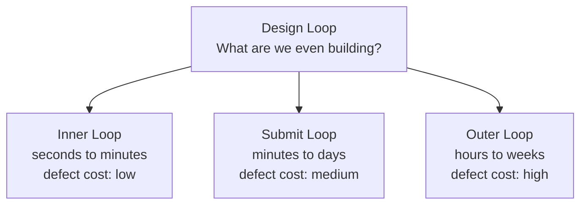

*The four development loops and the cost of a defect depending on where it is caught. Every practice pulls one class of defects one stage to the left.*

#### The fundamental law

The cost of a defect grows roughly exponentially with the distance between where it is introduced and where it is found:

- type error in the editor: 2 seconds
- the same error in the PR: 20 minutes of rework plus a review round
- the same error in production: an incident, a rollback, a postmortem, lost trust

The often-quoted "factor 10 per stage" traces to Barry Boehm (1981) and to an IBM Systems Sciences Institute table that has never been found as a primary source; Laurent Bossavit's *The Leprechauns of Software Engineering* (2015) documents how thin the evidence is. The direction is robust, the multiplier is folklore.

This gives **shift left**: almost every practice in this guide pulls one class of defects one stage earlier. A type checker pulls runtime errors into the editor. A pre-commit hook pulls CI failures onto your machine. A canary shrinks a production outage to 1% of users. A feature flag decouples deployment from release, so a defect does not become visible at deploy time.

The design loop sits above the cost row because its defects behave differently: they do not grow over time, they devalue everything below from the start. Building the wrong thing wastes 100% of the implementation, however clean it is.

#### Where AI plugs in

Addy Osmani's overlay marks, per loop, where AI reduces toil:

| Loop | AI entry points |
|---|---|
| Design | Chatbot for developers, AI auto-triage |
| Inner | Code completion & intent-to-code, AI refactorings, automated testing, AI-assisted debug |
| Submit | AI-assisted code review |
| Outer | Resource efficiency, AI performance refactorings |

#### The bottleneck moves right

AI speeds up the **inner loop** a lot and the submit and outer loops barely: review still needs human attention, test suites run just as long, deployments carry the same risk. A team that produces 5× as many changes with the same review capacity, test runtime and deploy frequency is not 5× faster; the changes pile up in front of the submit loop. This is the structural cause of verification debt (Module 12) and the usual answer to "why does AI help our team less than promised?": typing was not the bottleneck.

The harness (Module 9) exists to automate the right-hand loops too, so they keep pace with the inner loop.

#### Glossary

Inner/Submit/Outer/Design loop · Cycle time · Shift left · Toil · PreSubmit vs. Postsubmit · Design doc · RFC · ADR · Rework · Review latency

#### Hands-on (~30 minutes)

Map a real task from recent weeks onto the loops and estimate how much time went where. Most people underestimate the design loop.

Then note four numbers for your project: build time, test runtime, review latency, deploy time. This is your baseline for measuring impact in Module 13.

#### Checkpoint

1. A pre-commit hook that runs `mypy`: which loop does it sit in, which class of defects does it pull left, and where would the defect otherwise have surfaced?
2. Why is a test suite that takes 25 minutes a *design* problem and not merely an inconvenience?
3. A team introduces AI coding tools. PRs per week double; the average time from PR creation to merge rises from 6 to 30 hours. What happened, and in which loop is the problem?
4. Why does the design loop sit above the other three in the diagram instead of to their left?

[↑ Back to top](#machine-learning-agents-und-generative-ki)

---

## Phase 1 · The craft

### Module 1 · Version control as a thinking tool

Code review, bisect, rollback and agent checkpointing all need a clean history. Learn the data model first; the commands follow from it.

#### 1. What Git really is

Git does not store diffs. Git is a **directed acyclic graph of snapshots**. A commit contains a complete snapshot of the file tree, a pointer to its parent commit (two for a merge) and metadata (author, time, message). `git diff` computes the diff at runtime.

- **A branch is just a pointer to a commit**, a file with a 40-character hash. Branching is therefore free and instant (in SVN a branch was a copy), which made modern PR culture possible.
- **The history is a graph, not a list.** `git log` shows a linearized view. Merge and rebase are different operations because of the graph.
- `HEAD` points to the branch you are on. "Detached HEAD" means HEAD points directly at a commit; it is a state, not an error.

#### 2. The three areas

```
Working Directory  →  Staging Area (Index)  →  Repository
     (files)              (git add)             (git commit)
```

The staging area is the tool for cutting clean commits out of mixed work. A bug fix, a tidied function and a new error message in one set of changes: `git add -p` goes through the changes hunk by hunk, and you choose what goes into the next commit. One tangle becomes three atomic commits.

#### 3. The commit as a claim

A commit claims: *"Here is a self-contained, working change, with a justification."*

**Self-contained and working (atomicity).** Every commit on `main` should be runnable and green on its own. `git bisect`, `git revert` and `git cherry-pick` only work under this condition; a "WIP" or "fixes" commit breaks all three.

**With a justification.** The message states **why**, not what (the diff shows what). The why exists nowhere else and cannot be reconstructed six months later.

Bad: `update user service`
Good: `fix: session timeout on concurrent logins — server rejected the second token because the cache key omitted the device id`

**Conventional Commits** prefixes (`feat:`, `fix:`, `chore:`, `refactor:`, `docs:`, `test:`, `perf:`) make history machine-readable: changelogs are generated from them, and Semantic Versioning derives version numbers (`fix:` → patch, `feat:` → minor, `BREAKING CHANGE` → major).

#### 4. Merge vs. rebase

```
Starting point
  A ── B ── C          main
        └── D ── E     feature

After merge
  A ── B ── C ──────── M    (M has two parents)
        └── D ── E ───┘

After rebase
  A ── B ── C ── D' ── E'   (new hashes)
```

*Merge creates a commit with two parents; rebase creates new commits with new hashes.*

You branched off `main` at B and made D and E; meanwhile C landed on `main`.

- **Merge** creates M with two parents. The history is truthful (it shows parallel work) but branched, and hard to read in large repos.
- **Rebase** recreates D and E on top of C as D' and E': same content, **new commits with new hashes**. The history is linear but describes a sequence that never happened.

The one hard rule: **never rebase commits that someone else already has.** A colleague who pulled them now holds commits that no longer exist, and the next pull duplicates the history. Rebase your own unshared branch freely; never rebase `main`.

Most GitHub teams use **squash merge**: the whole PR becomes one commit on `main`. You get a linear history with one commit per PR and may commit as you like on your branch. The price: the structure inside the PR is lost, and a 2,000-line PR becomes a 2,000-line commit, which blunts `git bisect`. Hence small PRs.

#### 5. Branching strategies

- **GitFlow** (`develop`, `release/*`, `hotfix/*`, `feature/*`, `main`), from 2010, fits software with versioned releases where several versions are maintained at once (desktop, on-prem). For a web service that deploys twenty times a day it is overkill; its author now says so himself.
- **Trunk-based development:** everyone works against `main`, branches live hours to at most two days, unfinished features sit behind feature flags on `main`.

The underlying problem is **integration pain**: the chance of a merge conflict grows with branch lifetime and with the number of parallel branches. Two-week-old feature branches in a team of eight produce a merge day.

**Continuous integration is a practice, not a tool:** merging into the main branch at least daily. A team with a perfect pipeline and three-week-old branches does not practice CI.

#### 6. The pull request

The PR is a social artifact; Git has no PRs (GitHub invented them). A good PR is:

- **Small.** Review finds noticeably fewer defects beyond roughly 200–400 changed lines, and big PRs wait for someone with the headspace. A 1,000-line PR gets "LGTM", not a review.
- **One thing.** Refactoring and feature in one PR cannot be separated by the reviewer. Split them.
- **With context.** What is the problem? Why this solution? What should the reviewer look at? How did you verify it?
- **Self-read.** Read your own diff before sending it; you will find a third of the review comments yourself. With AI-generated code this is the most important step.

#### 7. The tools that make your history usable

- **`git bisect`:** binary search over the history. Mark one good and one bad commit, answer good/bad, and after log₂(n) steps you have the culprit (ten steps for 1,000 commits). `git bisect run ./test.sh` runs it automatically. Requires every commit to be runnable.
- **`git blame`:** the last commit per line. Its value is the chain line → commit → message → PR → discussion.
- **`git revert` vs. `git reset`:** `revert` creates a *new* commit that undoes a change and keeps history intact; it is the only option on shared branches. `reset` moves the branch pointer and rewrites history; use it only on local, unshared commits.
- **`git reflog`:** Git logs every movement of HEAD. A commit "lost" after a wrong `reset` is almost always recoverable (default retention 90 days). Git practically never loses anything that was committed.
- **`git stash`:** parks changes without committing; frequent use means you commit too rarely.

#### 8. Worktrees: the building block for parallel agents

`git worktree add ../feature-x feature-x` creates a **second working directory** for the same repository with its own checked-out branch. Unlike a second clone, both share one object database: no duplicated storage, no syncing, all branches visible in both.

For agentic development this is central: three agents on three tasks need three worktrees on three branches to avoid overwriting each other's files. Coding agents now build this in; Claude Code can run a sub-agent in its own automatically created worktree, removed again if the sub-agent made no changes.

#### 9. What never belongs in the repo

**Secrets.** A secret committed once stays **in the history**, even if the next commit deletes it. Rewriting with `git filter-repo` does not help: everyone who pulled still has it, and in a public repo scrapers find it within minutes. The only fix for a leaked secret is **rotation**: invalidate it and issue a new one. Prevent leaks with `.gitignore` and a secret-scanning pre-commit hook (`gitleaks`, `detect-secrets`; Module 2).

Also not in the repo: build artifacts, `node_modules`, virtual environments, large binaries (use Git LFS), IDE configuration.

#### 10. The AI connection

- **Git is the undo button for agents.** An agent that touches twenty files is only manageable if you can return to a defined state. Checkpointing in coding tools is Git underneath.
- **Clean working tree before starting an agent.** With your own uncommitted changes in the tree, the diff no longer shows what you changed and what the agent changed. Commit or stash, then start.
- **Review the diff, not the files.** Finished files look plausible; the diff shows what *changed*: a silently removed error handler, a changed default, a weakened test.
- **Trunk-based fits agents, GitFlow does not.** Agents produce many small changes quickly; long-lived branches multiply integration pain. More changes on `main` need more feature flags (Module 6).
- **Dangerous operations.** An agent with shell access that runs `git add -A && git commit` commits everything, including a forgotten `.env`. `git push --force` on a shared branch destroys work. Both belong on the deny list of the agent configuration and in branch protection rules (Module 5).
- **AI-generated commit messages** get the *what* right (it is in the diff) and the *why* wrong (it is in your head, the ticket, the discussion). Use them as a draft and add the reason.

#### 11. Anti-patterns

- `git commit -m "fix"`: destroys the value of blame and bisect
- The end-of-day catch-all commit containing eight unrelated changes
- Branches that grow older than a week
- `git push --force` on shared branches (instead of `--force-with-lease`, which checks whether someone else pushed)
- Committing without reading your own diff first
- Generated files in the repo: the merge conflict in them is always pointless work

#### 12. Glossary

Commit · Snapshot vs. diff · Branch as pointer · HEAD · Detached HEAD · Working directory / staging area (index) / repository · Atomic commit · Conventional Commits · Semantic Versioning · Merge commit · Rebase · Squash merge · Fast-forward · Trunk-based development · GitFlow · Integration pain · Pull request · `git bisect` · `git blame` · `revert` vs. `reset` · reflog · `git stash` · Worktree · `.gitignore` · Git LFS · Secret rotation · `--force-with-lease`

#### 13. Exercises

About 90 minutes in an empty test repo.

**E1: Make the data model visible.** New repo, three commits. Run `git log --graph --oneline --all` and `git cat-file -p HEAD` and look at the commit object: tree hash, parent hash, author, message.

**E2: Cut chaos into atomic commits.** Make three independent changes in one file, then split them with `git add -p` into three commits with proper messages. This is the core exercise.

**E3: Compare merge and rebase.** Rebuild the starting point from the diagram, merge in one copy and rebase in another. Compare `git log --graph --oneline` and the hashes.

**E4: Bisect.** Create fifteen commits, one of which introduces a bug. Write a script that exits 0/1 and let `git bisect run ./check.sh` find the culprit. Count the steps.

**E5: Break it and rescue it.** Run `git reset --hard HEAD~3` and recover the commits via `git reflog`.

**E6: Agent scenario.** Commit your state, let a coding agent (Claude Code, Antigravity) make a small multi-file change, and read *only* `git diff`. Note what the diff shows that reading the files would have missed. Then `git worktree add` a second branch, run a second agent in parallel and check that they do not interfere.

---

### Module 2 · The inner loop: static analysis & hooks

What separates a linter from a type checker, and why this chain lets agents work reliably.

#### 1. Static vs. dynamic

Everything in this module is **static analysis**: tools that *read* code without running it. Tests (Module 3) are **dynamic analysis**: they run it and observe. Static analysis finds defects that follow from the *structure* of the code, in every path, including the one that runs every three months. Tests find defects in *behavior*, but only on the paths they enter. The two complement each other.

These tools work on the **AST** (abstract syntax tree), not on text. A linter does not search for the string `except:`; it searches for a try node with an untyped handler. Formatting, comments and line breaks cannot fool it, which is why regex "linting" is unreliable.

#### 2. The tool family

| Tool | What it does | Examples |
|---|---|---|
| **Formatter** | changes only layout, never meaning | `black`, `ruff format`, `prettier`, `gofmt` |
| **Linter** | finds suspicious patterns | `ruff`, `eslint`, `pylint`, `clippy` |
| **Type checker** | checks type consistency across functions, files, modules | `mypy`, `pyright`, `tsc` |
| **Security linter / SAST** | linter with security rules | `bandit`, `semgrep`, `CodeQL` |
| **Secret scanner** | finds API keys, tokens, private keys | `gitleaks`, `detect-secrets`, `trufflehog` |
| **Dependency scanner (SCA)** | checks dependencies against vulnerability databases | `pip-audit`, `npm audit`, Dependabot, Renovate |

- **Formatters** are deliberately barely configurable (`black` is "uncompromising", `gofmt` has no options). The point is to end the discussion, and to keep diffs free of formatting noise, which speeds up review, especially of AI-generated code.
- **Linter rules** come in two groups. *Correctness*: unused variable (often a typo), unreachable code, bare `except:` (also swallows `KeyboardInterrupt`), mutable default arguments (`def f(x=[])`), `==` instead of `===` in JavaScript. *Convention*: naming, import order, complexity limits. Linting is mostly defect prevention, not style policing.
- `ruff` replaces `flake8`, `isort`, `pyupgrade` and `black` in one Rust tool that typically runs two orders of magnitude faster. That speed is what makes running it after *every* file change possible. `biome` does the same for JavaScript.
- **SAST** finds hard-coded passwords, SQL built by concatenation, insecure deserialization, weak crypto. Advanced tools do **taint analysis**: does data from an untrusted source (HTTP parameter) reach a dangerous sink (SQL query, `eval`) without sanitization?
- **Secret scanners** belong *before* the commit: a committed secret stays in the history (Module 1).
- **SCA** is not code analysis but software composition analysis; it belongs here because most of the code in a modern project is other people's.

#### 3. Type checking

Two axes that get confused:

- **statically vs. dynamically typed:** checked before or during execution?
- **strongly vs. weakly typed:** does the language convert types silently?

Python is dynamic and strong (`"1" + 1` fails at runtime). JavaScript is dynamic and weak (`"1" + 1` yields `"11"`).

**Type hints are inert at runtime.** The interpreter ignores `def add(a: int, b: int) -> int:`; `add("a", "b")` runs. The annotations exist for `mypy`, the IDE and humans. This is **gradual typing**: unannotated code stays unchecked, so you can add types module by module. TypeScript works the same way: `tsc` checks and then strips the types. Its escape hatch `any` disables checking; `unknown` forces an explicit check before use.

A type checker does not find logic errors. This is type-correct and wrong:

```python
def add(a: int, b: int) -> int:
    return a - b
```

Types guarantee the *shape*, tests the *meaning*.

Why types pay off in a dynamic language:

1. A class of defects disappears before runtime: `None` where an object is expected, a dict where a list is expected, a renamed field still used under the old name.
2. Types are documentation that cannot go stale, because they are checked.
3. **Types are machine-readable context for agents.** With a signature, a model does not have to guess what `config` contains; with `def process(data):` it guesses the structure and is often wrong.

Adopt module by module, not with a global `--strict`: in `mypy`, enable `disallow_untyped_defs` for new modules first. A `# type: ignore` needs an error code and a reason: `# type: ignore[arg-type]  # lib stubs are wrong, see issue #412`.

#### 4. Configuration belongs in the repo

All tool configuration lives versioned in the repository, not in IDE settings. In Python, `pyproject.toml` holds project metadata, dependencies and the ruff, mypy and pytest configuration; in JavaScript `eslint.config.js`, `tsconfig.json`, `package.json`. Otherwise code is green locally and red in CI, and an agent sees different rules than you. Pin tool versions too: `ruff` 0.4 locally and 0.9 in CI recreates "works on my machine".

#### 5. Git hooks

A Git hook is an executable script in `.git/hooks/` with a fixed name; Git runs it at fixed points and aborts the operation on a non-zero exit code. `.git/hooks/` is not versioned or cloned, so teams use a framework that installs hooks from a versioned config:

- `pre-commit` (language-agnostic): `.pre-commit-config.yaml`, each developer runs `pre-commit install` once
- `husky` plus `lint-staged` (JavaScript): same pattern

The relevant hooks:

- **pre-commit:** formatter, linter, secret scan
- **commit-msg:** can reject the message, e.g. to enforce Conventional Commits (`commitlint`)
- **pre-push:** slower checks such as type check and fast unit tests

**Latency is the design constraint.** A 40-second pre-commit hook teaches everyone `git commit --no-verify`. Good hooks check **only the changed files** (`lint-staged` does this; `pre-commit` does it by default).

**Hooks are a convenience, not enforcement.** They run on the developer's machine and can be skipped with a flag. Enforcement happens in CI with branch protection (Module 5). The hook shows the error in five seconds instead of five minutes.

#### 6. Agent hooks

An agent hook works like a Git hook, but fires on an *agent* event: after a file change, before a tool call, at the end of a response.

```
Agent edits a file → Hook fires immediately → ruff, mypy check instantly → Exit ≠ 0 with error text
        ↑                                                                          │
        └──────────────── the agent reads the error and fixes it itself ───────────┘
```

*The verification loop: the error text flows back to the agent, which corrects itself.*

In Claude Code, hook events include `PreToolUse`, `PostToolUse`, `UserPromptSubmit`, `Stop`, `SubagentStop`, `SessionStart` and `PreCompact`. They live under a `hooks` key in `.claude/settings.json` (project, versioned), `.claude/settings.local.json` (project, unversioned) or `~/.claude/settings.json` (user). A hook receives the tool call as JSON on stdin (for edits, `tool_input.file_path` names the changed file) and answers with its exit code:

- **0:** nothing happens, the agent continues
- **2:** blocking error; stderr is fed back to the model (the channel in the diagram)
- any other non-zero code: shown to the user only

A `PostToolUse` hook on the edit tool that runs `ruff check --fix` and `mypy` on the changed file is the standard construction; a minimal example is in Module 9. Antigravity has its own hook mechanism; check paths and events against its current documentation.

Why it works: an agent reads and writes text. A `mypy` message contains file, line and cause, which is a better signal for a model than almost any human description. Without this channel the agent reports "done" because nothing says otherwise. And it is cheap: a typo costs 20 seconds of model time in the agent loop, but five minutes of CI wait plus your context switch in the pipeline.

#### 7. Exit codes: the shared language

A process signals success with exit code 0 and failure with anything else. Hooks, pipelines and agents communicate this way: `ruff check`, `pytest` and `mypy` each return 0 when everything is fine.

So `make lint && make test` works mechanically: `&&` runs the second command only if the first returned 0, and the whole expression returns 0 only if both did. With `;` both always run and the last exit code wins, a classic silent bug in scripts. "The task is DONE when exit code 0 comes back" (Module 3) is meant literally.

#### 8. The friction ladder: which check runs where?

| Station | Budget | What runs there | Enforcement |
|---|---|---|---|
| Editor (LSP) | milliseconds | formatter on save, linter and type checker incrementally | none |
| Agent hook | 1–10 s | formatter, linter, type check on the changed files | none |
| Pre-commit | under 5 s | formatter, linter, secret scan; staged files only | bypassable |
| Pre-push | under 30 s | type check across the project, fast unit tests | bypassable |
| CI | minutes | everything, whole repo, multiple versions, security scans | binding |

A check belongs at the earliest station whose budget it fits: a type check over 500 files fits pre-push, not pre-commit; a full E2E run belongs only in CI.

#### 9. One entry point for everyone

Define exactly one command per check, and everyone calls it:

```makefile
lint:
    ruff format --check .
    ruff check .
    mypy src/

test:
    pytest -q
```

You, the pre-commit hook and CI all run `make lint`, and `AGENTS.md` says: "Before finishing any task, always run `make lint && make test`." If the agent runs a different command than the pipeline, the two truths drift apart and local green turns into CI red. Agent configuration should name the exact command, not describe code quality in prose.

#### 10. Adoption in existing code

A linter on a grown project reports 3,000 errors that nobody fixes. Four strategies:

- **Commit formatting separately** with the prefix `style:` and add its hash to `.git-blame-ignore-revs`, so `git blame` skips it.
- **Ratchet / baseline:** freeze the current error count and reject new violations; the count may only go down.
- **Check only changed lines** (`darker`, `lint-staged`): code improves where work happens anyway.
- **Arm the rules in stages:** correctness rules first, then conventions, then type-checker strictness.

#### 11. AI-specific points

- **AI code passes linters easily.** Models write stylistically clean code, so a green linter says less about AI code than about human code, where sloppy style often signals sloppy thinking.
- **Type checkers are especially valuable for AI code.** Typical model mistakes are type errors: a method that does not exist on the object, a library function with last version's signature, a return value that is sometimes a dict and sometimes an object.
- **Hallucinated dependencies ("slopsquatting").** Models invent package names. A 2025 USENIX Security study ("We Have a Package for You!", Spracklen et al.) found that roughly one fifth of packages recommended by code-generating models in its samples did not exist, and that the same phantom names recurred across runs, so attackers can register them with malicious code. Countermeasure: pin dependencies in a lock file and review every new package.
- **The cardinal rule:** the agent must never loosen rules to get green: no disabled rules, no scattered `# noqa` or `# type: ignore`, no `any`. This is the same failure as editing tests to pass (Module 3), only less visible. A harness whose rules the examinee may change measures nothing; write these prohibitions into the agent instructions.

#### 12. Anti-patterns

- Disabling a rule instead of fixing the code
- `# type: ignore` or `# noqa` without an error code and without a justification
- Formatter and linter with contradictory rules that overwrite each other
- A pre-commit hook so slow that everyone uses `--no-verify`
- Tool versions differing between local and CI
- Linter configuration in IDE settings instead of in the repo
- Relying on hooks as the enforcement mechanism instead of on CI

#### 13. Glossary

Static vs. dynamic analysis · AST · Formatter · Linter · Type checker · SAST · Taint analysis · SCA · Secret scanner · Gradual typing · statically/dynamically vs. strongly/weakly typed · Type hint · `any` vs. `unknown` · Strictness · Git hook · `pre-commit` / `commit-msg` / `pre-push` · `lint-staged` · `--no-verify` · Agent hook (`PostToolUse`) · Exit code · `&&` chaining · Ratchet/baseline · `.git-blame-ignore-revs` · Lock file · Slopsquatting

#### 14. Exercises

**E1: Tell the three tools apart.** Write a Python file with three defects: one formatting violation, one only the linter finds (e.g. a mutable default argument), one only the type checker finds. Run all three tools and see what each reports, and what none reports.

**E2: Set up the basics.** Configure `ruff` and `mypy` in `pyproject.toml` and create a `Makefile` with `lint` and `test`. Check the exit codes with `echo $?`.

**E3: Install pre-commit.** `.pre-commit-config.yaml` with ruff, mypy and `gitleaks`. Try to commit a file with a fake API key. Measure the hook's runtime; over five seconds is a design flaw.

**E4: Types as context.** Let an agent extend an untyped function of medium complexity. Annotate the function fully, reset, and repeat the same extension. Compare the results.

**E5: Build an agent hook.** Set up a `PostToolUse` hook in Claude Code that runs `ruff check` on each changed file. Give the agent a task that will produce a lint violation and check whether it fixes it without your help.

**E6: Provoke the failure pattern.** Give an agent a task with a genuine type error and phrase it as "make mypy green". Does it fix the error or add `# type: ignore`? This shows what the harness must be hardened against.

---

### Module 3 · Testing: the language in which you talk to agents about "done"

An agent can only iterate on its own if there is a machine-checkable statement of whether it is done. The only such statement is a green test suite. When the output itself is non-deterministic (an LLM answer, an agent trajectory), tests become **evals**; Module 11 covers that.

Unit tests, integration tests and smoke or E2E tests are the established terms ("root test" is not one).

#### 1. What a test really is

A test is an **executable specification**: "this concrete behavior is guaranteed and must not break." Its value is what it prevents, not what it covers. A test that can never fail has zero value and non-zero maintenance cost.

The anatomy, under two names:

```
Arrange  →  Act   →  Assert        (classic)
Given    →  When  →  Then          (BDD language)
```

Set up the state, do exactly one thing, check the expectation. Three "act" steps mean three tests.

**A test checks behavior, not implementation:**

```python
# bad: checks HOW it is done
def test_discount():
    calc = PriceCalculator()
    calc.apply_discount(100, 0.2)
    assert calc._discount_strategy.was_called   # couples to internals

# good: checks WHAT comes out
def test_applies_twenty_percent_discount():
    assert PriceCalculator().apply_discount(100, 0.2) == 80
```

The first test breaks on every refactoring although the behavior is unchanged: it punishes refactoring instead of protecting it. Suites full of such tests are why teams say "we can't touch the code anymore".

#### 2. The test pyramid, and why "unit" is a fuzzy term

| Level | Count | Runtime | Character |
|---|---|---|---|
| E2E | few | minutes | fragile |
| Integration | moderate number | seconds | |
| Unit | very many | milliseconds | |

*Upward: more system confidence. Downward: more diagnostic precision.*

**E2E** runs a complete user path through the deployed system (browser, real database, real neighbors). **Integration** checks components together (your code plus database or external API). **Unit** checks one unit in isolation.

"Unit" is poorly defined (function, class, module, behavior?). Two schools:

- **London School** (mockist): a unit is a class; all collaborators are replaced by test doubles. Maximum isolation, but the tests know the code structure and break on refactoring.
- **Detroit School** (classicist): a unit is a unit of behavior; real collaborators are fine if fast and deterministic. Only slow or uncontrollable parts are replaced.

Detroit has largely won in practice, consistent with "test behavior, not implementation".

Google classifies by **resource usage** instead of scope, which is checkable:

- **Small:** one process; no network, file system, `sleep` or concurrency. Milliseconds, deterministic.
- **Medium:** may use `localhost` (database in a container, local test server). Seconds.
- **Large:** everything else (real external services, network, whole environments).

The taxonomy is described in *Software Engineering at Google* (Winters, Manshreck, Wright, 2020), chapter 11, freely readable online, with the rule of thumb of roughly 80% small, 15% medium, 5% large tests.

The pyramid is an **economic argument**, not a law: build much of what is cheap, fast and precise and little of what is expensive, slow and fragile. Two developments shifted it: the Testing Trophy (Kent C. Dodds) argues that integration tests give the best effort-to-confidence ratio, and Testcontainers made a real Postgres for the suite a matter of seconds.

#### 3. Types beyond the pyramid

- **Smoke test:** minimal check after a deployment (health endpoint, DB connection, home page). Five tests, five seconds; proves only that further checks make sense. First gate in the canary (Module 6).
- **Regression test:** a role, not a type. For every production defect, first write a failing test that reproduces it, then fix. The suite grows where the system is actually brittle.
- **Contract test:** between services. Consumer tests against a mock that follows the contract; provider tests that it fulfills the contract. Verifies integration without starting everything.
- **Property-based testing:** state **invariants** and let the framework generate hundreds of inputs to refute them:

```python
@given(st.lists(st.integers()))
def test_sort_is_idempotent(xs):
    assert sorted(sorted(xs)) == sorted(xs)
```

`hypothesis` (Python), `fast-check` (JS). On failure they *shrink* the counterexample to the minimal case and find edge cases nobody thought of: empty list, Unicode corner case, integer overflow.

- **Snapshot / approval test:** stores the output on the first run and compares later runs against it. Useful for UI and complex structures; the trap is "update snapshot" without looking, after which the test is worthless. Especially risky with AI-generated code, whose output always looks plausible.
- **Characterization (golden) test:** for legacy code: pin down what the system does today, bugs included, then refactor. Guarantees unchangedness, not correctness.

#### 4. Test doubles

Gerard Meszaros' taxonomy:

| Type | Behavior |
|---|---|
| **Dummy** | Only passed to satisfy a signature. Never used. |
| **Stub** | Returns canned answers. Checks nothing. |
| **Spy** | A stub that additionally records how it was called. |
| **Mock** | Expects certain calls in advance and fails if they do not occur. |
| **Fake** | A working but simplified implementation, e.g., an in-memory database. |

A **mock** checks "X was called with these arguments", i.e. implementation; a **fake** couples to nothing. Rule of thumb:

> **Replace what you do not control. Do not replace what is yours.**

Not yours: external APIs, system clock, randomness, network, payment providers. Having to mock your own modules against each other signals too-tight coupling, a design problem (Module 4).

Time and randomness are the most common cause of unreliable tests. Inject them (`clock`, `rng`) instead of calling `datetime.now()` and `random.random()` directly.

#### 5. What makes a good test

- **Deterministic:** same result in every run, environment and timezone.
- **Isolated:** order-independent, no shared state.
- **Fast:** speed determines how often the test runs (friction ladder, Module 2).
- **Diagnostic on failure:** says *what* was wrong. `assert result == expected` with expressive values beats `assert is_valid`.
- **One reason to fail:** eight assertions on five things do not tell you what broke.
- **The name is the guarantee:** `test_rejects_login_after_three_failed_attempts`, not `test_login_2`.

#### 6. Flaky tests

A **flaky test** is sometimes green and sometimes red on unchanged code. Causes: timing or `sleep`, order dependence, shared state, real network calls, unseeded randomness, timezones and daylight saving time, concurrency.

The damage is social: once "just rerun it" is normal, a red build means nothing, and the whole suite loses its value as a signal. CI retry features are a dangerous convenience. Quarantine the test at once (out of the blocking run, with a ticket and a deadline), fix the cause, bring it back.

For agents this is critical: an agent that hits a flaky test sees red on correct code and "repairs" it by weakening the assertion, lengthening a `sleep` or skipping the test.

#### 7. Coverage, and why 100% is an anti-goal

**Line coverage** counts executed lines; **branch coverage** counts branches taken both ways and says more. Coverage measures execution, not verification. This gives 100% and guarantees nothing:

```python
def test_process():
    process(sample_input)   # no assertion
```

Coverage reliably shows what is **not** tested, nothing more. As a target it triggers Goodhart's Law: a 90% mandate produces assertion-free tests for getters and setters.

**Mutation testing** is the honest measure: the tool alters production code (`>` to `>=`, `+` to `-`, removes a call) and checks whether a test fails. A surviving mutant marks covered but unguarded code. Tools: `mutmut`, `cosmic-ray` (Python), `Stryker` (JS). It is slow and does not belong in the inner loop, but it matters more now, because generated tests tend to have high coverage and assertions that merely restate what the code does.

#### 8. TDD

**Red** (write a failing test) → **Green** (implement minimally until it passes) → **Refactor** (clean up, tests stay green).

TDD's real benefit is **design pressure**: the interface is fixed before the implementation, and hard-to-test code is usually badly cut code. It does not fit exploration, prototyping or UI tuning, where the desired behavior is not yet known.

In the agent era TDD is more useful: "make this failing test pass" has an unambiguous termination criterion that the agent cannot negotiate away.

#### 9. Tests as the definition of done for agents

The rule: *the task is DONE when exit code 0 comes back; on failure the model reads the stack trace and tries the next fix.* This needs three properties of the suite:

1. **Fast enough for many iterations.** A 20-minute suite cannot sustain 30 agent passes; run `pytest -m "not slow"` in the agent loop and everything in CI.
2. **Meaningful enough that green means correct.** An agent optimizes very efficiently against a broken signal.
3. **Diagnostic on failure.** The stack trace is the agent's only channel.

The four evasive maneuvers, from obvious to subtle:

- Adapting the test to the implementation instead of fixing the code
- Weakening the assertion (`assert x == 42` becomes `assert x is not None`)
- Skipping the test or marking it `xfail`
- Mocking until the test no longer exercises anything real

All four return exit code 0, and all four are solutions from the agent's point of view. A rule like "*do not ignore warnings and do not adapt any test just to make it pass*" is necessary but not sufficient.

**Circular reasoning:** if the same agent writes test *and* implementation, both come from the same understanding of the task. If that understanding is wrong, the test confirms the bug. Green then proves only self-consistency, the same weakness as a model grading its own answer (LLM-as-judge, Module 11). Countermeasures:

- **Read the test diff first in the PR.** Changes to existing tests are the most important warning signal in AI-assisted development.
- **Specification outside the agent:** you, or a separately tasked model, write the failing test; the agent makes it pass.
- **Tests in separate commits**, so the diff shows whether tests moved with the implementation.
- **Mutation testing periodically** as a spot check.

#### 10. Practical pytest

- **Fixtures** provide preconditions and clean up, with `scope` from `function` to `session`; shared fixtures live in `conftest.py` and are found automatically.
- **`@pytest.mark.parametrize`** generates cases from a table, the systematic way to cover edge cases.
- **Markers** (`@pytest.mark.slow`) split the fast suite from the full one.
- **Factories** (`factory_boy`) scale better for test data than a growing set of fixtures.
- **Databases:** run each test in a transaction rolled back at the end, orders of magnitude faster than a fresh database per test.

#### 11. Anti-patterns

- Tests that check implementation details
- Assertion-free tests that only generate coverage
- Retry as the way of dealing with flakiness
- Coverage as a target
- A test that depends on another test having run
- `sleep()` as a synchronization mechanism
- Mocking everything until only the mocks are being tested
- Updating a snapshot without reading the diff
- Test and implementation in the same commit from the same agent

#### 12. Glossary

Executable specification · Arrange-Act-Assert / Given-When-Then · Unit / integration / E2E · Small / Medium / Large · London vs. Detroit School · Testing Trophy · Testcontainers · Smoke test · Regression test · Contract test · Property-based testing · Shrinking · Invariant · Snapshot/approval test · Characterization test · Dummy / stub / spy / mock / fake · Flaky test · Quarantine · Line vs. branch coverage · Goodhart's Law · Mutation testing · Red-Green-Refactor · Fixture · Scope · `conftest.py` · `parametrize` · Marker · `xfail`

#### 13. Exercises

**E1: Behavior vs. implementation.** Write two tests for one function, one checking internals and one only the output. Refactor without changing behavior and see which breaks.

**E2: The pyramid.** One test per level for your project: unit for a pure function, integration against a real database (Testcontainers), E2E via the HTTP endpoint. Measure and compare the runtimes.

**E3: Create and remove flakiness.** Write three flaky tests (time-dependent, order-dependent, unseeded randomness), run the suite twenty times, then fix all three through injection instead of retry.

**E4: Demystify coverage.** Write an assertion-free suite with 100% line coverage, run `mutmut` and count the surviving mutants.

**E5: Property-based testing.** Pick a function with tricky edge cases (parser, sorting, rounding, currency) and state two invariants in `hypothesis`.

**E6: Circular reasoning.** Let an agent write test *and* implementation for a subtle requirement (e.g. commercial rounding of negative amounts) and check whether the test understood the requirement. Repeat with you writing the test and the agent implementing.

**E7: Provoke the evasive maneuver.** Give an agent a real bug with the deliberately bad assignment "make the test suite green". Note which maneuver it picks, write the rule that would have prevented it, and test again.

---

### Module 4 · Code design & architecture

Git, linters and tests mostly have right answers; design has trade-offs. It is the least automatable part of the work.

#### 1. What architecture is about

Software's value over hardware is that it can change, and requirements always change. The guiding question:

> **What does it cost to change this in six months, and how sure am I that this is exactly what will change?**

Every design decision is a **bet on the future**: making one thing easy to change makes another harder. Treating it as a question of quality instead of a bet produces systems that are flexible in every direction and usable in none.

#### 2. Coupling and cohesion

- **Cohesion:** how strongly the parts *inside* a unit belong together. High is good. A `user.py` with password hashing, invoicing and PDF export has low cohesion.
- **Coupling:** how strongly units depend *on each other*. Low is good.

The practical test:

> **If I change A, do I have to touch B?**

If yes, A and B are coupled, whatever the documentation, repo boundaries or interfaces say.

Degrees of coupling, from harmless to bad:

- **Data coupling:** B receives exactly the values it needs. Normal and fine.
- **Stamp coupling:** B receives a whole object but needs two fields, so it depends on the object's structure.
- **Control coupling:** A passes a flag that switches B's behavior (`render(data, is_pdf=True)`); usually two functions in disguise.
- **Common coupling:** both access global state; the dependency is invisible.
- **Content coupling:** A reaches into B's internals.

**Connascence** makes this precise by naming *what* connects two places: a name, a type, a meaning, an order, a timing. The further apart two places are, the weaker their connection must be: two lines in one function may depend on execution order, two services on two continents may not.

#### 3. Coupling versus duplication

**DRY** reads: *every piece of knowledge must have a single, unambiguous, authoritative representation within a system.* It is about **knowledge**, not text. VAT and a commission may both be `amount * rate` today; merging them couples two things that change independently, and a flag parameter follows within months, then two, then a branch.

> **Duplication is far cheaper than the wrong abstraction.** (Sandi Metz)

Duplication costs linearly and is easy to undo. A wrong abstraction costs twice (itself plus the workarounds) and is hard to undo once seven places depend on it. **Rule of Three:** write it once, duplicate it the second time, abstract only the third time, when the pattern is clear.

Whether two pieces of code are the same knowledge or only look alike is a domain question an agent cannot answer: it sees syntactic similarity, not the business domain.

#### 4. Abstraction and its costs

Every abstraction moves complexity; it makes one case easier and the others harder.

- **YAGNI** (You Aren't Gonna Need It): do not build flexibility for imagined cases. Most anticipated extension points are never used, and the change that comes does not fit them.
- **Law of leaky abstractions** (Joel Spolsky): every non-trivial abstraction leaks. An ORM hides SQL until a query is slow; TCP hides unreliable networks until they are very unreliable. You still need to understand the layer below; abstractions save typing, not knowledge.

#### 5. Layers and the direction of dependencies

```
Inbound adapters  ──▶  Domain  ◀──  Outbound adapters
 HTTP, CLI, Events     Business logic     DB, external APIs
```

*Ports and adapters: both sides depend on the domain, never the other way around.*

The left arrow is intuitive: the HTTP controller calls the business logic. The right arrow is **dependency inversion**: instead of "my code depends on Postgres", Postgres code depends on the domain.

> **The interface belongs to the caller, not to the implementer.**

The domain defines what it needs (`UserRepository` with `get(id)` and `save(user)`); the infrastructure implements it.

```python
# domain/ports.py — the domain defines its needs
class UserRepository(Protocol):
    def get(self, user_id: UserId) -> User | None: ...
    def save(self, user: User) -> None: ...

# domain/service.py — knows neither SQL nor HTTP
class Registration:
    def __init__(self, users: UserRepository) -> None:
        self._users = users

# infrastructure/postgres.py — depends on the domain
class PostgresUserRepository:
    def get(self, user_id: UserId) -> User | None: ...
```

Hexagonal architecture, ports and adapters and clean architecture are names for the same principle. Two check questions for any codebase:

1. **Can I test the business logic without starting an HTTP server or a database?**
2. **If I `grep` for `import psycopg`: does it show up in files containing business logic?**

**Hard-to-test code is almost always badly cut code.** Six mocks for one unit test mean the unit has six dependencies. Test pain is a design signal, which is why TDD is a design tool (Module 3).

#### 6. Dependency injection

Dependency injection means: **pass dependencies in instead of creating them.**

```python
# without DI — the dependency is set in concrete
class Registration:
    def __init__(self):
        self._users = PostgresUserRepository()   # not swappable

# with DI — a constructor parameter, nothing more
class Registration:
    def __init__(self, users: UserRepository):
        self._users = users
```

Python needs no container framework: a constructor parameter and one place that wires everything (the "composition root", usually `main.py`) suffice. In tests you pass a fake instead of a database, without patching module paths.

#### 7. SOLID, assessed

- **S, Single Responsibility:** not "a class does one thing" but *one reason to change*, where a reason is an **actor** (stakeholder group). If accounting and HR can both trigger changes to one class, that is the violation. At its core a statement about cohesion.
- **O, Open/Closed:** extensible without modification; today via composition and strategies rather than inheritance. More ideal than rule.
- **L, Liskov Substitution:** wherever the supertype is expected, every subtype must work unnoticed. Classic violation: a square inheriting from a rectangle cannot support independent `setWidth` and `setHeight`.
- **I, Interface Segregation:** many narrow interfaces instead of one wide one; less relevant with duck typing.
- **D, Dependency Inversion:** section 5; the most important of the five.

SOLID comes from object-oriented design around 2000. LSP and DIP are timeless; the rest has partly been overtaken by language evolution. Use it as a reading checklist, not as doctrine: dogmatic SOLID produces fifteen interfaces with one implementation each. Coupling, cohesion, good names and explicit data flow matter more.

#### 8. State, side effects, idempotency

A **pure function** returns the same output for the same input and changes nothing outside itself. A **side effect** is everything else: writing, reading, logging, network, time, randomness. Pure functions are trivially testable, understandable, parallelizable and cacheable.

**Functional core, imperative shell:** decisions and computations in pure functions, I/O at the edges. Read, then compute, then write, instead of interleaving them.

**Idempotency:** running an operation several times gives the same result as running it once. `set_status("paid")` is idempotent; `increment_counter()` is not. In distributed systems you never know whether the request or only the response was lost, so requests are retried; without idempotency the customer is charged twice. The standard fix is an idempotency key sent by the caller so the server can deduplicate. Every retry logic, message queue and "at least once" delivery presupposes idempotency (Module 6).

#### 9. Error handling is a design decision

**Catch an error where you can do something meaningful about it**, not where it arises; in most layers that means letting it through. AI-generated code often contains:

```python
try:
    result = risky_operation()
except Exception:
    pass          # the error is now invisible
```

The error does not disappear; it resurfaces three layers later as an inexplicable `None`. `except Exception:` with a generic fallback value is almost as bad.

**Result types** are the alternative to exceptions: the return value is explicitly success or failure, and the caller must handle both (Rust, Go, custom types in Python/TS). They make failure visible in the signature at the cost of noise. Pick one model per system.

**Fail fast:** invalid state fails immediately and loudly where it arises. Validate at the system boundary; inside, the domain may assume correct data.

#### 10. Names

A name is read a thousand times and written once. **Ubiquitous language** (domain-driven design): code uses exactly the domain's terms. If the business says "policy" and the code says `Contract`, every conversation, ticket and onboarding pays a translation fee, and eventually someone translates wrongly.

Models infer meaning from names. `data`, `result`, `handle`, `process`, `manager` tell a model almost nothing; precise names are context engineering, like type annotations.

#### 11. Refactoring as its own discipline

**Refactoring changes internal structure without changing external behavior** (Fowler); otherwise it is a change. Kent Beck's **two hats**:

> You wear either the refactoring hat or the feature hat. Never both at once.

A diff mixing renames and new logic is not reviewable: the reviewer cannot find the two real lines among 400 lines of movement. If it breaks, you do not know which part caused it. Separate commits, ideally separate PRs, refactoring first.

**Code smells** for diagnosis; two form the counterpart to section 2:

- **Shotgun surgery:** one business change requires small edits in twelve places. Coupling too high, knowledge scattered.
- **Divergent change:** one module changes for five unrelated reasons. Cohesion too low.

Others: long method, feature envy (a method uses another object's data more than its own), primitive obsession (everything is `str` and `dict` instead of a type such as `EmailAddress`), data clumps (the same three parameters always travel together; usually a missing object).

#### 12. Technical debt

Ward Cunningham's metaphor originally meant deliberately shipping an unfinished structure to learn earlier, then cleaning up, like a loan taken on purpose and repaid. Martin Fowler's quadrant adds two axes, *deliberate/inadvertent* and *prudent/reckless*:

- Deliberate and prudent: "We ship without a cache now, the ticket is filed, the deadline is set." Real, legitimate debt.
- Inadvertent and reckless: "What is a layered architecture?" Not debt, a knowledge gap.
- Inadvertent and prudent: "Now that it is finished, we see how it should have looked." Normal learning.

The interest is real: every later change in that area costs more. Make debt visible as tickets.

With AI, taking on debt has become much cheaper and paying it off has not: an afternoon can produce code that takes weeks to clean up.

#### 13. Design docs and ADRs

Writing is the thinking tool of the design loop: many bad architecture decisions fall apart when someone tries to justify them in three paragraphs.

An **ADR** (architecture decision record) is one page with four sections:

- **Context:** situation and constraints
- **Decision:** what is done
- **Consequences:** what becomes easier and what harder (listing only advantages signals unfinished thinking)
- **Alternatives and why rejected**

The last section is the valuable one: in two years someone asks "why didn't we do X?", and the answer is there, with the constraint that may have disappeared since. ADRs live versioned under `docs/adr/`.

Larger undertakings start with a **design doc** or **RFC**: problem, goals and non-goals, approaches considered, approach chosen, risks, open questions. This is the "Deliberate" step from Module 0, where mistakes are far cheaper than in the implementation.

#### 14. The AI connection

**An agent optimizes locally.** It solves the task with the context it has and does not see:

- that a third similar function signals a missing abstraction
- that two similar functions do *not* belong together in business terms
- that the helper it needs already exists outside its context window
- that its approach violates a convention established elsewhere

The result is a recognizable profile: locally clean, globally inconsistent. Duplication, because every session is isolated; over-abstraction when asked for it (a factory for two cases, a strategy pattern for one `if`); defensive `try/except` where nothing can fail; convention drift, because each session brings its own preferences.

**Architecture is context.** An agent that reads a consistent layered structure, in which domain code imports no infrastructure, produces better code because the pattern it reads is consistent. Precise types, expressive names, consistent structure and explicit design rules in `AGENTS.md` (Module 8) act directly on the output; the investment pays off for humans and models alike.

**Division of labor.** In an orchestrator-worker setup a large model plans and a fast one implements, which is economically right. The real orchestrator is you: whether an abstraction is the right bet, whether two things belong together, what a flexibility costs are judgment questions no model can own, because it does not know the future of your domain.

AI is mechanically excellent at refactoring: renaming, extracting, changing signatures, carrying a pattern through forty files, with the tests from Module 3 as a safety net. Deciding *whether* and *where to* refactor stays with you.

#### 15. Anti-patterns

- Abstracting at the second occurrence instead of the third
- Flag parameters that switch a function's behavior
- Business logic that knows SQL, HTTP, or file paths
- Interfaces with exactly one implementation that will never get a second
- Silently swallowing errors
- Refactoring and feature in the same commit
- Design decisions whose justification exists only in one person's head
- Anemic domain: classes without behavior, mere data holders, with all the logic in "service" classes
- An agent being allowed to restructure at scale without a human having fixed the target structure

#### 16. Glossary

Coupling (data, stamp, control, common, content) · Cohesion · Connascence · DRY · Rule of Three · The wrong abstraction · YAGNI · Leaky abstraction · Layered architecture · Ports and adapters / hexagonal / clean architecture · Dependency inversion · Dependency injection · Composition root · SOLID (SRP, OCP, LSP, ISP, DIP) · Pure function · Side effect · Functional core, imperative shell · Idempotency · Idempotency key · Fail fast · Result type · Ubiquitous language · Refactoring · Two hats · Code smell (shotgun surgery, divergent change, feature envy, primitive obsession, data clumps) · Technical debt · Fowler quadrant · ADR · Design doc / RFC

#### 17. Exercises

**E1: Measure coupling.** For one module, answer for each dependency: if it changes, do I have to touch this module? Name the coupling form (section 2). Find a flag parameter and split it into two functions.

**E2: Unwind the wrong abstraction.** Find a shared function with more than two flag or mode parameters and split it. Is the code longer but clearer?

**E3: Check dependency direction.** Ask the two questions from section 5. For a hit on question 2, put that dependency behind a Protocol, inject it, and write a business-logic test without a database.

**E4: Functional core.** Split a function that mixes reading, computing and writing into a pure function and a thin shell. Compare the test code needed before and after.

**E5: Write an ADR** for a real decision, one page, with at least two rejected alternatives and honest disadvantages of the chosen option.

**E6: Recognize the AI profile.** Let an agent build three related features in three separate sessions without conventions. Look for the patterns from section 14 (duplication, ignored helpers, convention drift, needless defensive code) and turn them into the first design rules for your `AGENTS.md`.

**E7: Architecture as context.** Repeat E6 with a clear layered structure, full type annotations and three explicit design rules in the context, and compare.

[↑ Back to top](#machine-learning-agents-und-generative-ki)

---

## Phase 2 · From repo to production

### Module 5 · CI/CD & quality gates

Up to here everything ran on your machine and could be bypassed. From here on, mechanisms are **binding** because they run on the server.

#### 1. Three terms everyone confuses

**Continuous integration** is first a *practice* (Module 1): integrate into the main branch at least daily and verify each integration automatically, so `main` is always green. The pipeline is the tool, not the thing.

```
Continuous Integration:   Commit → Build & Test → green main
Continuous Delivery:      Commit → Build & Test → Approval by a human → Production
Continuous Deployment:    Commit → Build & Test → Production
```

- **Continuous delivery:** every green commit on `main` is *deployable*; a human presses the button. Whether to ship becomes a business decision.
- **Continuous deployment:** every green commit goes to production automatically.

Continuous deployment is not "better"; it is a maturity level with hard prerequisites: feature flags, canary rollout, robust monitoring and automatic rollback (Modules 6 and 7). Without them you have only removed the safety net. In regulated domains the manual approval is often a compliance requirement. Asked "do you have CD?", the right answer is: *which one?*

#### 2. Anatomy of a pipeline

Using GitHub Actions as the example:

- **Workflow / pipeline:** the whole definition, versioned in the repo (`.github/workflows/*.yml`)
- **Trigger / event:** what starts it: `push`, `pull_request`, `schedule` (nightly), `workflow_dispatch` (manual), tags
- **Job:** runs on a runner in a fresh, isolated environment; jobs run in parallel unless `needs` orders them
- **Step:** one command or reusable action within a job
- **Runner:** the machine; hosted (billed per minute) or self-hosted (more control, more responsibility)
- **Artifact:** files that survive a job and are passed on
- **Cache:** reused state between runs, usually dependencies
- **Matrix:** one job across dimensions, e.g. Python 3.11/3.12/3.13 × Linux/macOS
- **Environment:** named target with its own secrets and optional approval rules
- **Concurrency:** stops five runs of the same PR from running at once, typically by cancelling the predecessor

**Every job starts in a fresh environment**; what one job writes is gone for the next unless passed as an artifact. That freshness is what rules out "works on my machine".

#### 3. Designing the pipeline

- **Cheap first, fail fast:** format check and lint (ten seconds) before type check, unit, integration and E2E (eight minutes).
- **Parallelize where possible:** the metric is human waiting time, not compute time. Lint, type check and security scan are independent.

Target for the PR pipeline: **under ten minutes**. Beyond about fifteen, people switch to other work and lose context, the slow-build problem from Module 0 one stage further right.

| When | What | Budget |
|---|---|---|
| On every PR | lint, type check, unit, fast integration, security scan | under 10 min |
| After the merge to `main` (postsubmit) | full integration, E2E, building the artifact | up to 30 min |
| At night (nightly) | matrix across all versions, load and performance tests, mutation testing | unbounded |

#### 4. Build once, deploy many

> **The artifact is built exactly once and then pushed unchanged through all environments.**

Rebuilding for production means production runs something other than what staging tested. Hence **configuration comes from outside**: database URL, API keys and feature switches arrive at runtime from environment variables or a secret store (twelve-factor: "strict separation of config from code").

Tag the artifact with the commit SHA and treat it as immutable: `myapp:a3f9c21`, not `myapp:latest`. You always know which code runs in production, and a rollback switches to an existing older image instead of rebuilding.

#### 5. Reproducibility

The same commit should yield the same artifact later and after staff changes. The first 90% is cheap:

- **Lock files** for all dependencies (`uv.lock`, `poetry.lock`, `package-lock.json`) in the repo; CI installs strictly from them (`npm ci`, not `npm install`).
- **Pin tool versions:** the same `ruff` and `mypy` locally and in CI (Module 2).
- **Base images by digest**, not tag: `python:3.12-slim` points to a different image every few months.
- **`latest` is always a mistake.**

#### 6. Quality gates: where it becomes binding

Hooks are a convenience; **branch protection is the mechanism**, enforced on the server. Usual rules on `main`:

- **Required status checks:** certain jobs must be green or the merge button stays disabled
- **Required reviews:** at least one approval, often with "dismiss stale reviews when new commits arrive"
- **CODEOWNERS:** certain paths need approval from certain people or teams
- **No direct push, no force push** to `main`
- **Linear history**, if you rely on squash merge

**Merge queue** solves the **semantic merge conflict**: PR A renames a function, PR B adds a call to the old name. Both are green, Git sees no conflict (the lines do not overlap), both merge, and `main` is red. A merge queue tests PRs serially in merge order *against the combined state* before they land. Overkill for three people; from about ten active developers, or with agents producing many parallel PRs, it decides between a green and a chronically red `main`. GitHub's merge queue is generally available (configured in a branch protection rule or ruleset); GitLab calls it "merge trains".

The same gates apply beyond code: agent skills go through a three-stage pipeline with scans and admin activation (Module 10), and eval suites act as gates for prompt, model and harness changes (Module 11).

#### 7. Security in and around the pipeline

**Security *through* the pipeline:** the Module 2 tools, now binding: SAST (`semgrep`, CodeQL), dependency scanning (`pip-audit`, Dependabot), secret scanning with push protection, container image scanning (`trivy`). Plus an **SBOM** (software bill of materials), a machine-readable list of all components, which answers "are we affected by this vulnerability?" in minutes.

**Security *of* the pipeline:** CI holds production credentials and may deploy, which makes it a high-value target reached through third-party code:

- **Pin actions to commit SHAs**, not tags. `actions/checkout@v4` is a moving target; whoever controls the tag controls your pipeline.
- **Minimal permissions:** `permissions: contents: read` by default, more only where needed.
- **No secrets in workflows that run on fork PRs.** `pull_request_target` runs with write rights and secrets of the target repo; combined with checking out the PR code, it executes foreign code with your keys.
- **OIDC instead of long-lived credentials:** the pipeline gets a short-lived token from the cloud provider per run.

Real incidents: in March 2025 the `tj-actions/changed-files` action was compromised (CVE-2025-30066). Its version tags were repointed to a malicious commit that dumped runner secrets into build logs, affecting tens of thousands of repositories that referenced it by tag; repositories pinned to a SHA were unaffected. In September 2025 a phished npm maintainer account published malicious versions of `chalk`, `debug` and other packages with billions of weekly downloads, followed by the self-propagating "Shai-Hulud" worm that harvested tokens from CI environments. Cheap defense against both: lock files plus a delay before adopting new versions (Renovate's `minimumReleaseAge` or equivalent).

#### 8. The pipeline as a reviewer gate for agents

When the pipeline fails, the job log can be fed back to the agent as a new prompt, without a human debugging it. This is the agent hook from Module 2 (exit code plus error text) one friction level further: slower, more complete, binding. Technically: a workflow that starts an agent with the job log on `failure()`.

Four conditions:

1. **The pipeline must be reliable.** With a flaky test the agent "repairs" correct code until it is broken (Module 3, section 6).
2. **A hard iteration limit.** Otherwise the loop burns tokens and CI minutes and accumulates random changes. Three attempts, then a human.
3. **The agent must not change the pipeline definition.** Otherwise the easiest path to green is deleting the job, and it hides well in a large diff. `.github/` belongs in CODEOWNERS and on the deny list.
4. **The agent must not bypass branch protection.** Its token needs the same restrictions as a human's.

#### 9. AI code review as a gate

PR bots (CodeRabbit and others) are good at mechanical checks: consistency with the codebase, obvious mistakes, missing error handling, missing tests for new behavior, known security patterns, and they do not tire. They are weak at the Module 4 questions: is the abstraction the right bet, does the logic match what the business meant, should this be built at all.

**Review theater:** a PR with fourteen AI comments *feels* thoroughly checked, so the human reads more superficially. More visible effort, less real verification. AI review supplements human review; the human still reads the test diff first (Module 3).

#### 10. Cost and scaling

CI minutes cost money. If AI quintuples the number of PRs, CI load quintuples too: the bottleneck from Module 0 shows up on the bill first. Levers:

- **Caching** of dependencies and build intermediates (usually the biggest single win)
- **Test impact analysis:** run only affected tests (Nx or Bazel in monorepos; `pytest-testmon` for small projects)
- **Concurrency with cancellation** of outdated runs
- **Tiering** per section 3
- **Merge queue**, so PRs are not retested individually against a moving `main`

#### 11. Anti-patterns

- Manual steps inside the pipeline ("then somebody copies the file over")
- Rebuilding per environment instead of passing one artifact along
- `latest` as a tag, unpinned actions, no lockfile
- Papering over flaky tests with automatic retry
- Secrets that end up in the log (every `echo` line is a potential leak)
- One single giant job instead of sensibly split, parallelizable jobs
- Branch protection that does not include administrators
- A bot token with more rights than a human
- Treating the pipeline as a pure formality while red builds are tolerated

#### 12. Glossary

Continuous integration / delivery / deployment · Workflow · Trigger · Job · Step · Runner (hosted/self-hosted) · `needs` · Artifact · Cache · Matrix build · Environment · Concurrency · Postsubmit · Nightly · Build once, deploy many · Twelve-factor configuration · Immutable artifact · SHA tagging · Lock file · Digest pinning · Branch protection · Required status check · CODEOWNERS · Semantic merge conflict · Merge queue · SAST · SCA · Push protection · SBOM · OIDC · `pull_request_target` · Test impact analysis · Review theater

#### 13. Exercises

**E1: Base pipeline.** GitHub Actions workflow: lint, type check and security scan in parallel, then unit tests, then integration. Measure total runtime and time to first failure.

**E2: Fail fast.** Introduce a formatting error and time the abort. Reverse the order (tests first) and time again.

**E3: Cache.** Measure the install step without and with a dependency cache (expect a factor of two to five).

**E4: Arm the gate.** Branch protection on `main` (required checks, no direct push, one approval). Try a direct push and read the error.

**E5: Semantic merge conflict.** One branch renames a function, another adds a call to the old name; both green. Merge both and watch `main` turn red without a Git conflict.

**E6: Build once, deploy many.** Build an image tagged with the commit SHA, run it with two configurations from environment variables, and confirm with `docker inspect` that it is the same image.

**E7: Harden the pipeline.** Pin all actions to SHAs, set a minimal `permissions` block, check for `pull_request_target`. Keep the notes for Module 12.

**E8: Reviewer gate with an agent.** Hand the job log to an agent on failure, limited to three iterations. Provoke a case where removing the test or job would be easiest and check that the safeguards from section 8 hold.

---

### Module 6 · Release engineering

#### 1. Deployment is not release

> **Deployment** means: the code runs on the infrastructure. **Release** means: users see the new behavior.

Treated as one event, every deployment is a risk, so deployments become rare, large and dangerous, and fear of deploying fulfills itself. Decoupled, code can sit in production unnoticed, deployment becomes a technical procedure without an audience, and release becomes a decision reversible in seconds. The goal is **boredom**: a deployment should be a non-event. Canary, feature flags and progressive delivery are techniques for this decoupling.

#### 2. Environments, and why staging always lies

The usual chain: **Local → Dev/Test → Staging → Production.** Staging never fully matches production, for structural reasons: data volume, data distribution (real data has edge cases no test set has), load, neighboring systems, scaling, network topology, user behavior. "It worked on staging" is not proof: staging rules out gross errors, not a query that times out at 40 million rows after being fast at 40,000.

So part of the verification moves into production, with a net and a limited blast radius. "Testing in production" without a net is reckless; with one it is the honest option.

- **Environment parity** (twelve-factor): keep differences small, e.g. the same database version, not SQLite locally and Postgres in production.
- **Ephemeral environments:** a complete short-lived environment per pull request, removed on merge. Realistic with container orchestration and valuable when agents produce many parallel PRs.

#### 3. The four deployment strategies

- **Recreate:** stop old, start new; a window without service. Fine for internal tools and night windows, and two versions never run at once, which simplifies migrations (section 6).
- **Rolling:** replace instances in small groups; no downtime, no extra resources; the Kubernetes default. **Both versions run simultaneously**, and rollback is as slow as rollout.
- **Blue-green:** two complete environments; the new one is loaded and verified, then the load balancer switches. Rollback means switching back, in seconds. Costs double infrastructure temporarily, and shared state (database, sessions, caches) must fit both versions.
- **Canary:** section 4.

Three details for stateful variants:

- **Connection draining:** an instance being shut down receives `SIGTERM`, accepts no new requests, finishes running ones, then exits.
- **Session affinity:** users pinned to instances change how a rollout behaves.
- **Warm-up:** fresh instances have cold caches, empty connection pools and (in JVM languages) unoptimized code; they are slower for a few minutes.

#### 4. Canary in practice

A small share of real users hits the new version first, and their experience is the signal.

```
1 %  ──▶  5 %  ──▶  25 %  ──▶  100 %
errors,    errors,    business    release
latency    latency    KPIs       done

◀── if any metric deviates from the baseline, it rolls back automatically
```

**Step 1, routing:** the load balancer, ingress or service mesh sends a share of traffic to the new version, by percentage, header, user cohort or region.

**Step 2, automated canary analysis:** compare against a **baseline**, not absolute thresholds. "Error rate below 0.5%" is useless because error rates vary with time of day, load and neighboring systems. Compare the canary with the old version running in parallel, in the same window, under the same load. **Deploy the baseline fresh too**: against a production instance warmed up for three weeks you mostly measure cold versus warm (caches, connection pools, unoptimized code). Netflix's Kayenta popularized this setup.

**Step 3, metrics**, in the order they become relevant:

- **Error rate:** HTTP 5xx, exception rate, failed jobs. Reacts fastest.
- **Latency as percentiles**, not mean. If 1% of requests take ten seconds and the rest 50 ms, the mean looks harmless while 1% of users leave. Use p50, p95, p99; at high volume p99 is the most honest.
- **Saturation:** CPU, memory, pool connections, queue depth. Catches resource leaks before they cause errors.
- **Business metrics:** conversion, orders, sign-ups. The only category that catches "technically green, but the buy button is gone". They need more traffic, so they matter at later stages.

**Step 4, observation window:** at 1% traffic two minutes is noise, in both directions. Size windows by event counts, not minutes: with a normal error rate of 0.1% you need many requests to detect even a doubling.

**Step 5, approval or rollback:** within thresholds, increase the share; outside, back to zero automatically. Automation removes the human reaction time that is missing at 3 a.m.

Where canary does not work:

- **Batch jobs and asynchronous processing:** no traffic to split.
- **Rare code paths:** 1% of traffic for twenty minutes never hits the year-end report.
- **Slowly emerging failures:** a memory leak after four hours. Canary catches acute regressions, not creeping ones.
- **Database changes:** section 6.
- **Small systems:** at 200 requests per hour 1% says nothing; use blue-green with fast rollback.

#### 5. Feature flags

A feature flag is a branch in the code controlled from outside: deployed, but off.

| Type | Purpose | Lifetime |
|---|---|---|
| **Release toggle** | gradual rollout of a new feature | days to weeks, then gone |
| **Experiment toggle** | A/B test, measuring variants against each other | duration of the experiment |
| **Ops toggle** | emergency switch, load shedding, circuit breaker | permanent |
| **Permission toggle** | feature only for certain customers or plans | permanent, business-driven |

Only the first two are temporary. Every flag doubles the state space: ten active flags give 1,024 combinations, of which you test a handful. Flags are deliberate, prudent technical debt with a repayment plan (Module 4, section 12). Hygiene: an owner and an expiry date per flag, a cleanup ticket filed at once, regular review. A release toggle fixed at "on" for eight months is dead code plus a switch someone can flip by accident. Test the state that will be production next, not all combinations.

- **Progressive delivery:** flags plus cohorts instead of percentages (internal staff → beta users → 5% → everyone); early cohorts give feedback, not only metrics.
- **Dark launch / shadow traffic:** the new path runs alongside, its output is discarded or compared with the old one, never delivered. Best tool for risky migrations (a new recommendation model, search implementation or calculation core): real production load, no user affected.

The same patterns apply to model upgrades and skill revisions: pin the version, roll out to a cohort, compare against the baseline with evals, keep the old version for rollback (Modules 10 and 11).

#### 6. Database migrations

**Code can be rolled back; data cannot.** With rolling and canary deployments, **old and new code run against the same database at the same time**, so the schema must fit both. A migration that breaks the old version makes rollback impossible exactly when you need it.

**Expand–migrate–contract** (parallel change) splits each schema change into several backward-compatible deployments. Renaming `name` to `full_name` with a direct `ALTER TABLE ... RENAME COLUMN` breaks every still-running old instance. Instead, five deployments:

1. **Expand:** add `full_name`, nullable. Old code ignores it.
2. **Double-write:** new code writes both columns, still reads `name`.
3. **Backfill:** fill existing rows in batches, not in one transaction over ten million rows.
4. **Switch:** read from `full_name`, still write both.
5. **Contract:** stop writing `name`, then drop it, once no running code needs it.

Every step can be rolled back safely. Further rules:

- **Never add a column directly as `NOT NULL`** (it breaks every old `INSERT`): add it nullable, fill it, then tighten the constraint.
- **Beware of locks:** an `ALTER TABLE` on a large table can lock for minutes and halt the service. In Postgres some operations need `CONCURRENTLY`; index creation always does.

The same applies to everything versioned at system boundaries (API responses, queue message formats, event schemas): extend additively, switch, then remove old fields.

#### 7. Rollback or roll-forward

- **Rollback:** back to the previous version. Fast and predictable, but only if no irreversible state change happened (hence section 6).
- **Roll-forward:** fix forward and redeploy, when rollback is impossible. Needs a fast pipeline.

Design for reversibility: for every change ask whether and how fast it can be taken back. **Rollback is a capability, not a configuration:** an unpracticed rollback fails in an emergency because the artifact is gone, the migration is not backward-compatible, nobody has the permission or nothing is documented. Practice it on a Tuesday morning.

#### 8. Health checks

- **Liveness:** "Is the process alive?" On failure: **restart**.
- **Readiness:** "Can it take requests now?" On failure: **remove from the load balancer**, do not restart.

An instance warming its cache or waiting on an overloaded database is *not ready* but *alive*. If the liveness check probes the database, a database problem makes the orchestrator restart all instances at once and turns an incident into a total outage. This misconfiguration is common.

This completes the outer loop from Module 0: postsubmit → staging → canary → production (experiment, flag flip, release) → measure, which leads back to observe.

#### 9. The AI connection

- **The question shifts** from "can we build fast?" to "can we roll out fast and safely?". This module's safety net makes a high rate of change usable; without it more throughput is more risk per week. Module 13 puts a number on it: deployment frequency without change failure rate is meaningless.
- **Feature flags become a necessity.** Trunk-based development with agents pushing many changes to `main` only works if unfinished work can be deployed inactive.
- **Migrations are the most dangerous AI-generated code.** Unprompted, an agent writes the direct `RENAME COLUMN`, because it is the obvious answer to "rename the column". It looks harmless in review (one line, correct syntax) and means downtime and no rollback in production. Put expand–migrate–contract into the agent instructions and require human review of migrations via CODEOWNERS.
- **Flag sprawl:** agents create flags and never clean them up. Expiry dates and regular review keep the state space in check.
- **Where AI helps:** anomaly detection in canary analysis, summarizing deployment diffs for approval, spotting risky migration patterns in PRs. Thresholds and approval criteria stay with you: a model that decides when a rollout proceeds controls the blast radius.

#### 10. Anti-patterns

- Treating deployment and release as the same event
- Checking the canary against absolute thresholds instead of a baseline
- Comparing the canary against a long warmed-up baseline
- Watching latency as a mean instead of as percentiles
- Observation windows too short for statistical meaning
- Schema changes that break the previous code version
- `NOT NULL` on a new column in one step
- Release toggles without expiry dates
- Rollback never practiced
- A liveness check that also probes external dependencies
- Deploying on Friday at 5 p.m. without anyone watching the metrics

#### 11. Glossary

Deployment vs. release · Environment parity · Ephemeral / preview environment · Recreate / rolling / blue-green / canary · Connection draining · Graceful shutdown · Session affinity · Warm-up · Automated canary analysis · Baseline · Percentiles (p50/p95/p99) · Saturation · Observation window · Blast radius · Feature flag · Release / experiment / ops / permission toggle · Kill switch · Circuit breaker · Progressive delivery · Cohort · Dark launch · Shadow traffic · Expand–migrate–contract / parallel change · Backfill · Backward compatibility · `CONCURRENTLY` · Rollback vs. roll-forward · Liveness vs. readiness

#### 12. Exercises

**E1: Decoupling.** Add a feature flag controlled by an environment variable. Deploy a feature switched off, verify users see nothing, switch it on without a new deployment.

**E2: Rolling deployment.** Replace three instances one by one while a script sends a request every second; log which version answered and see both live at once.

**E3: Percentiles.** Generate 1,000 latency values, ten of them at ten seconds, and compute mean, p50, p95 and p99.

**E4: Canary gate.** One page: metrics, thresholds relative to the baseline, observation window per stage, rollback triggers.

**E5: Expand–migrate–contract.** Rename a column in five deployments; after each, verify that the *previous* code version still works.

**E6: Practice rollback.** Deploy a deliberately broken version, roll back, time it from detection to recovery, and note where it snagged.

**E7: Separate health checks.** Implement `/healthz` (process only) and `/readyz` (dependencies), simulate a database outage, and check that the instance leaves the load balancer without restarting.

**E8: Migration test for agents.** Ask an agent to rename a column without guidance, inspect the result, write the rule that prevents the direct rename, and repeat. The wording goes into your `AGENTS.md`.

---

### Module 7 · Observability & operations

From *building* software to *operating* it: working with signals from a system you do not fully see, under time pressure, with incomplete evidence. Canary analysis (Module 6) depends on this.

#### 1. Monitoring vs. observability

- **Monitoring** answers questions you knew in advance: dashboard, threshold, warning.
- **Observability** answers new questions: "Why have requests from Android users in Frankfurt been slow since 2:20 p.m., but only with feature flag X on?"

The difference is **cardinality and context**. Monitoring aggregates in advance (a million requests become one number; breakdown dimensions are fixed beforehand). Observability keeps events with many attributes and allows any breakdown afterwards. Monitoring covers *known unknowns*, observability *unknown unknowns*. The test:

> **Can you answer a new question about your system without changing code and redeploying?**

If not, you have monitoring, which is often enough, but decides whether an unexpected incident takes five minutes or five hours to understand.

#### 2. The three pillars, and why the metaphor misleads

- **Logs:** discrete events with context; most detail, most expensive storage.
- **Metrics:** numeric aggregates over time; cheap, context-poor.
- **Traces:** the path of one request through a distributed system.

"Three pillars" suggests three systems, tools and bills, and many companies built it that way. The value lies in **correlation**: alert → metric → affected trace → log lines of that request. Without shared identifiers you do this by hand across three tools and lose the decisive minutes. **OpenTelemetry** is the vendor-neutral instrumentation standard that produces logs, metrics and traces with shared context; you instrument once and can switch backends without code changes.

#### 3. Logs done right

**Structured, not free text:**

```python
# bad: only searchable with regex
logger.info(f"Login failed for {email} from {ip}")

# good: queryable as fields
logger.info("login_failed", extra={"user_id": uid, "reason": "bad_password", "ip": ip})
```

`grep` works on a thousand lines and fails on millions; fields can be filtered, grouped and aggregated.

**Log levels** (if everything is ERROR, ERROR means nothing):

- `DEBUG`: development only, off in production
- `INFO`: normal business events you want to trace later
- `WARNING`: something unusual that was handled (retry, fallback)
- `ERROR`: an operation failed, a user is affected
- `CRITICAL`: the system as a whole is in danger

**Correlation IDs** are the most important measure: each incoming request gets an ID passed through all services, log lines and queue messages. Finding the lines of one request becomes a filter query.

**Never log** passwords, tokens, session keys, full card numbers, or personal data without a legal basis. Logs are data processing under the GDPR, usually sent to a third-party provider, often into a third country, with a retention period someone must define. Log user IDs instead of email addresses.

**Cost:** logging is often the biggest item on the observability bill. Sample high-frequency, low-information events.

#### 4. Metrics done right

- **Counter:** only increases (requests, errors)
- **Gauge:** goes up and down (active connections, memory)
- **Histogram:** distribution in buckets (latencies)

Latency must be a histogram because percentiles need the distribution. **Percentiles cannot be averaged:** the mean of ten instances' p99 is meaningless; aggregate the histogram buckets and compute the percentile from them.

**Cardinality:** every combination of label values is its own time series. `http_requests{method, status, endpoint}` gives perhaps 200 series; adding `user_id` gives millions, and the metrics system and the bill explode. High cardinality belongs in logs and traces.

What to measure:

- **RED** for services: Rate, Errors, Duration (Tom Wilkie, Weaveworks, 2015)
- **USE** for resources: Utilization, Saturation, Errors (Brendan Gregg, 2012)
- **Four Golden Signals:** Latency, Traffic, Errors, Saturation (Google SRE book, 2016, chapter 6, freely readable online)

They overlap heavily. For an HTTP service RED is the pragmatic start: three metrics per endpoint cover most of what you need in an emergency.

#### 5. Tracing

A **trace** is the complete path of a request; a **span** is a section of it (service call, database query, computation). Spans nest; the context travels in HTTP headers (standard: `traceparent`).

```
POST /checkout      ████████████████████████████████████████████  420 ms
  auth.verify        ██
  db.get_cart          ██
  pricing.calc            ██████████████████████████████  315 ms
    db.get_discount        ████  ████  ████  ████  ████     ← five identical queries
  db.save_order                                          ██
```

*Trace waterfall: five identical queries. The N+1 pattern becomes visible.*

"Checkout takes 420 ms" is not actionable; the trace shows five identical queries in sequence instead of one batched query. This is the **N+1 problem**, the most common performance defect with an ORM: an operational symptom of a design decision (Module 4).

**Sampling** is unavoidable at high volume:

- **Head-based:** decided at the start of the request; cheap, but loses interesting cases as often as boring ones.
- **Tail-based:** decided after the trace completes; keeps everything erroneous or slow; more valuable, but traces must be buffered until the decision.

#### 6. SLI, SLO, SLA, and the error budget

- **SLI** (service level indicator): a measured quantity from the user's view, e.g. *the share of requests answered in under 300 ms with a status below 500.*
- **SLO** (service level objective): a target for the SLI over a window, e.g. *99.9% over 30 rolling days.* An internal promise.
- **SLA** (service level agreement): a contract with consequences (credits, penalties). Always laxer than the SLO, as a buffer.
- **Error budget:** the remainder to 100%. An SLO of 99.9% over 30 days leaves **43 minutes** outside the target.

> These 43 minutes are not failure. They are a **budget** you are allowed to spend.

The conflict between shipping fast and staying stable becomes one agreed number. Budget left: faster, riskier rollouts are fine (shorter canary windows, continuous deployment). Budget used up: feature stop until reliability recovers.

Why 100% availability is the wrong target:

1. **Costs grow exponentially:** each additional nine costs a multiple of the previous one; 99.9% → 99.99% means multi-region and elaborate failover.
2. **Users do not notice:** their mobile network, Wi-Fi and browser are less reliable than your service.
3. **100% means never changing**, and an unchanged system is a dying one.

Some unreliability buys speed; the error budget makes the trade explicit. Good SLOs are formulated from the **user's perspective** ("CPU below 80%" is not an SLO) and are **achievable** (an SLO breached for four months is ignored).

#### 7. Alerting

> **Alert on symptoms, not on causes.**

"Error rate for users elevated" is an alert; "CPU at 91%" is not (it may be normal, a batch job may be running). Cause alerts create noise, while outages with unexpected causes slip through.

Every alert must be **urgent** (cannot wait until tomorrow), **actionable** (there is something to do) and **for a human** (not automatically fixable). Otherwise it belongs on a dashboard or in a ticket. **Alert fatigue:** if four of five night alerts mean nothing, the fifth, real one is ignored. Review every alert that fired without leading to action.

**Burn-rate alerts** tie alerting to how fast the error budget is consumed: very fast (the monthly budget gone in an hour) wakes someone up; slow creates a ticket for the next business day. Every alert links to a **runbook**: what it means, what to check first, usual causes, how to mitigate.

#### 8. Incident response

- **Separate roles.** The **incident commander** coordinates and decides and does *not* debug; alongside, one person for communication (status page, stakeholders) and one for the technical work.
- **Mitigation before root-causing.** Stop the bleeding first (roll back, switch off the flag, redirect traffic, shed load), understand later. A rollback whose cause was never clarified is a successful incident.
- **Metrics:** MTTD (time to detection), MTTR (time to recovery), MTBF (time between failures). In complex systems MTTR is usually the better lever: preventing all outages is unaffordable, fixing them in three minutes instead of thirty is achievable.
- **Blameless postmortem:** assume everyone acted reasonably with the information they had. With blame in the room you stop hearing the truth and stop learning. **"Human error" is a starting point, not a cause:** why was the wrong action possible, why was it the obvious one, why did nothing catch it? If one command could delete production, that is the finding.
- **Five Whys** suggests one linear causal chain; complex systems fail through several contributing factors that are each harmless alone. Look for several.
- **Actions with an owner and a deadline**, or the incident returns.
- **On-call:** *you build it, you run it.* Being woken by your own code is the strongest quality feedback loop there is.

#### 9. The AI connection

- **Production signals are debug context for agents.** "The endpoint is slow" is useless to a model; a trace with five identical sequential queries leads almost directly to the fix. This is the "Measure" node from Module 0 and Addy Osmani's *resource efficiency* and *AI performance refactorings*.
- **AI in incidents:** useful for correlating many signals, summarizing the timeline, generating hypotheses. Dangerous as decision-maker: a convincingly named wrong cause costs the minutes mitigation needed, and mitigation needs no root cause anyway. Generated postmortems are good for the timeline and worthless for the insight, which comes from the participants' discussion.
- **LLM observability:** AI systems need the same toolbox with different signals: traces across agent steps and tool calls, tokens and cost per request, latency per model call, retrieval hit rates, eval results on production traffic (online evaluation, Module 11). OpenTelemetry has *Generative AI semantic conventions* for this (`gen_ai.*` attributes for model, token counts, tool calls, agent spans). They are still marked as in development and change between releases: pin the semantic-conventions version you emit and read the changelog before upgrading.
- **Agents in production are not deterministic.** A retry gives a different result. Error rates of AI components are distributions, not yes/no; SLIs must reflect that, and alerts must not fire on every deviating answer.

#### 10. Anti-patterns

- Alerting on causes instead of user symptoms
- Alerts nobody takes seriously anymore because they fire too often without action
- Free-text logs without structure and without a correlation ID
- High-cardinality labels in metrics
- Latency as a mean
- Dashboards nobody looks at, instead of SLOs somebody holds to
- SLOs that have been breached for months and still stand unchanged
- Root-causing during the ongoing incident instead of mitigation
- Postmortems without actions carrying an owner and a deadline
- Personal data in logs at a third-party provider
- An incident commander who debugs personally

#### 11. Glossary

Monitoring vs. observability · Known/unknown unknowns · Cardinality · OpenTelemetry · Structured logging · Log level · Correlation ID · Sampling · Counter / gauge / histogram · RED · USE · Four Golden Signals · Trace · Span · Context propagation · `traceparent` · Head- vs. tail-based sampling · N+1 problem · SLI · SLO · SLA · Error budget · Burn rate · Runbook · Alert fatigue · Incident commander · Severity · Mitigation · MTTD / MTTR / MTBF · Blameless postmortem · Contributing factors · On-call · You build it, you run it · LLM observability

#### 12. Exercises

**E1: Structured logging.** Switch to JSON logs with a correlation ID passed from the incoming request through all calls. Then pull all log lines of one failed request.

**E2: RED metrics.** Instrument one endpoint with rate, error rate and a latency histogram; under load, compare p50, p95 and p99 with the mean.

**E3: Blow up cardinality.** Add a request ID as a metric label, count the resulting time series, remove it.

**E4: Tracing.** Instrument with OpenTelemetry, build in an N+1 problem, find it in the waterfall, fix it, and measure before and after.

**E5: SLO.** Define a user-facing SLI, an SLO over 30 days and the error budget in minutes, plus what happens at 50%, 90% and 100% consumption.

**E6: Alert.** Write a burn-rate alert on the SLO and its runbook; check it against the three criteria in section 7.

**E7: Simulate an incident.** Stop the database, raise latency or deploy a faulty version. Time detection and recovery, then write a postmortem with a timeline, at least three contributing factors, and actions with owners.

**E8: Trace an agent.** Instrument an agent run with traces across steps and tool calls, plus cost and tokens per step. Then sketch an SLI for a non-deterministic component; Module 11 gives the eval tools.

[↑ Back to top](#machine-learning-agents-und-generative-ki)

---

## Phase 3 · Building AI in, systematically

Phase 3 assumes AI basics and focuses on the mechanics behind the practices and how they interlock with Phases 1 and 2. Modules 8 and 9 cover one agent in one repository. Module 10 scales its know-how across an organization as skills, Module 11 measures models and agents, Module 12 covers what no signal catches, and Module 13 measures the effect on the team.

### Module 8 · Context engineering & spec-driven development

#### 1. From prompt engineering to context engineering

- **Prompt engineering:** finding the right wording for a single request.
- **Context engineering:** designing the *information environment* in which a model works. A system design task, and the decisive one for agents running hundreds of steps.

Mental model: the model is the CPU, the context window is working memory, and you do **memory management**: what to load when, how long to keep it, what to page out.

#### 2. The physics of the context window

```
Reliability with which information in the context is used

 high ▐█▌                                     ▐█▌
      ▐█▌ ▐█▌                             ▐█▌ ▐█▌
      ▐█▌ ▐█▌ ▐█▌                     ▐█▌ ▐█▌ ▐█▌
      ▐█▌ ▐█▌ ▐█▌ ▐█▌ ▐█▌ ▐█▌ ▐█▌ ▐█▌ ▐█▌ ▐█▌ ▐█▌
 low  ─────────────────────────────────────────────
      Start              Middle                End
                 what sits here is most likely to be missed
```

*Lost in the Middle: information in the middle of the context is most likely to be missed.*

- **Context is finite and shared:** system instructions, tool definitions, project context, history, files read, tool outputs and the answer compete for the same space.
- **Attention is uneven** (*Lost in the Middle*): put the most important things at the beginning or the end, not in the middle of a long dump.
- **More context is not better.** Irrelevant context measurably degrades performance: it dilutes the signal, creates competing patterns and distracts. An agent given half the repository works worse than one given the three relevant files. Ask what is necessary, not what could be useful.
- **Context has a cost structure.** Prefix caching makes stable leading portions much cheaper and faster, as long as they stay *unchanged*. Static content first (system instructions, tool definitions, project context), variable content last. A timestamp or changing ID in the system prompt invalidates the cache on every request; nothing breaks, it only costs money, so it goes unnoticed.

#### 3. What fills the context

| Component | Control | Typical size |
|---|---|---|
| System instructions | complete | small, stable |
| Tool definitions | complete | grows with the number of tools |
| Project context (`AGENTS.md`) | complete | small to medium |
| Conversation history | indirect | grows monotonically |
| Files read | indirect | medium to large |
| **Tool outputs** | **hardly any** | **unbounded** |

Tool outputs are the largest uncurated source: a `cat` on a 4,000-line file, a test run full of stack traces, a `grep` with 800 hits. They are the usual reason an agent forgets obvious things after twenty minutes. Build tools with *terse* output: `pytest -q --tb=short`, `ruff check --output-format=concise`, a script that returns relevant lines instead of whole files.

**Too many tools degrade tool selection:** each costs context, and the hit rate drops with thirty similar-sounding options. Fewer, clearly delineated tools win. The same holds for skills (Module 10).

#### 4. Techniques of context management

- **Progressive disclosure / just-in-time:** give the agent tools to load what it needs instead of loading everything up front. A directory tree plus a search tool beats the embedded repository. Skills apply this to know-how: only name and description sit in the context, the body loads when needed (Module 10).
- **Compaction:** summarize and replace a long history. Lossy; what survives is a design decision (decisions and their reasons yes, tool outputs no).
- **Externalization:** state belongs in files: the plan in `PLAN.md`, intermediate results in files, open items in a list. The file system is long-term memory, and a context loss does not destroy the work.
- **Sub-agents:** a sub-agent with its own window handles a delimited task and returns only the result; 40,000 tokens of research never reach the main context (Module 9).
- **Context hygiene:** start a new session when the topic changes. Remnants of a failed debugging session pull the next task in the same direction.

#### 5. Engineering is context

> **Well-structured code is compressed context.**

- **Type annotations (Module 2):** `def process(orders: list[Order]) -> Invoice` answers in one line what `def process(data)` forces the model to read the whole file for.
- **Precise names and ubiquitous language (Module 4):** `manager`, `handle`, `result` carry almost no information.
- **Layered structure (Module 4):** consistent patterns in what is read produce consistent patterns in what is written, without a rule.
- **Tests (Module 3):** the only specification that checks itself.
- **Small, cohesive modules:** fit into the window; a 3,000-line module forces either completeness or guessing.
- **Conventions and a clean `AGENTS.md`:** reduce the freedom in which a model can drift.

Code that is hard for humans to read is harder still for models, which lack the experience a senior developer uses to fill gaps. Structure is the condition for AI writing the code well.

#### 6. Spec-driven development

**The specification is the primary artifact; the code is derived from it.** Earlier attempts (MDA, UML code generation) failed because translating spec to code was expensive and the reverse impossible. The translation is now cheap, so the valuable artifact moves up a level.

The chain: **Intent → Spec → Plan → Tasks → Implementation → Verification.** GitHub Spec Kit formalizes it; three Markdown files are enough.

A good spec contains:

- **Problem and context:** why at all, which constraints
- **Non-goals:** keep the agent from turning an endpoint into a framework
- **Acceptance criteria, phrased testably:** "returns 422 with field names on invalid input", not "handles errors cleanly"
- **Constraints:** existing patterns, libraries to use, performance requirements, what must *not* be touched
- **Open questions:** explicit, so they get answered instead of guessed

It does not contain implementation details you leave to the agent; a spec that describes the code in prose gives away the advantage. A spec is a design doc (Module 4) addressed to a machine, which does not complain about unclear passages but invents something plausible.

#### 7. The working cycle: Explore → Plan → Implement → Verify

> **Plan first, code second.**

A misunderstanding costs 200 tokens to correct in planning and 2,000 lines plus a review round afterwards (Module 0).

- **Explore:** have it read, not write: "Read these four files and explain how the order process works." You check the *understanding*, where misunderstandings cost a paragraph to fix.
- **Plan:** the plan as a visible artifact. Models usually propose something too complicated (one abstraction layer too many, a pattern where a function suffices, configuration for one case); simplifying is your most valuable intervention. In Claude Code this is *plan mode* (Shift+Tab, or `claude --permission-mode plan`): the agent can read and search but not edit until you approve. Sub-agents can be told to plan only, and the plan can be written to a file (externalization).
- **Implement:** small steps, each verified; the harness from Modules 2 and 3 runs throughout.
- **Verify:** check against the acceptance criteria of the spec, not only "tests green".

#### 8. Task sizing

The right size for an agent task is **what you can still seriously review in one pull request**, not what the agent can manage. Larger tasks get disproportionately worse: error probability multiplies across steps, the context fills during the work, and beyond a certain diff size review stops happening (Module 1, section 6).

**Cut vertically, not horizontally.** A thin end-to-end slice (API to database, with a test) is runnable, testable and individually rollbackable; "all data models first, then all services" is only verifiable at the end.

#### 9. What context does not solve

- No context makes a model an expert on *your* domain: rules that live in three people's heads, the special case a major customer pushed through four years ago.
- No context replaces verification; better context raises the hit rate, it does not remove the need to check.
- On a bad result, the usual reflex is more context. The problem is usually the **clarity of the task**; more context only produces a longer wrong answer. Sharpen the spec instead.

#### 10. Anti-patterns

- Dumping the whole repository into the context
- Placing important things in the middle of a long dump
- Variable content in the system prompt that invalidates the cache on every request
- Tools that return unfiltered raw output
- Thirty tools of which five are needed
- Continuing the same session for hours although the topic has changed three times
- Letting it implement without having seen the plan
- A spec that describes the code in prose
- Acceptance criteria without testability ("should be robust")
- Sizing tasks by agent capacity instead of review capacity
- Shoveling in context on a bad result instead of sharpening the task

#### 11. Glossary

Context engineering vs. prompt engineering · Context window as working memory · Lost in the Middle · Context rot · Signal dilution · Prefix caching · Tool definitions as context cost · Progressive disclosure / just-in-time context · Compaction · Externalization · Sub-agent · Context hygiene · Spec-driven development · Non-goals · Acceptance criteria · Constraints · Plan mode · Explore–Plan–Implement–Verify · Vertical vs. horizontal slicing

#### 12. Exercises

**E1: Signal dilution.** Give an agent the same task with the three relevant files and with fifteen files of which twelve are irrelevant; compare.

**E2: Position effect.** Place an unusual rule ("amounts are always rounded commercially") at the beginning, middle and end of a long context; check each output.

**E3: Tame tool outputs.** Compare context length with full test output and with `-q --tb=short`; write a wrapper that returns only failed tests and their key lines.

**E4: Externalization.** Let an agent keep plan and progress in `PLAN.md`, end the session midway, and check whether a new session continues from the file alone.

**E5: Write a spec** for a feature: problem, non-goals, testable acceptance criteria, constraints, open questions. Give it to an agent without explanation; every question or guess marks a gap.

**E6: Plan first.** Build one feature by direct prompt and once via Explore → Plan (with your correction) → Implement; compare diff size, touch-ups and review effort.

**E7: Simplify the plan.** Strike everything unnecessary from a generated plan and note what you struck. After five rounds you have a list of typical overcomplications for your `AGENTS.md`.

**E8: Slicing.** Split a feature into three vertical slices, each runnable and rollbackable, and compare the review effort with one large PR.

---

### Module 9 · Building the agent harness

The synthesis of Phases 1 and 2, and the justification of "*verification beats model size*".

#### 1. What a harness is

A *test harness* is the environment in which a subject under test runs, is driven and is observed. An **agent harness** is the set of instructions, tools, checks, boundaries and gates within which an agent works.

Technically it is a **control loop**. Without feedback the agent runs open-loop: it acts and never learns whether it worked. With feedback it runs closed-loop: every action produces a measurable signal that corrects the next. The harness sets the **strength and speed of the coupling between action and consequence**. A strong model in an open loop guesses well; a weaker model in a closed loop iterates, and iteration with feedback beats one-shot guessing. Model quality matters, but without feedback it optimizes the wrong degree of freedom. Module 11 shows the same in benchmarks: the harness changes scores as much as the model.

#### 2. The five layers

| Layer | Answers | Building blocks | From module |
|---|---|---|---|
| **Instructions** | What applies here? | `AGENTS.md`, conventions | new |
| **Tools** | What can it do? | MCP, Makefile, scripts | 2, 8 |
| **Verification** | What gets checked? | hooks, lint, type check, tests | 2, 3 |
| **Boundaries** | What may it not do? | permissions, sandbox, deny list | 1, 5, 6 |
| **Gates** | What is binding? | CI, branch protection, review | 5 |

Instructions act **probabilistically**: they are mostly followed. Boundaries and gates act **deterministically**: they cannot be bypassed. This difference runs through the module. Skills (Module 10) add a sixth building block between instructions and tools: know-how loaded on demand.

#### 3. Writing `AGENTS.md`

`AGENTS.md` is read at the start of every session and has become a cross-tool open standard; `CLAUDE.md` and `GEMINI.md` are tool-specific variants. Check per tool what it reads: Claude Code reads `CLAUDE.md` at three levels (user-wide in `~/.claude/`, project root, per subdirectory, plus an unversioned `CLAUDE.local.md`) and supports `@path` imports. The robust cross-tool pattern is a one-line `CLAUDE.md` containing `@AGENTS.md`, so one source serves every tool. `/init` generates a starting `CLAUDE.md` from the repository; prune it.

**Commands, not prose:** a line is worth something if it determines an action unambiguously.

```markdown
## Verification
Before finishing any task: `make lint && make test`
Both must return exit code 0. No exceptions.

## Forbidden
- Changing tests or marking them @skip/@xfail to make them pass
- `# noqa` or `# type: ignore` without an error code and justification
- Changes to `.github/`, `Makefile`, `.pre-commit-config.yaml`
- `git add -A`, `git commit --no-verify`, `git push --force`
- Schema migrations without expand-migrate-contract (see docs/adr/0012)

## Structure
src/domain/    pure business logic, imports nothing from infra/
src/infra/     adapters for DB, HTTP, external APIs
tests/unit/    no I/O, run in milliseconds
```

Not in it:

- Anything visible in the code (a folder structure the agent can list costs context and adds nothing).
- Generic quality prose: "write clean, maintainable code" changes nothing measurable.
- Knowledge that goes stale: an unmaintained line becomes a false statement that actively harms.

**`AGENTS.md` is expensive:** it sits in *every* context of *every* session. A 400-line file competes with the working context (signal dilution, Module 8). Keep it small; growth signals that rules should become checks (section 9) or skills (Module 10).

- In monorepos use a **hierarchy**: a root file for shared rules, a small file per package.
- **`AGENTS.md` is code:** versioned, reviewed, in CODEOWNERS. A rule the agent may add itself is not a rule.
- Every rule should come from an *observed* failure. Invented rules fill context and protect against nothing.

#### 4. Tools

**MCP** (Model Context Protocol) is the standard for connecting tools and data sources, an adapter protocol in the sense of ports and adapters (Module 4): the agent knows the interface, not the implementation. Design rules from Module 8:

- **Terse outputs.** A tool returning 3,000 lines destroys the context.
- **Few, clearly delineated tools.** Selection quality drops with similar-sounding options.
- **A script often beats a server.** `make check-migrations` is deterministic, versioned, runs locally and is identical for human and agent.

An MCP server is foreign code with access to your data and tools; choosing one is a supply chain decision (Module 12). Authenticating agents to MCP servers, other agents and external APIs on Google Cloud (ID vs. access tokens, Agent Identity, Auth Manager) is covered in [pca.md, sections 4.16 and 4.17](pca.md#416-authentifizierung-für-agents-bausteine-oidc-und-google-managed-oauth).

#### 5. Verification

| Station | Budget | What runs | Effect |
|---|---|---|---|
| Agent hook | 1–10 s | format, lint, type check on changed files | probabilistic |
| Agent test run | 10–60 s | fast unit tests | probabilistic |
| Pre-commit | under 5 s | format, lint, secret scan | bypassable |
| CI pipeline | minutes | everything, complete | **binding** |
| Review | hours | design, business logic, test diff | **binding** |

One command for everyone (Module 2): `make lint && make test`, called by you, the hook, the agent and CI. Speed matters more than with humans: a human runs the suite five times a day, an agent thirty times a session. Two minutes of test runtime are a coffee break for you and an hour for the agent.

#### 6. Boundaries: the underrated layer

Each deny-list entry is an evasive maneuver that is a solution from the agent's point of view:

| Prohibition | Why | Module |
|---|---|---|
| Adapting tests to make them pass | destroys the termination criterion | 3 |
| Loosening lint rules, scattering `noqa` | destroys the signal | 2 |
| Changing `.github/` or `Makefile` | deletes the gate itself | 5 |
| `git add -A`, `--no-verify`, `--force` | commits secrets, bypasses checks | 1 |
| Migration without expand-migrate-contract | prevents rollback, creates downtime | 6 |
| Creating flags without expiry dates | state space grows silently | 6 |

**These prohibitions belong in mechanisms, not only in `AGENTS.md`.** An instruction competes with the agent's goal: if the task is "make the tests green" and the honest path is hard, adapting the test is rewarded by the stated goal. Under enough pressure an agent bypasses every rule that is only a rule.

Enforcement: CODEOWNERS on `tests/`, `.github/` and migration directories; branch protection that also binds bot tokens; tool permissions that do not offer certain commands; and for autonomous runs **sandboxing** (containers with limited file system access, a dedicated worktree, restricted network). *The more autonomy you grant, the more isolation you must build.*

In Claude Code, tool permissions and hooks live in the same file. A minimal project `.claude/settings.json` (check the current documentation for exact rule syntax before copying):

```json
{
  "permissions": {
    "deny": [
      "Bash(git push --force*)",
      "Bash(git add -A*)",
      "Bash(git commit --no-verify*)",
      "Edit(.github/**)",
      "Edit(Makefile)",
      "Read(./.env)"
    ]
  },
  "hooks": {
    "PostToolUse": [
      {
        "matcher": "Edit|Write",
        "hooks": [
          {
            "type": "command",
            "command": "f=$(jq -r .tool_input.file_path); case \"$f\" in *.py) ruff check \"$f\" && mypy \"$f\" || exit 2;; esac"
          }
        ]
      }
    ]
  }
}
```

The `deny` entries are deterministic (layer 4): the call is refused before it runs. The hook is the verification loop (layer 3): exit code 2 feeds the linter output back to the model. A deny rule on `Edit(tests/**)` would stop the agent from writing tests at all, so protecting tests stays with CODEOWNERS and review (layer 5).

#### 7. Sub-agents and the orchestrator-worker pattern

The orchestrator plans *within* a frame a human sets: specification, non-goals, constraints (Module 8) and sign-off. Without this frame it plans plausibly in the wrong direction, because the design-loop decisions (Module 4) need knowledge of the domain's future.

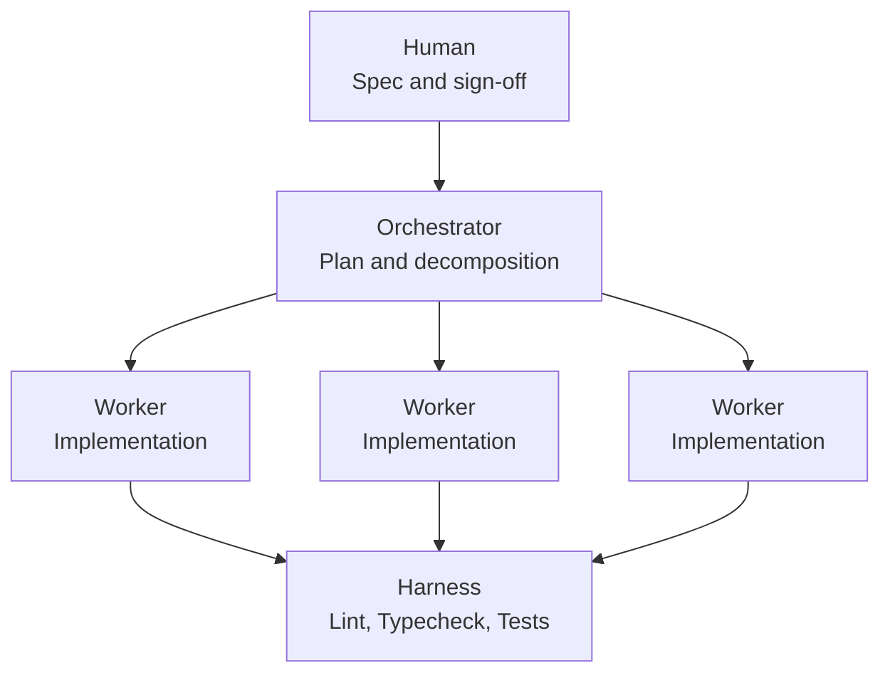

*Orchestrator-worker with the human at the top and the harness as the verification stage. Failures go back to the responsible worker, not to the human.*

- **The main benefit is context isolation:** 40,000 tokens of research return as three paragraphs (Module 8).
- **The handover is lossy:** the sub-agent does not know what the main agent knows. "Continue from there" fails; write the task completely, as for a new colleague, to the standard of a spec.
- **Parallelism has follow-on costs:** three agents in three worktrees do not collide on files, but semantic merge conflicts (Module 5) become more frequent; a merge queue becomes necessary.

Claude Code defines sub-agents as Markdown files with frontmatter in `.claude/agents/` (project) or `~/.claude/agents/` (user), each with its own tool allowlist, model and system prompt. A "reviewer" sub-agent can get read-only tools and a "security" sub-agent a fresh context without the implementation history, the separation Module 12, section 6 asks for. Domain sub-agents with their own skill sets are the scaling pattern in Module 10.

#### 8. Multi-model routing and tokenomics

**The metric is cost per successfully completed task, not cost per token.** A cheap model that needs five iterations and still fails review costs more than an expensive one that delivers in one pass.

- **A large model pays off** for planning, architecture decisions, hard bugs with unclear causes, and code review: few tokens, high cost of error (the left side of the loops in Module 0).
- **A small model suffices** for mechanical implementation against a clear spec, boilerplate, tests from a template, formatting and migrations across many files: many tokens, immediately verifiable.
- **In the inner loop latency counts more than cost:** a model that takes 40 seconds for a small change breaks the loop like a slow build.
- **Provisioned throughput** (reserved capacity at a fixed price) fits the steady, high volume of the worker model in the implement-test-debug loop: cost control and stable latency. The planning model is called selectively; per-token billing suffices.
- **Prefix caching** (Module 8) is the cheapest lever: static content first, variable content last.

Which model to route where is an eval question (Module 11), not a leaderboard lookup.

#### 9. The feedback loop on the harness itself

Regularly (every sprint or week) ask which failures occurred *repeatedly*, and for each: rule, check or boundary?

1. **Best: an automatic check** that makes the failure impossible (lint rule, test, pipeline script).
2. **Second best: a boundary** that prevents it (permission, CODEOWNERS, sandbox).
3. **Worst: a rule** in `AGENTS.md`.

Rules act probabilistically and cost context permanently; checks act deterministically and cost only when they fire.

> **Every rule in `AGENTS.md` is an admission that you could not build a check.**

Design conventions often remain rules. But a rule violated three times needs a check, not bolder letters.

#### 10. When the harness is too much

A harness costs maintenance, latency in every loop, context and onboarding effort. A prototype, throwaway script or exploratory analysis does not need it. The question from Module 0: **how often does this loop run, and what does a failure cost?** A one-off script whose output you check needs no gate; a service with users needs all five layers.

On-ramp from zero: formatter and linter in the hook → fast test suite with one entry command → `AGENTS.md` with check commands and a deny list → CI with branch protection → the rest as needed. The first three steps deliver most of the effect.

#### 11. Anti-patterns

- `AGENTS.md` as an essay on code quality instead of a command list
- An `AGENTS.md` that grows to 500 lines over time instead of rules becoming checks
- Prohibitions only as instruction, without a mechanism behind them
- A bot token with more rights than a human
- The agent being allowed to change its own verification infrastructure
- Rules born from imagination instead of observed failures
- Optimizing cost per token instead of cost per completed task
- Sub-agents with vague task descriptions ("continue")
- Parallel agents without worktrees and without a merge queue
- Autonomy without corresponding isolation
- A harness that is never revised although the same failures recur

#### 12. Glossary

Agent harness · Open vs. closed control loop · `AGENTS.md` / `CLAUDE.md` / `GEMINI.md` · Hierarchical instruction files · MCP · Tool output discipline · Probabilistic rule vs. deterministic check · Deny list · Sandboxing · Worktree isolation · Sub-agent · Context handover · Orchestrator-worker · Multi-model routing · Cost per completed task · Provisioned throughput · Prefix caching · Harness retrospective

#### 13. Exercises

**E1: Minimal `AGENTS.md`.** At most 40 lines: check commands, structure in three lines, deny list, nothing visible in the code. Count the tokens.

**E2: Rules from observation.** From what you observed in Module 4 (E6, E7) and Module 3 (E7), write three rules, each traced to an observed failure. Could each be a check?

**E3: From rule to check.** Turn one rule into an automatic check (lint plugin, test, Makefile script), remove the rule from `AGENTS.md`, and verify the failure is still caught.

**E4: Arm the boundaries.** CODEOWNERS on `tests/`, `.github/` and the migration directory. Give an agent a task where changing a test is easiest and watch what the PR process does.

**E5: Trim tool outputs.** Build `make test-agent` that prints only failed tests with short tracebacks; compare context length over a full agent run.

**E6: Orchestrator-worker.** A planning model splits a feature into three tasks, a fast model implements them in three worktrees in parallel; merge them and note where it snags.

**E7: Cost per task.** Run one task with a large and a small model; record tokens, iterations, wall-clock time and whether the result passes review; compute cost per *successful* task.

**E8: Harness retrospective.** For one week, list every agent failure in your project, map each to the ranking in section 9, and implement the three most frequent fixes.

---

### Module 10 · Skills at scale: registries, governance and retrieval

How an engineering organization keeps agent skills from sprawling, and how an agent finds the right skill among hundreds without flooding its context window. Module 9 built the harness for one repository; this module shares its know-how across teams.

> **"Skills guide, hooks enforce."**
> A skill changes what the model is *likely* to do. Only hooks, sandboxes and gateways change what it *can* do. Almost every design decision below follows from keeping these two apart.

> **Preview.** Skill Registry (Agent Platform) and Semantic Governance Policies are Preview (Pre-GA terms, limited support). Check the launch stage of Agent Registry skills before you build production processes on them.

**Quick reference**

- **Against skill sprawl, three stages:**
  1. **Personal:** draft skills inside the repo (`<repo>/.agents/skills/`, gitignored), never globally in the home directory.
  2. **Team:** share through a pull request with Tech Lead review (CODEOWNERS), automated `SKILL.md` linting and short ADK trajectory evals in CI.
  3. **Organization:** CI publishes an immutable revision into a central governance project in Google Cloud Agent Registry (`eu` or `europe-west3`). Nothing is served until an admin pins a revision and sets the skill `ACTIVE`; production agents get a fixed revision; duplicates are retired via `DEPRECATED` → `DECOMMISSIONED`. A central GitHub skills monorepo is the second-best option and the natural GitOps source for this stage.
- **Four primitives, strictly separated:** rules (always loaded), skills (on demand), MCP servers (live access), hooks/sandbox/gateway (deterministic, outside the model); section 3.
- **Finding the right skill, three tiers by catalog size:** up to ~30 skills progressive disclosure; ~50 to hundreds top-3–5 retrieval with LRU eviction; organization-wide domain subagents with 5–15 skills each; section 6.

#### 1. The two problems

Teams adopt local coding agents (Antigravity, Gemini CLI, Claude Code) and build their own agents with ADK. Two problems follow.

**Skill sprawl (organizational).** Engineers prototype workflows on their laptops, copy `SKILL.md` files between repositories and keep duplicate API helper scripts. Nobody reviews them or scans the scripts, no version is pinned, and there is no central switch to turn a bad skill off.

**Runtime scaling (technical).** Binding dozens of MCP tool schemas or hundreds of skills statically into the system prompt causes three failures at once:

1. **Token cost:** every turn pays for every schema, used or not.
2. **Latency:** a longer prompt means a later first token (TTFT).
3. **Selection accuracy:** with many similar schemas the model picks the wrong tool or invents parameters (Module 8, section 3).

Chaining tools sequentially does not shorten the schemas, and a bigger thinking budget adds thinking tokens on top of a bloated prompt. The fix is changing *what is in the prompt* (sections 3 to 6).

#### 2. What a skill is

A skill follows the open, vendor-neutral [Agent Skills specification](https://agentskills.io/specification): a plain, Git-versionable directory that runs unchanged in Antigravity (IDE and CLI), ADK, Gemini CLI, Claude Code and Agent Registry.

```
terraform-security-review/
├── SKILL.md        # required: YAML frontmatter + Markdown instructions
├── references/     # optional: API specs, standards, schemas (read on demand)
├── scripts/        # optional: deterministic checks the agent runs instead of rewriting them
└── assets/         # optional: templates, JSON schemas, config boilerplate
```

**Frontmatter rules** (from the spec):

| Field | Required | Constraint |
|---|---|---|
| `name` | yes | 1–64 characters, lowercase `a-z`, `0-9` and hyphens; no hyphen at the start, at the end or doubled; must match the folder name |
| `description` | yes | 1–1024 characters; says *what* the skill does and *when* to use it |
| `metadata` | no (yes for Agent Registry) | flat map from string to string |
| `license`, `compatibility` (≤ 500 chars), `allowed-tools` (experimental) | no | |

**Trigger hygiene.** At scale the typical failure is not "no skill matches" but "two skills match". A description needs both halves, *Use when …* and *Don't use for …*; the negative half separates a skill from its neighbours.

```yaml
---
name: terraform-security-review
description: >-
  Audits Terraform modules (.tf) for least-privilege IAM, CMEK encryption,
  VPC Service Controls and regional guardrails (eu / europe-west3).
  Use when creating, reviewing or refactoring Terraform infrastructure modules
  or GCP IAM bindings. Don't use for Kubernetes runtime debugging, application
  unit tests or live production deployments.
metadata:
  owner: platform-security
---
```

**Packaging for Agent Registry.** Zip the directory with `SKILL.md` at the archive root. Upload validation: at most 8 directory levels; the frontmatter must define `name`, `description` and `metadata`; the compressed ZIP may be up to **1 MB**. With security scanning enabled, the limits of 10 MB uncompressed in total and 1 MB per file also apply; otherwise revision creation fails with `INVALID_ARGUMENT` or the scan status becomes `UNSUPPORTED_FORMAT`.

Because the spec requires `metadata` to be a flat string map (Agent Registry stores `map<string, string>`), ADK-specific list fields such as `metadata.adk_additional_tools` only work for skills ADK loads locally, not for skills published to Agent Registry. ADK 2.13 validates that `adk_additional_tools` is a list of strings.

#### 3. The four primitives

Most skill sprawl, and almost every accidental safety incident with agents, starts with something put into `SKILL.md` or the global prompt that belongs in another layer. This maps onto the five harness layers of Module 9: rules are instructions, MCP servers are tools, hooks/sandbox/gateway are boundaries.

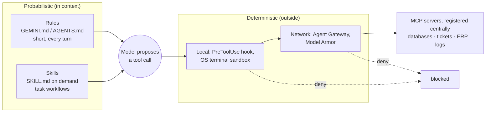

*Everything on the left can be ignored by the model. Everything on the right cannot.*

| Primitive | Put here | Typical misuse |
|---|---|---|
| **Rules** | build and test commands, language standards, module boundaries | a 300-line incident runbook in `GEMINI.md` that every prompt pays for |
| **Skills** | playbooks, review checklists, templates, helper scripts | a skill as a security boundary ("never call DELETE") |
| **MCP servers** | live, authenticated access to systems | the same REST wrapper script copied into twenty team skills |
| **Hooks, sandbox, gateway** | hard rules: block destructive calls, scan for secrets, lint after every edit | a safety rule written as a sentence in a prompt |

1. **Rules** load into every session in the repository; reserve them for short, universally valid conventions. Antigravity truncates a single rule file above 24,000 bytes (after `@`-includes are expanded); global and `always_on` rules share a budget of 20,000 tokens, above which the largest files are replaced by pointers. Besides `GEMINI.md` and `AGENTS.md`, Antigravity reads `.agents/rules/*.md` with a `trigger` in the frontmatter: `always_on`, `model_decision` (only path and description up front, the full rule when the task matches), `glob` (when matching files are touched) or `manual` (only when `@`-mentioned). A `model_decision` rule is progressive disclosure for rules, close to a skill. A missing or invalid trigger silently discards the rule.
2. **Skills** hold task-specific procedures loaded on demand. They steer the model *probabilistically* and are never a hard security boundary.
3. **MCP servers** give live, authenticated access to databases, Cloud Logging, issue trackers and wikis (Jira, Confluence) or ERP systems. Instead of copying wrapper scripts across skills, register vetted MCP servers centrally in Agent Registry, control access with IAM (`roles/mcp.toolUser` for Google Cloud MCP servers) or Agent Gateway authorization policies (for third-party and custom servers), and default to **read-only modes** for analysis and triage. See [mcp.ipynb](mcp.ipynb) and [gateway.ipynb](gateway.ipynb).
4. **Hooks, sandbox and gateway** run outside the model, which cannot talk its way around them: block `DELETE` calls or space and table drops in Confluence and databases, screen prompts and responses for secrets and PII (Model Armor), run the linter after every edit (`PostToolUse`). Locally in Antigravity: the OS-level terminal sandbox plus hooks in `.agents/hooks.json` (workspace) or `~/.gemini/config/hooks.json` (global), with the events `SessionStart`, `PreToolUse`, `PostToolUse`, `PreInvocation`, `PostInvocation`, `Stop`; a `PreToolUse` hook blocks a call by printing JSON with `"decision": "deny"` on stdout. Claude Code blocks with exit code 2 instead ([Module 2](#module-2--the-inner-loop-static-analysis--hooks)). Centrally, for all MCP and agent traffic: Agent Gateway with Model Armor.

##### Semantic governance: protecting tainted sessions

A session becomes *tainted* when it has taken in untrusted content (an email, a web page, an uploaded document, an issue ticket) that can carry injected instructions. Semantic Governance Policies then stop the agent from loading skills that can act outward:

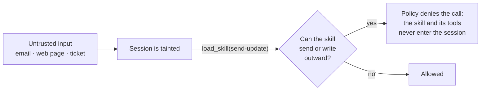

The policy intercepts the ADK skill tools (`list_skills`, `load_skill`, `load_skill_resource`, `run_skill_script`) and checks each call against constraints written in natural language. This applies the lethal-trifecta defense from [Module 12](#module-12--reviewing-ai-code-critically-security--verification-debt): cut the outward-acting leg once untrusted content is in the context. An LLM evaluates the policy, and the docs say its verdicts "may not be accurate"; it is a probabilistic layer that adds to hooks and gateways but does not replace them.

#### 4. Where skills live: two registries

Google Cloud has two services with "skill registry" in the description, for different problems:

| | **Agent Registry** (skills) | **Skill Registry** (Agent Platform) |
|---|---|---|
| Purpose | governance and distribution catalog for the whole organization | runtime repository with semantic retrieval |
| API | `agentregistry.googleapis.com` | `aiplatform.googleapis.com/v1beta1` |
| Discovery | `skills:search` (used by ADK's `GCPSkillRegistry`) | `skills:retrieve` with `top_k`, over display name and description |
| Versioning | immutable `SkillRevision`, `defaultRevision` pointer, five lifecycle states | skill plus immutable revisions, default revision |
| EU locations | `eu` multi-region, `europe-west3` (Frankfurt), `europe-west10` (Berlin) and more | `europe-west4` (Netherlands); also `us-central1`, `us-east5` |
| Notes | malware and vulnerability scanning of uploads; `constraints/gcp.resourceLocations` enforced on regional create | data residency US and EU supported; CMEK and VPC-SC not supported |

**Agent Registry** knows two kinds of skills:

- **Standalone skills:** versioned ZIP bundles (instructions plus scripts) that an agent downloads into its own context; governed across projects, independent of any agent deployment.
- **Inline A2A skills:** the `skills` array in a remote agent's `agent-card.json`. They advertise what a remote agent can do so another agent can delegate to it over A2A (see [a2a.ipynb](a2a.ipynb)); versioned with the Agent Card.

Skill IDs show the publisher. Google-managed skills come from verified publishers (`FIRST_PARTY`, e.g. `urn:skill:cloud.google.com:…`) and are visible in every project. Your own skills get the prefix `private-` automatically (`private-terraform-security-review`) so they cannot collide with verified ones; use the prefixed ID in all later commands.

The organization policy `constraints/gcp.resourceLocations` is enforced when you create regional `Skill` and `SkillRevision` resources. It is not retroactive, and the docs do not say whether it applies to `eu` or `global`.

**Skill Registry** provisions a built-in system skill, `gcp-skill-registry`, with which agents create, search and manage skills. It appears from the second API call on; the first response does not list it.

**For strict in-country requirements (Frankfurt):** use Agent Registry in `europe-west3` as the catalog and let ADK search it lazily (section 6.2). Skill Registry is not offered in `europe-west3`.

#### 5. Governance: the three-stage pipeline

Experimentation stays fast while unreviewed skills cannot spread; each stage adds a gate. This is CI/CD (Module 5) and release engineering (Module 6) applied to skills.

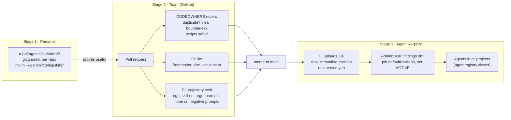

*Each arrow to the right is a promotion; each gate is a place where a bad skill stops.*

##### Stage 1: personal sandbox

Draft and test skills in the project repository under `<repo>/.agents/skills/`, excluded from Git while they are personal experiments. **Scope project skills to the repository**, never install them in `~/.gemini/config/skills/`: global skills are visible in every project on the machine, pile up and compete for the model's attention everywhere. Antigravity also reads `.agents/skills/` in every parent folder up to the repository root, so a monorepo can hold shared skills at the root and package-specific ones further down.

##### Stage 2: team review in Git

A useful skill goes into the repository through a pull request. Engineering standards that span repositories go into a central skills repository (e.g. `company-agent-skills`), which each repo installs, for example with `npx skills add <org>/company-agent-skills` or as an Antigravity plugin from the marketplace (`agy plugin install <plugin>`).

Tech Leads review via CODEOWNERS: duplicate of an existing skill? Clear boundaries in the description? Safe scripts? CI adds two gates before the merge:

1. **Schema and security lint:** valid frontmatter (`skills-ref validate ./my-skill` checks the spec), size limits, static analysis of `scripts/`.
2. **Trajectory evaluation:** a short eval set (`trajectory.evalset.json`) checks that the agent calls `load_skill` for the right skill on target prompts, ignores it on neighbouring prompts, and that nothing regressed. In `adk eval` the metric is `tool_trajectory_avg_score`; the Gen AI Evaluation Service has an equivalent tool-use metric. Evaluation methods in general: Module 11.

Run these evals against a model endpoint that satisfies your residency requirement; Gemini 3.x models were served only on `global` (see [a2a.ipynb](a2a.ipynb)), so check the model's location table first (section 6.2).

##### Stage 3: organization-wide publishing

On merge to `main`, a pipeline zips the skill and uploads it as a new immutable revision into a central **governance project** in Agent Registry. The point is an IAM split, so the pipeline that uploads cannot put anything into production:

| Who | Role | May |
|---|---|---|
| CI pipeline | **custom role** with only create and read permissions on skills and skill revisions | create skills (not served) and upload revisions (not served until pinned) |
| Platform and security admins | `roles/agentregistry.editor` or `roles/agentregistry.admin` | review scan findings, move `defaultRevision`, set `ACTIVE`, retire skills, curate MCP servers |
| Consuming teams and agent service accounts | `roles/agentregistry.viewer` | discover and load approved skills, nothing else |

The predefined `roles/agentregistry.user` can also update skills, change their lifecycle state and delete them; a pipeline with it could activate its own upload, and the four-eyes principle would be gone. Hence the custom role.

##### Lifecycle: five states

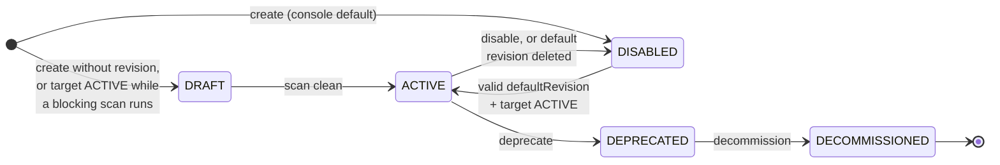

| State | Served at runtime? | Meaning |
|---|---|---|
| `DRAFT` | no | being prepared; also the waiting state while the initial revision's blocking scan runs |
| `DISABLED` | no, resolution and download fail immediately | kill switch; reached automatically when the default revision is deleted |
| `ACTIVE` | yes | requires `defaultRevision` to point to an active revision |
| `DEPRECATED` | yes, still resolvable and downloadable | signals retirement after a grace period |
| `DECOMMISSIONED` | no, permanently | terminal and irreversible; only reachable from `DEPRECATED` |

Scanning has three modes: `DISABLED`, `ENABLED_NONBLOCKING` and `ENABLED_BLOCKING` (the default). Under blocking scanning, a skill created with target `ACTIVE` stays in `DRAFT` until the scan of its initial revision is clean, and pinning a revision with findings or a pending scan fails with `FAILED_PRECONDITION`.

##### Release, pin, roll back

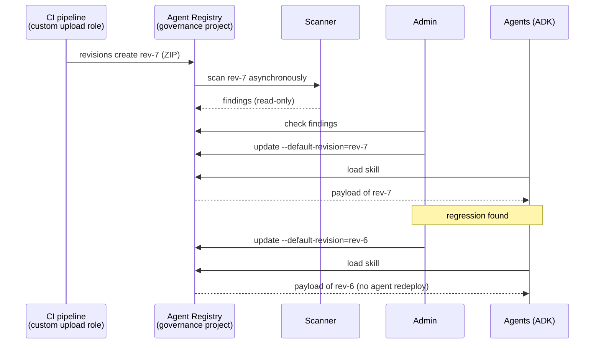

*Rollback is just moving a pointer. ADK's `GCPSkillRegistry` always loads the skill's `defaultRevision`, so every agent picks up the change on its next load.*

The same workflow with `gcloud` against a central governance project in Frankfurt. The GA group `gcloud agent-registry skills` needs gcloud 591.0.0 or later; instead of `--payload`, `--gcs-source-uri=gs://…` uploads from Cloud Storage.

```bash
PROJECT=agent-governance-prod   # central governance project
LOCATION=europe-west3
SKILL=terraform-security-review # stored as private-terraform-security-review

# 1. Package: SKILL.md must sit at the archive root
(cd skills/$SKILL && zip -r ../../$SKILL.zip .)

# 2a. First release only (CI service account): create the skill, not served yet
gcloud agent-registry skills create $SKILL \
    --project=$PROJECT --location=$LOCATION \
    --display-name="Terraform Security Review" \
    --description="Audits .tf modules for IAM, CMEK, VPC-SC and EU guardrails." \
    --target-state=DISABLED \
    --payload=./$SKILL.zip

# 2b. Every later release: a new immutable revision (the default does not move)
gcloud agent-registry skills revisions create REVISION_ID \
    --skill=private-$SKILL \
    --project=$PROJECT --location=$LOCATION \
    --payload=./$SKILL.zip

# Revision IDs, including the one created in step 2a
gcloud agent-registry skills revisions list \
    --skill=private-$SKILL --project=$PROJECT --location=$LOCATION

# 3. Admin, after checking the scan findings: pin the revision, then activate
gcloud agent-registry skills update private-$SKILL \
    --project=$PROJECT --location=$LOCATION \
    --default-revision=FULL_REVISION_NAME   # projects/…/skills/private-…/revisions/REVISION_ID, as listed

gcloud agent-registry skills update private-$SKILL \
    --project=$PROJECT --location=$LOCATION \
    --target-state=ACTIVE

# Rollback: the same --default-revision update with an older revision
```

#### 6. Runtime: finding the right skill among hundreds

The approach depends on how many skills and tools one agent can reach. The tiers build on each other: Tier C agents use Tier B search, and Tier B still loads skills through Tier A's levels.

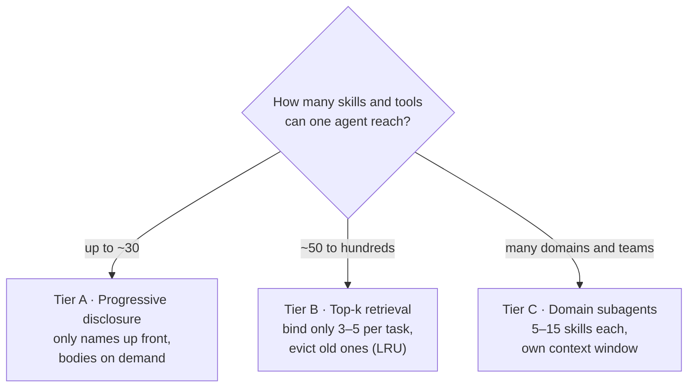

##### 6.1 Tier A (up to ~30 skills): progressive disclosure

Antigravity and ADK never inject full skill files up front. They disclose in three levels (Module 8, section 4):

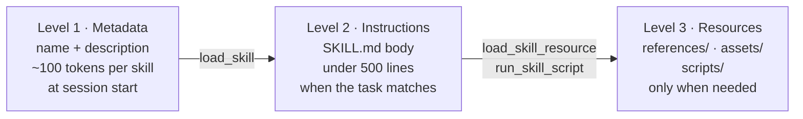

1. **Metadata:** at the start the agent sees only name and description of each skill; unused skills cost almost nothing.
2. **Instructions:** when a task matches, the agent pulls the `SKILL.md` body into context. Keep it focused (the spec recommends under 500 lines and under ~5,000 tokens) and move long reference tables into separate files.
3. **Resources:** detailed docs and scripts are read or run on demand. A script's source never has to enter the context, only its short stdout.

- **Antigravity** shows the list of names and descriptions on every turn and reads the full `SKILL.md` when a skill looks relevant; tool names are not exposed.
- **ADK** (`SkillToolset`) has two discovery modes. `LAZY` (default) offers a `list_skills` tool: one extra model turn before the first `load_skill`, but no skill names in the system instruction; better for large or changing catalogs. `EAGER` injects the catalog into the system instruction as XML and drops `list_skills`; better for small, stable catalogs. Registry skills are reachable only through `search_skills` in both modes. `run_skill_script` is offered only if scripts can run: a `code_executor` or an `environment` on the `SkillToolset`, or a `code_executor` on the agent.

##### 6.2 Tier B (~50 to hundreds): top-k retrieval, lazy search, eviction

From about 50 tools, or with hundreds of skills across the organization, even the Level 1 list no longer belongs in the system prompt. The pattern is **RAG for skills and tools**: before the reasoning loop, match the request against an index, take the top 3 to 5 skills or tools, and bind only those for the turn. Token use and latency stay small and predictable, and all capabilities remain reachable.

**ADK with Agent Registry (works in `europe-west3`).** `SkillToolset` plus `GCPSkillRegistry` puts **no** registry skill into the base prompt, so the prompt prefix stays stable and the prefix cache keeps working (Module 8, section 2). The agent calls `search_skills` (backed by Agent Registry's `skills:search`), loads only what it needs, and old skills are evicted:

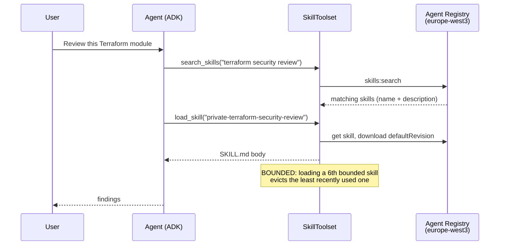

Skill lifecycle modes in ADK (`SkillLifecycleConfig`):

| Mode | Stays active | Counts against `max_active_skills` |
|---|---|---|
| `PERSISTENT` (default) | for the rest of the session, unless unloaded | no |
| `BOUNDED` | like persistent, but the least recently loaded one is evicted beyond the cap | yes (default cap 5) |
| `EPHEMERAL` | until the end of the turn that loaded it | no (under `run_live` it behaves like persistent) |

The lifecycle feature is **experimental**: `ADK_ENABLE_SKILL_LIFECYCLE=1` enables the `unload_skill` tool and prunes evicted `SKILL.md` bodies from the request; without it, eviction only deactivates the skill's dynamic tools.

For locally loaded skills, `metadata.adk_additional_tools` activates skill-specific tools only when the skill loads. That changes the tool declaration list and invalidates the prefix cache once at activation; grouping related steps keeps cache hit rates high.

```python
# Names checked against google-adk 2.13.0. Environment:
#   GOOGLE_GENAI_USE_VERTEXAI=TRUE
#   GOOGLE_CLOUD_PROJECT=agent-governance-prod
#   GOOGLE_CLOUD_LOCATION=global   # model endpoint (see the note below)
#   ADK_ENABLE_SKILL_LIFECYCLE=1   # experimental: unload_skill + pruning of evicted bodies

from google.adk.agents import Agent
from google.adk.integrations.skill_registry.gcp_skill_registry import GCPSkillRegistry
from google.adk.tools.skill_toolset import (
    SkillDiscoveryMode,
    SkillLifecycleConfig,
    SkillLifecycleMode,
    SkillToolset,
)

# 1. The governance catalog in Frankfurt; its location is independent of the model's
registry = GCPSkillRegistry(
    project_id="agent-governance-prod",
    location="europe-west3",
)

# 2. Lazy discovery (no registry skill in the base prompt) + LRU cap of 5 bounded skills
skill_toolset = SkillToolset(
    registry=registry,
    discovery_mode=SkillDiscoveryMode.LAZY,  # default; registry skills are always searched on demand
    lifecycle_config=SkillLifecycleConfig(
        enabled=True,
        default_mode=SkillLifecycleMode.BOUNDED,
        max_active_skills=5,  # also the default
    ),
)

engineering_agent = Agent(
    name="platform_engineering_assistant",
    model="gemini-3.5-flash",
    instruction=(
        "Use search_skills to discover approved enterprise skills matching the "
        "current task, and load only the specific reference files required."
    ),
    tools=[skill_toolset],
)
```

`GCPSkillRegistry` takes its location as a parameter, so catalog and model endpoint can differ, and here they must: Gemini 3.x ran only on `global`. The docs warn: "Don't use the global endpoint if you have ML processing requirements." A catalog in Frankfurt is easy; fully in-country processing also needs a model served on a regional or `eu` endpoint. Check the model's location table before promising it.

**Custom router with Skill Registry (`europe-west4`).** A self-built pre-loop router gets the top-k skills directly. `RetrieveSkills` searches over display name and description, so trigger hygiene (section 2) also drives retrieval quality.

```python
import agentplatform

client = agentplatform.Client(project="sandbox-project", location="europe-west4")

# Only the 5 best-matching skills for the current request
response = client.skills.retrieve(
    query=user_prompt,
    config={"top_k": 5},
)
selected_skills = [s.skill_name for s in response.retrieved_skills]
```

##### 6.3 Tier C (organization-wide): domain subagents instead of a "God agent"

Even with top-k search, one agent should not do Terraform audits, SecOps triage, ERP finance queries and frontend unit tests at once. Split broad workflows into **domain subagents**:

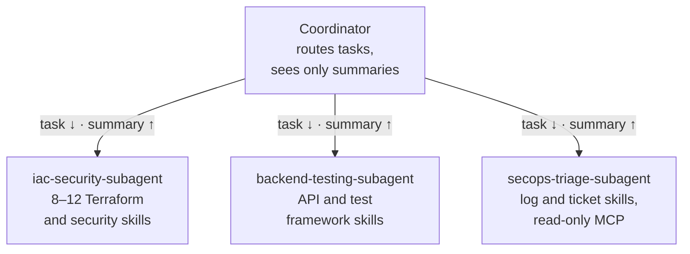

- **Small search space:** each subagent searches only its own 5–15 skills, so selection is precise.
- **Context isolation:** long logs, tool traces and loaded `SKILL.md` bodies stay in the subagent's disposable context; the coordinator gets a short structured summary (Module 9, section 7).
- **Least privilege per agent:** each subagent runs under its own identity (SPIFFE-based Agent Identity, see [identity.ipynb](identity.ipynb) and [pca.md, section 4.17](pca.md#417-agent-authentifizierung-in-der-praxis-identitäten-tokens-auth-manager)) with IAM grants only for its domain's skills and MCP servers.

In ADK, subagents are `LlmAgent`s with `include_contents="none"`, wired via `sub_agents=[...]` or wrapped in `AgentTool`. In Antigravity, subagents start without the parent's conversation history and run asynchronously in the background; the parent chooses the workspace when it calls `invoke_subagent`: `inherit` (the parent's workspace), `branch` (an isolated Git worktree, for concurrent code edits) or `share` (shared directory storage).

#### 7. Chat-first SaaS vs. GitOps plus registry

Chat-first SaaS platforms for "AI employees" optimize skills for non-technical users. Both sides solve a real problem:

| Dimension | Where chat-first SaaS excels | Where GitOps plus Agent Registry is stronger |
|---|---|---|
| **Authoring** | zero boilerplate: "turn this workflow into a skill" in the chat, no `SKILL.md`, YAML or ZIP | engineers also generate skills by prompt, but get Git-versioned artifacts, runnable `scripts/` and CI evals; for business users a no-code agent builder inside the same governed cloud boundary can close the gap |
| **Sharing** | one click between personal, team and organization tabs, no IAM setup | team skills only via pull request (CODEOWNERS, no shadow sprawl); org skills via a governance project, pinned revisions and IAM roles |
| **Write protection** | read vs. write separated per connector, one-click approval requests | defense in depth: OS sandbox and `PreToolUse` hooks, script scanning, read-only MCP modes, Agent Gateway and Model Armor, semantic governance for tainted sessions |
| **Residency and portability** | multi-tenant SaaS, often a US or EU region per tenant; skills stored in the platform; model processing wherever the model is hosted | catalog in `eu` or `europe-west3`, VPC Service Controls, CMEK where the service supports it; the same open `SKILL.md` runs in Antigravity, ADK, Gemini CLI and Agent Registry |

SaaS workspaces optimize for fast, click-based sharing among business teams. GitOps plus registry treats skills like production software: review, pinned revisions, automated evals, data residency and an open format without lock-in.

#### 8. Glossary

Skill sprawl · Agent Skills specification · `SKILL.md` · Frontmatter · Trigger hygiene ("Use when / Don't use for") · Progressive disclosure · Standalone skill vs. inline A2A skill · `SkillRevision` · `defaultRevision` · Lifecycle states (`DRAFT`, `DISABLED`, `ACTIVE`, `DEPRECATED`, `DECOMMISSIONED`) · Governance project · Four-eyes principle · Trajectory evaluation · Rules vs. skills vs. MCP vs. hooks · `PreToolUse` · Tainted session · Semantic governance · Top-k retrieval · Lazy vs. eager discovery · LRU eviction · Prefix cache · Domain subagent · Context isolation

#### 9. Exercises

**E1: Write one skill (~20 minutes).** Turn a task you repeat (e.g. "set up a new agent notebook in this repo") into a skill under `.agents/skills/<name>/` and validate it with `skills-ref validate ./<name>`. Does `name` match the folder, and does the description have both halves?

**E2: Test the trigger.** Write five prompts that should load the skill and five neighbouring prompts that should not; run them in Antigravity or Claude Code and count hits and false hits. Rewrite the description until both are right. This is the manual version of the stage-2 CI gate.

**E3: Lazy vs. eager in ADK.** Build a `SkillToolset` with three local skills in `SkillDiscoveryMode.LAZY` and `EAGER`; compare the system instruction (eager contains the catalog as XML) and the model turns until the first `load_skill`.

**E4: Lifecycle in a sandbox project.** In a throwaway project: create a skill, upload two revisions, pin the first and set it `ACTIVE`, pin the second, roll back to the first, then deprecate. Do not decommission anything you still need; it is irreversible.

**E5: A hook that says no.** Write an Antigravity `PreToolUse` hook that denies `rm -rf` and any `DELETE` request to an API, test it, and compare with the Claude Code variant from [Module 2](#module-2--the-inner-loop-static-analysis--hooks).

#### 10. Checkpoint

1. A team puts its 300-line incident runbook into `GEMINI.md`. Which two costs does that cause, and where does the runbook belong?
2. "Never call DELETE on Confluence" is written into a skill. Why is that not a safety control, and which layer should enforce it?
3. A skill is `DEPRECATED`. Can agents still load it? What must happen before it can be `DECOMMISSIONED`, and what can never happen afterwards?
4. The CI service account has `roles/agentregistry.user`. Why does that break the four-eyes principle, and what is the fix?
5. An agent can reach 400 skills. Why does neither a bigger thinking budget nor tool chaining help, and what does?
6. Why does activating a skill's `adk_additional_tools` cause one prefix-cache miss, and how do you keep such misses rare?
7. The skill catalog is in `europe-west3` and the agent uses a Gemini 3.x model. Is the workload processed entirely in Frankfurt?

#### 11. Check before relying on it

- Launch stage of Agent Registry skills (Preview or GA).
- `roles/mcp.toolUser` as the role for Google Cloud MCP servers.
- The name of the tool-use metric in the Gen AI Evaluation Service.
- The response fields of `client.skills.retrieve` (`retrieved_skills`, `skill_name`); the docs show the call but not the response.
- The `npx skills add` syntax for installing skills from a central repository.
- Which Gemini models are served in `europe-west3` or `eu` when you read this.

#### 12. References

**Agent Registry (central governance catalog)**

- [Overview and governance projects](https://docs.cloud.google.com/agent-registry/overview)
- [Skills architecture: standalone vs. inline A2A skills, lifecycle](https://docs.cloud.google.com/agent-registry/skills-architecture)
- [Register standalone skills (console, gcloud, REST)](https://docs.cloud.google.com/agent-registry/register-skills)
- [Manage skills: lifecycle, default revision, IAM](https://docs.cloud.google.com/agent-registry/manage-skills)
- [Manage skill revisions](https://docs.cloud.google.com/agent-registry/manage-skill-revisions)
- [Locations](https://docs.cloud.google.com/agent-registry/locations)
- [IAM roles and permissions](https://docs.cloud.google.com/agent-registry/roles-permissions)

**Gemini Enterprise Agent Platform (Skill Registry, governance, evaluation)**

- [Skill Registry overview](https://docs.cloud.google.com/gemini-enterprise-agent-platform/build/skill-registry)
- [Create, manage and retrieve skills (`skills:retrieve`)](https://docs.cloud.google.com/gemini-enterprise-agent-platform/build/skill-registry/create-manage)
- [Govern agent skills: semantic governance policies](https://docs.cloud.google.com/gemini-enterprise-agent-platform/govern/policies/govern-agent-skills)
- [Agent evaluation](https://docs.cloud.google.com/gemini-enterprise-agent-platform/optimize/evaluation/agent-evaluation)
- [Model locations (global, multi-region, regional)](https://docs.cloud.google.com/vertex-ai/generative-ai/docs/learn/locations)

**Antigravity, ADK and open standards**

- [Antigravity: skills](https://antigravity.google/docs/skills) · [rules](https://antigravity.google/docs/rules) · [hooks](https://antigravity.google/docs/hooks) · [sandbox](https://antigravity.google/docs/sandbox) · [subagents](https://antigravity.google/docs/subagents) · [MCP](https://antigravity.google/docs/mcp)
- [Admin settings for AI developer tools](https://docs.cloud.google.com/gemini/enterprise/docs/ai-developer-tools-settings)
- [ADK: skills and `SkillToolset`](https://adk.dev/skills/) · [function tools](https://adk.dev/tools-custom/function-tools/)
- [Dynamic tool search in ADK (Google Cloud Community, Medium)](https://medium.com/google-cloud/implementing-anthropic-style-dynamic-tool-search-tool-f39d02a35139)
- [Agent Skills specification](https://agentskills.io/specification)
- [Google's open-source skills (google/skills)](https://github.com/google/skills) · [agents-cli (google/agents-cli)](https://github.com/google/agents-cli)

**In this repo:** [mcp.ipynb](mcp.ipynb) (MCP server, Agent Registry) · [identity.ipynb](identity.ipynb) (Agent Identity) · [gateway.ipynb](gateway.ipynb) (Agent Gateway, Model Armor) · [a2a.ipynb](a2a.ipynb) (A2A, Agent Card)

---

### Module 11 · Evaluating models and agents

Module 3 made "done" machine-checkable for deterministic code. Model output and agent trajectories vary from run to run, so tests become **evals**: the same idea (an executable specification, deterministic where possible) plus statistics. This module covers reading public leaderboards and building your own evaluation.

#### 1. Agent = model + harness

The **model** is the trained network: it predicts tokens and reasons. The **harness** (Module 9) is everything that steers the model and connects it to the outside world.

```
Agent  =  Model                           +  Harness
          weights: token prediction,         system prompt, loaded instructions (AGENTS.md, skills),
          reasoning                          tools and MCP servers, context compaction, retries,
                                             output parsers, sandbox, guardrails
```

The same model scores very differently in different harnesses. Vendor numbers with their own scaffold are therefore not comparable with a leaderboard that runs all models in one harness (e.g. SWE-bench Pro at Scale, where every model runs with mini-swe-agent).

#### 2. Four levels of evaluation

| Level | What is fixed, what varies | Examples |
| --- | --- | --- |
| 1. Model in isolation | one prompt → one answer, no tools, no loop | HLE, MathArena, LiveBench, GPQA |
| 2. Model in a fixed harness | harness fixed, model varies | SWE-bench Pro (SEAL), SWE-rebench, τ-Bench, MCP-Atlas, HAL |
| 3. Harness ablation | model fixed, exactly one harness part varies (system prompt, tool schema, skill) | no public leaderboard; work on your own agent |
| 4. Agent end-to-end | the whole run: planning, tool calls (trajectory), grounding, final state of the environment | Terminal-Bench, OSWorld, own agent evals |

Level 1 says little about agents: a model with top single-prompt scores can fail a 25-step run by filling tool parameters wrongly, guessing on after an error, or editing files in the wrong place.

**Rule:** once tools are involved, it is technically always an agent evaluation. Whether it becomes a model or a harness evaluation depends on which knob you hold fixed and which you turn.

#### 3. Five questions for every number

**1. Is the model ranked, or model plus harness?** Vendor numbers often use their own scaffold, more attempts or a higher thinking level. Only numbers from the same harness are comparable.

**2. pass@1, pass@k or pass^k?** Agents are stochastic; one run per task says little. If each task runs n times and c runs succeed (success rate p = c/n), there are two different questions:

- `pass@k`: does **at least one** of k attempts succeed? Measures what the system can do in principle, e.g. generating several patches and picking the best by test. Approximation `pass@k ≈ 1 − (1 − p)^k`; unbiased estimator `1 − C(n−c, k) / C(n, k)` (Codex paper).
- `pass^k`: do **all** k attempts succeed? Measures reliability in operation, where every single run must work. Approximation `pass^k ≈ p^k`; estimator `C(c, k) / C(n, k)` (introduced with τ-Bench).

Example with p = 0.75 and k = 3:

- `pass@3 = 1 − 0.25³ = 0.984`, i.e. 98.4%: almost every task is solvable for the system.
- `pass^3 = 0.75³ = 0.422`, i.e. 42.2%: in more than half of the series of three, at least one run fails.

pass@k matters for research and best-of-n; pass^k for agents in production.

**3. What does it cost?** Compare cost, latency and step count only over **successful** runs (cost per solved task, as in Module 9). Otherwise an agent that gives up after one second looks cheap and fast. A higher thinking level does not always pay off; the cost-performance plot (Pareto front) shows where it does.

**4. Is the difference larger than the noise?** The standard error of a success rate p over n tasks is `√(p·(1−p)/n)`; the 95% interval spans about ±1.96 standard errors (pp = percentage points):

| Tasks n | Success rate p | Standard error | 95% interval |
| --- | --- | --- | --- |
| 10 | 0.8 | 12.6 pp | ±24.8 pp |
| 50 | 0.7 | 6.5 pp | ±12.7 pp |
| 500 | 0.7 | 2.0 pp | ±4.0 pp |

To check: HLE has 2,500 questions. At 54.8% that gives ±1.96·√(0.548·0.452/2500) = ±1.95 pp, practically the ±1.94 shown on the leaderboard. Ranks with overlapping intervals are a tie. Infrastructure adds noise: tight timeouts, container memory limits or rate limits lower scores by several points, and a crashed container looks like a model failure in the report.

**5. Is the benchmark contaminated or saturated?** Contaminated: tasks or solutions were in the training data (e.g. SWE-bench Verified). Saturated: the top is so close to 100% or to the human baseline that differences mean nothing (MMLU, GPQA Diamond, AIME). Remedies: tasks created after the training cutoff (LiveBench, SWE-rebench, MathArena, LiveCodeBench) and private test sets.

#### 4. Your own evaluation

Leaderboards say how good a model is in general. Whether it fits your case only an evaluation with your own harness and your own tasks shows (levels 2 to 4).

##### 4.1 Grading in three stages

1. **Deterministic first.** Check the result, not the path, wherever possible: do the unit tests pass, is the JSON or SQL valid, is the right record in the database, was no forbidden endpoint called? Such checks are free, fast, reproducible, and do not punish an agent for finding a smarter path than expected. This is Module 3 applied to agents.
2. **Tool trajectory.** For runs with mandatory steps, check the sequence of tool calls. In ADK, `tool_trajectory_avg_score` has three modes:
   - `EXACT` (default): exactly these calls in exactly this order, nothing extra. Fits mandatory protocols such as preview → human approval → delete.
   - `IN_ORDER`: the expected calls in this order, others allowed in between (e.g. extra search and read). The best default for real workflows.
   - `ANY_ORDER`: all expected calls, order irrelevant. Fits parallel information gathering.
3. **LLM judge with rubrics.** Where language, completeness or grounding must be graded: no vague 1-to-5 scale, but individual yes/no questions ("Does the answer contain the order number from the tool result?"). Do not average mandatory and safety criteria; multiply them as gates:
   `score = (g₁ · g₂ · …) × (w₁·r₁ + w₂·r₂ + …)` with gates gₘ ∈ {0, 1} and rubrics rᵢ ∈ {0, 1}. A safety violation sets the score to 0 instead of disappearing in the average.

##### 4.2 Calibrating the judge

Example: an agent is correct in 95% of cases. A lazy judge that always says PASS has 95% accuracy and misses every single error. So test a judge on 50 to 100 hand-graded cases (split into a development part and a held-out part) with three numbers:

- **TPR** (sensitivity) = TP / (TP + FN): what share of the truly good runs does the judge mark PASS?
- **TNR** (specificity) = TN / (TN + FP): what share of the faulty runs does it mark FAIL? The most important number for safety and regression tests.
- **Cohen's κ** = (pₒ − pₑ) / (1 − pₑ): agreement with the human, corrected for chance (pₒ = observed, pₑ = chance-expected agreement). In the example pₒ = 0.95 and pₑ = 0.95·1 + 0.05·0 = 0.95, so κ = 0: the 95% accuracy is worthless. Rule of thumb: usable from κ ≈ 0.6, good from 0.8.

Every judge prompt needs three outcomes: `PASS if …`, `FAIL if …` and `INSUFFICIENT` when the evidence for a verdict is missing. A judge from the same model family grading its own output repeats the circular reasoning of Module 3, section 9; calibration against humans is what breaks it.

##### 4.3 Applied to models.ipynb

In [models.ipynb](models.ipynb) the cells "Model Benchmark" (speed and LLM-as-a-judge) and "Model Evaluation" (Gen AI Evaluation Service with the rubric `GENERAL_QUALITY`) compare Gemini 3.8 Flash with DeepSeek V4.1 Flash on 10 prompts with one run each. What follows:

- **Two prompts have a fixed answer** and need no judge:
  - Train problem: at 10:00 train A has already covered 60 miles, 220 miles remain. The trains close at 60 + 80 = 140 mph, so it takes 220 / 140 = 1.571 h ≈ 94 minutes. They meet at about **11:34**.
  - Fibonacci debugging: the term `fibonacci(n-3)` is wrong, correct is `fibonacci(n-1) + fibonacci(n-2)`; plus the exponential runtime without memoization.

  Both can be checked deterministically (time by regex, code by unit test).
- **10 prompts with one run each detect only large differences** (95% interval about ±25 pp, table in section 3). Better: more prompts and 3 to 5 runs per prompt, which also gives pass^k and the spread.
- **Check the judge first** (4.2) on a small hand-graded sample.
- **Compare latency and cost** only over passed answers.

Docs: [Gen AI Evaluation Service](https://docs.cloud.google.com/vertex-ai/generative-ai/docs/models/evaluation-overview), [ADK Evaluation](https://adk.dev/evaluate/) and [ADK criteria](https://adk.dev/evaluate/criteria/).

#### 5. Evals across the lifecycle

| Where | What the eval does | Module |
| --- | --- | --- |
| Inner loop | a small, fast eval set run by the agent or developer after a prompt, tool or skill change | 2, 3 |
| CI gate | the eval suite as a required check for changes to prompts, tool schemas, skills and model IDs; a regression blocks the merge | 5 |
| Release | a new model version or skill revision rolls out like code: shadow traffic or canary, compared with the baseline on the same eval set, old version kept for rollback | 6 |
| Production | online evaluation on sampled traffic, eval scores as SLIs with distributions instead of yes/no | 7 |
| Harness work | level-3 ablations: change one harness part, keep the model fixed, measure | 9 |
| Skills | trajectory evals check that the right skill loads on target prompts and none on neighbouring prompts | 10 |
| Team | eval results next to DORA and rework rate when judging whether AI helps | 13 |

#### 6. Map of the comparison sites

What each site measures, what it is good for, and its limits. Numbers are in section 8.

##### 6.1 Human preference and everyday quality

- **Arena** (formerly LMArena / LMSYS Chatbot Arena), https://arena.ai/leaderboard. Users compare two answers blind; a Bradley-Terry rating (similar to Elo) results. Large data base, hard to manipulate, many sub-boards (text, WebDev/Code Arena, agent, vision, documents, search, image, video); the WebDev board is useful for coding taste. Measures style, formatting and perceived helpfulness, hardly factual correctness; confidence intervals of the top models overlap heavily; new models are marked "preliminary" until enough votes exist.

##### 6.2 Reasoning and knowledge, contamination-resistant

- **LiveBench**, https://livebench.ai. Monthly renewed tasks (math, code, data analysis, instruction following), graded objectively without an LLM judge. Low contamination, broad. Short tasks, hardly agentic; tight at the top.
- **Humanity's Last Exam (HLE)**, https://lastexam.ai, leaderboard https://labs.scale.com/leaderboard/humanitys_last_exam. 2,500 expert-level questions from over 100 fields (Scale AI and CAIS). Still discriminating; the leaderboard also shows calibration error (how well a model judges its own uncertainty). Closed questions with fixed answers; some answers in the dataset are disputed. Variants exist (HLE-Rolling, a continuously renewed fork since 2026-09-17; "HLE-Diamond" in the Artificial Analysis index); do not mix their values.
- **GPQA Diamond**, legacy: Artificial Analysis lists it only under "Legacy Evaluations" because frontier models have practically solved it, like MMLU.
- **ARC Prize (ARC-AGI-1/2/3)**, https://arcprize.org/leaderboard. Fluid intelligence on novel patterns; ARC-AGI-3 is interactive: agents must adapt to unknown environments instead of solving static grid puzzles. Shows cost per task, has a human baseline, hard to memorize. ARC-AGI-3 scores squared efficiency relative to humans, not the share of solved tasks, so values are not comparable with v1/v2; they also vary strongly with scaffolding.

##### 6.3 Mathematics and science

- **Epoch AI Benchmarking Hub** (with FrontierMath and the Epoch Capabilities Index), https://epoch.ai/benchmarks, https://epoch.ai/eci. Collects results of many meaningful benchmarks, partly measured by Epoch, in one searchable database. FrontierMath holds research mathematics in tiers 1–4. The **ECI** puts many benchmarks on one scale (Claude 3.5 Sonnet = 130, GPT-5 = 150), with confidence interval. Independent, with trend analyses and downloadable raw data (ECI as CSV). Epoch disclosed that OpenAI funded FrontierMath and had access to most tasks and solutions: a conflict of interest.
- **MathArena** (ETH Zürich), https://matharena.ai. Competition problems published after each model's training cutoff, plus proof grading (e.g. USAMO) and ArXivMath, a final-answer benchmark for research-level mathematics. Practically contamination-free, tests proof writing, full reasoning traces on Hugging Face. The classic final-answer competitions (AIME) are exhausted; only the harder boards still discriminate.
- **CritPt** (in the Artificial Analysis index as "CritPt v2 (Hard Subset)"): research-level physics reasoning; worth checking on its own for physics-related use, e.g. quantum dynamics.

##### 6.4 Coding agents

- **SWE-bench (Verified / Pro)**, https://www.swebench.com, Pro https://labs.scale.com/leaderboard/swe_bench_pro_public. Solving real GitHub issues in complete repos. Pro is multilingual (Python, Go, TypeScript, JavaScript); Scale's SEAL board runs all models in the same scaffold (mini-swe-agent), so it is fair. Verified is considered contaminated, and many of the hardest unsolved tasks had faulty test cases; according to secondary sources OpenAI no longer reports Verified and recommends Pro. Vendor numbers with their own scaffold are not comparable with SEAL.
- **SWE-rebench** (Nebius), https://swe-rebench.com. Coding agents on tasks from fresh GitHub pull requests, scored over a current time window. Same scaffold for all models and tasks newer than many training cutoffs: the counterpart to contaminated SWE-bench Verified, with error bars. Python-heavy and a small window (111 tasks from 65 repos), hence large uncertainty; not always updated promptly.
- **Terminal-Bench**, https://www.tbench.ai. Can an agent work in a real terminal instead of only producing patches? Realistic DevOps, sysadmin and scientific computing tasks in Docker, with cost and tokens. Ranks agent harness plus model, not the model alone; top-10 confidence intervals overlap heavily; major versions (2.x, 3.0, 4.0) are not comparable.
- **Aider Polyglot**, https://aider.chat/docs/leaderboards/. Code editing in several languages in the Aider workflow; practical for pair programming, with costs. Tied to one tool workflow; tight at the top.
- **LiveCodeBench**, https://livecodebench.github.io. Competition problems (LeetCode, AtCoder, Codeforces) with publication dates; evaluate only problems published after a model's cutoff. Low contamination; short self-contained tasks without repo context, little about agents.

##### 6.5 Tool use, MCP and customer agents

- **Berkeley Function-Calling Leaderboard (BFCL)**, https://gorilla.cs.berkeley.edu/leaderboard.html. Reliable tool and API calls with correct parameters, also multi-step. Directly relevant for agents calling APIs; tests single calls, not whole workflows (for those: τ-Bench, MCP-Atlas).
- **τ-Bench (τ², τ³)** (Sierra), https://taubench.com. Customer-service agents: the model talks to a simulated user, calls tools (APIs of an airline, retailer, telco, bank) and must follow policies; the final database state is graded. τ³ adds banking with knowledge retrieval and voice. Measures reliability over repetitions (pass^k) and policy adherence. The simulated user is itself an LLM and adds noise; domains were corrected (retail and airline in February 2026), so do not compare values across a correction.
- **MCP-Atlas** (Scale), https://labs.scale.com/leaderboard/mcp_atlas. Tool use over real MCP servers: 36 servers, 220 tools, 1,000 tasks (500 public, 500 private); the model must find suitable tools, combine them across servers and answer from the results. Closer to real agent applications than BFCL. Graded by an LLM judge; the methodology changed in April 2026 (new judge, retry on transient tool errors, budget of 100 tool calls instead of 20 rounds) and everything was re-graded, so older values are not comparable.

##### 6.6 Computer use and web research

- **OSWorld (Verified, 2.0)**, https://os-world.github.io. A computer-use agent operates real programs in a VM via screen, mouse and keyboard (369 tasks in the original). Checks the final state by script; human baseline 72.36% (original paper). According to secondary sources the top of OSWorld-Verified is above the human baseline, so it is nearly saturated; OSWorld 2.0 (since 2026-06-26) is not comparable with Verified; results depend strongly on the step limit (e.g. 100 steps).
- **BrowseComp / BrowseComp-Plus**, https://openai.com/index/browsecomp/, Plus https://tevatron-browsecomp-plus.hf.space. Research agents finding hard-to-find facts on the open web (1,266 questions with short, checkable answers). Answers are easy to verify but hard to find. Results depend heavily on search tool and product, many top values come from products rather than open harnesses; the top is around 90% according to secondary sources. BrowseComp-Plus uses a fixed document corpus and allows fair comparison of model and retriever.

##### 6.7 Agents in real knowledge work

- **SemiAnalysis GDPx**, https://gdpx.semianalysis.com. General agentic capability in 11 economically valuable domains, built with specialized partners; live leaderboard, results per domain, cost per task. 206 tasks from 14 partners, including chip design, cybersecurity, biology, quant trading, materials science and recursive self-improvement. Very high bar (top around 12%), cost-performance Pareto plot, rollouts visible. v1.0 with few tasks per domain, so rankings within a domain are statistically shaky; tasks are partner-curated.
- **GDPval** (OpenAI), https://arxiv.org/abs/2510.04374. Tasks from 44 occupations; experts compare model output blind with human work. Primary source behind GDPval-AA, which earlier versions of the Artificial Analysis index contained. Economically relevant tasks with real work products (documents, spreadsheets, presentations). Human grading is expensive and slow; the vendor measures its own models.
- **METR Time Horizons**, https://metr.org/time-horizons. The only major metric in human working time: the task length at which a model succeeds 50% of the time. An intuitive measure of the long-term trend. METR warns that measurements above 16 hours are unreliable with the current task set, so the metric is effectively at its limit; the page states that it is no longer actively maintained.
- **Vals AI**, https://www.vals.ai. Domain-specific benchmarks for legal, finance, medicine and tax, plus mirrors of Terminal-Bench and SWE-bench with cost and latency. Industry-relevant, good for enterprise conversations; partly private datasets, less reproducible.
- **HAL – Holistic Agent Leaderboard** (Princeton), https://hal.cs.princeton.edu. Runs the same agent harnesses with different models across many benchmarks (coding, web, science, customer service) and measures cost. Separates model and harness most cleanly, shows cost against accuracy, logs visible. Lags behind new models because its own runs are expensive.

##### 6.8 Factuality and hallucination

- **FACTS** (Google DeepMind, Google Research, Google Cloud and Kaggle), https://www.kaggle.com/benchmarks/google/facts. Factuality in four parts: Grounding (answer only from a given document), Parametric (knowledge without tools), Search (with web search) and Multimodal (images); the total is the mean of the four. Grounding is directly relevant for RAG; Kaggle holds back private test sets and grades itself. Graded by LLM judges; co-developed by Google, a conflict of interest (as with FrontierMath and OpenAI).
- **AA-Omniscience** in the Artificial Analysis index measures knowledge and hallucination tendency; wrong answers cost points, abstaining does not.

##### 6.9 ML research and ML engineering

- **MLE-bench** (OpenAI), https://github.com/openai/mle-bench: 75 Kaggle competitions; the agent prepares data, trains models and produces a submission, scored in medals as on Kaggle.
- **PaperBench** (OpenAI), https://github.com/openai/preparedness: reproduce 20 ICML 2024 papers from scratch (write code, run experiments), graded with detailed rubrics.

##### 6.10 Production: price, speed, meta-indices

- **Artificial Analysis**, https://artificialanalysis.ai. Intelligence Index plus independent measurements of price, tokens per second and time to first token per provider. The index combines a handful of evaluations, a large part on private held-out test sets (composition in section 8), with views on token efficiency and cost per task. Frequent version changes (most recently v4.2 → v5.0) make time series difficult; the aggregate hides special strengths.
- **BenchLM**, https://benchlm.ai. Aggregates dozens of benchmarks with category weighting and marks which ones enter the total and which are shown for information only. One place for many leaderboards, dated per snapshot; mirrors third-party data with a delay; the weighting is an editorial decision.
- **Stanford HELM**, https://crfm.stanford.edu/helm/. Academic standard for transparent, reproducible evaluation, including safety, bias and robustness, with full disclosure of prompts and outputs; often lags the newest frontier releases.
- **OpenRouter Rankings**, https://openrouter.ai/rankings. Which models developers actually use, by token volume. Shows real adoption, biased by prices and OpenRouter's user base; says nothing about quality.
- **MTEB** (embeddings), https://huggingface.co/spaces/mteb/leaderboard. Embedding models for retrieval, clustering and RAG; the standard for choosing RAG components. Results transfer only partly to domain-specific corpora; your own evaluation remains necessary.

#### 7. Which site for which question?

| Question | First stop |
| --- | --- |
| Which model feels best in chat? | Arena |
| What can the frontier really do, across domains? | GDPx, Artificial Analysis, Epoch (ECI) |
| How good is the model at mathematics and physics? | MathArena (ArXivMath), FrontierMath, CritPt |
| Which model for coding agents? | SWE-bench Pro (SEAL), SWE-rebench, Terminal-Bench, Arena WebDev |
| Which model for tool calling, MCP or customer agents? | BFCL, τ-Bench, MCP-Atlas |
| Which model for computer use and web research? | OSWorld, BrowseComp (Plus) |
| How reliable on facts, how good for RAG? | FACTS (Grounding), AA-Omniscience, MTEB for embeddings |
| What does the model contribute, what the harness? | HAL, own evaluation (section 4) |
| What does it cost, and how fast is it in production? | Artificial Analysis |
| How does the long-term trend develop? | Epoch (ECI), METR |
| Does it fit my use case? | only your own evaluation |

Use the primary source rather than aggregator mirrors, and always check whether the model or the combination of model and harness is ranked.

#### 8. Snapshot (2026-11-02)

Read on 2026-11-02 from the primary page of each board, except where "secondary source" is noted; the ± values are as shown on the page. Only this table needs updating when new models appear.

| Board | Top | Score | Behind / note |
| --- | --- | --- | --- |
| Arena Text | Gemini 4 Carbon (High) | 1528 ± 9 (preliminary) | Gemini 4 Argon (High) 1520 ± 6, Claude Opus 5.5 (High) 1509 ± 7; page dated 2026-10-27 |
| Arena Agent | Claude Opus 5.5 (Max) | 20.94% | |
| Epoch ECI | GPT-6 Astra | 169.1 (CI 165.9–174.3) | Claude Opus 5.5 168.4, GPT-6.1 Terra 168.1; intervals overlap, so a tie. CSV from 2026-11-02 |
| Artificial Analysis | Index v5.0 | – | 9 evaluations: AA-Briefcase v1.1, AutomationBench-AA, GDP.pdf, FrontierCode 2.0, Terminal-Bench 4.0, AA-Omniscience v1.1, HLE-Diamond, CritPt v2 (Hard Subset), Terminal-Bench-Science 0.1.0; 60% of the weight private; ranking not read |
| HLE | GPT 6 Astra | 54.80 ± 1.94% | Fable 5.1 (xhigh) 46.50%, gemini-3.1-pro-preview (thinking high) 46.44% |
| GDPx v1.0 | Claude Opus 5.5 | 12.0% | Gemini 4 Carbon 10.9%, GPT-6 Astra 9.6% |
| SWE-bench Pro (SEAL, public) | Muse Spark 1.1 | 61.50 ± 3.10% | gpt-5.4 (xHigh) 59.10%; all with mini-swe-agent |
| SWE-rebench | Fable 5 [high] | 64.5 ± 1.41% | Grok 4.5 [high] 63.8%, Opus 5 [high] 63.4%; window 2026-05-15 to 2026-07-01, not updated since July |
| τ³-Banking (text) | Qwen 3.8 Max | 55.2% (pass^1) | Claude Opus 5 48.7%, Grok 4.5x 47.9% |
| MCP-Atlas | Muse Spark 1.1 | 88.10 ± 1.95% | Fable 5.1 87.20%, claude-opus-5 (xhigh) 85.80% |
| Terminal-Bench | – | – | leaderboard shows version 4.0; table loads dynamically, not read |
| METR | – | – | page no longer actively maintained; top value about 17.4 h according to a secondary source (Claude Mythos Preview, May 2026) |
| OSWorld-Verified | – | – | table loads dynamically; top around 85–86% according to secondary sources (human 72.36%). OSWorld 2.0 since 2026-06-26 |
| BrowseComp | – | about 92% | secondary source (BenchLM, 2026-10-29) |

#### 9. Staying current when new models appear

##### 9.1 Checklist for a new model

Timings are estimates.

1. **On release day:** read the model card, system card or tech report. Note which benchmarks, which scaffold, pass@1 or pass@k / best-of-n, which thinking level, notes on contamination. Record vendor numbers with their source.
2. **In the first days:** Artificial Analysis (index, price, tokens per second, time to first token), Vals AI, Epoch (ECI).
3. **After one to two weeks:** Arena (needs enough votes, "preliminary" until then), SWE-bench Pro (SEAL), Terminal-Bench, τ-Bench, MCP-Atlas, HLE, GDPx.
4. **After weeks to months:** METR (if still maintained), FrontierMath, the next MathArena competition, HAL.
5. **Own evaluation:** run the cells in [models.ipynb](models.ipynb) with the new model ID (latency, Model Evaluation). This is level 2 with your own harness.
6. **Update the snapshot table** (section 8) with the date.

##### 9.2 Automation options

**Machine-readable:** the ECI is available as CSV (`https://epoch.ai/data/eci_scores.csv`). The tables of HLE, MCP-Atlas and SWE-bench Pro (Scale), SWE-rebench, τ-Bench, GDPx and Arena Text are in the HTML and can be fetched as text. Only readable with a browser, because the data loads dynamically: Terminal-Bench, OSWorld, ARC Prize, METR. Artificial Analysis offers its data under its own terms of use; check them before automating.

| Stage | How | Effort | Benefit | Drawback |
| --- | --- | --- | --- | --- |
| 1. Reminder | monthly calendar entry with checklist 9.1; subscribe to the blogs or newsletters of the main leaderboards | minutes | nothing to maintain | all manual |
| 2. Scheduled script | Python script reads the ECI CSV and the text tables and rewrites the snapshot table with the date; scheduled via GitHub Actions (cron) or Cloud Scheduler with a Cloud Run job; result as a pull request | an afternoon | reproducible, primary sources only | breaks when a site changes its layout; dynamic pages missing |
| 3. Scheduled agent | a scheduled AI agent (e.g. a Claude Code routine or an ADK agent as a Cloud Run job) reads the primary pages with a browser, compares with the snapshot and proposes changes and new benchmarks as a pull request | about a day | covers dynamic pages and new benchmarks | can confuse or invent numbers, hence rules: every number with source and date, unconfirmed values marked, merge only after review |
| 4. Automatic own evaluation | detect a new model in Model Garden (query the model list via API), run the evaluation from models.ipynb as a job, results in BigQuery, comparison with the previous month | several days | answers the real question: does it fit my case? | cost per run, maintenance |

For stage 3: fetched web pages are data, not instructions (prompt injection, Module 12). The agent gets read-only web access and may only create a branch with a pull request, never write to `main` directly.

**Recommendation (own assessment):** start with stage 1 and checklist 9.1. If that becomes tedious, stage 2 for the machine-readable sources; stage 3 only with review before every merge. Stage 4 pays off once there is a fixed set of your own tasks.

#### 10. Glossary

Model vs. harness · Scaffold · Harness ablation · Trajectory · Grounding · pass@k vs. pass^k · Standard error · Confidence interval · Contamination · Saturation · Held-out / private test set · Pareto front · Deterministic check · `tool_trajectory_avg_score` (`EXACT`, `IN_ORDER`, `ANY_ORDER`) · LLM-as-a-judge · Rubric · Gate · TPR / TNR · Cohen's κ · Online evaluation

#### 11. Exercises

**E1: pass@k vs. pass^k.** Run five prompts from [models.ipynb](models.ipynb) five times each, compute p per prompt, then pass@3 and pass^3 with the estimators from section 3.

**E2: Noise check.** For your own eval set, compute the 95% interval of the success rate. How large must a difference between two models be before you believe it?

**E3: Calibrate a judge.** Hand-grade 50 outputs, run the judge, and compute TPR, TNR and Cohen's κ on the held-out half. Rewrite the rubric as yes/no questions with an `INSUFFICIENT` outcome and repeat.

**E4: Harness ablation.** Keep the model fixed and change exactly one harness part (system prompt, a tool description or a skill description); measure the difference with the same eval set.

#### 12. Sources

Primary sources (leaderboards, methodology, papers):

- Arena: https://arena.ai/leaderboard
- LiveBench: https://livebench.ai
- Humanity's Last Exam: https://lastexam.ai · paper https://arxiv.org/abs/2501.14249 · leaderboard https://labs.scale.com/leaderboard/humanitys_last_exam
- ARC Prize: https://arcprize.org/leaderboard · ARC-AGI-3 https://arcprize.org/arc-agi/3
- Epoch AI: https://epoch.ai/benchmarks · ECI https://epoch.ai/eci (data: https://epoch.ai/data/eci_scores.csv)
- MathArena: https://matharena.ai
- Artificial Analysis, index methodology: https://artificialanalysis.ai/methodology/intelligence-benchmarking
- SWE-bench: https://www.swebench.com · paper https://arxiv.org/abs/2310.06770
- SWE-bench Pro: https://labs.scale.com/leaderboard/swe_bench_pro_public · paper https://arxiv.org/abs/2509.16941
- SWE-rebench: https://swe-rebench.com · paper https://arxiv.org/abs/2505.20411
- Terminal-Bench: https://www.tbench.ai
- LiveCodeBench: https://livecodebench.github.io · paper https://arxiv.org/abs/2403.07974
- τ-Bench: https://taubench.com · paper https://arxiv.org/abs/2406.12045 · τ²-Bench https://arxiv.org/abs/2506.07982
- MCP-Atlas: https://labs.scale.com/leaderboard/mcp_atlas · paper https://arxiv.org/abs/2602.00933
- OSWorld: https://os-world.github.io · paper https://arxiv.org/abs/2404.07972
- BrowseComp: https://openai.com/index/browsecomp/ · paper https://arxiv.org/abs/2504.12516 · BrowseComp-Plus https://arxiv.org/abs/2508.06600
- GDPx: https://gdpx.semianalysis.com
- GDPval: https://arxiv.org/abs/2510.04374
- METR: https://metr.org/time-horizons · paper https://arxiv.org/abs/2503.14499
- HAL: https://hal.cs.princeton.edu
- FACTS: https://www.kaggle.com/benchmarks/google/facts · paper https://arxiv.org/abs/2512.10791
- MLE-bench: https://arxiv.org/abs/2410.07095 · PaperBench: https://arxiv.org/abs/2504.01848
- pass@k (Codex paper): https://arxiv.org/abs/2107.03374

Secondary sources, only for the marked values in section 8:

- OSWorld: https://www.developersdigest.tech/benchmarks/osworld
- BrowseComp: https://www.benchlm.ai/benchmarks/browsecomp
- METR: https://futuresearch.ai/app/p/a/frontier-metr-time-horizon-2029
- SWE-bench Pro vs. Verified: https://morphllm.com/swe-bench-pro

[↑ Back to top](#machine-learning-agents-und-generative-ki)

---

### Module 12 · Reviewing AI code critically: security & verification debt

A control loop reacts only to signals it measures. This module covers the defects that **produce no red signal**, which is why it follows the harness.

#### 1. Why these defects are invisible

A missing authorization check throws no exception, has no wrong type and breaks no test (the test checks that the authorized user gets access, and they do). Every harness signal checks **presences**: clean syntax, consistent types, specified behavior. The most dangerous defects in AI-generated code are **absences**.

```
 Linter green   Type check green   Tests green   CI green
┌──────────────────────────────────────────────────────────┐
│  Not checked: authorization, rate limiting, insecure     │
│  defaults. These defects are absences, which is why      │
│  they never produce a red signal.                        │
└──────────────────────────────────────────────────────────┘
```

*Green signals only check what is there, not what is missing.*

#### 2. The mental model

Treat AI output like code from a very fast, very self-confident developer who does not know your domain, feels no responsibility for the overall system, and learned from mostly public code. Public code is full of tutorials, examples and forum answers optimized for *comprehensibility*, not security: a FastAPI tutorial leaves out authorization because it distracts; a query example uses string formatting because it is shorter. The model generates from that distribution, not from production code. Result: **AI code is stylistically above average and security-wise at best average.**

#### 3. The review bias

With human code, style is a **correlate of care**: someone who names consistently and structures cleanly has usually thought things through. With AI code style is free and says nothing about the reasoning, so the learned heuristic misleads. **Automation bias** adds to it: people overestimate the correctness of machine output, more so the more fluent it is.

> Not: "Does this look right?" But: **"What would have to be true for this to be wrong, and is it?"**

#### 4. The defect classes

##### a) Missing access control

Number one in the OWASP Top 10 and the most frequent gap in AI-generated code:

- **Authentication:** who are you?
- **Authorization:** may you access *this* resource?

A generated endpoint usually checks the first and skips the second: `GET /orders/{id}` returns the order whenever a valid token is present, without checking that it belongs to the requester. This **insecure direct object reference** passes the test, which uses the user's own order.

> **For every "the authorized user can do X" there belongs an "the unauthorized user cannot do X."**

These **negative tests** turn an absence into a presence the harness can check. They are the most effective single remedy in this module; nobody, human or model, writes them unprompted.

##### b) The remaining classic gaps

- **Injection:** queries built by string concatenation instead of parameter binding, shell calls with interpolated user data, templates with unsanitized input. The linter sees nothing; the type checker sees a `str`.
- **Secrets in the wrong place:** API keys in the client, hard-coded credentials "for now".
- **Insecure defaults:** CORS wildcard, debug mode on, permissive file permissions, certificate verification off; often added because something failed locally.
- **Missing rate limiting:** almost never generated unless asked for.
- **Cryptography:** outdated password hashes, home-built encryption, insecure modes; models reproduce ten-year-old tutorials.
- **Server-side request forgery (SSRF):** fetching a user-supplied URL without restricting the target.

All are absences, which is why SAST (Module 5) belongs in the pipeline as a binding step: it checks patterns no functional test covers.

##### c) Supply chain

- **Hallucinated package names (slopsquatting):** models invent packages reproducibly, so attackers can register the names with malicious code (Module 2).
- **Typosquatting:** swapped letters.
- **Transitive dependencies:** one vetted package pulls twelve, which pull forty; the attack surface is the whole tree.
- **Install scripts** that run at installation time.

**A new dependency is a decision, not an implementation detail.** Put it on the deny list (Module 9) and behind human approval via CODEOWNERS on `pyproject.toml` and `package.json`, plus lock files, dependency review as a PR gate, and an SBOM (Module 5). The same applies to skills and MCP servers from outside your organization: they are code and instructions that run with the agent's rights (Module 10).

##### d) Prompt injection in agentic workflows

**A model does not reliably distinguish instructions from data.** Both are text in one context. A GitHub issue, a fetched web page, an error message from a third-party system, MCP server output or a third-party skill can all act as instructions.

Simon Willison's *lethal trifecta*: the danger is real when three conditions hold at once:

1. The agent has access to **private data** (repository, secrets, internal systems)
2. It processes **untrusted content** (external issues, web pages, third-party dependencies)
3. It can **act outward** (commit, push, send HTTP requests, write messages)

Remove one and the damage is substantially limited.

> **Prompt injection cannot be prompted away.** The countermeasures are architectural, not linguistic.

A CI workflow that starts an agent on an externally created issue, gives it repository access and commit rights combines all three, and teams build exactly this because it is convenient. Countermeasures:

- **Separate the factors:** an agent that processes untrusted content gets no write rights; an agent with write rights reads only curated inputs.
- **Human confirmation at points with outward effect:** push, network access, irreversible operations.
- **Minimal permissions** (Module 5) and sandboxing (Module 9).
- **MCP servers are a trust decision:** their output lands unfiltered in the context.

The OWASP *Top 10 for LLM Applications* (2025) lists prompt injection as LLM01, with "excessive agency" and "supply chain" covering the rest of this module; it is the reference for "is this a recognized risk class?". Acting outward does not require pushing code: rendering a Markdown image whose URL contains a secret, or fetching an attacker-controlled URL, already exfiltrates. Any tool that can make an outbound request counts.

##### e) Verification debt

**Verification debt** is the growing gap between code produced and code actually verified. Producing code has become much cheaper; verifying it has not (Module 0). Like the security gaps it **produces no signal**: a PR waved through with "LGTM" looks the same in every statistic as one examined carefully.

Symptoms:

- PRs get larger on average
- Time per reviewed line drops
- Approvals without a single comment accumulate
- Production defects rise while test coverage stays constant

If the tests are generated too, verification checks itself (Module 3), and the numbers keep looking good.

Countermeasures (all slow the pace, which is why they are often skipped):

- **Cap PR size**, hard; the most effective single measure.
- **Plan review capacity as the bottleneck**, not as an unbounded resource.
- **Mutation testing** periodically.
- **Separate test writer and implementer** (Module 3, section 9).

> A team's throughput is bounded by its **verification capacity**, not by its generation capacity. Ignoring this does not increase speed; it moves defects into production.

##### f) Licensing and intellectual property

Training corpora contain code under various licenses; larger adopted blocks, especially very specific algorithms, carry a residual risk. The legal situation is in flux. Operationally: a license scanner in the pipeline, a documented policy, and the legal department when in doubt. Not a formality for regulated or product-adjacent code.

#### 5. The review procedure for AI code

1. **Test diff first.** Were existing tests changed, weakened or skipped? (Module 3)
2. **Search for absences.** Authorization check, rate limiting, negative tests, input validation?
3. **Read the diff, not the files** (Module 1): the diff shows the silently removed error handling.
4. **Vet new dependencies.** Does the package exist, is it maintained, do we need it?
5. **Check the business logic against the spec** (Module 8): does it do the right thing?
6. **Review migrations and configuration separately:** harmless-looking, largest consequences (Module 6).

#### 6. AI as a defender

Models recognize known security patterns well *when asked specifically*. Use a **separate review pass with an explicit security role**, in its own session without the implementation context: *Check this diff for missing authorization, missing input validation, missing rate limiting, and insecure defaults. List what is missing, not what is there.* The missing implementation context partly breaks the circular reasoning. In Claude Code this is a sub-agent with read-only tools (Module 9).

The limit: it finds known patterns, not domain rules such as "a case worker of the North region must not see cases of the South region", which exist only in heads and specs.

#### 7. Anti-patterns

- Reading style quality as an indication of care
- Writing only positive test cases
- New dependencies without human approval
- An agent that reads untrusted inputs *and* has write rights
- Trying to "solve" prompt injection through wording in the system prompt
- Assuming review capacity is unbounded
- Leaving PR size uncapped because agents deliver fast
- Counting generated tests as evidence of verified code
- Security review in the same context as the implementation
- "Fixing" a leaked secret by deletion instead of rotation (Module 1)

#### 8. Glossary

Absence defect · Automation bias · OWASP Top 10 · Authentication vs. authorization · Insecure direct object reference · Negative test · Injection · SSRF · Insecure default · SAST · Slopsquatting · Typosquatting · Transitive dependency · SBOM · Dependency review · Prompt injection · Lethal trifecta · Instruction-data mixing · Verification debt · Circular reasoning with generated tests · Mutation testing · License scan

#### 9. Exercises

**E1: Find the absence.** Let an agent build an authenticated endpoint that returns a resource by ID. Is there an authorization check? Write the negative test yourself and see whether it fails.

**E2: Negative tests systematically.** Add a negative test to each positive test of three endpoints; count the real gaps found on the first run.

**E3: Add SAST.** Add `bandit` or `semgrep` to the pipeline, run it on AI-generated code from earlier exercises, and sort hits into real and false alarms.

**E4: Style bias.** Let an agent write a function twice, once with explicit instructions for extensive docstrings and clean structure. Have a colleague review both without context and compare the thoroughness.

**E5: Supply chain.** For each package an agent proposes: does it exist, when was the last commit, how many transitive dependencies? Then put CODEOWNERS on your dependency files.

**E6: The trifecta in your setup.** For each agent workflow, chart which of the three conditions hold; where all three do, which factor is cheapest to remove?

**E7: Security review in a separate context.** Have an earlier AI-generated PR reviewed in a fresh session with an explicit security assignment; compare with your normal review.

**E8: Measure verification debt.** For the last twenty PRs of a repo: average diff size, time to approval, review comments. Rising diff size with falling comments per line is the curve.

---

### Module 13 · Scaling in the team & measuring impact

The earlier modules were about your repo and your work; this one is about the organization and the question "**is AI actually getting us anywhere?**". Enthusiasts answer with adoption numbers, skeptics with anecdotes; both are worthless. Organization-wide skills (Module 10) are one half of scaling; measurement is the other.

#### 1. DORA: the four metrics

| Metric | What it measures | Dimension |
|---|---|---|
| **Deployment frequency** | How often does code go to production? | Throughput |
| **Lead time for changes** | How long from commit to production? | Throughput |
| **Change failure rate** | What share of deployments causes an incident? | Stability |
| **Failed deployment recovery time** | How quickly is the state restored? | Stability |

Two throughput and two stability metrics; only together do they say anything. The key finding of the DORA research (now at Google): **throughput and stability correlate positively.** Teams that deploy more often have fewer outages, because frequent deploys force small changes and the ability to deploy often comes from the same practices that produce stability (automated tests, trunk-based development, fast rollback, observability). "Fast or stable, pick one" is empirically wrong; the real trade-off is between both and the effort of building the practices. All four can be collected from Git and CI without asking anybody.

DORA has measured AI directly. The 2024 report found higher AI adoption associated with *lower* delivery throughput and stability (roughly −1.5% throughput and −7% stability per 25% increase in adoption), while individual flow and documentation quality improved. The 2025 report ("State of AI-assisted Software Development") describes AI as an amplifier: it improves outcomes where strong version control, small batches, fast feedback and platform capabilities exist, and worsens them where they are missing. Its seven-item "AI Capabilities Model" reads like a summary of Modules 1, 5, 8 and 13. Cite these when someone presents adoption rate as success; check the reports for exact figures before quoting them.

#### 2. What AI actually shifts

The most valuable measurement is the **decomposition of lead time**:

```
Lead time: from commit to production

before    [ Coding ][   waiting for review   ][ Review ][ CI ][ Deploy ]

with AI   [Cod][   waiting for review   ][ Review ][ CI ][ Deploy ]

          only the coding segment shrinks; the total barely moves
```

If coding is 20% of lead time and gets halved, the total improves by 10%, within weekly noise. The largest block in most teams is **waiting for review**, which AI-assisted coding does not touch. The lever for lead time is review latency: smaller PRs, clear ownership, fixed review slots, a merge queue.

> **Rising deployment frequency with simultaneously rising change failure rate is not a success.** That is more scrap per week.

#### 3. Metrics you should not use

- **Lines of code:** always wrong, absurd now that code is free to produce.
- **Number of commits or PRs:** measures decomposition, not value.
- **Story points and velocity:** measure estimation behavior and rise once they become a target.
- **"Share of code written by AI":** measures **adoption, not value**, and rewards generating more instead of working better.
- **Acceptance rate of autocomplete suggestions:** measures convenience; a suggestion rewritten two minutes later still counts.
- **Self-assessed time savings:** the weakest data point.

METR, *Measuring the Impact of Early-2025 AI on Experienced Open-Source Developer Productivity* (July 2025): 16 experienced developers, 246 real issues on their own mature repositories, randomized per task. With AI allowed, tasks took **19% longer**. Beforehand they forecast 24% faster; afterwards they believed they had been 20% faster. The study is small and specific and does not show that AI slows people down in general. It robustly shows the **perception gap**: self-assessed speed is unusable as a measurement.

#### 4. What you should measure instead

**SPACE** explains why one number never suffices. Five dimensions: **S**atisfaction and well-being, **P**erformance (quality of outcomes), **A**ctivity (amount of output), **C**ommunication and collaboration, **E**fficiency and flow. Always measure at least three.

Complementing DORA:

- **The four baseline numbers from Module 0:** build time, test runtime, review latency, deploy time; the most direct measure of friction.
- **Rework rate / code churn:** share of code changed again within two to three weeks. Captures quickly produced code that turns out wrong; churn rising with output volume means speed was traded for rework.
- **Review thoroughness:** comments per changed line, share of approvals without comment; the measure of verification debt (Module 12).
- **Onboarding time:** time to a newcomer's first productive PR; an honest indicator of codebase and documentation quality, and the same quantity that matters for models (Module 8).
- **Eval results** for AI features and agent workflows, tracked like any quality metric (Module 11).

#### 5. A measurement design that cannot be gamed

- **Always pairs:** every throughput metric gets a quality counterweight (deployment frequency vs. change failure rate, output volume vs. rework rate). The only reliable guard against Goodhart's Law.
- **Team level, never individual:** a metric attributed to a person gets optimized instead of used. DORA measures the *delivery system*; carrying it into performance reviews is the most common abuse.
- **Baseline before the rollout:** otherwise only self-report remains.
- **Outcome over activity:** not "how much was generated" but how quickly value reaches users, at what failure rate, with how much rework.
- **Structured qualitative data:** a regular survey with the same questions explains the numbers.

#### 6. Golden paths and platform engineering

What works for you must be reproducible in the team without you. A **golden path** is the maintained, supported, documented way of doing something: not the only allowed way, the easiest.

> **Make the right way the easiest way.**

Governance through a friction gradient instead of prohibitions needs no enforcement. Concretely: a template repository with a ready-made harness (hooks, `make lint`, `make test`, pipeline, branch protection), shared `AGENTS.md` building blocks, uniform check commands, and a governed skill catalog (Module 10). A new project gets Modules 2, 3, 5 and 9 for free.

**Platform engineering** builds the internal platform as a *product* with developers as customers. Built as coercion, it gets bypassed when the golden path is less convenient than the detour, and you get governance theater.

#### 7. Standards and responsibility

Extend the **definition of done** explicitly: tests green including negative tests for new endpoints (Module 12); test diff read in review; no new dependencies without approval; migrations per expand–migrate–contract; flags with expiry dates; eval suite passed for AI features (Module 11).

> **Responsible for AI-generated code is the human who opens the pull request.**

Not the model, not the tool. Without this rule a zone of no responsibility appears, and verification debt accumulates there.

#### 8. The adoption curve

The typical trajectory: enthusiasm, disillusionment, differentiated use. Early gains are real (boilerplate, unfamiliar APIs, tests from a template); later it turns out the hard parts stay hard because they never depended on typing.

- **Benefit most robust:** new projects without legacy, unfamiliar languages and frameworks, boilerplate and glue code, mechanical migrations across many files, understanding foreign codebases, tests following an established pattern.
- **Benefit small or negative:** very large, very familiar codebases with high implicit quality requirements (the METR context), highly specialized domains, and tasks where the *specification* is the work and the implementation trivial.

#### 9. Answering the question

1. **What we measured:** the DORA foursome plus rework rate, with a baseline from before the rollout
2. **Where it worked:** with a number and context (which kind of work)
3. **Where it did not:** honestly, with the lead-time decomposition as explanation
4. **What the bottleneck is now:** usually review capacity, and what it costs
5. **What we do next:** the next lever, not more tool licenses

Point 3 earns credibility; a report with only successes is not believed.

#### 10. Anti-patterns

- Making a single metric the target
- Applying DORA indicators to individuals
- Measuring after the rollout, without a baseline before
- "Share of AI-generated code" as a success measure
- Self-assessed time savings as evidence
- Celebrating deployment frequency without putting change failure rate next to it
- Golden path as coercion instead of as an offer
- Introducing AI without touching the review process
- Not explicitly assigning responsibility for generated code
- Reporting only successes

#### 11. Glossary

DORA metrics · Deployment frequency · Lead time for changes · Change failure rate · Recovery time · Throughput vs. stability · Lead-time decomposition · Review latency · SPACE framework · Rework rate / code churn · Vanity metric · Goodhart's Law · Perception gap · Baseline · Golden path · Platform engineering · Internal platform as a product · Definition of done · CODEOWNERS · Adoption curve

#### 12. Exercises

**E1: Collect DORA.** Compute all four indicators from Git and CI data for a repository. Define change failure rate, if needed, as the share of deployments followed within 24 hours by a hotfix or rollback.

**E2: Decompose lead time.** Measure the five segments of the diagram for the last thirty PRs. The largest block is the bottleneck.

**E3: Rework rate.** Share of changed lines changed again within three weeks over two months; compare periods with more and less AI use.

**E4: Undermine a vanity metric.** Describe three ways to raise "share of AI-generated code" without creating value.

**E5: Measurement concept** for a team of eight following section 5, two pages: what, how collected, at what cadence, which pair against which.

**E6: Golden path.** A template repository containing your Module 9 harness; have someone start a project with it alone and time the first green PR.

**E7: Definition of done** for AI-assisted development, each line traced to a module; for each line: rule, check or boundary (Module 9, section 9)?

**E8: Rehearse the answer** to "is AI actually getting us anywhere?" following section 9, for a context you know, with real or plausibly estimated numbers. Five minutes of speaking time.

[↑ Back to top](#machine-learning-agents-und-generative-ki)

---

## Closing

### Capstone · One feature from spec to production

Carry one feature all the way through on your own, with the full harness:

```
SPEC.md → Plan → Agent implements → Hooks + tests green
   → PR with AI review → CI gates → Staging → Canary with metric gate
   → Feature flag → Measure → Retro on AGENTS.md
```

1. **Write the SPEC.md** (Module 8): intent, behavior, non-goals, testable acceptance criteria.
2. **Demand the plan and simplify it** (Module 8): the most valuable intervention is usually deleting.
3. **Agent implements inside the harness** (Modules 2, 3, 9, 10): clean worktree, hooks active, relevant skills available on demand, `make lint && make test` as definition of done.
4. **Open the PR, keep the review order** (Modules 1, 12): test diff first, search for absences, vet dependencies.
5. **Pass the CI gates** (Module 5): branch protection, no bypassing; for AI features the eval suite is one of the gates (Module 11).
6. **Staging, then canary with a metric gate** (Modules 6, 7): error rate and latency percentiles against the baseline, automatic rollback defined.
7. **Feature flag with an expiry date** (Module 6): deployment and release decoupled.
8. **Measure** (Modules 7, 11, 13): look at the metrics and eval results defined beforehand.
9. **Retro on `AGENTS.md`** (Modules 9, 10): every rule from an observed failure of this run goes in; every rule that can become a check becomes one; repeated know-how becomes a skill and goes through the governance pipeline.

Work through the module exercises before the capstone; they build on each other. The biggest immediate effect comes from Modules 2 (hooks and static analysis), 3 (testing) and 6 (release and canary); Module 3 is the main lever of the whole guide.

[↑ Back to top](#machine-learning-agents-und-generative-ki)
