# Google Cloud Architecture (Professional Cloud Architect)

Ein Thema pro Teil. Kosten (Abrechnung, Rabatte, Spot, Datenverkehr) bekommen in jedem Teil einen eigenen Abschnitt.

## Teile

- [1. Compute und Serverless](#1-compute-und-serverless): Wo läuft mein Code (Entscheidungsbaum), Maschinenfamilien, eigene Images und Instanzvorlagen, Managed Instance Groups (Autoscaling, Autohealing, Rolling Updates), Spot-VMs, Sole-Tenant-Nodes, VM Manager, GPUs, Cloud Run vs. Cloud Run Functions vs. App Engine
- [2. GKE: Google Kubernetes Engine](#2-gke-google-kubernetes-engine): Control Plane und Node Pools, Standard vs. Autopilot, Deployment vs. StatefulSet, Services und Ingress, private Nodes, HPA und Cluster Autoscaler, Rollouts und Probes, Workload Identity, Binary Authorization, Fleet
- [3. Networking: VPC, Verbindungen und Load Balancing](#3-networking-vpc-verbindungen-und-load-balancing): L3/L4/L7-Schichtenmodell, globales VPC und regionale Subnetze, Firewall-Regeln (Prioritäten, Tags vs. Service Accounts), Shared VPC vs. Peering, Private Google Access, Cloud NAT, Private Services Access vs. Private Service Connect, VPC Service Controls, HA VPN, Dedicated und Partner Interconnect, Application vs. Proxy vs. Passthrough Network LB, URL Maps, Health Checks, Cloud CDN, Cloud Armor
- [4. IAM und Security](#4-iam-und-security): Ressourcenhierarchie, IAM-Rollen, Service Accounts, Organization Policies, Cloud KMS und CMEK, Secret Manager, Sensitive Data Protection, Compliance; dazu Authentification: Bausteine (Agent, Runtime, MCP, A2A, Identity), OIDC vs. Access-Token, Registry header_provider, Fehlerbilder 401/403, Google-managed OAuth
- [5. Data: Speicher, Datenbanken und Analytics](#5-data-speicher-datenbanken-und-analytics): welcher Speicher wofür (Entscheidungsbaum), Cloud-Storage-Klassen und Lifecycle, Medien mit Cloud CDN ausliefern, Persistent Disk und Filestore, Datentransfer, Cloud SQL, AlloyDB, Spanner, Bigtable (Row Keys), Firestore, Memorystore, BigQuery, Pub/Sub, Dataflow, Dataproc
- [6. Operations: Delivery, Betrieb, Ausfallsicherheit und Migration](#6-operations-delivery-betrieb-ausfallsicherheit-und-migration): Cloud Build, Cloud Deploy, Release-Strategien, Terraform, Cloud Monitoring und Logging, Trace und Profiler, SLOs und Error Budgets, RPO und RTO, DR-Muster, Backup and DR Service, Migration Center, Migrate to VMs, Database Migration Service

---

## 1. Compute und Serverless

Lernnotiz zur Prüfung Professional Cloud Architect (PCA). Compute Engine ist das Thema, das in den Prüfungsfragen am
häufigsten vorkommt, oft als Teil einer größeren Architektur. Diese Notiz beantwortet zuerst die Grundfrage „Wo läuft
mein Code?“ und geht dann durch Compute Engine (VMs, Images, Managed Instance Groups, Spot, Sole-Tenant) und die
Serverless-Dienste (Cloud Run, Cloud Run Functions, App Engine). GKE hat ein eigenes Kapitel: [2. GKE: Google Kubernetes Engine](#2-gke-google-kubernetes-engine).

---

### 1.0 Das Bild zuerst: Wo läuft mein Code?

Ein ML-Team betreibt fünf sehr verschiedene Dinge, und jedes landet auf einer anderen Plattform:

| Teil | Eigenschaft | Plattform |
|---|---|---|
| **Training** eines Bildmodells, nachts, 8 GPUs, darf unterbrochen werden | Batch, fehlertolerant, teure Hardware | **Spot-VMs** mit GPUs und Checkpoints |
| **Lizenzserver** einer alten Simulationssoftware, Lizenz an physische Kerne gebunden | eigenes Betriebssystem, Lizenzbedingungen | **Compute Engine auf Sole-Tenant Nodes** |
| **Web-API** für Vorhersagen, tagsüber viel, nachts nichts | zustandsloser Container, HTTP | **Cloud Run** (skaliert auf null) |
| **Vorschaubilder** erzeugen, sobald ein Bild im Bucket landet | kleines Stück Code, durch ein Ereignis ausgelöst | **Cloud Run Functions** |
| **Plattform** mit 30 Microservices, mehreren Teams, eigener Service Mesh | viele Container, Kubernetes-Know-how vorhanden | **GKE** (siehe [2. GKE: Google Kubernetes Engine](#2-gke-google-kubernetes-engine)) |

Die Entscheidung folgt fast immer denselben Fragen:

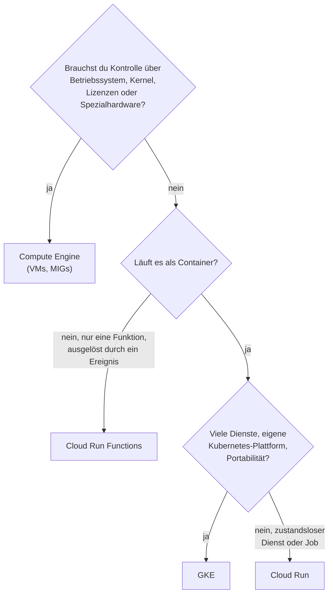

*App Engine fehlt bewusst: Für neue Anwendungen empfiehlt Google Cloud Run (Abschnitt 1.9).*

**Faustregel:** So viel verwalten lassen wie möglich. Je weiter rechts im Baum, desto weniger Betrieb (Patches,
Skalierung, Kapazität), aber auch weniger Kontrolle. Compute Engine ist richtig, wenn man die Kontrolle wirklich
braucht, nicht aus Gewohnheit.

---

### 1.1 Eine VM besteht aus vier Teilen

Eine Compute-Engine-VM ist die Kombination aus **Maschinentyp** (CPU und Speicher), **Image** (Betriebssystem auf
der Boot-Platte), **Platten** und **Netzwerkkarte(n)**.

**Maschinenfamilien:**

| Familie | Beispiele | wofür |
|---|---|---|
| **General purpose** | E2 (günstig), N2, N4, C3, C4 | Web-Server, Anwendungen, die meisten Workloads |
| **Compute-optimized** | C2, H3 | hohe Leistung pro Kern, HPC, Spiele-Server |
| **Memory-optimized** | M-Serie | sehr große In-Memory-Datenbanken (z. B. SAP HANA) |
| **Accelerator-optimized** | A-Serie, G2 | GPUs für Training und Inferenz |

Passt keine Größe, gibt es **Custom Machine Types** mit frei gewählter Zahl von vCPUs und Speicher. Wie groß eine VM
sein muss, weiß man oft erst im Betrieb: Man startet mit einer Größe ähnlich der bisherigen On-Prem-VM, installiert
den Monitoring-Agent und lässt sich vom **Rightsizing-Recommender** Empfehlungen geben.

**Von Google gewartet:** Bei Wartungsarbeiten am Host zieht Google laufende VMs per **Live Migration** auf einen anderen
Host um, ohne Neustart. Für mehr Sicherheit gibt es **Shielded VMs** (geprüfter Bootvorgang) und **Confidential VMs**
(verschlüsselter Arbeitsspeicher, siehe [4.7 Verschlüsselung und Schlüssel](#47-verschlüsselung-und-schlüssel)).

---

### 1.2 Images, Instanzvorlagen und Skripte

**Images.** Eine VM startet von einem Image: einem öffentlichen (Debian, Ubuntu, Windows Server …) oder einem
**eigenen Image**, das man aus einer konfigurierten Platte erstellt. **Image Families** zeigen immer auf die neueste
Version eines Images.

**Der wichtigste Zielkonflikt: Wann wird installiert?**

| Ansatz | Start einer neuen VM | Wann |
|---|---|---|
| **Startup Script** installiert Pakete beim Booten | langsam (Minuten), abhängig von externen Paketquellen | wenig Abhängigkeiten, häufige Änderungen |
| **eigenes Image** mit allem vorinstalliert („gebacken“) | schnell (Sekunden) | viele Abhängigkeiten, Autoscaling muss schnell reagieren |

Für Autoscaling zählt die Startzeit: Eine VM, die fünf Minuten installiert, hilft bei einer Lastspitze zu spät.
Deshalb lautet die typische Antwort: eigenes Image mit allen Abhängigkeiten, daraus eine Instanzvorlage, daraus eine
MIG.

**Instanzvorlage (Instance Template).** Beschreibt eine VM vollständig: Maschinentyp, Image, Platten, Netzwerk,
Service Account, Metadaten. Vorlagen sind **unveränderlich**; eine neue Version der Anwendung bedeutet eine neue
Vorlage.

**Metadaten und Skripte.** `startup-script` läuft bei jedem Start, `shutdown-script` beim Herunterfahren. Das
Shutdown-Script ist wichtig bei Spot-VMs (Abschnitt 1.4): Dort sichert die Anwendung ihren Zustand, bevor die VM
gestoppt wird.

---

### 1.3 Managed Instance Groups

Eine **Managed Instance Group (MIG)** erzeugt aus einer Instanzvorlage viele gleiche VMs und hält sie am Leben. Sie
kann drei Dinge, die einzelne VMs nicht können:

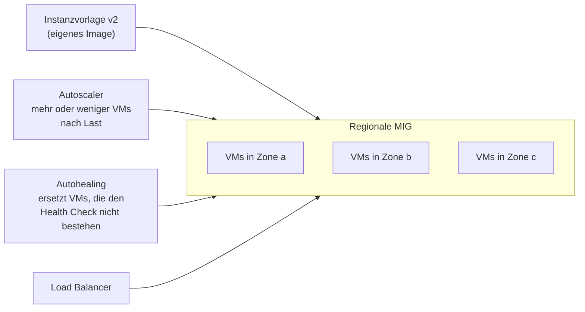

**Zonal oder regional.** Eine **zonale MIG** steht in einer Zone; fällt die Zone aus, ist alles weg. Eine
**regionale MIG** verteilt die VMs über mehrere Zonen einer Region und übersteht den Ausfall einer Zone. Für
Produktion ist die regionale MIG hinter einem Load Balancer die Standardantwort für „hochverfügbar über Zonen“.

**Autoscaling.** Der Autoscaler fügt VMs hinzu oder entfernt sie, gesteuert durch ein Signal:

| Signal | Beispiel |
|---|---|
| CPU-Auslastung | Ziel 60 % über alle VMs |
| Kapazität am Load Balancer | Anfragen pro Sekunde pro VM |
| Cloud-Monitoring-Metrik | Speicherauslastung (braucht den Ops Agent auf den VMs), Länge einer Pub/Sub-Warteschlange |
| Zeitplan | vor dem erwarteten Ansturm am Montagmorgen hochskalieren |

Zwei Fallen aus der Praxis:

- **Speicher als Signal:** Die Metrik des Agents hat für jeden Speicherzustand (`used`, `free`, `cached` …) eine eigene
  Zeitreihe. Soll bei „mehr als 80 % belegt“ skaliert werden, muss der Filter auf `state = used` stehen (oder
  gleichwertig: `free` mit Ziel 20 %).
- **Die Obergrenze:** Steigt die Latenz, obwohl der Autoscaler aktiv ist, steht die MIG oft schon auf ihrer
  **maximalen Instanzzahl**. Dann hilft nur, das Maximum zu erhöhen (und Quotas zu prüfen).

**Autohealing** ersetzt VMs, die einen Health Check nicht bestehen. Wichtig ist ein ausreichend langer **Initial
Delay**, sonst ersetzt die MIG VMs, die noch starten (Details und die typische Neustart-Schleife in
[3.11 Health Checks und Autohealing](#311-health-checks-und-autohealing)).

**Neue Version ausrollen.** Man gibt der MIG eine neue Instanzvorlage. Wie schnell die VMs ersetzt werden, bestimmt
der Update-Typ:

| Update-Typ | Verhalten | wann |
|---|---|---|
| **Proactive** | MIG ersetzt die VMs aktiv, schrittweise (`maxSurge`, `maxUnavailable`) | normale Releases |
| **Opportunistic** | MIG ersetzt eine VM erst, wenn sie ohnehin neu erstellt wird (Autoscaling, Autohealing) | unkritische Änderungen ohne Eile |
| **Canary** | zwei Vorlagen in einer MIG, z. B. 10 % auf v2 | neue Version erst an wenigen VMs prüfen |

**Stateful MIGs** behalten Namen, Platten und IPs einzelner VMs auch beim Ersetzen, für Anwendungen mit Zustand
(z. B. eine Datenbank-Replik pro VM).

---

### 1.4 Spot-VMs

**Spot-VMs** nutzen freie Kapazität in Googles Rechenzentren, mit **bis zu 91 % Rabatt**. Der Preis dafür: Google
kann sie **jederzeit** zurückholen, und es gibt **keine SLA**. Sie sind die neue Form der früheren *preemptible VMs*;
anders als diese (höchstens 24 Stunden Laufzeit) haben Spot-VMs keine Höchstlaufzeit.

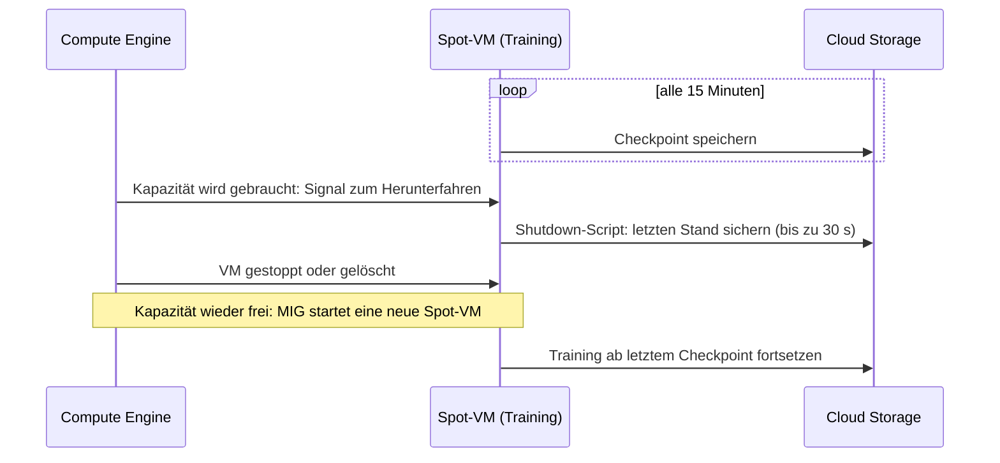

- Nach dem Signal bleiben **bis zu 30 Sekunden** (best effort) für das Shutdown-Script.
- Die **Termination Action** legt fest, ob die VM gestoppt (`STOP`, Standard) oder gelöscht (`DELETE`) wird.
- Geeignet für Arbeit, die eine Unterbrechung verträgt: Batch, Rendering, CI-Tests, ML-Training mit **Checkpoints**.
  Ungeeignet für Datenbanken und alles mit Nutzerverkehr ohne Ausweichkapazität.
- In einer MIG ersetzt die Gruppe zurückgeholte VMs automatisch, sobald wieder Kapazität da ist.

---

### 1.5 Sole-Tenant Nodes

Ein **Sole-Tenant Node** ist ein physischer Server, auf dem nur VMs des eigenen Projekts laufen. Zwei Gründe dafür:

- **Lizenzen (Bring Your Own License):** Manche Lizenzen, z. B. für Windows Server oder SQL Server, sind an physische
  Kerne oder Server gebunden. Wer vorhandene Lizenzen mitnehmen will, importiert das Image und startet die VMs auf
  Sole-Tenant Nodes.
- **Isolation und Compliance:** Vorgaben verlangen, dass Workloads nicht mit fremden Kunden auf einer Hardware
  laufen, oder dass bestimmte Workloads auf bestimmten Servern laufen. Per **Node Affinity Labels** steuert man,
  welche VM auf welchem Node landet.

Sole-Tenant Nodes kosten den ganzen Server, egal wie viele VMs darauf laufen.

---

### 1.6 Platten an der VM

| Speicher | Eigenschaft | wann |
|---|---|---|
| **Persistent Disk / Hyperdisk** (zonal) | Netzwerkplatte, überlebt die VM, Größe und Leistung einstellbar | Boot- und Datenplatten |
| **Regional Persistent Disk** | synchron in zwei Zonen gespiegelt | VM soll nach Zonenausfall in einer anderen Zone mit denselben Daten starten |
| **Local SSD** | physisch am Host, sehr schnell, **flüchtig** | Caches, Scratch-Daten; nach Stopp oder Ausfall weg |
| **Filestore** | NFS-Dateifreigabe für viele VMs | gemeinsame Dateien für eine VM-Flotte |

**Zonenausfall ohne Datenverlust:** Instanzvorlage für die Anwendung plus Regional Persistent Disk für die Daten. Fällt
die Zone aus, startet man eine neue VM aus der Vorlage in der zweiten Zone und hängt die regionale Platte an (per
Force-Attach).

Speicheroptionen im Vergleich (auch Cloud Storage und Datenbanken) stehen in [5. Data: Speicher, Datenbanken und Analytics](#5-data-speicher-datenbanken-und-analytics), Snapshots und Backups
in [6. Operations: Delivery, Betrieb, Ausfallsicherheit und Migration](#6-operations-delivery-betrieb-ausfallsicherheit-und-migration).

---

### 1.7 VMs betreiben: Agent, Patches, Zugang

- **Ops Agent:** sammelt Logs und Metriken aus dem Gastsystem (z. B. Speicherauslastung, Syslog, Anwendungslogs).
  Ohne Agent sieht Cloud Monitoring nur, was der Hypervisor von außen messen kann (CPU, Netzwerk, Platte), aber keinen
  Speicher. Admin-Activity-Logs der Google-APIs kommen dagegen ohne Agent.
- **VM Manager (OS Config):** Patch-Management für Hunderte VMs mit Zeitplänen, Inventar der installierten Pakete,
  OS-Richtlinien. Standardantwort auf „Betriebssysteme vieler VMs regelmäßig patchen“.
- **OS Login:** SSH-Zugang über IAM-Rollen statt über SSH-Schlüssel in den Metadaten; Zugang endet, wenn das Konto
  gesperrt wird.
- **Zugang ohne externe IP:** IAP TCP Forwarding (siehe [3.3 Firewall: wer darf mit wem sprechen](#33-firewall-wer-darf-mit-wem-sprechen)).
- **Zeitpläne:** **Instance Schedules** starten und stoppen VMs zu festen Zeiten, z. B. Entwicklungsumgebungen nur zu
  Bürozeiten. Für komplexere Logik: Cloud Scheduler löst eine Cloud Run Function aus.

---

### 1.8 GPUs und TPUs

> **Anknüpfung an ML-Praxis.** Für Training und Inferenz gibt es **accelerator-optimized** Maschinen mit GPUs (A-Serie,
> G2) und TPUs (über Vertex AI, GKE oder direkt als TPU-VMs). Drei Dinge entscheiden über Kosten und Verfügbarkeit:
>
> - **Kapazität ist knapp.** Für planbare Last sichert man GPUs mit **Reservierungen** (auch geteilt zwischen
>   Projekten, siehe [2. GKE: Google Kubernetes Engine](#2-gke-google-kubernetes-engine)); für Batch-Jobs, die warten können, gibt es den **Dynamic Workload
>   Scheduler**, der Kapazität bündelt bereitstellt.
> - **Spot-GPUs** kosten einen Bruchteil, brauchen aber Checkpoints (Abschnitt 1.4).
> - **Inferenz ohne eigene VMs:** Cloud Run kann inzwischen GPUs (NVIDIA L4, RTX PRO 6000) nutzen und auch dann auf
>   null skalieren (Abschnitt 1.9).

---

### 1.9 Serverless: Cloud Run, Functions, App Engine

Serverless heißt: Man gibt Code oder einen Container ab, Google kümmert sich um Server, Skalierung und Patches. Man
zahlt (meist) nur, solange Anfragen verarbeitet werden.

#### Cloud Run

Cloud Run führt **Container** aus und skaliert sie nach Anfragen, **bis auf null**.

- **Services** beantworten HTTP-Anfragen; **Jobs** laufen bis zum Ende (Batch); **Functions** sind die
  Funktions-Variante (siehe unten).
- **Concurrency:** Eine Instanz bearbeitet standardmäßig bis zu **80 Anfragen gleichzeitig**; das spart Instanzen
  gegenüber „eine Anfrage pro Instanz“.
- **Timeout:** Standard 5 Minuten, einstellbar bis **60 Minuten**.
- **Kaltstart:** Skaliert ein Dienst von null hoch, dauert die erste Anfrage länger. Abhilfe: **Mindestinstanzen**
  (kosten dafür auch ohne Anfragen).
- **Ins VPC:** Direct VPC egress; **mehrere Regionen hinter einer IP:** Serverless NEGs am globalen Load Balancer (beides
  in [3. Networking: VPC, Verbindungen und Load Balancing](#3-networking-vpc-verbindungen-und-load-balancing)).

**Revisionen und Traffic-Splitting.** Jedes Deployment erzeugt eine unveränderliche **Revision**. Den Verkehr kann man
prozentual auf Revisionen verteilen, z. B. erst 5 % auf die neue Version (Canary), dann schrittweise mehr, und bei
Problemen sofort zurück:

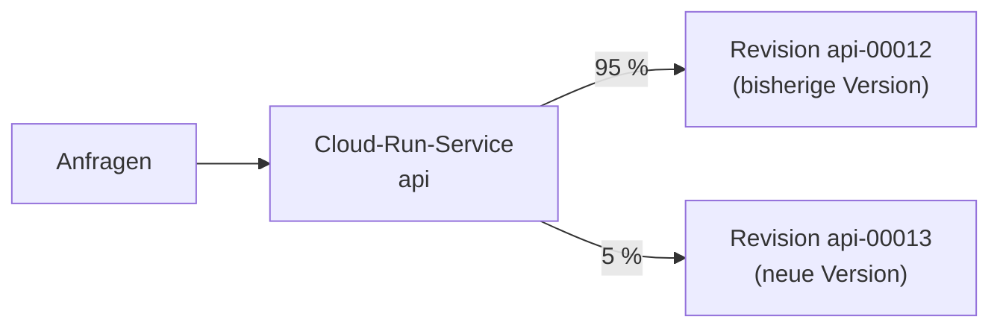

#### Cloud Run Functions

Ein einzelnes Stück Code (Python, Node.js, Go …), das auf ein **Ereignis** reagiert: eine HTTP-Anfrage, eine Datei in
Cloud Storage, eine Pub/Sub-Nachricht, ein Ereignis aus Eventarc. Es skaliert auf null und passt für kleine,
ereignisgetriebene Aufgaben und für ein schnelles MVP, das nur zu Bürozeiten genutzt wird.

#### App Engine

Die älteste Serverless-Plattform von Google. Für neue Anwendungen empfiehlt Google inzwischen **Cloud Run**. In
Prüfungsfragen taucht App Engine trotzdem oft auf:

| | App Engine **standard** | App Engine **flexible** | Cloud Run |
|---|---|---|---|
| Deployment | Quellcode, vorgegebene Runtimes | Quellcode oder eigener Container | Quellcode oder Container |
| skaliert auf null | ja | nein (mindestens 2 Instanzen) | ja |
| Timeout | 10 Min. (automatische Skalierung) | 60 Min. | bis 60 Min. |
| typisch in Fragen | schnelle Skalierung, wenig Betrieb | eigene Bibliotheken, VPN/VPC-Zugang | moderne Standardwahl |

**Versionen und Traffic-Splitting** gibt es auch bei App Engine: Eine neue Version wird deployt, ohne Verkehr zu
bekommen (`--no-promote`), und dann schrittweise oder auf einmal freigeschaltet. Das macht App Engine in älteren
Fragen zur Antwort auf „Entwickler stellen Versionen bereit, der Betrieb schaltet sie frei“.

#### Drumherum: Zeitpläne, Aufgaben, Abläufe

| Dienst | wofür |
|---|---|
| **Cloud Scheduler** | Cron in der Cloud: löst zu festen Zeiten HTTP-Aufrufe oder Pub/Sub-Nachrichten aus |
| **Cloud Tasks** | Warteschlange für einzelne Aufgaben mit Wiederholung und Ratenbegrenzung |
| **Eventarc** | leitet Ereignisse aus Google-Diensten an Cloud Run weiter |
| **Workflows** | mehrere Schritte und Dienste in einer festen Reihenfolge orchestrieren |

Zuverlässige zeitgesteuerte Verarbeitung entsteht so: Cloud Scheduler schreibt nach Plan in ein Pub/Sub-Topic, ein
Dienst abonniert es und arbeitet die Nachrichten ab. Fällt der Dienst kurz aus, bleiben die Nachrichten erhalten.

---

### 1.10 Kosten

| Hebel | Was er bringt |
|---|---|
| **Spot-VMs** | bis zu 91 % günstiger für unterbrechbare Arbeit |
| **Committed Use Discounts (CUD)** | Rabatt für eine Zusage über 1 oder 3 Jahre (pro Ressource oder pro Ausgaben) |
| **Sustained Use Discounts** | automatischer Rabatt bei Dauerbetrieb für manche Maschinenfamilien |
| **Rightsizing** | Recommender schlägt kleinere Maschinentypen vor, wenn VMs dauerhaft wenig ausgelastet sind |
| **Leerlauf finden** | Recommender listet ungenutzte VMs und Platten (`gcloud recommender …`) |
| **Zeitpläne** | Entwicklungs-VMs nachts und am Wochenende stoppen (Instance Schedules) |
| **Autoscaling** | nur so viele VMs wie die Last braucht, statt für die Spitze zu planen |
| **Serverless** | Cloud Run und Functions kosten nichts, solange keine Anfragen kommen (ohne Mindestinstanzen) |

Gestoppte VMs kosten keine Rechenleistung mehr, ihre Platten aber weiter. Sole-Tenant Nodes und reservierte Kapazität
kosten auch ungenutzt.

---

### 1.11 Prüfungssignale: Spickzettel

| Wenn die Frage sagt … | … ist die Antwort meist |
|---|---|
| viele Paketabhängigkeiten, neue VMs sollen schnell starten | eigenes Image mit allem, daraus Instanzvorlage und MIG |
| zustandslose Anwendung, tagsüber viel, nachts wenig | eigenes Image, Instanzvorlage, MIG mit Autoscaling |
| hochverfügbar über Zonen | regionale MIG (über alle Zonen) hinter Load Balancer |
| nach Speicherauslastung skalieren | Ops Agent, Monitoring-Metrik mit `state = used` als Signal |
| Latenz steigt, Autoscaler läuft schon | maximale Instanzzahl der MIG erhöhen |
| unkritisches Update ohne Eile | Rolling Update im Modus Opportunistic |
| VMs der MIG starten ständig neu | Autohealing bzw. Initial Delay prüfen, Check zur Diagnose abschalten |
| Batch-Jobs, die nicht zeitkritisch sind, günstig | Spot-VMs (früher preemptible) |
| Anwendung vor dem Abschalten sauber beenden | Shutdown-Script in den Metadaten |
| GPU-Batch günstig und robust | Spot-VMs mit Persistent Disk und Checkpoints |
| Windows-Lizenzen mitnehmen | Image importieren, VMs auf Sole-Tenant Nodes |
| Workload muss auf bestimmten Servern laufen | Sole-Tenant Nodes mit Node Affinity Labels |
| nach Zonenausfall in anderer Zone mit Daten neu starten | Instanzvorlage plus Regional Persistent Disk |
| Größe der VM unklar | ähnlich wie bisher starten, Monitoring-Agent, Rightsizing-Empfehlungen |
| viele Linux-VMs patchen | VM Manager mit Patch-Jobs |
| Speicher- und Systemlogs der VMs sammeln | Ops Agent (früher Logging-/Monitoring-Agent) |
| Dev- und Staging-VMs nur zu Bürozeiten | Instance Schedules (oder Cloud Scheduler plus Function) |
| zuverlässige zeitgesteuerte Verarbeitung | Cloud Scheduler → Pub/Sub → verarbeitender Dienst |
| zustandsloser Container, schwankende Last, schrittweise Releases | Cloud Run mit Traffic-Splitting zwischen Revisionen |
| MVP nur zu Bürozeiten, minimale Kosten | Cloud Run Functions (oder Cloud Run) |
| HTTP-API mit schneller Skalierung, wenig Betrieb (ältere Frage) | App Engine standard |
| App Engine soll ins Rechenzentrum per VPN (ältere Frage) | App Engine flexible (heute auch Serverless VPC Access) |
| nach Lift-and-Shift modernisieren | GKE mit Containern oder App Engine bzw. Cloud Run |

---

### 1.12 Alte und neue Namen

| In älteren Fragen | Heute |
|---|---|
| preemptible VMs | Spot-VMs |
| Cloud Functions | Cloud Run Functions |
| Stackdriver Logging-/Monitoring-Agent | Ops Agent |
| App Engine Cron | Cloud Scheduler |
| Cloud Run for Anthos | Knative serving auf GKE |
| Deployment Manager | Terraform oder Infrastructure Manager |
| OS patch management | VM Manager (Patch) |

---

### 1.13 Quellen

- [Machine families](https://docs.cloud.google.com/compute/docs/machine-resource) ·
  [Custom images](https://docs.cloud.google.com/compute/docs/images/create-custom) ·
  [Instance templates](https://docs.cloud.google.com/compute/docs/instance-templates)
- [Managed instance groups](https://docs.cloud.google.com/compute/docs/instance-groups) ·
  [Autoscaling](https://docs.cloud.google.com/compute/docs/autoscaler) ·
  [Updating MIGs](https://docs.cloud.google.com/compute/docs/instance-groups/updating-migs)
- [Spot VMs](https://docs.cloud.google.com/compute/docs/instances/spot)
  (bis zu 91 %, keine SLA, bis zu 30 s zum Herunterfahren, keine Höchstlaufzeit)
- [Sole-tenant nodes](https://docs.cloud.google.com/compute/docs/nodes/sole-tenant-nodes) ·
  [Regional Persistent Disk](https://docs.cloud.google.com/compute/docs/disks/high-availability-regional-persistent-disk)
- [Ops Agent](https://docs.cloud.google.com/stackdriver/docs/solutions/agents/ops-agent) ·
  [VM Manager](https://docs.cloud.google.com/compute/docs/vm-manager) ·
  [Instance schedules](https://docs.cloud.google.com/compute/docs/instances/schedule-instance-start-stop)
- [Cloud Run](https://docs.cloud.google.com/run/docs/overview/what-is-cloud-run) ·
  [GPUs on Cloud Run](https://docs.cloud.google.com/run/docs/configuring/services/gpu)
  (L4 und RTX PRO 6000, Skalierung auf null)
- [App Engine vs. Cloud Run](https://docs.cloud.google.com/appengine/migration-center/run/compare-gae-with-run)
  (Google empfiehlt Cloud Run für neue Nutzer; Timeouts und Concurrency)
- [Cloud Scheduler](https://docs.cloud.google.com/scheduler/docs/overview) ·
  [Committed use discounts](https://docs.cloud.google.com/compute/docs/instances/committed-use-discounts-overview)

[↑ Back to top](#google-cloud-architecture-professional-cloud-architect)

---

## 2. GKE: Google Kubernetes Engine

Lernnotiz zur Prüfung Professional Cloud Architect (PCA). GKE gehört dort zu den häufigsten Themen: Architektur,
Skalierung, Rollouts, Netzwerk und Supply-Chain-Sicherheit. Die Notiz erklärt die Konzepte an einem durchgehenden
Beispiel und endet mit einem Spickzettel typischer Fragemuster.

*Prüfungsfragen benutzen oft alte Namen (Google Container Engine, Stackdriver, Container Registry,
Anthos, kubemci); die heutigen Namen stehen in [Abschnitt 2.11](#211-alte-namen-in-den-fragen).*

---

### 2.0 Das Bild zuerst: eine ML-Plattform auf GKE

Ein konkretes Beispiel, an dem alle Begriffe hängen. Ein Team betreibt auf einem GKE-Cluster vier Dinge:

| Teil | Eigenschaft | Kubernetes-Objekt |
|---|---|---|
| **Embedding-API** (FastAPI, 3 Kopien, hinter HTTPS) | zustandslos: jede Kopie ist austauschbar | **Deployment** + **Service** + **Ingress** |
| **Vektordatenbank** (3 Knoten, jeder mit eigener Platte) | zustandsbehaftet: Knoten 0 bleibt Knoten 0 | **StatefulSet** mit Persistent Volumes |
| **Log-Agent** auf jeder Maschine | genau einer pro Node | **DaemonSet** |
| **nächtlicher Re-Index** | läuft, endet, fertig | **CronJob** (startet **Jobs**) |

Die Embedding-API skaliert mit der Last, die Vektordatenbank nicht. Der Re-Index darf auf billigen Spot-VMs laufen,
weil ein abgebrochener Lauf einfach neu startet. So sieht das im Cluster aus:

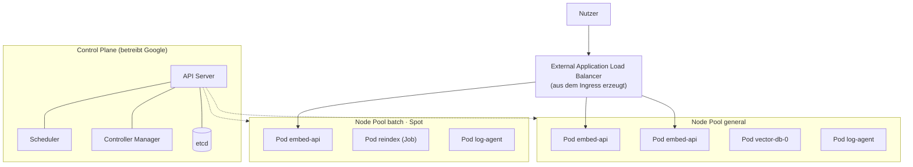

*Die Control Plane entscheidet, was wo läuft; die Nodes führen es aus. Du sprichst nur mit dem API Server
(per `kubectl`).*

---

### 2.1 Architektur: Control Plane, Nodes, Pods

**Pod.** Die kleinste Einheit: ein oder mehrere Container, die sich Netzwerk (eine IP) und Volumes teilen. Ein
zweiter Container im selben Pod heißt *Sidecar*, z. B. der Cloud SQL Auth Proxy neben der App.

**Node.** Eine Compute-Engine-VM, auf der Pods laufen. **Node Pool**: eine Gruppe gleich konfigurierter Nodes
(gleicher Maschinentyp, z. B. ein GPU-Pool und ein Standard-Pool). Technisch ist ein Node Pool eine Managed
Instance Group.

**Control Plane.** API Server, Scheduler, Controller und die Datenbank etcd. Bei GKE betreibt Google sie; du
siehst sie nicht als VM.

**Der wichtigste Mechanismus: Soll und Ist.** Du schreibst in YAML, was sein *soll* („3 Kopien von embed-api“).
Controller vergleichen das ständig mit dem *Ist* und gleichen es an. Stirbt ein Pod, startet der Controller einen
neuen. Fast jede Prüfungsantwort zu Selbstheilung, Rollouts und Skalierung folgt aus diesem einen Prinzip.

**Werkzeuge**:

- `gcloud container clusters …` verwaltet den **Cluster** als Google-Cloud-Ressource (anlegen, Node Pools,
  Autoscaling einschalten, Upgrades).
- `kubectl …` verwaltet **Kubernetes-Objekte im Cluster** (Deployments, Services, Rollouts).

#### Standard vs. Autopilot

| | Standard | Autopilot |
|---|---|---|
| Nodes und Node Pools | verwaltest du | verwaltet Google (Node Auto-Provisioning) |
| Abrechnung | pro Node (VM), auch wenn er halb leer ist | pro Pod, nach dessen Resource Requests |
| Freiheit | volle Kontrolle (Maschinentypen, privilegierte Pods, eigene DaemonSets) | eingeschränkt, dafür sichere Voreinstellungen |
| Prüfungssignal | „volle Kontrolle“, spezielle Node-Konfiguration | „Team neu bei Kubernetes“, „Betriebsaufwand senken“ |

#### Zonal vs. regional

- **Zonaler Cluster:** eine Control-Plane-Kopie in einer Zone. Während eines Control-Plane-Upgrades ist die API kurz
  nicht erreichbar.
- **Regionaler Cluster:** Control Plane und Nodes über drei Zonen verteilt. Fällt eine Zone aus, läuft der
  Cluster weiter. Für Produktion die Standardantwort, wenn nach Hochverfügbarkeit gefragt wird.
- **Mehrere Regionen** brauchen **mehrere Cluster** plus Multi-Cluster-Routing (Abschnitt 2.9).

---

### 2.2 Workloads: welches Objekt wofür

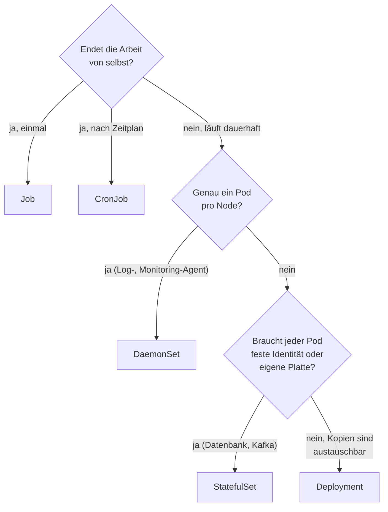

- **Deployment** verwaltet ein ReplicaSet, das die Zahl der Pod-Kopien hält. Standard für zustandslose Dienste
 .
- **StatefulSet** gibt jedem Pod einen festen Namen mit Nummer (`vector-db-0`, `vector-db-1`), der Neustarts und
  Umzüge überlebt, und jedem Pod sein eigenes Persistent Volume (`volumeClaimTemplates`). Prüfungssignal:
  feste Hostnamen, auch wenn Pods skaliert oder neu gestartet werden.
- **DaemonSet** startet auf jedem Node genau einen Pod, auch auf neu hinzukommenden Nodes.
- **Job / CronJob** für Batch: läuft bis zum Erfolg, wiederholt bei Fehlern.

**Speicher.** Ein Pod schreibt nicht dauerhaft in sein Dateisystem; das ist nach einem Neustart weg. Dauerhafte
Daten liegen auf einem **PersistentVolume** (bei GKE eine Persistent Disk über den CSI-Treiber), angefordert per
**PersistentVolumeClaim**. Für zonale Ausfallsicherheit gibt es Regional Persistent Disks. Für Dateifreigaben, die
viele Pods gleichzeitig beschreiben, Filestore.

---

### 2.3 Netzwerk: Services, Ingress, private Nodes

#### Das Problem, das Services lösen

Pods kommen und gehen, und jeder neue Pod bekommt eine neue IP. Ein anderer Dienst kann sich diese IPs nicht merken.
Ein **Service** gibt einer Gruppe von Pods (ausgewählt über Labels) eine **feste IP und einen DNS-Namen**, z. B.
`embed-api.default.svc.cluster.local`, und verteilt die Anfragen auf die gerade gesunden Pods.

| Typ | Erreichbar von | Was GKE anlegt | Wofür |
|---|---|---|---|
| `ClusterIP` (Standard) | nur im Cluster | nichts außerhalb | Microservice zu Microservice |
| `NodePort` | Port auf jedem Node | nichts | selten direkt; Baustein für Load Balancer |
| `LoadBalancer` | außen (oder intern per Annotation) | Passthrough Network Load Balancer (L4) | TCP/UDP-Dienste, nicht-HTTP |
| **Ingress** | außen, HTTP(S) | External Application Load Balancer (L7) | HTTPS, URL-Pfade, Zertifikate |
| **Gateway** (Gateway API) | außen oder intern, L7 | Application Load Balancer, auch über mehrere Cluster | Nachfolger von Ingress, Multi-Cluster |

**Container-native Load Balancing.** Der Load Balancer schickt Anfragen über **Network Endpoint Groups (NEGs)**
direkt an die Pod-IPs statt erst an einen Node, der weiterleitet. Das spart einen Sprung und verteilt gleichmäßiger.
Möglich ist das, weil Pods in **VPC-nativen Clustern** echte VPC-IPs haben (siehe unten).

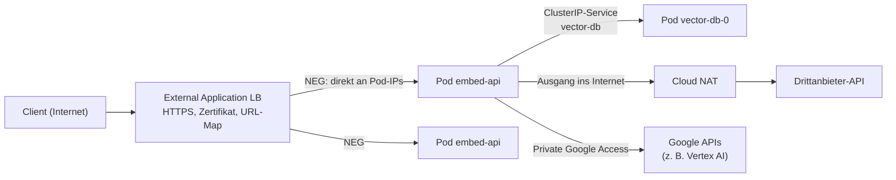

#### VPC-native Cluster (Alias-IPs)

In einem VPC-nativen Cluster hat das Subnetz der Nodes zwei **sekundäre IP-Bereiche**: einen für Pods, einen für
Services. Pod-IPs sind damit normale VPC-Adressen. Folgen:

- Andere VMs, Peering-Netze und On-Prem (über VPN/Interconnect) erreichen Pods direkt.
- Firewall-Regeln und NEGs funktionieren auf Pod-Ebene.
- **IP-Planung zählt:** Pods verbrauchen viele Adressen. Ein zu kleiner Pod-Bereich begrenzt, wie viele Nodes der
  Cluster haben kann. Das ist eine typische Falle bei Shared VPC.

#### Private Nodes und der Zugang zur Control Plane

Heute beschreibt die GKE-Doku das als **Netzwerkisolation** mit zwei getrennten Fragen; die Prüfungsfragen sagen
dazu meist noch „private cluster“.

1. **Nodes:** *Private Nodes* haben nur interne IPs und sind von außen nicht erreichbar. Weil sie keine externe IP
   haben, kommen sie **ohne Cloud NAT nicht ins Internet** (z. B. zu einer Drittanbieter-API). Google-APIs
   erreichen sie über Private Google Access.
2. **Control Plane:** Empfohlen ist der **DNS-basierte Endpunkt**: ein fester DNS-Name, Zugriff über IAM, ohne
   Bastion-Host. Daneben gibt es **IP-basierte Endpunkte** (extern und intern, oder nur intern). Für IP-basierte
   Endpunkte gilt: **Authorized Networks** einschalten, eine IP-Firewall vor der Control Plane mit bis zu 100
   Bereichen. Die Prüfungsantwort für „maximal abgeschottet“ ist der private Endpunkt plus Authorized Networks
  .

**Folge für CI/CD:** Ein Deploy-Werkzeug im Internet erreicht einen privaten Endpunkt nicht. Lösung: ein **Cloud
Build Private Pool**, der per Peering im selben VPC hängt, und Cloud Deploy nutzt diesen Pool.

**Datenbanken anbinden.** Für Cloud SQL läuft der **Cloud SQL Auth Proxy** als Sidecar im Pod: Er authentifiziert
über IAM und verschlüsselt die Verbindung. Bei Verbindungsproblemen liest man die Logs von App, Proxy und Cloud SQL
.

---

### 2.4 Skalierung: zwei Ebenen

Das wichtigste Missverständnis zuerst: **Der Cluster Autoscaler schaut nicht auf die CPU-Last.** Er fügt Nodes hinzu,
wenn Pods **nicht eingeplant werden können**, weil ihre *Requests* auf keinen Node mehr passen. Die CPU-Last bringt
nur der **HorizontalPodAutoscaler** ins Spiel. Deshalb braucht „skaliere Nodes nach CPU-Last“ beides.

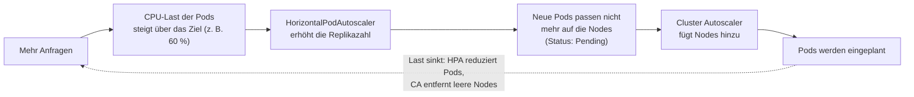

**Ein Rechenbeispiel.** Jeder embed-api-Pod fordert `cpu: 500m` an (eine halbe vCPU). Angenommen, auf einem Node
sind nach Systemreserven 3,5 vCPU nutzbar. Dann passen 7 Pods auf einen Node. Will der HPA 10 Pods, bleiben 3 im
Status *Pending*, und erst *das* löst den Cluster Autoscaler aus: Er startet einen zweiten Node. Fordert der Pod zu
wenig an (z. B. `100m`, braucht aber 400m), packt der Scheduler zu viele Pods auf einen Node, die Pods bremsen sich
gegenseitig, und der Cluster Autoscaler merkt nichts.

| Werkzeug | Ändert | Auslöser |
|---|---|---|
| **HorizontalPodAutoscaler (HPA)** | Zahl der Pods | CPU, Speicher, eigene oder externe Metriken |
| **VerticalPodAutoscaler (VPA)** | Requests eines Pods | gemessener Verbrauch (macht Requests passend) |
| **Cluster Autoscaler** | Zahl der Nodes im Node Pool | Pods im Status Pending; leere Nodes werden entfernt |
| **Node Auto-Provisioning** | legt passende Node Pools an | Pods, für die es keinen passenden Pool gibt (bei Autopilot immer an) |

**Externe Metriken.** Ein Pub/Sub-Konsument, der in Filestore schreibt, ist durch I/O begrenzt; seine CPU bleibt
niedrig, CPU-Skalierung greift nie. Richtig ist der HPA auf die Metrik
`subscription/num_undelivered_messages`, also auf die Länge der Warteschlange.

**Requests und Limits**:

- **Request:** was der Scheduler für den Pod reserviert. Grundlage für Einplanung und Cluster Autoscaler.
- **Limit:** Obergrenze. Über dem CPU-Limit wird gedrosselt, über dem Speicher-Limit wird der Container beendet
  (OOMKilled).
- Setzt man nur ein Limit, setzt Kubernetes den Request gleich dem Limit. Das reserviert oft zu viel. Faustregel:
  Requests knapp über dem typischen Verbrauch.

**Kosten**: Ein fester Pool von 200 Nodes ist teuer. HPA für die Pods plus Cluster Autoscaler für die Nodes
passt die Kapazität der Last an. Fehlertolerante Batch-Jobs laufen auf einem **Spot-VM-Node-Pool**.

> **Anknüpfung an ML-Praxis.** Für GPU-Inferenz skaliert man selten nach CPU, sondern nach Warteschlangenlänge oder
> Anfragen pro Sekunde (externe oder eigene Metrik). Training auf Spot-GPUs braucht Checkpoints, weil Spot-Nodes
> jederzeit zurückgeholt werden können. Knappe GPUs sichert man mit **Reservierungen**; eine *Shared Reservation* in
> einem eigenen Projekt können Produktion und Entwicklung gemeinsam nutzen.

---

### 2.5 Rollouts und Zuverlässigkeit

Ein **Rolling Update** ersetzt alte Pods schrittweise durch neue. Ausgelöst wird es, indem man das Image im
Deployment ändert, z. B. `kubectl set image deployment/echo-deployment app=…:v2`. Zwei Parameter steuern das
Tempo: `maxSurge` (wie viele zusätzliche Pods kurz erlaubt sind) und `maxUnavailable` (wie viele fehlen dürfen).
Zurück geht es mit `kubectl rollout undo`.

Damit das ohne Ausfall klappt, muss Kubernetes wissen, **wann ein neuer Pod wirklich bereit ist**. Dafür gibt es
Probes:

| Probe | Frage | Folge bei Fehlschlag |
|---|---|---|
| **readinessProbe** | Darf der Pod Anfragen bekommen? | Pod bekommt keinen Verkehr; der Rollout wartet, alte Pods laufen weiter |
| **livenessProbe** | Lebt der Container noch? | Container wird neu gestartet |
| **startupProbe** | Ist der langsame Start fertig? | schützt langsam startende Apps vor der Liveness-Probe |

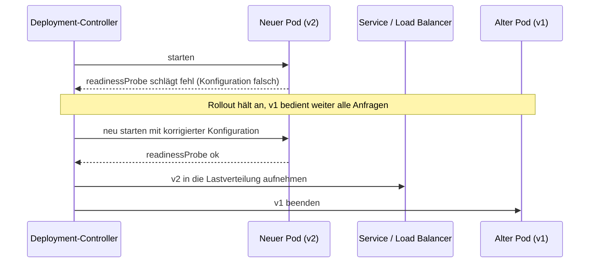

*Ohne readinessProbe gilt ein Pod als bereit, sobald der Container läuft. Ein falsch konfigurierter v2-Pod bekäme
sofort Verkehr, und v1 würde abgebaut.*

**Fehlersuche bei Neustarts.** Starten alle Pods alle paar Sekunden neu (*CrashLoopBackOff*), steht der Grund fast
immer im Log des Containers. GKE schickt alles, was Container nach stdout und stderr schreiben, an Cloud Logging
.

**Weitere Mittel:** *PodDisruptionBudgets* begrenzen, wie viele Pods bei Wartung gleichzeitig fehlen dürfen.
Canary-Releases (erst wenige Prozent Verkehr auf v2) gehen mit Cloud Deploy oder einem Service Mesh. Vor dem Start
prüft man die Kapazität mit einem echten **Lasttest**, nicht mit Schätzungen.

---

### 2.6 Sicherheit und Supply Chain

#### Workload Identity: Pods ohne Schlüssel

**Problem:** Eine App im Pod will Cloud Storage lesen. Ein Service-Account-Schlüssel als Datei im Container ist ein
Geheimnis, das ausläuft, kopiert werden kann und rotiert werden muss.

**Lösung:** **Workload Identity Federation for GKE**. Der Pod läuft mit einem Kubernetes-Service-Account (KSA). Google
Cloud erkennt diesen KSA als IAM-Principal, und man gibt ihm IAM-Rollen direkt (oder lässt ihn einen Google-Service-
Account verwenden). Die App bekommt kurzlebige Tokens über den Metadaten-Server, wie überall sonst in Google Cloud.
Kein Schlüssel verlässt Google.

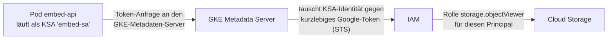

Für Workloads **außerhalb** von Google Cloud (On-Prem, andere Kubernetes-Cluster) gibt es **Workload Identity
Federation** mit einem externen Identitätsanbieter, z. B. Active Directory; ebenfalls ohne Schlüssel.

**IAM vs. RBAC.** IAM regelt, wer den *Cluster* verwalten darf (Google-Cloud-Ebene). Kubernetes-RBAC regelt, wer
*im* Cluster welche Objekte ändern darf (z. B. nur im Namespace `team-a`). Beide gelten zusammen.

#### Supply Chain: nur geprüfte Images in Produktion

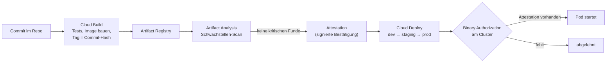

- **Binary Authorization** erzwingt am Cluster eine Richtlinie: Ein Image läuft nur mit den nötigen Attestations,
  z. B. „Tests bestanden“ und „Scan sauber“. Damit kann niemand ein ungeprüftes Image direkt in Produktion
  deployen.
- **Artifact Analysis** scannt Images in Artifact Registry auf bekannte Schwachstellen; Cloud Build erzeugt dazu
  Provenance-Metadaten (SLSA). Dazu gehört: von Google gepflegte, schlanke Basis-Images verwenden und schon
  vor dem Build scannen (Shift-left).

#### Weitere Härtung

- **Shielded GKE Nodes:** Secure Boot und Integritätsprüfung der Node-VMs.
- **Confidential GKE Nodes:** Speicher der Nodes zur Laufzeit verschlüsselt, z. B. für Training auf sensiblen Daten
 .
- **Audit-Trail:** Cloud Audit Logs für die Google-Cloud-Ebene plus GKE Audit Logging für die Kubernetes-API
 .
- **Compliance:** GKE und Google Cloud liefern die Bausteine für eine PCI-DSS-konforme Umgebung; die Konformität
  selbst bleibt Aufgabe des Kunden (Shared Responsibility).

---

### 2.7 CI/CD für Container

Die Kette ist in fast allen CI/CD-Fragen dieselbe:

1. Push ins Repository löst einen **Cloud-Build-Trigger** aus.
2. Erst schnelle Unit-Tests, dann **ein** Image bauen.
3. Image mit dem **Commit-Hash** taggen, nicht mit `latest`. Nur so ist jede Produktionsversion eindeutig einem
   Commit zugeordnet und auditierbar.
4. Image nach **Artifact Registry** pushen.
5. **Cloud Deploy** befördert *dasselbe* Image durch die Umgebungen; getestet wird in Staging, nicht neu gebaut.

**Dockerfile schneller machen**: kleines Basis-Image (z. B. Alpine oder distroless) und die Reihenfolge der
Schichten beachten. Erst Abhängigkeiten installieren, dann den Quellcode kopieren. So bleibt die teure
Abhängigkeitsschicht im Cache, wenn sich nur der Code ändert.

**Open-Source-Bausteine**: Wer Portabilität verlangt, bekommt Kubernetes (GKE), Helm für Pakete und Jenkins
für CI/CD.

**Infrastruktur als Code im Kubernetes-Stil**: **Config Connector** bildet Google-Cloud-Ressourcen (Buckets,
Cloud SQL) als Kubernetes-Objekte ab. **Config Controller** ist die verwaltete Variante davon (mit Config Sync). Wer
ohnehin in Kubernetes-YAML denkt, verwaltet so auch die Cloud-Ressourcen.

---

### 2.8 Betrieb und Observability

| Aufgabe | Werkzeug |
|---|---|
| Logs der Container | Cloud Logging (stdout und stderr werden automatisch eingesammelt) |
| Logging und Monitoring nachträglich einschalten | Cloud Operations for GKE per Cluster-Update, ohne Neuaufbau |
| Cluster überwachen, alarmieren | vordefinierte GKE-Dashboards in Cloud Monitoring, dann Alerting Policies |
| Prometheus-Metriken | Managed Service for Prometheus |
| Latenz über mehrere Microservices | Cloud Trace; der `traceparent`-Header muss zwischen den Diensten weitergereicht werden |
| Telemetrie zwischen Diensten, SLOs | Service Mesh: Topologie-Ansicht, SLO und Alert in der Console |
| Ausfall eines Dienstes testen | Fault Injection im Service Mesh (Istio) |

---

### 2.9 Viele Cluster: Fleet und GKE Enterprise

Ab mehreren Clustern (mehrere Regionen, Umgebungen oder Clouds) fasst man sie zu einer **Fleet** zusammen und
verwaltet sie gemeinsam. Diese Funktionen hießen früher **Anthos**, dann **GKE Enterprise**.

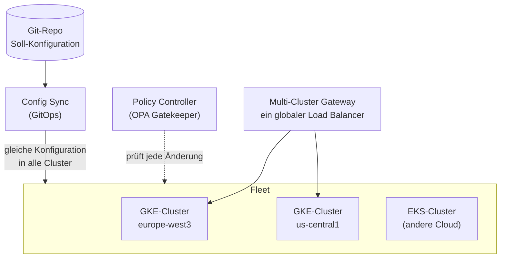

- **Config Sync** zieht die Konfiguration aus einem Git-Repository in alle Cluster und hält sie dort gleich.
  **Policy Controller** setzt Regeln durch (z. B. „keine privilegierten Container“).
- **Multi-Cluster Gateway** (früher Multi Cluster Ingress, noch früher das Werkzeug `kubemci`): ein globaler
  Application Load Balancer vor Clustern in mehreren Regionen. Nutzer landen beim nächsten gesunden Cluster
 .
- **Cloud Service Mesh** (früher Anthos Service Mesh, auf Basis von Istio): mTLS zwischen Diensten, Telemetrie,
  Traffic-Steuerung, SLOs.

---

### 2.10 Kosten

| Hebel | Was er bringt |
|---|---|
| **Abrechnungsmodell kennen** | beide Modi: eine Gebühr pro Cluster. Dazu bei Standard die Nodes (VMs), auch halb leere; bei Autopilot die **Resource Requests** der Pods |
| **Requests passend setzen** | zu hohe Requests reservieren Kapazität, die niemand nutzt (bei Autopilot direkt auf der Rechnung); der VerticalPodAutoscaler schlägt passende Werte vor |
| **HPA plus Cluster Autoscaler** | Pods und Nodes folgen der Last, statt dauerhaft für die Spitze bereitzustehen |
| **Spot-Node-Pools** | fehlertolerante Workloads (Batch, CI, Training mit Checkpoints) deutlich günstiger |
| **Committed Use Discounts** | Rabatt für die Grundlast, die ohnehin immer läuft |
| **Kosten zuordnen** | GKE Cost Allocation verteilt die Kosten im Billing Export auf Namespaces und Labels, z. B. pro Team |
| **Scale-down nicht blockieren** | Pods ohne Controller, strenge PodDisruptionBudgets oder `safe-to-evict: false` verhindern, dass leere Nodes verschwinden |

---

### 2.11 Alte Namen in den Fragen

| In der Frage | Heute |
|---|---|
| Google Container Engine | Google Kubernetes Engine (GKE) |
| Stackdriver Logging / Monitoring | Cloud Logging / Cloud Monitoring (Cloud Operations) |
| Container Registry | Artifact Registry (Container Registry ist abgekündigt) |
| Anthos, Anthos GKE | GKE Enterprise, Fleet |
| Anthos Service Mesh | Cloud Service Mesh |
| `kubemci`, Multi Cluster Ingress | Multi-Cluster Gateway (Gateway API) |
| master, master authorized networks | Control Plane, Authorized Networks |
| private cluster | Private Nodes plus Control-Plane-Endpunkte (DNS-basiert oder IP-basiert) |
| Kritis (Signieren im CI/CD) | Attestations für Binary Authorization |

---

### 2.12 Prüfungssignale: Spickzettel

| Wenn die Frage sagt … | … ist die Antwort meist |
|---|---|
| Nodes nach CPU-Last hinzufügen | HPA **und** Cluster Autoscaler |
| feste Hostnamen trotz Neustart | StatefulSet |
| Update mit minimaler Ausfallzeit | Rolling Update (`kubectl set image`) |
| Rollouts verursachen Ausfälle durch Fehlkonfiguration | readinessProbe und livenessProbe |
| Pods starten ständig neu | Container-Logs in Cloud Logging lesen |
| Pub/Sub-Konsument kommt nicht hinterher, CPU niedrig | HPA auf `num_undelivered_messages` |
| Team neu bei Kubernetes, wenig Betriebsaufwand | Autopilot |
| private Nodes brauchen Internet | Cloud NAT |
| Control Plane maximal abschotten | privater Endpunkt plus Authorized Networks |
| Deploy in Cluster mit privatem Endpunkt scheitert | Cloud Build Private Pool im selben VPC |
| nur geprüfte Images in Produktion | Binary Authorization mit Attestations |
| Schwachstellen in Images finden | Artifact Analysis (plus Basis-Images von Google) |
| Deployment eindeutig einem Commit zuordnen | Image-Tag = Commit-Hash |
| Pods sollen ohne Schlüssel auf Google-APIs zugreifen | Workload Identity Federation for GKE |
| eine App in mehreren Regionen, ein Einstiegspunkt | mehrere Cluster plus Multi-Cluster Gateway |
| Konfiguration und Richtlinien über viele Cluster und Clouds | Config Sync plus Policy Controller |
| Cloud-Ressourcen als Kubernetes-YAML verwalten | Config Controller (Config Connector) |
| knappe GPUs für Produktion und Entwicklung sichern | Shared Reservation in eigenem Projekt |
| sensible Daten auch im Speicher schützen | Confidential GKE Nodes |
| lückenloser Audit-Trail | Cloud Audit Logs plus GKE Audit Logging |


---

### 2.13 Quellen

- [GKE overview](https://docs.cloud.google.com/kubernetes-engine/docs/concepts/kubernetes-engine-overview)
- [Autopilot overview](https://docs.cloud.google.com/kubernetes-engine/docs/concepts/autopilot-overview)
- [Cluster autoscaler](https://docs.cloud.google.com/kubernetes-engine/docs/concepts/cluster-autoscaler)
  (entscheidet nach Requests, nicht nach Auslastung)
- [Horizontal Pod autoscaling](https://docs.cloud.google.com/kubernetes-engine/docs/concepts/horizontalpodautoscaler)
- [Network isolation](https://docs.cloud.google.com/kubernetes-engine/docs/concepts/network-isolation)
  (Private Nodes, DNS-basierter Endpunkt empfohlen, Cloud NAT für Ausgang)
- [VPC-native clusters](https://docs.cloud.google.com/kubernetes-engine/docs/concepts/alias-ips)
- [Ingress](https://docs.cloud.google.com/kubernetes-engine/docs/concepts/ingress) ·
  [Gateway API](https://docs.cloud.google.com/kubernetes-engine/docs/concepts/gateway-api)
- [Workload Identity Federation for GKE](https://docs.cloud.google.com/kubernetes-engine/docs/concepts/workload-identity)
- [Binary Authorization](https://docs.cloud.google.com/binary-authorization/docs/overview)
- Kubernetes-Grundlagen: [Workloads](https://kubernetes.io/docs/concepts/workloads/) ·
  [Probes](https://kubernetes.io/docs/concepts/configuration/liveness-readiness-startup-probes/) ·
  [Resource requests and limits](https://kubernetes.io/docs/concepts/configuration/manage-resources-containers/)

[↑ Back to top](#google-cloud-architecture-professional-cloud-architect)

---

## 3. Networking: VPC, Verbindungen und Load Balancing

Lernnotiz zur Prüfung Professional Cloud Architect (PCA). Netzwerk ist dort das größte Themenfeld. Die Notiz beginnt
mit dem Schichtenmodell (L3, L4, L7), weil es erklärt, was Firewall, Load Balancer und Cloud Armor jeweils sehen
können. Danach folgen das VPC-Netz mit Firewall, privaten Zugängen und hybriden Verbindungen (Teil 1) und Load
Balancing mit CDN und Cloud Armor (Teil 2). Das Netzwerk innerhalb von GKE (Services, Ingress, private Nodes) steht
in [2. GKE: Google Kubernetes Engine](#2-gke-google-kubernetes-engine).

---

### 3.0 Das Bild zuerst: eine ML-Plattform mit Rechenzentrum


Ein Unternehmen hat ein Rechenzentrum in Frankfurt und baut eine ML-Plattform auf Google Cloud. Die Anforderungen:

1. Ein **Netzwerk-Team** verwaltet das Netz zentral; die ML-Teams sollen VMs anlegen, aber keine Firewall-Regeln
   ändern.
2. Keine VM hat eine **externe IP-Adresse**. Trotzdem müssen Trainings-VMs Daten aus Cloud Storage lesen und Pakete
   aus dem Internet laden.
3. Eine **Cloud-SQL-Datenbank** und ein **Cloud-Run-Dienst** sollen nur über private IPs erreichbar sein.
4. Das **Rechenzentrum** schickt große Datenmengen nach Google Cloud, privat und hochverfügbar.

Jede Anforderung hat ihren eigenen Baustein. So hängen sie zusammen:

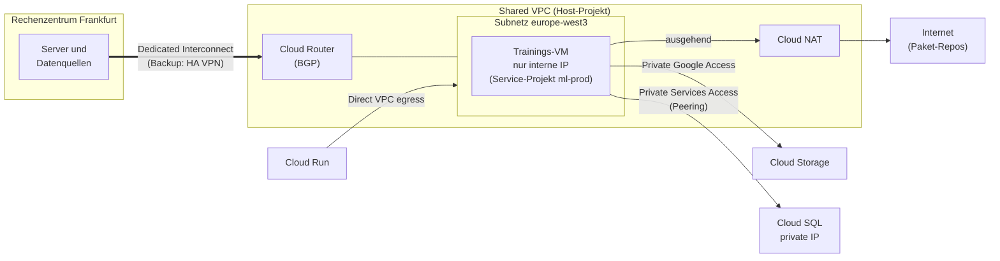

| Anforderung | Baustein | Abschnitt |
|---|---|---|
| zentrales Netz, Teams ohne Netzrechte | Shared VPC | 3.4 |
| Google-APIs ohne externe IP | Private Google Access | 3.5 |
| Internet nur ausgehend | Cloud NAT | 3.5 |
| Cloud SQL nur privat | Private Services Access | 3.5 |
| Cloud Run ins VPC | Direct VPC egress | 3.5 |
| Rechenzentrum anbinden | Interconnect, HA VPN, Cloud Router | 3.6 |

---

### 3.1 Schichtenmodell: L3, L4 und L7

Viele Begriffe in diesem Dokument hängen an einer Frage: **Auf welcher Schicht arbeitet ein Baustein?** Daraus folgt,
was er sehen und worüber er entscheiden kann. Netzwerker beschreiben das mit dem OSI-Modell aus sieben Schichten. Für
Cloud-Architektur reichen drei davon (L3, L4, L7), dazu L2 und L1 für Interconnect.

#### Das Bild zuerst: ein Aufruf in drei Umschlägen

Ein Browser ruft `https://app.example.com/api/images` auf. Unterwegs steckt die Anfrage in drei Umschlägen, einer im
anderen. Jede Station auf dem Weg öffnet nur so viele Umschläge, wie sie für ihre Aufgabe braucht.

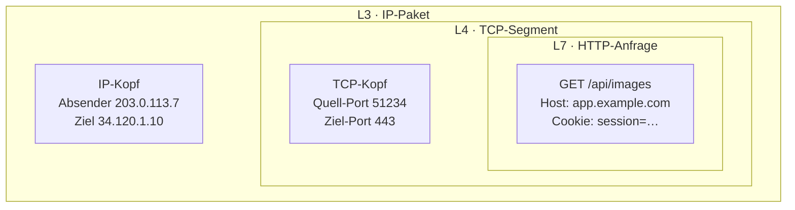

*Bei HTTPS ist der innerste Umschlag zusätzlich mit TLS verschlossen. Wer den Pfad lesen will, braucht den
Schlüssel, also das Zertifikat.*

| Schicht | Name | Steht auf dem Umschlag | Im Beispiel | Frage, die sie beantwortet |
|---|---|---|---|---|
| **L7** | Anwendung | Methode, Pfad, Host, Header, Cookies | `GET /api/images`, `Host: app.example.com` | *Was* will der Client? |
| **L4** | Transport | Quell- und Ziel-Port, TCP oder UDP | TCP, Port 443 | *Welches Programm* auf der Maschine, und wie zuverlässig? |
| **L3** | Netzwerk | Absender- und Ziel-IP-Adresse | `203.0.113.7` → `34.120.1.10` | *Welche Maschine*, und auf welchem Weg dorthin? |

Ein Vergleich mit der Post: L3 ist die Adresse des Gebäudes, L4 die Abteilung im Gebäude (und ob als Einschreiben
mit Empfangsbestätigung, TCP, oder als einfacher Brief, UDP), L7 der Inhalt des Briefs. Darunter liegen **L2** (der
Rahmen auf einer einzelnen Leitung, z. B. Ethernet mit einer VLAN-Nummer) und **L1** (die Leitung selbst, z. B. die
Glasfaser eines Dedicated Interconnect).

#### Die Regel, die alles erklärt

**Ein Baustein kann nur nach dem entscheiden, was auf seiner Schicht und darunter sichtbar ist.** Eine
Firewall-Regel sieht IP-Adressen und Ports, aber nicht den Pfad `/api/images`. Ein Load Balancer, der nach Pfaden
verteilen soll, muss den HTTP-Umschlag öffnen; bei HTTPS heißt das, er muss TLS beenden und braucht dafür das
Zertifikat.

Daraus folgen viele typische Prüfungsantworten:

- **Nach URL-Pfad oder Host verteilen** (`/v1` hierhin, `/v2` dorthin): Das geht nur mit einem L7-Load-Balancer,
  dem Application Load Balancer (Abschnitt 3.10).
- **SQL-Injection oder Cross-Site-Scripting abwehren:** Der Angriff steckt im L7-Inhalt. VPC-Firewall-Regeln sehen
  ihn nicht, Cloud Armor mit WAF-Regeln schon (Abschnitt 3.14).
- **Einen UDP-Dienst verteilen** (Spiel, VoIP, DNS): UDP ist ein L4-Protokoll ohne Verbindung. Ein
  HTTP-Load-Balancer kann damit nichts anfangen, nur der Passthrough Network Load Balancer.
- **Die echte Client-IP beim Backend:** Ein Proxy (auf L7 oder L4) beendet die Verbindung des Clients und baut eine
  neue auf. Das Backend sieht als L3-Absender den Proxy; die Original-IP steht nur noch im L7-Header
  `X-Forwarded-For`. Ein Passthrough-Load-Balancer lässt den L3-Umschlag unverändert.
- **DDoS-Angriffe gibt es auf jeder Schicht.** SYN-Floods und UDP-Fluten zielen auf L3/L4, HTTP-Fluten auf L7.
  Cloud Armor wehrt L3/L4-Angriffe immer ab; für L7 braucht man eigene Regeln.
- **Verschlüsseln geht auf verschiedenen Schichten:** HA VPN (IPsec) verschlüsselt ganze L3-Pakete, MACsec auf einem
  Interconnect verschlüsselt auf L2, TLS (HTTPS) sitzt zwischen L4 und L7.

#### Was sieht welche Station?

Derselbe Aufruf auf dem Weg durch Google Cloud:

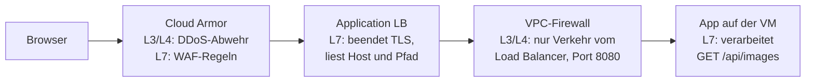

| Schicht | Bausteine in Google Cloud |
|---|---|
| **L7** | Application Load Balancer mit URL Map, Cloud CDN, Cloud Armor (WAF-Regeln), Identity-Aware Proxy, GKE Ingress und Gateway, Service Mesh |
| **L4** | Proxy und Passthrough Network Load Balancer, Ports und Protokolle in Firewall-Regeln, Cloud NAT (übersetzt Adressen und Ports) |
| **L3** | VPC-Routen, IP-Bereiche in Firewall-Regeln, VPC Peering, Cloud VPN (IPsec), Cloud Router (lernt L3-Routen per BGP), Private Service Connect |
| **L2/L1** | Cloud Interconnect (Leitung und VLAN-Attachments), MACsec |

Die normale VPC-Firewall arbeitet auf L3/L4. Wer auch in den Inhalt schauen will (Intrusion Prevention), braucht
Cloud NGFW Enterprise oder, für Web-Anwendungen, Cloud Armor am Load Balancer.

---

### 3.2 Das Grundmodell: globales Netz, regionale Subnetze


**Ein VPC-Netz ist global, ein Subnetz ist regional.** Ein einziges VPC kann Subnetze in Frankfurt und in Iowa haben,
und VMs in beiden sprechen über interne IPs miteinander, ohne VPN dazwischen. Der Verkehr läuft über Googles eigenes
Netz. Das unterscheidet Google Cloud von anderen Clouds, in denen ein Netz an eine Region gebunden ist.

**Subnetze und IP-Bereiche.** Jedes Subnetz hat einen primären IP-Bereich (für VMs) und optional sekundäre Bereiche
(z. B. für GKE-Pods und -Services, siehe [2. GKE: Google Kubernetes Engine](#2-gke-google-kubernetes-engine)). Ein Subnetz kann man später vergrößern, aber nicht
verkleinern.

- **Auto-Mode-VPC:** legt in jeder Region automatisch ein Subnetz aus einem festen Bereich (`10.128.0.0/9`) an.
  Bequem zum Ausprobieren, aber die Bereiche überschneiden sich mit jedem anderen Auto-Mode-VPC.
- **Custom-Mode-VPC:** Du legst die Subnetze selbst an. Für Produktion die richtige Wahl, weil sich nur so
  Überschneidungen mit On-Prem und anderen Netzen vermeiden lassen.

**IP-Planung ist die Entscheidung, die man später am schwersten ändert.** Überschneiden sich Bereiche, funktionieren
Peering und VPN nicht oder nur mit Umwegen. Deshalb: vor der ersten VM einen Adressplan machen, der On-Prem, alle
VPCs und das Wachstum von GKE einschließt.

**Routen.** Jedes VPC hat automatisch eine Route pro Subnetz und eine Standardroute ins Internet (`0.0.0.0/0`).
Dazu kommen eigene statische Routen und **dynamische Routen**, die ein Cloud Router per BGP von On-Prem lernt. Der
**dynamische Routing-Modus** des VPC entscheidet, ob gelernte Routen nur in der Region des Cloud Routers gelten
(regional) oder im ganzen VPC (global).

**Netzwerk-Tiers.** *Premium Tier* (Standard) führt den Verkehr so weit wie möglich über Googles Backbone und ist
Voraussetzung für globale Load Balancer. *Standard Tier* übergibt den Verkehr früh ans öffentliche Internet: billiger,
aber nur regional und mit schwankender Latenz.

---

### 3.3 Firewall: wer darf mit wem sprechen


#### Wie eine Regel aussieht

Eine VPC-Firewall-Regel hat sechs Teile: **Richtung** (ingress oder egress), **Priorität** (0 bis 65535, die
*kleinere* Zahl gewinnt, Standard ist 1000), **Aktion** (allow oder deny), **Ziel** (alle VMs, VMs mit einem
Network Tag oder VMs mit einem Service Account), **Quelle bzw. Ziel-Bereich** und **Protokoll mit Ports**.

Zwei Eigenschaften muss man kennen:

- **Zustandsbehaftet (stateful):** Ist eine Verbindung in eine Richtung erlaubt, sind die Antwortpakete automatisch
  erlaubt. Man braucht keine Regel für den Rückweg.
- **Implizite Regeln** mit der niedrigsten Priorität 65535: *ausgehend alles erlaubt*, *eingehend alles verboten*.
  Ein neues Custom-VPC lässt also nichts herein, bis man es erlaubt. (Das `default`-Netz bringt zusätzlich Regeln
  für internen Verkehr, SSH, RDP und ICMP mit.)

#### Ein Beispiel mit Prioritäten

Aufgabe: Alle VMs dürfen nur zum Active-Directory-Server sprechen (Ports 389 und 636), sonst nirgends hin. Weil
ausgehend implizit alles erlaubt ist, braucht man zwei Regeln:

| Priorität | Richtung | Aktion | Ziel | Wohin |
|---|---|---|---|---|
| 100 | egress | allow | alle VMs | AD-Server, TCP 389 und 636 |
| 1000 | egress | deny | alle VMs | `0.0.0.0/0`, alles |

Ein Paket zum AD-Server trifft zuerst Regel 100 und ist erlaubt. Jedes andere Paket fällt durch bis Regel 1000 und
wird verworfen. Mit vertauschten Prioritäten würde die Deny-Regel alles blockieren, auch den AD-Verkehr.

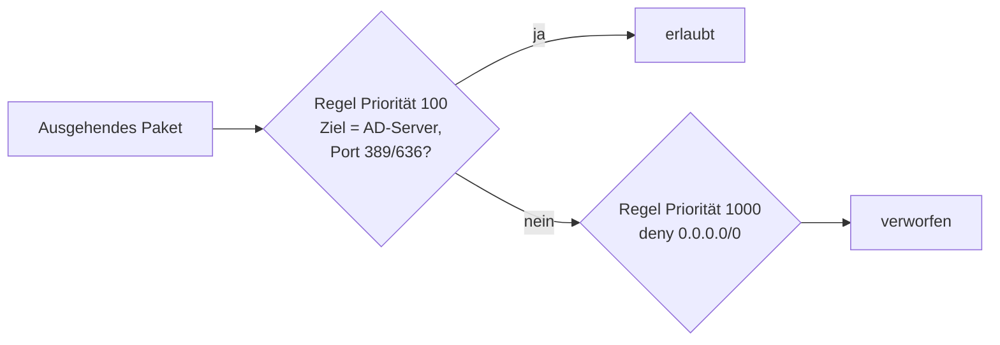

#### Network Tags oder Service Accounts als Ziel

In einer Drei-Schichten-Anwendung (Web, API, Datenbank) bekommt jede Schicht ihr Ziel, und die Regeln erlauben nur
Web → API → Datenbank. IP-Adressen eignen sich dafür nicht, weil VMs beim Skalieren neue IPs bekommen.

| Ziel | Vorteil | Nachteil |
|---|---|---|
| **Network Tag** (z. B. `web`) | einfach, sofort änderbar | jeder mit Rechten an der VM kann das Tag ändern und sich damit Zugang verschaffen |
| **Service Account** der VM | an IAM gebunden: Wechseln erfordert Rechte am Service Account und ein Stoppen der VM | etwas mehr Aufwand |

Für strenge Trennung sind Service Accounts die sicherere Wahl; Prüfungsfragen mit „Sicherheit“ im Vordergrund
zielen oft darauf. In einer einzelnen Regel kann man Tags und Service Accounts nicht als Ziel mischen.

#### Regeln für die ganze Organisation

- **Hierarchische Firewall-Richtlinien** hängen an Organisation oder Ordner und werden *vor* den Regeln im VPC
  ausgewertet. Neben allow und deny gibt es `goto_next` (an die nächste Ebene weiterreichen). So setzt ein
  Sicherheitsteam Regeln durch, die kein Projekt überschreiben kann.
- **Netzwerk-Firewall-Richtlinien** (global oder regional) bündeln Regeln pro VPC und können **sichere Tags**
  (Resource-Manager-Tags) verwenden, deren Vergabe per IAM kontrolliert ist.

**Kontrolle und Aufräumen:** *Firewall Rules Logging* protokolliert, welche Regel welche Verbindung erlaubt oder
blockiert hat. Darauf baut *Firewall Insights* im Network Intelligence Center auf und zeigt ungenutzte oder
verdeckte Regeln. Ohne Logging hat Firewall Insights keine Daten.

#### Anmelden ohne externe IP: IAP

Wie kommt ein Admin per SSH auf eine VM ohne externe IP, ohne VPN? Mit **IAP TCP Forwarding**: Identity-Aware Proxy
prüft die Identität und tunnelt die Verbindung. Nötig sind die Rolle *IAP-secured Tunnel User* und eine
Firewall-Regel, die eingehend Port 22 aus dem IAP-Bereich `35.235.240.0/20` erlaubt. Dann reicht
`gcloud compute ssh vm-name --tunnel-through-iap`.

---

### 3.4 Mehrere Netze verbinden: Shared VPC, Peering und mehr


#### Shared VPC: ein Netz, viele Projekte

**Problem:** Viele Teams mit eigenen Projekten, aber das Netz (Subnetze, Firewall, Verbindung ins Rechenzentrum) soll
an einer Stelle verwaltet werden.

**Lösung:** Ein **Host-Projekt** besitzt das VPC. **Service-Projekte** werden angehängt und legen ihre VMs, GKE-Cluster
usw. in die Subnetze des Host-Projekts. Netz und Anwendungen sind so administrativ getrennt:

| Wer | Rolle | Wo |
|---|---|---|
| Netzwerk-Team | *Network Admin* (und *Security Admin* für Firewall) | Host-Projekt |
| Organisations-Admin | *Shared VPC Admin* (hängt Projekte an) | Organisation oder Ordner |
| Entwicklerteams | *Network User* (darf Subnetze benutzen) plus z. B. *Compute Instance Admin* | Host-Projekt bzw. einzelne Subnetze; Service-Projekt |

Shared VPC funktioniert nur **innerhalb einer Organisation**.

#### VPC Network Peering: zwei Netze direkt verbinden

Peering verbindet zwei VPCs, sodass VMs über interne IPs sprechen. Es funktioniert auch **zwischen Projekten und
Organisationen** (z. B. mit einem Partner). Jede Seite verwaltet ihr VPC und ihre Firewall weiter selbst.
Voraussetzung: Die Subnetz-Bereiche dürfen sich **nicht überschneiden**.

Die wichtigste Eigenschaft: **Peering ist nicht transitiv.**

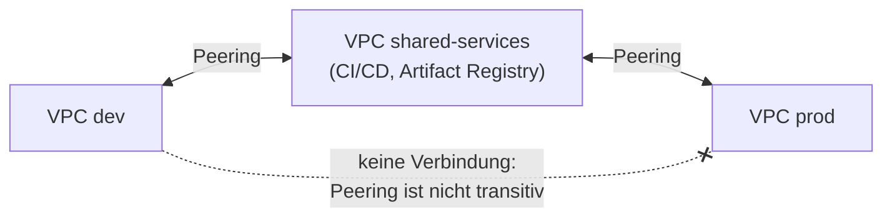

*dev und prod erreichen beide die gemeinsamen Dienste, aber nicht einander. Genau das ist oft gewünscht: Umgebungen
getrennt, gemeinsame Dienste erreichbar.*

Routen zu On-Prem (statisch oder per BGP gelernt) kann ein VPC über das Peering an den Partner exportieren. Ein
drittes gepeertes VPC erreicht man aber nie über ein Peering hinweg.

#### Welcher Weg wann

| Situation | Weg |
|---|---|
| ein zentral verwaltetes Netz für viele Projekte derselben Organisation | **Shared VPC** |
| zwei VPCs, auch über Organisationsgrenzen, ohne Überschneidung | **VPC Network Peering** |
| Umgebungen getrennt, aber alle erreichen gemeinsame Dienste | Peering jeder Umgebung mit einem Shared-Services-VPC |
| eine VM muss in mehreren VPCs stehen (z. B. Firewall-Appliance) | **mehrere Netzwerkkarten** (eine pro VPC, beim Anlegen festgelegt) |
| zwei Netze mit überschneidenden Bereichen oder zwei Shared VPCs in verschiedenen Organisationen | **Cloud VPN** zwischen den Netzen, mit Cloud Router und gezielten Route-Advertisements |
| viele VPCs und Standorte sternförmig verbinden | **Network Connectivity Center** (Hub mit VPC- und Hybrid-Spokes) |

---

### 3.5 Private Wege zu Google und zu Diensten


Eine VM ohne externe IP will an vier Arten von Zielen. Für jedes gibt es einen eigenen Mechanismus, und genau diese
Zuordnung prüfen viele Fragen.

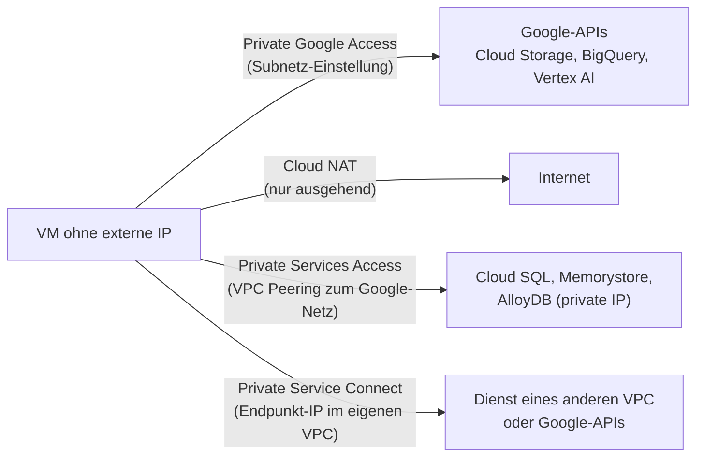

| Ziel | Mechanismus | Wie es technisch geht |
|---|---|---|
| Google-APIs | **Private Google Access** | pro Subnetz einschalten; die VM erreicht die APIs ohne externe IP |
| Internet, nur ausgehend | **Cloud NAT** | regional, am Cloud Router konfiguriert, ohne eigene Proxy-VM; man wählt, welche Subnetze NAT nutzen. Von außen kommt keine Verbindung herein |
| verwaltete Dienste mit privater IP (Cloud SQL, Memorystore, AlloyDB) | **Private Services Access** | man reserviert einen IP-Bereich; Google verbindet sein Dienst-VPC per **VPC Peering** |
| Dienst eines anderen Anbieters oder Teams, oder Google-APIs über eine eigene IP | **Private Service Connect (PSC)** | eine **Endpunkt-IP** im eigenen Subnetz leitet an den Dienst weiter; kein Peering, Überschneidungen egal |
| Cloud Run, App Engine Standard, Cloud Run Functions ins VPC | **Direct VPC egress** (bei Cloud Run empfohlen) oder **Serverless VPC Access Connector** | der Dienst bekommt einen Weg zu internen IPs im VPC |

**Warum PSC oft besser ist als Peering:** Peering verbindet ganze Netze und verlangt überschneidungsfreie Bereiche.
PSC veröffentlicht genau *einen* Dienst als eine IP im Netz des Konsumenten. Der Anbieter sieht das Netz des Kunden
nicht, und beide Seiten dürfen dieselben Adressbereiche verwenden.

**Typischer Fehler mit Serverless:** Ein Cloud-Run-Dienst erreicht eine AlloyDB oder Cloud SQL mit privater IP nicht.
Der Grund: Cloud Run läuft standardmäßig außerhalb des VPC. Lösung: Direct VPC egress einschalten.

#### Private Google Access von On-Prem und VPC Service Controls

Auch Server im **Rechenzentrum** können Google-APIs über VPN oder Interconnect erreichen statt über das Internet.
Dafür gibt es zwei feste Adressbereiche, die man per DNS und Route-Advertisement ins Rechenzentrum bringt:

- `private.googleapis.com` (`199.36.153.8/30`): die meisten Google-APIs.
- `restricted.googleapis.com` (`199.36.153.4/30`): nur Dienste, die **VPC Service Controls** unterstützen.

**VPC Service Controls (VPC-SC)** ist keine Firewall für VMs. Es zieht einen **Perimeter um Projekte** und kontrolliert,
von wo aus Google-APIs wie BigQuery oder Cloud Storage benutzt werden dürfen. Ziel ist Schutz vor
**Datenabfluss**: Selbst ein gestohlenes Token kann Daten nicht in ein Projekt außerhalb des Perimeters kopieren.
Prüfungsmuster: „BigQuery-Daten dürfen nur aus dem Rechenzentrum über das VPN erreichbar sein“ heißt
**VPC Service Controls plus Private Google Access für On-Prem-Hosts** (über `restricted.googleapis.com`).

> **Anknüpfung an ML-Praxis.** Trainings-VMs und GKE-Nodes ohne externe IP lesen ihre Daten über Private Google
> Access aus Cloud Storage und laden Pakete über Cloud NAT. Ein Vertex-AI-Endpunkt lässt sich per Private Service
> Connect privat erreichbar machen. Und VPC Service Controls um die Projekte mit Trainingsdaten verhindert, dass ein
> Notebook die Daten in einen privaten Bucket außerhalb kopiert.

---

### 3.6 Hybride Verbindungen: VPN und Interconnect


#### Cloud Router: das Bindeglied

Ein **Cloud Router** spricht BGP mit dem Router im Rechenzentrum. Beide Seiten tauschen ihre Netze aus; ändert sich
ein Subnetz, lernt die andere Seite das automatisch. Man kann gezielt steuern, welche Bereiche er ankündigt
(*custom route advertisements*). Das hilft z. B., wenn sich nach einer Firmenübernahme Bereiche überschneiden: Man
kündigt die überschneidenden Bereiche einfach nicht an.

#### Cloud VPN

IPsec-verschlüsselte Tunnel über das Internet. Schnell eingerichtet, günstig, aber begrenzt in der Bandbreite.

| | **HA VPN** (empfohlen) | Classic VPN |
|---|---|---|
| SLA | **99,99 %** (bei richtiger Topologie) | 99,9 % |
| Aufbau | Gateway mit **zwei Interfaces** und zwei externen IPs; mindestens zwei Tunnel zum Peer | ein Interface, eine IP |
| Routing | nur dynamisch (BGP über Cloud Router) | nur statisch |
| Bandbreite | pro Tunnel bis 250.000 Pakete/s, je nach Paketgröße etwa 1–3 Gbps; mehr Tunnel für mehr Bandbreite | dasselbe Limit pro Tunnel |

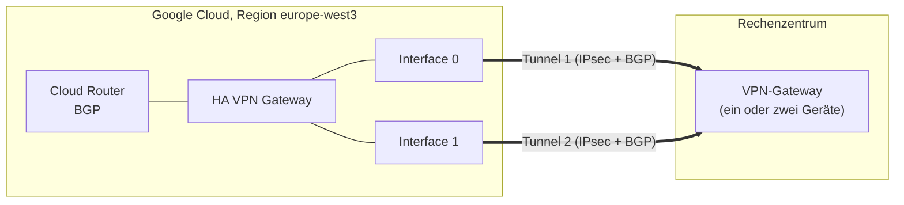

*Fällt ein Tunnel oder ein Interface aus, läuft der Verkehr über den anderen weiter. Erst zwei Tunnel ergeben die
99,99 %.*

**Ein VPN-Gateway ist regional.** Läuft eine Anwendung in einem VPC in zwei Regionen und beide sollen ins
Rechenzentrum, braucht man ein Gateway mit Tunneln in **jeder Region** (oder globales dynamisches Routing, dann
nutzen beide Regionen die Tunnel einer Region, mit dem Umweg über die Region).

#### Cloud Interconnect

Eine **physische, private Verbindung** zu Googles Netz, ohne Internet dazwischen. Für große Datenmengen und
gleichmäßige Latenz.

| | **Dedicated Interconnect** | **Partner Interconnect** |
|---|---|---|
| Verbindung | eigene Leitung in einer Colocation-Einrichtung, in der Google präsent ist | über einen Netzanbieter, der schon mit Google verbunden ist |
| Bandbreite | Leitungen mit 10 oder 100 Gbps, bündelbar | 50 Mbps bis 50 Gbps pro VLAN-Attachment |
| wann | sehr viel Bandbreite und das Rechenzentrum erreicht eine Colocation | keine Colocation in Reichweite, oder weniger Bandbreite nötig |

Dazu kommt **Cross-Cloud Interconnect** für eine direkte Leitung zu einer anderen Cloud.

**Interconnect verschlüsselt nicht.** Der Verkehr ist privat, aber nicht verschlüsselt. Wer Verschlüsselung braucht,
nimmt **MACsec** oder **HA VPN über Interconnect**.

**Verfügbarkeit hängt von der Topologie ab** (Dedicated Interconnect):

- **99,9 %:** zwei Verbindungen in einer Metro, in verschiedenen *Edge Availability Domains* (getrennte
  Wartungszonen).
- **99,99 %:** mindestens **vier Verbindungen**, zwei in jeder von **zwei Metros**, in jeder Metro auf beide Edge
  Availability Domains verteilt; mindestens **zwei Cloud Router** in zwei Regionen; das VPC im **globalen**
  dynamischen Routing-Modus. (Seit Kurzem gibt es auch eine Variante mit vier Verbindungen in einer Metro und einer
  Region.)

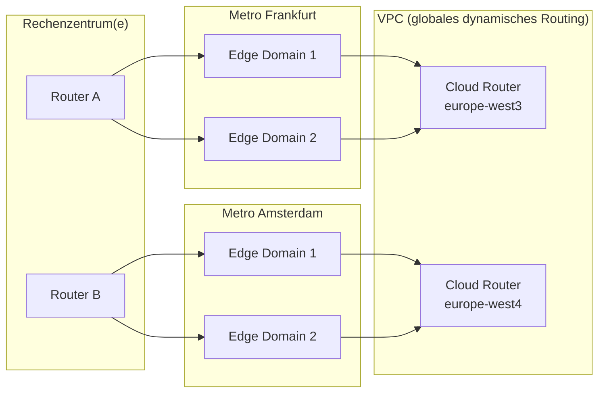

#### Welche Verbindung wann

```mermaid
flowchart TD
    Q1{"Wie viel Bandbreite<br/>dauerhaft?"}
    Q1 -- "wenige Gbps,<br/>schnell starten" --> VPN["HA VPN<br/>verschlüsselt, über Internet"]
    Q1 -- "10 Gbps und mehr<br/>(z. B. große DB-Replikation)" --> Q2{"Colocation mit<br/>Google erreichbar?"}
    Q2 -- "ja" --> DED["Dedicated Interconnect"]
    Q2 -- "nein" --> PAR["Partner Interconnect"]
    DED --> ENC{"Verschlüsselung<br/>nötig?"}
    PAR --> ENC
    ENC -- "ja" --> MAC["MACsec oder<br/>HA VPN über Interconnect"]
    ENC -- "nein" --> OK["fertig; HA VPN als<br/>günstiges Backup möglich"]
```

**Zwei Muster aus der Praxis:**

- **Interconnect plus VPN als Backup:** Für Disaster Recovery prüft man, dass die Replikation über Interconnect
  läuft *und* dass das VPN die Verbindung übernimmt, wenn der Interconnect ausfällt.
- **Überschneidungsfreie Bereiche** sind Voraussetzung für jede hybride Verbindung. In einer schrittweisen Migration
  bekommt Google Cloud einen Bereich, den das Rechenzentrum nicht benutzt.

---

### 3.7 Leitplanken für die ganze Organisation


Manche Regeln sollen in allen Projekten gelten, egal was ein Projekt-Admin tut. Dafür gibt es **Organization
Policies** (Constraints) an Organisation oder Ordner:

- `constraints/compute.vmExternalIpAccess`: nur die aufgelisteten VMs dürfen externe IPs haben, alle anderen nicht.
- `constraints/gcp.resourceLocations`: Ressourcen nur in erlaubten Regionen (z. B. nur EU).
- `constraints/compute.restrictSharedVpcHostProjects` und Verwandte: welche Projekte Shared VPC nutzen dürfen.

Zusammen mit hierarchischen Firewall-Richtlinien (Abschnitt 3.3) und VPC Service Controls (Abschnitt 3.5) ergibt das die
Leitplanken, die ein zentrales Team setzt und die einzelne Projekte nicht aufweichen können.

---

### 3.8 Load Balancing, das Bild zuerst: eine globale Bild-Generierungs-App


Eine Web-App erzeugt Bilder mit einem Diffusionsmodell. Nutzer sitzen in Europa und Amerika. Die App besteht aus:

- **statischen Dateien** (HTML, JS, Beispielbilder) in einem Cloud-Storage-Bucket,
- einer **API** auf Compute-Engine-VMs in zwei Regionen (`europe-west3`, `us-central1`),
- einem **Generierungsdienst** auf Cloud Run, ebenfalls in beiden Regionen,
- einem **internen Modell-Dienst** auf GPU-VMs, den nur die API aufruft.

Alles Öffentliche soll unter **einer** Domain und **einer** IP-Adresse erreichbar sein, Nutzer sollen in der
nächstgelegenen Region landen, und die App braucht Schutz vor Angriffen.

```mermaid
flowchart LR
    U["Nutzer weltweit"] --> IP["eine Anycast-IP<br/>app.example.com"]
    IP --> ALB["Global External<br/>Application Load Balancer<br/>+ Cloud Armor"]
    ALB -- "/static/*<br/>(Cloud CDN)" --> BB["Backend Bucket<br/>Cloud Storage"]
    ALB -- "/api/*" --> MEU["MIG europe-west3"]
    ALB -- "/api/*" --> MUS["MIG us-central1"]
    ALB -- "/generate" --> NEG["Serverless NEGs<br/>Cloud Run in 2 Regionen"]
    MEU --> ILB["Internal Application LB"]
    MUS --> ILB
    ILB --> GPU["Modell-Dienst<br/>(GPU-VMs)"]
```

*Ein einziger globaler Load Balancer verteilt nach Pfad auf drei Arten von Backends. Der Modell-Dienst ist nur intern
erreichbar, über einen eigenen internen Load Balancer.*

---

### 3.9 Die Bausteine eines Load Balancers


Ein Load Balancer in Google Cloud ist kein einzelnes Gerät, sondern eine Kette von Konfigurationsobjekten. Eine
Anfrage durchläuft sie von links nach rechts:

```mermaid
flowchart LR
    FR["Forwarding Rule<br/>IP-Adresse + Port"] --> TP["Target Proxy<br/>(HTTPS: Zertifikat,<br/>SSL-Policy)"]
    TP --> UM["URL Map<br/>Host- und Pfadregeln"]
    UM --> BS["Backend Service<br/>Health Check, Affinität,<br/>CDN, Cloud Armor, Timeout"]
    UM --> BB["Backend Bucket<br/>(Cloud Storage)"]
    BS --> BE["Backends<br/>Instanzgruppen oder NEGs"]
```

| Baustein | Aufgabe |
|---|---|
| **Forwarding Rule** | die öffentliche oder interne IP und der Port, unter denen der Load Balancer erreichbar ist |
| **Target Proxy** | beendet die Client-Verbindung; bei HTTPS hängt hier das Zertifikat |
| **URL Map** | entscheidet anhand von Host und Pfad, welcher Backend Service die Anfrage bekommt |
| **Backend Service** | Gruppe gleichartiger Backends mit Health Check, Lastverteilungsmodus, Session-Affinität, Timeout; hier schaltet man Cloud CDN und Cloud Armor ein |
| **Backends** | Managed Instance Groups, Network Endpoint Groups (NEGs) oder ein Backend Bucket |

Bei Passthrough-Load-Balancern (Abschnitt 3.10) fehlen Target Proxy und URL Map: Die Pakete gehen unverändert an die
Backends.

> **Anknüpfung an ML-Praxis.** Der **Timeout des Backend Service** ist standardmäßig 30 Sekunden. Eine LLM-Antwort,
> die länger streamt, oder eine Bildgenerierung über 30 Sekunden bricht sonst am Load Balancer ab, obwohl der Dienst
> noch arbeitet. Für solche Dienste den Timeout erhöhen oder asynchron arbeiten (Auftrag annehmen, Ergebnis später
> abholen).

---

### 3.10 Welcher Load Balancer: die drei Familien


Die Wahl folgt aus drei Fragen: **Welches Protokoll?** **Von außen oder intern?** **Eine Region oder mehrere?**

```mermaid
flowchart TD
    Q1{"Welcher Verkehr?"}
    Q1 -- "HTTP/HTTPS" --> ALB["Application Load Balancer<br/>(L7, Proxy)"]
    Q1 -- "TCP, evtl. mit<br/>SSL-Terminierung" --> PNLB["Proxy Network LB<br/>(L4, Proxy)"]
    Q1 -- "UDP, andere Protokolle,<br/>oder Client-IP muss<br/>erhalten bleiben" --> PTNLB["Passthrough Network LB<br/>(L4, Pakete unverändert)"]
    ALB --> Q2{"Von außen<br/>oder intern?"}
    PNLB --> Q2
    PTNLB --> Q2
    Q2 -- "außen" --> Q3{"Backends in<br/>mehreren Regionen?"}
    Q2 -- "intern" --> Q4{"Clients oder Backends<br/>in mehreren Regionen?"}
    Q3 -- "ja" --> G["global external"]
    Q3 -- "nein" --> R["regional external"]
    Q4 -- "ja" --> CR["cross-region internal"]
    Q4 -- "nein" --> RI["regional internal"]
```

*Nicht jede Kombination gibt es: Den Passthrough Network Load Balancer gibt es intern nur regional, „cross-region
internal“ nur als Application oder Proxy Network Load Balancer.*

| Familie | Protokolle | Varianten | Client-IP beim Backend |
|---|---|---|---|
| **Application Load Balancer** | HTTP, HTTPS (inkl. HTTP/2, WebSockets) | global external, regional external, regional internal, cross-region internal, classic | nein (steht im Header `X-Forwarded-For`) |
| **Proxy Network Load Balancer** | TCP, optional SSL-Offload | global external, regional external, regional internal, cross-region internal, classic | nein |
| **Passthrough Network Load Balancer** | TCP, UDP, ICMP, ESP, GRE u. a. | regional external, internal (regional), global external (Preview) | **ja** |

Was man daraus ableitet:

- **Proxy** heißt: Der Load Balancer beendet die Verbindung des Clients und baut eine neue zum Backend auf. Er kann
  dadurch TLS beenden, nach Pfaden routen, cachen und Angriffe filtern. Der Preis: Das Backend sieht die IP des
  Load Balancers, nicht die des Clients.
- **Passthrough** heißt: Pakete gehen unverändert durch, das Backend antwortet direkt dem Client. Nötig für UDP (z. B.
  Spiele, VoIP) und wenn die Anwendung die echte Client-IP braucht.
- **Global** heißt: eine Anycast-IP weltweit, Nutzer landen am nächsten Google-Standort, Backends in vielen Regionen.
  Setzt das **Premium Tier** voraus (siehe [Abschnitt 3.2](#32-das-grundmodell-globales-netz-regionale-subnetze)).
- **Regional** passt, wenn alle Backends in einer Region stehen oder Daten die Region nicht verlassen dürfen.
- **Classic**-Varianten sind die älteren Implementierungen; Google empfiehlt den Umstieg auf die neuen globalen.

Envoy-basierte regionale und interne Load Balancer brauchen im VPC ein **Proxy-only Subnet** pro Region, aus dem die
Proxys ihre Adressen nehmen.

---

### 3.11 Health Checks und Autohealing


**Health Checks** fragen regelmäßig jedes Backend ab (z. B. `GET /healthz`). Nur gesunde Backends bekommen Verkehr.
Die Prüfungen kommen von Google-Systemen aus festen Adressbereichen, und genau das ist eine häufige Falle: **Ohne
Firewall-Regel, die diese Bereiche eingehend erlaubt, gelten alle Backends als krank**, und der Load Balancer
liefert Fehler, obwohl die VMs laufen.

- Für Application und Proxy Network Load Balancer sowie den internen Passthrough-LB: `35.191.0.0/16`.
- Für den regionalen externen Passthrough-LB zusätzlich `209.85.152.0/22` und `209.85.204.0/22`.
- Ältere Doku und viele Prüfungsfragen nennen außerdem `130.211.0.0/22`; die aktuelle Doku führt diesen Bereich
  nicht mehr auf.

**Autohealing** ist etwas anderes, nutzt aber ebenfalls einen Health Check: Eine Managed Instance Group **ersetzt**
VMs, die den Check nicht bestehen. Der Unterschied:

| | Load-Balancer-Health-Check | Autohealing-Health-Check der MIG |
|---|---|---|
| Folge bei „krank“ | kein Verkehr mehr an dieses Backend | VM wird gelöscht und neu erstellt |
| typisch | häufige, strenge Prüfung | großzügiger, mit **Initial Delay** |

**Die klassische Neustart-Schleife:** Eine App braucht 90 Sekunden zum Starten, das Initial Delay steht auf 10
Sekunden. Autohealing hält jede neue VM für krank und ersetzt sie, bevor sie fertig ist. Alle VMs starten im Kreis
neu. Zur Fehlersuche schaltet man den Autohealing-Check vorübergehend ab, damit man sich auf eine VM verbinden und die
Logs lesen kann; die eigentliche Lösung ist ein passendes Initial Delay.

---

### 3.12 Routing: Pfade, Regionen, Failover


**Pfad- und Host-Regeln.** Die URL Map ordnet Anfragen zu: `/v1/*` an den alten API-Backend-Service, `/v2/*` an den
neuen, `/static/*` an einen Backend Bucket. So laufen zwei API-Versionen parallel unter derselben IP, demselben
Zertifikat und demselben DNS-Eintrag. Mit **gewichteter Aufteilung** (z. B. 95 % / 5 %) in der URL Map lässt sich
ein Canary-Release machen.

**Über Regionen.** Der globale externe Application Load Balancer schickt jede Anfrage an die **nächstgelegene Region
mit gesunden Backends und freier Kapazität**. Fällt eine Region aus oder ist sie voll, geht der Verkehr automatisch
in die nächste. Das ist die Standardantwort für „Anwendung in zwei Regionen, automatisches Failover“.

```mermaid
sequenceDiagram
    participant U as Nutzer in Paris
    participant L as Global External ALB
    participant E as MIG europe-west3
    participant A as MIG us-central1
    U->>L: GET /api/images
    L->>E: nächste gesunde Region
    E-->>U: Antwort
    Note over E: Region fällt aus,<br/>Health Checks schlagen fehl
    U->>L: GET /api/images
    L->>A: automatisch nächste gesunde Region
    A-->>U: Antwort (höhere Latenz, aber verfügbar)
```

**Innerhalb einer Region.** Eine **regionale MIG über drei Zonen** hinter einem (regionalen oder globalen) Load
Balancer übersteht den Ausfall einer Zone. Für Anwendungen ohne HTTP und ohne Clustering (z. B. ein TCP-Dienst mit
Dateien auf der Platte) gibt es ein klassisches Muster: aktive und Standby-VM in zwei Zonen, eine **Regional
Persistent Disk** (synchron in zwei Zonen gespiegelt) und ein **Passthrough Network Load Balancer** davor.

**Sitzungen und WebSockets.** Application Load Balancer unterstützen WebSockets. Hält eine Anwendung Sitzungen im
Speicher eines Servers, hilft **Session-Affinität** (nach Client-IP, generiertem Cookie, eigenem Cookie oder Header).
Robuster ist es, Sitzungen aus dem Server herauszulegen (z. B. in Memorystore), damit jede Anfrage an jedes Backend
gehen kann.

**DNS als Alternative.** Cloud DNS kann mit **Routing-Richtlinien** (geolocation, gewichtet, Failover) ebenfalls
Verkehr verteilen. Das ist gröber (Clients cachen DNS-Antworten) und kennt keine Health-Checks auf Anfrage-Ebene;
für Web-Anwendungen ist der globale Load Balancer meist die bessere Antwort.

---

### 3.13 Statische Inhalte und Cloud CDN


**Backend Buckets.** Ein Cloud-Storage-Bucket kann direkt Backend eines Application Load Balancers sein. Statische
Dateien kommen dann ohne VM aus, unter derselben Domain wie die API.

**Cloud CDN** speichert Antworten an Googles Edge-Standorten nahe beim Nutzer. Man schaltet es pro Backend Service oder
Backend Bucket am globalen externen Application Load Balancer ein. Beim nächsten Abruf kommt die Datei vom Edge, das
Backend wird nicht gefragt.

**Cache Key und Trefferquote.** Der Cache merkt sich jede Antwort unter einem Schlüssel, der standardmäßig Protokoll,
Host, Pfad und Query-String enthält. Ein Bild, das einmal über `http://` und einmal über `https://` abgerufen wird,
liegt dann zweimal im Cache, und jeder erste Abruf geht ans Backend. Wer Teile aus dem Cache Key entfernt, die für
den Inhalt keine Rolle spielen (Protokoll, irrelevante Query-Parameter), erhöht die **Trefferquote**.

Weitere Hebel: Cache-Modus und TTL (wie lange ein Objekt gilt), `Cache-Control`-Header der Anwendung,
**Invalidierung** bei geänderten Inhalten, **Signed URLs** für zeitlich begrenzten Zugriff auf private Inhalte. Für
große Medien und Video-Streaming gibt es **Media CDN**.

**Typische Kombination für schnelle Seiten:** Cloud CDN für statische Inhalte und Bilder, Memorystore als Cache für
dynamische Daten der Anwendung.

---

### 3.14 Sicherheit: TLS, Cloud Armor, IAP


**TLS.** Der Target Proxy beendet HTTPS mit einem Zertifikat. Bequem sind **Google-verwaltete Zertifikate** (über
Certificate Manager), die Google ausstellt und erneuert. **SSL-Policies** legen fest, welche TLS-Versionen und
Cipher erlaubt sind. Für **Ende-zu-Ende-Verschlüsselung** stellt man zusätzlich das Protokoll zwischen Load Balancer
und Backend auf HTTPS (oder HTTP/2 mit TLS).

**Cloud Armor** hängt als Sicherheitsrichtlinie am Backend Service:

- **L3/L4-DDoS-Schutz** ist für Backends hinter den unterstützten Load Balancern **immer aktiv**.
- **L7-Schutz** (z. B. HTTP-Floods, SQL-Injection) braucht eine **eigene Richtlinie**: vorkonfigurierte WAF-Regeln
  gegen die OWASP Top 10, eigene Regeln (nach IP, Land, Header), Ratenbegrenzung.
- **Adaptive Protection** erkennt L7-Angriffe am Verkehrsmuster und schlägt Regeln vor; sie setzt **Cloud Armor
  Enterprise** voraus.
- Unterstützt werden u. a. alle externen Application Load Balancer, der regionale interne Application Load Balancer,
  der globale externe Proxy Network Load Balancer und der regionale externe Passthrough Network Load Balancer, dazu
  VMs mit externer IP.

**Damit niemand Cloud Armor umgeht**, darf das Backend nur über den Load Balancer erreichbar sein. Bei Cloud Run heißt
das: Ingress-Einstellung **„Internal and Cloud Load Balancing“** und den Dienst über eine Serverless NEG anbinden.
Sonst ruft ein Angreifer einfach die `run.app`-URL direkt auf.

**Identity-Aware Proxy (IAP)** am Application Load Balancer prüft vor dem Backend, ob ein Nutzer angemeldet und
berechtigt ist. Das ersetzt ein VPN für interne Web-Anwendungen.

---

### 3.15 Backends: Instanzgruppen, NEGs, Cloud Run, GKE


| Backend | Was dahinter steht | typisch |
|---|---|---|
| **Managed Instance Group** | VMs aus einer Vorlage, mit Autoscaling und Autohealing | klassische Web- und API-Server |
| **Zonale NEG** (`GCE_VM_IP_PORT`) | einzelne IP:Port-Paare, z. B. GKE-Pods | Container-natives Load Balancing (siehe [2. GKE: Google Kubernetes Engine](#2-gke-google-kubernetes-engine)) |
| **Serverless NEG** | Cloud Run, App Engine, Cloud Run Functions | Serverless-Dienste hinter globaler IP, Cloud Armor, CDN |
| **Internet NEG** | ein Ziel außerhalb von Google Cloud | externer Ursprung hinter dem Load Balancer |
| **Hybrid NEG** | IP:Port im Rechenzentrum (über VPN/Interconnect) | On-Prem-Dienste hinter demselben Load Balancer |
| **Backend Bucket** | Cloud-Storage-Bucket | statische Inhalte, mit Cloud CDN |

**Cloud Run in mehreren Regionen:** pro Region eine Serverless NEG, alle im selben Backend Service eines globalen
externen Application Load Balancers. Nutzer landen in der nächstgelegenen Region, fällt eine aus, übernimmt die
andere.

**GKE:** Ein Ingress oder Gateway legt automatisch einen Application Load Balancer mit NEGs an. Für mehrere Cluster
in mehreren Regionen gibt es das **Multi-Cluster Gateway** (früher Multi Cluster Ingress, noch früher `kubemci`).

---

### 3.16 Kosten

| Hebel | Was er bringt |
|---|---|
| **Datenverkehr verstehen** | eingehender Verkehr ist kostenlos; ausgehender ins Internet und zwischen Regionen kostet, Verkehr zwischen Zonen einer Region ebenfalls. Gesprächige Dienste deshalb in dieselbe Zone oder Region legen |
| **Netzwerk-Tier** | Standard Tier ist günstiger als Premium, aber nur regional und mit schwankender Latenz |
| **Cloud CDN** | Antworten aus dem Cache entlasten das Backend und sparen ausgehenden Verkehr vom Ursprung |
| **Interconnect statt VPN bei großen Mengen** | Verkehr über Interconnect wird günstiger abgerechnet als über das Internet; VPN-Tunnel kosten pro Stunde plus Verkehr |
| **Cloud NAT** | kostet pro Gateway und pro verarbeiteter Datenmenge; Google-APIs besser über Private Google Access statt über NAT erreichen |
| **Load Balancer** | Kosten für Weiterleitungsregeln und verarbeitete Daten; mehrere Dienste hinter einem Load Balancer mit URL Map bündeln |
| **Cloud Armor** | Kosten pro Richtlinie, Regel und Anfrage; Adaptive Protection nur mit Cloud Armor Enterprise |
| **Private Service Connect** | Endpunkte kosten pro Stunde und pro Datenmenge |

---

### 3.17 Prüfungssignale: Spickzettel

Die Tabellen fassen typische Fragemuster zusammen, nach Themen getrennt.

**Schichten**

| Wenn die Frage sagt … | … ist die Antwort meist |
|---|---|
| nach URL-Pfad oder Host verteilen | L7: Application Load Balancer mit URL Map |
| SQL-Injection, XSS, OWASP Top 10 abwehren | L7: Cloud Armor mit WAF-Regeln (nicht die VPC-Firewall) |
| UDP verteilen oder Client-IP erhalten | L4 passthrough: Passthrough Network Load Balancer |
| nur bestimmte Adressen und Ports zulassen | L3/L4: VPC-Firewall-Regel |

**Netz und Verbindungen**

| Wenn die Frage sagt … | … ist die Antwort meist |
|---|---|
| Verkehr zwischen Schichten erlauben, ohne feste IPs | Firewall-Regeln mit Network Tags (oder Service Accounts) |
| Schichten streng und sicher trennen | Firewall-Regeln auf **Service Accounts** pro Schicht |
| nur ein Ziel erlauben, sonst nichts ausgehend | allow mit kleiner Prioritätszahl, deny all mit größerer |
| Wirkung von Firewall-Regeln auswerten | Firewall Rules Logging einschalten (Grundlage für Firewall Insights) |
| externe IPs organisationsweit verbieten | Organization Policy `compute.vmExternalIpAccess` |
| VM ohne externe IP soll Dateien aus Cloud Storage laden | Private Google Access am Subnetz |
| VM oder GKE-Node ohne externe IP braucht Internet | Cloud NAT |
| SSH ohne externe IP und ohne VPN | IAP TCP Forwarding plus Rolle IAP-secured Tunnel User |
| Netzwerk-Team verwaltet Netz, Entwickler nur VMs | Shared VPC: Host-Projekt mit Network Admin, Service-Projekt für die Entwickler |
| Netz mit Partner in anderer Organisation verbinden | VPC Network Peering |
| Umgebungen getrennt, gemeinsame Dienste erreichbar | Peering jeder Umgebung mit einem Shared-Services-VPC |
| eine VM in drei VPCs | mehrere Netzwerkkarten |
| zwei Shared VPCs aus verschiedenen Organisationen verbinden | Cloud VPN zwischen den Netzen |
| überschneidende Bereiche nach Übernahme | Cloud VPN mit Cloud Router und custom route advertisements |
| App Engine oder Cloud Functions sollen ins VPC | Serverless VPC Access (bei Cloud Run: Direct VPC egress) |
| Cloud Run erreicht private Datenbank nicht | Direct VPC egress |
| BigQuery nur aus dem Rechenzentrum, kein Datenabfluss | VPC Service Controls plus Private Google Access für On-Prem |
| private Verbindung mit 20 Gbps oder mehr | Dedicated Interconnect |
| hohe Bandbreite, aber keine Colocation | Partner Interconnect |
| privates Netz mit 99,99 %, über Internet | HA VPN mit zwei Tunneln |
| Interconnect mit 99,99 % | vier Verbindungen in zwei Metros, verschiedene Edge Availability Domains |
| VPC in zwei Regionen, beide per VPN ins Rechenzentrum | VPN-Gateway mit Tunnel in jeder Region |
| Migration mit VPN, Adressen planen | Google-Bereich ohne Überschneidung mit On-Prem |
| globaler Load Balancer, Verkehr über Googles Netz | Premium Tier |

**Load Balancing**

| Wenn die Frage sagt … | … ist die Antwort meist |
|---|---|
| alte und neue API-Version unter derselben IP, demselben Zertifikat | URL Map mit eigenem Backend Service pro Pfad |
| globales Routing nach URL-Pfad, verschlüsselt bis zum Backend | globaler externer Application LB (HTTPS) mit URL Map, Backend-Protokoll HTTPS |
| Load Balancer meldet alle Backends krank, VMs laufen aber | Firewall-Regel für die Health-Check-Bereiche fehlt |
| VMs der MIG starten ständig neu | Autohealing-Check bzw. Initial Delay prüfen; zur Diagnose Check vorübergehend abschalten |
| Anwendung in zwei Regionen, automatisches Failover | MIGs in beiden Regionen hinter globalem externem Application LB |
| hochverfügbar über Zonen in einer Region | regionale MIG über alle Zonen, davor Load Balancer |
| TCP-Anwendung ohne Clustering, Daten auf Platte, hochverfügbar | aktive und Standby-VM in zwei Zonen, Regional Persistent Disk, Passthrough Network LB |
| UDP oder echte Client-IP nötig | Passthrough Network Load Balancer |
| Trefferquote im CDN erhöhen | Cache Key anpassen (z. B. Protokoll weglassen) |
| statische Dateien und Medien schnell weltweit ausliefern | Cloud CDN am externen Application LB, Backend Bucket |
| Seiten schneller, dynamische Daten und Bilder | Cloud CDN plus Memorystore |
| DDoS auf L3/L4 und L7 | Cloud Armor mit vorkonfigurierten und eigenen Regeln |
| aller Verkehr zu Cloud Run muss durch Cloud Armor | Cloud-Run-Ingress „Internal and Cloud Load Balancing“, Serverless NEG am Load Balancer |
| Microservices auf Cloud Run in mehreren Regionen hinter einer IP | Serverless NEGs pro Region im Backend Service eines globalen Application LB |
| GKE-App in mehreren Regionen, ein Einstiegspunkt | Multi-Cluster Gateway |
| interne Web-App ohne VPN für Mitarbeitende | Identity-Aware Proxy am Application LB |
| lange laufende Anfragen brechen nach 30 s ab | Timeout des Backend Service erhöhen |

---

### 3.18 Alte und neue Namen

| In älteren Fragen | Heute |
|---|---|
| Cloud VPN mit statischem Routing | Classic VPN (HA VPN wird empfohlen) |
| Serverless VPC Access als einziger Weg | bei Cloud Run zusätzlich Direct VPC egress (ohne Connector) |
| Cloud Functions | Cloud Run Functions |
| „private cluster“ bei GKE | Private Nodes plus Control-Plane-Endpunkte (siehe [2. GKE: Google Kubernetes Engine](#2-gke-google-kubernetes-engine)) |
|---|---|
| HTTP(S) Load Balancer, HTTPS Load Balancer | (global oder regional) external Application Load Balancer |
| Internal HTTP(S) Load Balancer | internal Application Load Balancer |
| TCP Proxy, SSL Proxy Load Balancer | Proxy Network Load Balancer |
| Network Load Balancer (Target Pools) | external Passthrough Network Load Balancer (mit Backend Service) |
| Internal TCP/UDP Load Balancer | internal Passthrough Network Load Balancer |
| kubemci, Multi Cluster Ingress | Multi-Cluster Gateway |
| Health-Check-Bereiche `130.211.0.0/22` und `35.191.0.0/16` | aktuelle Doku: `35.191.0.0/16` (plus Sonderbereiche für externe Passthrough-LBs) |

---

### 3.19 Quellen

**VPC und Verbindungen**

- [VPC overview](https://docs.cloud.google.com/vpc/docs/vpc) · [Subnets](https://docs.cloud.google.com/vpc/docs/subnets) ·
  [Routes](https://docs.cloud.google.com/vpc/docs/routes)
- [VPC firewall rules](https://docs.cloud.google.com/firewall/docs/firewalls) ·
  [Hierarchical firewall policies](https://docs.cloud.google.com/firewall/docs/firewall-policies)
- [Shared VPC](https://docs.cloud.google.com/vpc/docs/shared-vpc) ·
  [VPC Network Peering](https://docs.cloud.google.com/vpc/docs/vpc-peering)
- [Private access options](https://docs.cloud.google.com/vpc/docs/private-access-options)
  (nur Private Services Access nutzt Peering, PSC nutzt Endpunkte)
- [Private Google Access for on-premises hosts](https://docs.cloud.google.com/vpc/docs/private-google-access-hybrid) ·
  [Private Service Connect](https://docs.cloud.google.com/vpc/docs/private-service-connect)
- [Cloud NAT](https://docs.cloud.google.com/nat/docs/overview) ·
  [IAP TCP forwarding](https://docs.cloud.google.com/iap/docs/using-tcp-forwarding)
- [Cloud VPN overview](https://docs.cloud.google.com/network-connectivity/docs/vpn/concepts/overview)
  (HA VPN 99,99 %, Classic 99,9 %, 250.000 Pakete/s pro Tunnel, Gateways regional)
- [Cloud Interconnect overview](https://docs.cloud.google.com/network-connectivity/docs/interconnect/concepts/overview)
  (Partner 50 Mbps bis 50 Gbps, keine Verschlüsselung ab Werk) ·
  [99,99 % mit Dedicated Interconnect](https://docs.cloud.google.com/network-connectivity/docs/interconnect/tutorials/dedicated-creating-9999-availability)
- [VPC Service Controls](https://docs.cloud.google.com/vpc-service-controls/docs/overview) ·
  [Organization policy constraints](https://docs.cloud.google.com/resource-manager/docs/organization-policy/org-policy-constraints)

**Load Balancing**

- [Choose a load balancer](https://docs.cloud.google.com/load-balancing/docs/choosing-load-balancer)
  (drei Familien, Proxy vs. Passthrough, global vs. regional, Premium Tier)
- [Load balancing overview](https://docs.cloud.google.com/load-balancing/docs/load-balancing-overview) ·
  [Backend services](https://docs.cloud.google.com/load-balancing/docs/backend-service) ·
  [URL maps](https://docs.cloud.google.com/load-balancing/docs/url-map-concepts)
- [Health checks](https://docs.cloud.google.com/load-balancing/docs/health-check-concepts)
  (Quellbereiche) ·
  [Autohealing for MIGs](https://docs.cloud.google.com/compute/docs/instance-groups/autohealing-instances-in-migs)
- [Cloud CDN overview](https://docs.cloud.google.com/cdn/docs/overview) ·
  [Cache keys](https://docs.cloud.google.com/cdn/docs/caching#cache-keys)
- [Cloud Armor overview](https://docs.cloud.google.com/armor/docs/cloud-armor-overview)
  (unterstützte Load Balancer, L3/L4 immer an, Adaptive Protection nur mit Enterprise)
- [Serverless NEGs](https://docs.cloud.google.com/load-balancing/docs/negs/serverless-neg-concepts) ·
  [Cloud Run ingress settings](https://docs.cloud.google.com/run/docs/securing/ingress)
- [Identity-Aware Proxy](https://docs.cloud.google.com/iap/docs/concepts-overview) ·
  [Cloud DNS routing policies](https://docs.cloud.google.com/dns/docs/routing-policies-overview)

[↑ Back to top](#google-cloud-architecture-professional-cloud-architect)

---

## 4. IAM und Security

Lernnotiz zur Prüfung Professional Cloud Architect (PCA). Sicherheit steckt in fast jeder Prüfungsfrage, oft als
Nebenbedingung („mit minimalen Rechten“, „ohne Schlüssel“, „compliant“). Diese Notiz ordnet die Bausteine entlang von
fünf Fragen: Wer bist du? Wo liegt was? Was darfst du? Wie sind die Daten geschützt? Wie weist man das nach?

---

### 4.0 Das Bild zuerst: ein Unternehmen mit drei Abteilungen

Ein Unternehmen zieht nach Google Cloud. Es hat drei Abteilungen: **Finance**, **Marketing** und **Forschung** (mit
einer ML-Plattform). Die Anforderungen:

1. Mitarbeitende melden sich weiter mit ihrem **Active-Directory-Konto** an.
2. Jede Abteilung verwaltet ihre Projekte selbst, die **Sicherheitsabteilung** setzt aber zentrale Regeln.
3. Finance-Daten dürfen **die EU nicht verlassen** und werden mit **eigenen Schlüsseln** verschlüsselt.
4. Keine VM in Produktion bekommt eine **externe IP**, und niemand erzeugt **Service-Account-Schlüssel**.
5. Alle Logs aus Produktion landen **zentral** bei der Sicherheitsabteilung.

```mermaid
flowchart TB
    ORG["Organisation example.com<br/>Org Policies:<br/>keine SA-Schlüssel,<br/>nur Konten aus example.com"]
    ORG --> FIN["Ordner Finance<br/>Org Policy:<br/>nur EU-Regionen"]
    ORG --> MKT["Ordner Marketing"]
    ORG --> RES["Ordner Forschung"]
    ORG --> SEC["Projekt security-central<br/>Log-Buckets, Security Command Center"]
    FIN --> FP["Ordner Prod<br/>Log-Sink → security-central"]
    FIN --> FD["Ordner Dev"]
    FP --> P1["Projekt fin-ledger-prod<br/>Cloud KMS: CMEK"]
    RES --> RP["Projekt ml-platform-prod"]
    RES --> RD["Projekt ml-sandbox<br/>Gruppe research-devs: Editor"]
```

| Anforderung | Baustein | Abschnitt |
|---|---|---|
| Anmeldung mit Active Directory | Cloud Identity mit Google Cloud Directory Sync und SAML-SSO | 4.2 |
| Abteilungen getrennt, zentral steuerbar | Ordner pro Abteilung, Rollen an Gruppen auf Ordner-Ebene | 4.3, 4.4 |
| Daten nur in der EU, eigene Schlüssel | Org Policy `gcp.resourceLocations`, Cloud KMS mit CMEK | 4.6, 4.7 |
| keine externen IPs, keine SA-Schlüssel | Org Policies `compute.vmExternalIpAccess`, `iam.managed.disableServiceAccountKeyCreation` | 4.6 |
| Logs zentral | aggregierter Log-Sink am Prod-Ordner | 4.10 |

---

### 4.1 Zwei Fragen: Wer bist du, und was darfst du?

Jeder Zugriff in Google Cloud läuft durch zwei Prüfungen:

- **Authentifizierung:** *Wer bist du?* Ein Mensch meldet sich an, ein Programm weist sich mit einem Token aus.
- **Autorisierung:** *Was darfst du?* IAM prüft, ob diese Identität für diese Aktion an dieser Ressource eine Rolle
  hat.

Fehlt der Nachweis, kommt **401**; ist er gültig, aber die Rolle fehlt, kommt **403**. (Ausführlich, mit Tokens, in
[4.16 Authentifizierung für Agents: Bausteine, OIDC und Google-managed OAuth](#416-authentifizierung-für-agents-bausteine-oidc-und-google-managed-oauth).)

Eine dritte Ebene wird oft verwechselt: **Organization Policies** fragen nicht *wer*, sondern *was überhaupt*. IAM sagt
„Anna darf VMs anlegen“. Eine Organization Policy sagt „in dieser Organisation hat keine VM eine externe IP, egal wer
sie anlegt“. Beide gelten zusammen:

| | IAM | Organization Policy |
|---|---|---|
| Frage | Wer darf welche Aktion ausführen? | Welche Konfigurationen sind überhaupt erlaubt? |
| bezieht sich auf | Identitäten (Nutzer, Gruppen, Service Accounts) | Ressourcen und ihre Einstellungen |
| Beispiel | Gruppe `ml-devs` darf in `ml-sandbox` VMs anlegen | keine VM mit externer IP, nur Regionen in der EU |

---

### 4.2 Identitäten: Menschen und Gruppen

Google Cloud verwaltet selbst keine Passwörter für Mitarbeitende. Menschen kommen aus **Cloud Identity** oder
**Google Workspace** (dasselbe Verzeichnis; Workspace bringt zusätzlich Gmail, Docs usw. mit). Zu einer Domain wie
`example.com` gehört genau eine **Organisation** in Google Cloud.

**Gruppen statt Einzelpersonen.** Rollen gibt man Google-Gruppen (`finance-admins@example.com`), nicht einzelnen
Konten. Wer die Abteilung wechselt, wechselt die Gruppe; an den IAM-Richtlinien ändert sich nichts.

#### Vorhandenes Active Directory weiter nutzen

Die meisten Unternehmen haben schon ein Verzeichnis. Die Standardantwort verbindet zwei Mechanismen:

```mermaid
flowchart LR
    AD["Active Directory<br/>(bleibt führend)"] -- "Google Cloud Directory Sync<br/>kopiert Nutzer und Gruppen" --> CI["Cloud Identity<br/>example.com"]
    U["Mitarbeiterin"] -- "1. öffnet die Console" --> CI
    CI -- "2. leitet zur Anmeldung um<br/>(SAML-SSO)" --> IDP["AD FS oder<br/>anderer SAML-IdP"]
    IDP -- "3. Passwort, MFA,<br/>signierte Bestätigung" --> CI
    CI -- "4. angemeldet" --> GC["Google Cloud"]
```

- **Google Cloud Directory Sync (GCDS)** gleicht Nutzer und Gruppen aus AD einseitig nach Cloud Identity ab.
  Passwörter werden nicht kopiert.
- **SAML 2.0 SSO** schickt die eigentliche Anmeldung an den bestehenden Identity Provider (z. B. AD FS, Entra ID,
  Okta). Passwortregeln und MFA bleiben dort.
- **Workforce Identity Federation** ist die Variante ganz ohne Synchronisation: Nutzer aus dem externen IdP erhalten
  direkt Zugriff auf Google Cloud, ohne Konto in Cloud Identity.

**Starke Anmeldung:** 2-Schritt-Verifizierung erzwingen, für Admins Sicherheitsschlüssel. Super-Admin-Konten nur für
die Notfall-Verwaltung von Cloud Identity, nicht für die tägliche Arbeit in Google Cloud.

---

### 4.3 Ressourcenhierarchie und Vererbung

```
Organisation (example.com)
└── Ordner (z. B. Abteilung, darunter Umgebung)
    └── Projekt (Abrechnungs- und Isolationseinheit)
        └── Ressourcen (VMs, Buckets, Datasets, …)
```

**Projekte** sind die Grundeinheit: Jede Ressource gehört zu genau einem Projekt, APIs werden pro Projekt
eingeschaltet, Kosten pro Projekt abgerechnet. **Ordner** gruppieren Projekte, z. B. nach Abteilung und darunter nach
Umgebung (prod, dev). Die **Organisation** ist die Wurzel.

**Vererbung: Rechte werden nach unten addiert.** Die wirksame IAM-Richtlinie einer Ressource ist die **Vereinigung**
aus ihrer eigenen Richtlinie und allen Richtlinien darüber. Daraus folgt eine wichtige Konsequenz:

> Ein Recht, das weiter oben vergeben wurde, kann man weiter unten **nicht wegnehmen** (außer mit einer Deny-Policy,
> Abschnitt 4.4). Rollen deshalb so tief wie möglich vergeben.

**Beispiel:** Die Gruppe `dev-team` hat *Project Owner* auf der Organisation und damit auf allen Projekten, auch in
Finance. Soll sie nur an Shopping-Projekten arbeiten, reicht es nicht, ihr in Finance etwas zu verweigern. Richtig
ist: die Rolle auf der Organisation **entfernen** und auf dem Ordner Shopping **neu vergeben**.

**Typische Muster:**

- **Ein Ordner pro Abteilung**, Rollen an die Gruppe der Abteilung auf dem Ordner: Jede Abteilung verwaltet sich
  selbst, alles bleibt in einer Organisation und damit zentral steuerbar.
- **Projekte, die außerhalb der Organisation entstanden sind** (z. B. von Entwicklern mit privatem Konto angelegt),
  in die Organisation umziehen. Entwickler bekommen *Project Creator* nur auf einem Ordner `Development`, damit neue
  Projekte gleich an der richtigen Stelle entstehen.
- **Sandbox-Projekte** für Experimente automatisch anlegen: nur die nötigen APIs eingeschaltet, niedrigere Quotas,
  Budget mit Alarm.

Labels (`team: finance`) helfen bei Kostenzuordnung und Filtern, regeln aber keinen Zugriff.

---

### 4.4 Rollen, Bindungen und Bedingungen

Eine **Rolle** ist eine Sammlung von Berechtigungen (z. B. `storage.objects.get`). Eine **Bindung** verbindet in der
IAM-Richtlinie einer Ressource eine Rolle mit Principals (Nutzer, Gruppe, Service Account, Domain).

| Rollentyp | Beispiele | Einsatz |
|---|---|---|
| **Basic** (früher primitive) | Owner, Editor, Viewer | zu breit für Produktion; Editor darf fast alles ändern |
| **Predefined** | `roles/storage.objectViewer`, `roles/bigquery.dataViewer` | Standardwahl: von Google gepflegt, auf einen Dienst zugeschnitten |
| **Custom** | eigene Auswahl an Berechtigungen | wenn keine vordefinierte Rolle schmal genug ist; muss man selbst pflegen |

**Least Privilege in der Praxis:** vordefinierte Rollen, an Gruppen, auf der tiefsten passenden Ebene. Für den
Überblick der Sicherheitsabteilung über alle Projekte reichen Lese-Rollen auf Organisationsebene (z. B. *Organization
Viewer* plus *Viewer*, oder *Security Reviewer* für die IAM-Richtlinien).

#### Wie IAM entscheidet

```mermaid
flowchart TD
    R["Anfrage: Anna will<br/>storage.objects.get auf Bucket X"] --> D{"Deny-Policy auf Bucket,<br/>Projekt, Ordner oder Org<br/>trifft zu?"}
    D -- "ja" --> NO["verweigert (403)"]
    D -- "nein" --> A{"Allow-Bindung irgendwo<br/>auf dem Pfad zur Org<br/>mit dieser Berechtigung?"}
    A -- "nein" --> NO
    A -- "ja" --> C{"Hat die Bindung eine<br/>IAM-Bedingung?"}
    C -- "nein" --> YES["erlaubt"]
    C -- "ja, erfüllt" --> YES
    C -- "ja, nicht erfüllt" --> NO
```

- **IAM Conditions** knüpfen eine Bindung an Bedingungen: Zeit (Zugriff für externe Auditoren automatisch ab einem
  Datum ungültig), Ressourcenname oder -typ, Tags.
- **Deny Policies** werden *vor* den Allow-Bindungen geprüft und schlagen sie. Damit kann man Rechte sperren, die
  weiter oben vergeben wurden, z. B. „niemand außer der Gruppe `break-glass` darf Projekte löschen“.
- **Privileged Access Manager (PAM)** vergibt erhöhte Rechte nur auf Antrag und befristet (Just-in-Time), mit
  Genehmigung und Audit-Spur. Statt dauerhaft Owner zu sein, beantragt man die Rolle für zwei Stunden.

#### Werkzeuge zum Aufräumen (Policy Intelligence)

- **IAM Recommender** schlägt vor, Rollen zu verkleinern, deren Berechtigungen seit Wochen ungenutzt sind. (Andere
  Recommender finden z. B. ungenutzte VMs.)
- **Policy Analyzer** beantwortet „Wer hat Zugriff auf diese Ressource?“ und „Worauf hat diese Gruppe Zugriff?“.
- **Policy Troubleshooter** erklärt, warum eine bestimmte Anfrage erlaubt oder verweigert wurde.

---

### 4.5 Service Accounts: Identitäten für Programme

Ein **Service Account** ist die Identität eines Programms: einer VM, eines Cloud-Run-Dienstes, einer Pipeline. Wie
bei Menschen bekommt er Rollen, z. B. *Pub/Sub Publisher* für eine Anwendung, die Nachrichten veröffentlicht.

**Das Problem mit Schlüsseln.** Ein Service-Account-Schlüssel ist eine JSON-Datei mit einem privaten Schlüssel, der
lange gilt. Er landet in Repositories, Images und Laptops und ist damit das häufigste Einfallstor. Neue Organisationen
verbieten das Anlegen von Schlüsseln deshalb inzwischen standardmäßig (Abschnitt 4.6).

Es gibt bessere Wege, je nachdem, wo das Programm läuft:

```mermaid
flowchart TD
    Q{"Wo läuft das Programm?"}
    Q -- "auf Google Cloud<br/>(VM, Cloud Run, Functions)" --> ATT["Service Account an die<br/>Ressource hängen; Tokens kommen<br/>kurzlebig vom Metadaten-Server"]
    Q -- "auf GKE" --> WIF_GKE["Workload Identity<br/>Federation for GKE"]
    Q -- "außerhalb: AWS, Azure,<br/>GitHub Actions, On-Prem" --> WIF["Workload Identity Federation:<br/>externes Token gegen<br/>Google-Token tauschen"]
    Q -- "Mensch oder Pipeline braucht<br/>kurz die Rechte eines SA" --> IMP["Impersonation:<br/>kurzlebiges Token des SA<br/>(Service Account Token Creator)"]
    Q -- "nichts davon möglich" --> KEY["Schlüssel als letzter Ausweg:<br/>rotieren, im Secret Manager"]
```

- **Angehängter Service Account:** Die Anwendung auf der VM fragt den Metadaten-Server und bekommt ein Token, das
  nach etwa einer Stunde abläuft. Nichts muss gespeichert werden. Standardantwort auf „wie authentifiziert sich die
  Anwendung auf der VM gegenüber Pub/Sub“.
- **Workload Identity Federation:** Ein Programm, das schon eine Identität bei einem anderen Anbieter hat (AWS-Rolle,
  Azure Managed Identity, GitHub-OIDC-Token, Active Directory), tauscht dessen Token beim Security Token Service
  gegen ein Google-Token. Kein Schlüssel verlässt Google. Für GKE siehe [2.6 Sicherheit und Supply Chain](#26-sicherheit-und-supply-chain).
- **Impersonation:** Eine CI/CD-Pipeline (z. B. Terraform in Cloud Build) oder ein Admin nimmt für eine Aktion die
  Identität eines Service Accounts mit genau den nötigen Rechten an. Dazu braucht der Aufrufer die Rolle *Service
  Account Token Creator* auf diesem Service Account.

**Weitere Regeln:**

- Ein Service Account **pro Anwendung** mit genau den nötigen Rollen. Die **Standard-Service-Accounts** von Compute
  Engine und App Engine hatten früher automatisch *Editor*; neue Organisationen verhindern das per Org Policy.
- **Service Agents** sind von Google verwaltete Service Accounts, mit denen ein Dienst in deinem Projekt arbeitet
  (z. B. Cloud Storage beim Zugriff auf einen KMS-Schlüssel). Ihnen gibt man Rollen, man meldet sich aber nie mit
  ihnen an.

> **Anknüpfung an ML-Praxis.** Ein Notebook, das mit einem heruntergeladenen Schlüssel auf Trainingsdaten zugreift, ist
> genau das Muster, das man vermeiden will. Besser: lokal mit den eigenen Nutzerdaten (Application Default
> Credentials), in der Cloud mit dem angehängten Service Account des Vertex-AI-Jobs oder der Workbench-Instanz.

---

### 4.6 Organization Policies: was überhaupt erlaubt ist

Eine **Organization Policy** setzt einen **Constraint** an Organisation, Ordner oder Projekt. Er vererbt sich nach
unten; ein Ordner oder Projekt kann eine Ausnahme bekommen, wenn die Richtlinie das zulässt. Neue Constraints lassen
sich erst im **Dry-Run** testen.

| Constraint | Wirkung | typischer Anlass |
|---|---|---|
| `iam.allowedPolicyMemberDomains` | nur Konten aus erlaubten Domains in IAM-Richtlinien (*Domain Restricted Sharing*) | niemand teilt Projekte mit privaten Gmail-Konten |
| `iam.managed.disableServiceAccountKeyCreation` | keine neuen Service-Account-Schlüssel | Schlüssel als Einfallstor schließen |
| `iam.automaticIamGrantsForDefaultServiceAccounts` | Standard-Service-Accounts bekommen nicht mehr automatisch *Editor* | Least Privilege |
| `compute.vmExternalIpAccess` | nur aufgelistete VMs dürfen externe IPs haben | Backend-Server nie öffentlich |
| `gcp.resourceLocations` | Ressourcen nur in erlaubten Regionen | Datenresidenz, z. B. nur EU |
| `storage.uniformBucketLevelAccess` | Buckets nur mit IAM, ohne Objekt-ACLs | einheitliche, prüfbare Rechte |
| `compute.requireOsLogin` | SSH-Zugang über IAM statt über SSH-Schlüssel in Metadaten | Zugang zentral steuern |

**Secure by default:** Für Organisationen, die **seit dem 3. Mai 2024** angelegt wurden, setzt Google eine
Sicherheits-Grundlinie automatisch durch, darunter Domain Restricted Sharing, das Verbot von
Service-Account-Schlüsseln (Erstellen und Hochladen), kein automatisches *Editor* für Standard-Service-Accounts und
Uniform Bucket-Level Access. Ältere Organisationen sollten diese Constraints selbst setzen.

Netzwerkregeln für die ganze Organisation (hierarchische Firewall-Richtlinien) stehen in
[3.3 Firewall: wer darf mit wem sprechen](#33-firewall-wer-darf-mit-wem-sprechen).

---

### 4.7 Verschlüsselung und Schlüssel

**Grundsatz:** Google Cloud verschlüsselt **alle gespeicherten Daten immer**, ohne dass man etwas tun muss, mit von
Google verwalteten Schlüsseln. Auch Verkehr zwischen Google-Rechenzentren ist verschlüsselt. Die Frage ist also nie
*ob*, sondern **wer den Schlüssel kontrolliert**.

```mermaid
flowchart LR
    G["Google-verwaltet<br/>(Standard)<br/>nichts zu tun"] --> CMEK["CMEK in Cloud KMS<br/>(Software-Schlüssel)<br/>du rotierst, sperrst, löschst"]
    CMEK --> HSM["CMEK mit Cloud HSM<br/>Schlüssel nie außerhalb<br/>eines FIPS-Level-3-HSM"]
    HSM --> EKM["Cloud EKM<br/>Schlüssel liegt bei einem<br/>externen Anbieter, nicht bei Google"]
    CSEK["CSEK<br/>du schickst den Schlüssel<br/>mit jeder Anfrage mit"]
```

*Von links nach rechts: mehr Kontrolle, mehr Aufwand, höhere Kosten. CSEK ist ein Sonderweg nur für Cloud Storage und
Compute Engine.*

| Variante | Wer hält den Schlüssel | Wann |
|---|---|---|
| **Google-managed** | Google | Standard, wenn keine Vorgabe besteht |
| **CMEK** (customer-managed, Cloud KMS) | du, in Cloud KMS | Vorgabe „eigene Schlüssel“, Rotation nach eigenem Plan, Daten durch Sperren des Schlüssels unlesbar machen |
| **CMEK mit HSM-Schutzstufe** (Cloud HSM) | du, in Hardware-Sicherheitsmodulen nach FIPS 140-2 Level 3 | Compliance verlangt Hardware-Schutz der Schlüssel |
| **Cloud EKM** | ein externer Key Manager außerhalb von Google | Schlüssel dürfen Google nie erreichen (Souveränität) |
| **CSEK** (customer-supplied) | du, außerhalb von Google; nur für Cloud Storage und Compute Engine | eigener Schlüssel bei jedem Zugriff; geht er verloren, sind die Daten verloren |

**So funktioniert CMEK:** In Cloud KMS legt man einen **Key Ring** (in einer Region) und darin einen **Schlüssel** an.
Jede **Rotation** erzeugt eine neue Schlüsselversion; neue Daten nutzen die neue Version, alte bleiben lesbar. Der
Dienst (z. B. Cloud Storage) greift über seinen **Service Agent** zu, der dafür die Rolle *Cloud KMS CryptoKey
Encrypter/Decrypter* auf genau diesem Schlüssel braucht. Wird eine Schlüsselversion deaktiviert oder zerstört, sind
die damit verschlüsselten Daten nicht mehr lesbar (*Crypto-Shredding*).

**Prüfungsmuster:** „Der Schlüssel des Buckets muss aus regulatorischen Gründen rotiert werden können“ heißt: Schlüssel
in Cloud KMS anlegen und am Bucket als Standard-Schlüssel eintragen (CMEK). „Schlüssel müssen in einem HSM erzeugt und
gespeichert werden“ heißt: Cloud-KMS-Schlüssel mit Schutzstufe HSM.

**Daten während der Verarbeitung.** Verschlüsselung at rest und in transit schützt nicht den Arbeitsspeicher.
**Confidential Computing** (Confidential VMs, Confidential GKE Nodes) verschlüsselt auch den Speicher einer laufenden
Maschine, z. B. beim Training auf sensiblen Daten.

---

### 4.8 Secrets

Passwörter, API-Schlüssel und Zertifikate gehören in den **Secret Manager**, nicht in Code, Container-Images oder
Umgebungsvariablen in Konfigurationsdateien.

- Jedes Secret hat **Versionen**; eine neue Version ersetzt die alte, ohne dass sich die Anwendung ändert.
- Zugriff regelt IAM **pro Secret** (*Secret Manager Secret Accessor*), z. B. nur für den Service Account der
  Anwendung, die die Datenbank braucht.
- Jeder Zugriff landet im Audit Log; Rotation lässt sich mit Benachrichtigungen automatisieren.

Bei 30 Microservices mit je eigenen Datenbank-Zugangsdaten ist das die Standardantwort. Noch besser ist, wo möglich,
gar kein Passwort zu brauchen, z. B. mit IAM-Authentifizierung bei Cloud SQL.

---

### 4.9 Sensible Daten schützen

#### Sensitive Data Protection (früher Cloud DLP)

Der Dienst **findet** sensible Daten (Kreditkartennummern, Namen, Ausweisnummern; dafür gibt es vordefinierte *infoTypes*)
in Cloud Storage, BigQuery und Datenströmen und **entschärft** sie:

| Methode | Aus `4111 1111 1111 1111` wird | umkehrbar |
|---|---|---|
| Maskieren | `**** **** **** 1111` | nein |
| Entfernen | (leer) | nein |
| Tokenisieren (Pseudonymisieren) | `TOKEN_8f3a…`, mit Schlüssel umkehrbar | ja, mit Schlüssel |
| formaterhaltende Verschlüsselung | `5320 9184 2207 6631` (sieht aus wie eine Kartennummer) | ja, mit Schlüssel |

Prüfungsmuster: Chat-Protokolle in Bigtable sollen von persönlichen Daten bereinigt werden; Antwort: mit Sensitive
Data Protection de-identifizieren.

#### PCI-Umfang klein halten

Jedes System, das Kartennummern sieht, fällt unter PCI DSS. Wer analysieren will, ohne das Analysesystem in den
PCI-Umfang zu ziehen, **tokenisiert** am Eingang:

```mermaid
flowchart LR
    K["Zahlung mit<br/>Kartennummer"] --> T["Tokenizer-Dienst<br/>(im PCI-Umfang,<br/>klein und abgeschottet)"]
    T -- "Kartennummer, verschlüsselt" --> V[("Tresor<br/>(im PCI-Umfang)")]
    T -- "nur Token" --> A["Analyse in BigQuery<br/>(außerhalb des PCI-Umfangs)"]
```

#### Zugriff auf Daten fein steuern

- **BigQuery:** pro Zielgruppe ein Dataset mit **autorisierten Views**, die nur freigegebene Spalten zeigen (z. B.
  ohne personenbezogene Daten); **Policy Tags** für Spalten-Sicherheit, **Row-Level Security** für Zeilen.
- **Cloud Storage:** **Uniform Bucket-Level Access** (nur IAM, keine Objekt-ACLs), vordefinierte Storage-Rollen an
  Gruppen; **Public Access Prevention** gegen versehentlich öffentliche Buckets.
- **Signed URLs** geben jemandem ohne Google-Konto befristet Zugriff auf genau ein Objekt, z. B. Upload für 24 Stunden.
  Für Uploads aus dem Browser zusätzlich **CORS** am Bucket erlauben.

---

### 4.10 Erkennen und nachweisen: Audit Logs und Security Command Center

#### Cloud Audit Logs

| Typ | Was | Standard |
|---|---|---|
| **Admin Activity** | Konfigurationsänderungen (VM anlegen, IAM ändern) | immer an, nicht abschaltbar |
| **System Event** | Aktionen von Google-Systemen (z. B. Live-Migration) | immer an, nicht abschaltbar |
| **Policy Denied** | Zugriffe, die eine Sicherheitsrichtlinie (z. B. VPC Service Controls) blockiert hat | an, nicht abschaltbar; Speicher kostet |
| **Data Access** | Lesen von Konfiguration und Daten (wer hat welches Objekt gelesen, welche Abfrage ausgeführt) | **aus**, außer bei BigQuery; erzeugt viel Volumen und kostet |

Prüfungsmuster: „Wie viele Abfragen hat jeder Nutzer in BigQuery ausgeführt?“ steht in den Data Access Logs von
BigQuery (die dort standardmäßig an sind). Für Auswertungen exportiert man sie per Sink nach BigQuery.

#### Logs zentral sammeln

```mermaid
flowchart LR
    subgraph PROD["Ordner Prod"]
        P1["Projekt A"]
        P2["Projekt B"]
        P3["Projekt C"]
    end
    PROD -- "aggregierter Sink<br/>(am Ordner, mit Unterprojekten)" --> B[("Log-Bucket oder BigQuery<br/>im Projekt security-central")]
    B --> AUD["Auditoren:<br/>Views mit nur den<br/>freigegebenen Spalten"]
```

- Ein **aggregierter Sink** am Ordner oder an der Organisation erfasst die Logs aller Projekte darunter, auch künftiger.
  Ziel: ein Log-Bucket, ein BigQuery-Dataset oder Pub/Sub in einem zentralen Projekt.
- **Gesperrte Aufbewahrung** (Bucket Lock bei Cloud Storage, gesperrte Log-Buckets) verhindert, dass Logs vor Ablauf
  der Frist gelöscht werden.
- Für jährliche Prüfungen: Export nach BigQuery und Auditoren nur über Views berechtigen.

#### Weitere Werkzeuge

- **Security Command Center:** zentrale Übersicht über Fehlkonfigurationen (z. B. öffentliche Buckets, offene
  Firewall-Ports), Schwachstellen und erkannte Bedrohungen in der ganzen Organisation.
- **Access Transparency** protokolliert, wenn Google-Mitarbeitende auf deine Inhalte zugreifen (z. B. bei einem
  Support-Fall); **Access Approval** verlangt vorher deine Zustimmung.
- **VPC Service Controls** gegen Datenabfluss über Google-APIs: siehe
  [3.5 Private Wege zu Google und zu Diensten](#35-private-wege-zu-google-und-zu-diensten).

---

### 4.11 Compliance und Souveränität

**Geteilte Verantwortung.** Google sichert die Infrastruktur und lässt sie zertifizieren (ISO/IEC 27001, SOC 2, PCI DSS
usw.). Der Kunde ist dafür verantwortlich, *seine* Anwendung und Konfiguration konform zu bauen. Eine Frage wie „Ist
GKE PCI-konform?“ beantwortet sich deshalb so: Google Cloud liefert die Bausteine für eine PCI-konforme Umgebung; die
Konformität selbst baut der Kunde.

| Vorgabe | Was man tut |
|---|---|
| Nachweise zu ISO 27001, SOC usw. | Berichte im **Compliance Reports Manager** abrufen |
| HIPAA (Gesundheitsdaten, USA) | nur Dienste aus der Liste HIPAA-fähiger Produkte nutzen und ein **Business Associate Agreement (BAA)** mit Google abschließen |
| PCI DSS | Umfang klein halten (Tokenisierung, eigenes Projekt oder VPC für den Kartenbereich), Bausteine aus diesem Dokument |
| DSGVO | Datenschutz in der Architektur entwerfen: Datenminimierung, Zugriffskontrolle, Verschlüsselung, Datenresidenz, Löschkonzepte |
| Daten nur in bestimmten Regionen | Org Policy `gcp.resourceLocations` |
| Souveränität, regulierte Umgebungen | **Assured Workloads** setzt Kontrollen eines Regelwerks (z. B. EU-Datengrenze, Zugriffe nur durch Personal in der Region) automatisch durch; dazu CMEK oder EKM |

---

### 4.12 Kosten

Die meisten Bausteine dieser Notiz kosten wenig oder nichts (IAM, Organization Policies, Admin Activity Logs). Kosten
entstehen vor allem hier:

- **Cloud KMS:** pro aktiver Schlüsselversion und Monat und pro kryptografischer Operation. HSM- und EKM-Schlüssel
  kosten mehr als Software-Schlüssel. Häufige Rotation erzeugt mehr aktive Versionen.
- **Data Access Logs:** können sehr viel Volumen erzeugen; nur dort einschalten, wo man sie braucht, und mit
  Ausschlussfiltern arbeiten.
- **Security Command Center:** die Basisstufe ist kostenlos, erweiterte Stufen (Bedrohungserkennung, Posture) werden
  pro Ressource oder Volumen abgerechnet.
- **Secret Manager:** pro aktiver Secret-Version und pro Zugriff; Anwendungen sollten Secrets beim Start laden und
  cachen, nicht bei jeder Anfrage.
- **Sensitive Data Protection:** nach gescannter Datenmenge; vor einem großen Scan mit Stichproben arbeiten.

---

### 4.13 Prüfungssignale: Spickzettel

| Wenn die Frage sagt … | … ist die Antwort meist |
|---|---|
| bestehendes Active Directory für die Anmeldung behalten | Google Cloud Directory Sync plus SAML-SSO zum bestehenden IdP |
| Abteilungen unabhängig, aber zentral steuern | eine Organisation mit einem Ordner pro Abteilung |
| wie wirken Richtlinien auf mehreren Ebenen | Vereinigung: eigene Richtlinie plus alle geerbten |
| Gruppe soll nur noch an einem Bereich arbeiten | Rolle oben entfernen, auf dem passenden Ordner neu vergeben |
| Abteilungen mit gleichen Rechten pro Person | Google-Gruppe pro Abteilung, Rollen an die Gruppe auf dem Ordner |
| Sicherheitsteam soll alles sehen, nichts ändern | Organization Viewer plus Viewer (oder Security Reviewer) |
| Projekte außerhalb der Organisation | in die Organisation umziehen, Project Creator nur auf Dev-Ordner |
| nur Konten der eigenen Domain in IAM | Org Policy Domain Restricted Sharing |
| externe IPs nur für bestimmte VMs | Org Policy `compute.vmExternalIpAccess` mit Liste |
| Ressourcen nur in bestimmten Regionen | Org Policy `gcp.resourceLocations` |
| externe Prüfer brauchen befristeten Zugriff | IAM-Bindung an eine Gruppe mit zeitbasierter IAM Condition |
| Anwendung auf der VM soll Pub/Sub nutzen | Service Account der VM mit passender Pub/Sub-Rolle |
| Terraform in CI/CD ohne Schlüsseldatei | Service-Account-Impersonation, plan im Pull Request, apply nach Freigabe |
| Workloads außerhalb von Google Cloud ohne Schlüssel | Workload Identity Federation (z. B. mit Active Directory) |
| Zugangsdaten für viele Microservices | Secret Manager |
| Bucket-Schlüssel muss rotierbar sein | CMEK: Schlüssel in Cloud KMS, am Bucket eintragen |
| Schlüssel muss in einem HSM liegen | Cloud-KMS-Schlüssel mit Schutzstufe HSM |
| eigene Schlüssel beim Upload mitgeben | CSEK (nur Cloud Storage und Compute Engine) |
| personenbezogene Daten aus Texten entfernen | Sensitive Data Protection (DLP) zum De-identifizieren |
| Kartendaten analysieren, PCI-Umfang klein | Tokenizer-Dienst, nur Tokens speichern |
| Data Scientists ohne Zugriff auf PII | eigenes Dataset mit autorisierten Views ohne PII-Spalten |
| sensible Berichte in Cloud Storage | Uniform Bucket-Level Access, vordefinierte Storage-Rollen an Gruppen |
| Nutzer ohne Google-Konto sollen hoch- oder herunterladen | Signed URL mit Ablaufzeit (plus CORS für den Browser) |
| Logs aller Prod-Projekte zentral | aggregierter Sink am Prod-Ordner in ein zentrales Projekt |
| wer hat wie viele BigQuery-Abfragen ausgeführt | Data Access Logs (bei BigQuery standardmäßig an), per Sink nach BigQuery |
| nicht abstreitbarer Audit-Trail | Cloud Audit Logs (Admin Activity immer an), Aufbewahrung sperren |
| ISO-27001-Nachweise | Compliance Reports Manager |
| HIPAA-Audit | nur konforme Produkte nutzen, BAA abschließen |
| ungenutzte Rechte oder Ressourcen finden | Recommender (IAM Recommender bzw. `gcloud recommender`) |

---

### 4.14 Alte und neue Namen

| In älteren Fragen | Heute |
|---|---|
| primitive roles | basic roles (Owner, Editor, Viewer) |
| G Suite | Google Workspace |
| Cloud DLP, Data Loss Prevention API | Sensitive Data Protection (DLP API heißt weiter so) |
| Stackdriver Logging | Cloud Logging |
| `iam.disableServiceAccountKeyCreation` | zusätzlich verwalteter Constraint `iam.managed.disableServiceAccountKeyCreation` |
| restrict identities by domain | Domain Restricted Sharing (`iam.allowedPolicyMemberDomains`) |
| Workload Identity (GKE) | Workload Identity Federation for GKE |
| Cloud Functions | Cloud Run Functions |

---

### 4.15 Quellen

- [Resource hierarchy](https://docs.cloud.google.com/resource-manager/docs/cloud-platform-resource-hierarchy) ·
  [IAM overview](https://docs.cloud.google.com/iam/docs/overview) ·
  [Roles and permissions](https://docs.cloud.google.com/iam/docs/roles-overview)
- [IAM Conditions](https://docs.cloud.google.com/iam/docs/conditions-overview) ·
  [Deny policies](https://docs.cloud.google.com/iam/docs/deny-overview) ·
  [Privileged Access Manager](https://docs.cloud.google.com/iam/docs/pam-overview)
- [Service accounts](https://docs.cloud.google.com/iam/docs/service-account-overview) ·
  [Best practices for service accounts](https://docs.cloud.google.com/iam/docs/best-practices-service-accounts) ·
  [Workload Identity Federation](https://docs.cloud.google.com/iam/docs/workload-identity-federation) ·
  [Workforce Identity Federation](https://docs.cloud.google.com/iam/docs/workforce-identity-federation)
- [Federating with Active Directory](https://docs.cloud.google.com/architecture/identity/federating-gcp-with-active-directory-introduction)
- [Organization policy constraints](https://docs.cloud.google.com/resource-manager/docs/organization-policy/org-policy-constraints) ·
  [Secure-by-default organizations](https://docs.cloud.google.com/resource-manager/docs/secure-by-default-organizations)
  (Grundlinie für Organisationen ab 2024-05-03)
- [Default encryption at rest](https://docs.cloud.google.com/docs/security/encryption/default-encryption) ·
  [CMEK](https://docs.cloud.google.com/kms/docs/cmek) ·
  [Cloud HSM](https://docs.cloud.google.com/kms/docs/hsm) (FIPS 140-2 Level 3) ·
  [Cloud EKM](https://docs.cloud.google.com/kms/docs/ekm) ·
  [CSEK](https://docs.cloud.google.com/storage/docs/encryption/customer-supplied-keys)
- [Secret Manager](https://docs.cloud.google.com/secret-manager/docs/overview) ·
  [Sensitive Data Protection](https://docs.cloud.google.com/sensitive-data-protection/docs/sensitive-data-protection-overview)
- [Cloud Audit Logs](https://docs.cloud.google.com/logging/docs/audit)
  (Typen und Standards) ·
  [Aggregated sinks](https://docs.cloud.google.com/logging/docs/export/aggregated_sinks) ·
  [Security Command Center](https://docs.cloud.google.com/security-command-center/docs/security-command-center-overview) ·
  [Access Transparency](https://docs.cloud.google.com/assured-workloads/access-transparency/docs/overview)
- [Compliance Reports Manager](https://cloud.google.com/security/compliance/compliance-reports-manager) ·
  [Assured Workloads](https://docs.cloud.google.com/assured-workloads/docs/overview)

---

### 4.16 Authentifizierung für Agents: Bausteine, OIDC und Google-managed OAuth


**Authentification**

| Frage | Baustein | Kurz erklärt | Wo du ihn schon hast |
|---|---|---|---|
| **Was denkt und entscheidet?** | **Agent** (ADK) | ein Modell mit Anweisung, das entscheidet, welches Werkzeug es wann benutzt | `agents.ipynb`, `mcp.ipynb` |
| **Wo läuft der Agent?** | **Agent Runtime** (Agent Engine) | Google betreibt den Agent in der Cloud, nicht mehr dein Notebook | `agents.ipynb` (Pipeline deployt) |
| **Wie benutzt ein Agent ein Werkzeug?** | **MCP** | Standard-Schnittstelle zu Tools: Der Agent ruft eine Funktion mit festen Parametern auf und bekommt Daten zurück. Das Tool denkt nicht selbst. | `mcp.ipynb` |
| **Wie arbeitet ein Agent mit einem anderen Agent?** | **A2A** | Standard für Agent-zu-Agent: Ein Agent gibt eine *Aufgabe* in Sprache ab. Der andere Agent hat eigenes Modell und eigene Tools, entscheidet selbst und liefert ein Ergebnis. | `a2a.ipynb` (seit 2026-10-26: ein Rechercheur fragt den BigQuery-Analysten über A2A) |
| **Wer ist der Agent, wenn er etwas aufruft?** | **Identität:** Service Agent, eigenes Dienstkonto oder **Agent Identity (SPIFFE-ID)** | Service Agent: alle Agents im Projekt teilen sich eine Identität. Agent Identity: jeder Agent bekommt seine eigene, ohne Schlüssel. | Service Agent in `agents.ipynb`; Agent Identity in `identity.ipynb` (seit 2026-10-26 deployt, mit eigenem BigQuery-Recht) |
| **Wie beweist er das beim Ziel?** | **Authentifizierung**, je nach Ziel verschieden | Google-API: Access-Token. Cloud Run: ID-Token (OIDC). Fremder Dienst wie GitHub: dessen eigenes Geheimnis (Token), das der **Auth Manager** verwahrt und erst im Moment des Aufrufs herausgibt. | ID-Token in `mcp.ipynb`; API-Key aus Secret Manager in `mcp.ipynb` |
| **Wo findet man alles, und wer kontrolliert?** | **Agent Registry** und **Agent Gateway** | Registry: Verzeichnis aller Agents, MCP-Server und Skills, mit Identität. Gateway: Kontrollpunkt im Datenweg, der Aufrufe durchlässt oder blockt. | Registry in `mcp.ipynb` und `identity.ipynb`; Gateway in `gateway.ipynb` (seit 2026-10-27, mit Model Armor am Eingang) |

Der wichtigste Unterschied ist der zwischen **MCP und A2A**. MCP heißt „Agent benutzt ein Werkzeug“, zum Beispiel „führe diese SQL-Abfrage aus“. A2A heißt „Agent beauftragt einen Kollegen“, zum Beispiel „finde heraus, wie gesund dieses Repository ist“, und der Kollege entscheidet selbst, welche Werkzeuge er dafür benutzt.

**2. Wie die Bausteine zusammenspielen**

```
                         Nutzer
                           │
                    ┌──────▼──────┐        A2A         ┌──────────────┐
  Identität? ─────▶ │  Agent A    │ ─────────────────▶ │  Agent B     │ ◀── eigene Identität
                    │ (Runtime)   │  "erledige Aufgabe" │  (Runtime)   │
                    └──┬────┬─────┘                    └──────┬───────┘
                   MCP │    │ MCP                          MCP │
            ┌──────────┘    └──────────┐                       ▼
            ▼                          ▼                  Fremd-MCP (GitHub)
     eigener MCP-Server         Google-verwalteter        Anmeldung: Token aus
     (Cloud Run, BigQuery)      MCP (Developer            dem Auth Manager
     Anmeldung: ID-Token        Knowledge, BigQuery)
                                Anmeldung: Google-IAM

  Querschnitt:  Agent Registry (wer existiert, wo, als wer)   Agent Gateway (Kontrolle im Datenweg)
```

Es gibt also drei Arten von MCP-Servern:
- **Selbst gebaut**, wie dein BigQuery-Server auf Cloud Run.
- **Von Google betrieben**, wie Developer Knowledge oder der verwaltete BigQuery-MCP.
- **Von Dritten betrieben**, wie GitHub oder Slack.

Je nach Art meldet sich der Agent anders an.

**3. Use Cases zur Auswahl**

| | Use Case | Was du lernst | Neue Bausteine | Stand |
|---|---|---|---|---|
| **UC1** | **Deployter Agent mit eigenem MCP-Tool:** dein BigQuery-Analyst läuft auf Agent Runtime statt im Notebook und ruft deinen Cloud-Run-MCP auf | was sich ändert, wenn der Agent nicht mehr *du* ist: ID-Token mit genauer Audience, `run.invoker` für die Agent-Identität, ein Toolset, das sich deployen (pickeln) lässt | Runtime + MCP | erledigt (`mcp.ipynb`, 2026-10-25) |
| **UC2** | **Agent mit Fremd-MCP (GitHub):** ein Agent liest Issues und Repositories über GitHubs MCP-Server | Umgang mit fremden Geheimnissen, Rechte auf Tool-Ebene (`tool_filter`), Prompt Injection durch fremde Inhalte | Fremd-MCP, Secret Manager, später Auth Manager | offen (noch kein Notebook) |
| **UC3** | **Agent beauftragt Agent (A2A):** zwei Agents auf zwei Engines, z. B. ein Rechercheur, der deinen BigQuery-Analysten als Kollegen fragt | Agent Card, A2A-Server und -Client, Anmeldung zwischen Agents | A2A | erledigt (`a2a.ipynb`, 2026-10-26) |
| **UC4** | **Jeder Agent mit eigener Identität:** Agent Identity statt geteiltem Service Agent, Rechte nur für genau diesen Agent (Least Privilege) | SPIFFE-ID, IAM auf den Principal, Registry zeigt, wer als wer läuft | Agent Identity | erledigt (`identity.ipynb`, 2026-10-26) |
| **UC5** | **Zentrale Kontrolle:** Aufrufe an einen Agent laufen über ein Agent Gateway | Gateway anlegen, binden, Regeln | Agent Gateway | erledigt für den Eingang (`gateway.ipynb`, 2026-10-27); Ausgang nicht umgesetzt |

**Meine Empfehlung (Oktober 2026, bis auf UC2 umgesetzt):** zuerst **UC1**. Es baut direkt auf `mcp.ipynb` auf, funktioniert schon jetzt, und es ist die Voraussetzung für alles andere: UC2 bis UC5 setzen deployte Agents voraus. Danach **UC3**, ebenfalls ohne Wartezeit. Nach dem Wechsel weg von der Organisation folgt **UC4**, dann **UC2** mit Auth Manager und zuletzt **UC5**.

**Authentifizierung: Ja, du nutzt schon OIDC, und daran ändert sich nichts**

`credentials.id_token` ist ein OIDC-ID-Token. Cloud Run prüft es bei jedem Aufruf, weil der Dienst mit `--no-allow-unauthenticated` deployt ist. Das bleibt so. Neu ist nur die Frage, *wer* das Token anhängt, wenn der Agent den Server aus der Registry holt.

*Drei Schritte, drei verschiedene Prüfungen:*

| Schritt | Wer ruft wen | Token | Wer prüft | Nötige Rolle |
|---|---|---|---|---|
| 1. Katalog lesen | du (Notebook) → `agentregistry.googleapis.com` | OAuth2-Access-Token (`ya29.…`) aus ADC | die Google-API | Leserecht auf die Agent Registry (als Projekt-Owner vorhanden) |
| 2. MCP-Server aufrufen | du bzw. dein Agent → `bq-mcp-analyst-….run.app` | **OIDC-ID-Token** (JWT, `credentials.id_token`) | Cloud Run | `roles/run.invoker` für den Aufrufer (Projekt-Owner haben das Recht schon über das Projekt) |
| 3. BigQuery abfragen | der Container als `bq-mcp-analyst@…` → `bigquery.googleapis.com` | Access-Token des Dienstkontos (vom Metadata-Server) | BigQuery | `roles/bigquery.jobUser` für das Dienstkonto |

*Access-Token und ID-Token:*

* **Access-Token** (`credentials.token`, beginnt mit `ya29.`): eine Berechtigung für **Google-APIs** wie Vertex AI, BigQuery oder die Agent Registry. Er sagt, *was* der Inhaber darf (Scopes); die API schaut beim Google-Autorisierungsdienst nach, wem er gehört.
* **ID-Token** (`credentials.id_token`, ein JWT `eyJ…`): ein von Google signierter **Identitätsnachweis**. Er enthält, *wer* du bist (`email`), für wen er ausgestellt ist (`aud`, Audience) und wie lange er gilt (`exp`, etwa 1 Stunde). Cloud Run ist keine Google-API, sondern dein eigener Dienst; es will deshalb einen Identitätsnachweis. Cloud Run prüft die Signatur und die Gültigkeit und danach per IAM, ob diese Identität `roles/run.invoker` hat.
* Ein ungültiges Token oder der falsche Typ (Access- statt ID-Token) ergibt `401`; gar kein Token ergibt `403`.

*Warum die Registry einen `header_provider` braucht:*

Bisher hast du die Verbindung selbst gebaut und das Token über `headers=` mitgegeben. 
* Mit der Registry baut ADK die Verbindung in `get_mcp_toolset()` selbst. Der Registry-Eintrag enthält nur URL und Protokoll, **keine Zugangsdaten**; ein Katalog, den viele lesen, soll keine Geheimnisse speichern. 
* Von sich aus hängt ADK Credentials nur an Aufrufe zu `*.googleapis.com`, und das sind Access-Tokens. An `*.run.app` hängt ADK nichts an, und Cloud Run antwortet mit `403`. Deshalb bekommt `AgentRegistry` einen `header_provider`: eine Funktion, die ADK vor jedem MCP-Aufruf ruft und deren Header (`Authorization: Bearer <ID-Token>`) mitgeschickt werden. 
* Sie erneuert das Token, wenn es abgelaufen ist. **Wichtig:** ADK ruft den `header_provider` nur mit einem Agent-Kontext auf, also während ein Agent läuft. 
* Ein direktes `await toolset.get_tools()` außerhalb eines Agents schickt deshalb kein Token, und Cloud Run antwortet mit `403`. 
* Getestet: ohne Kontext 403 (Provider 0-mal gerufen), mit Kontext wird `query_public_dataset` gefunden (Provider 1-mal gerufen).

```diff
- bq_params = StreamableHTTPConnectionParams(
-     url=f"{CLOUD_RUN_URL}/mcp",
-     headers={"Authorization": f"Bearer {credentials.id_token}"},
- )
- tools = MCPToolset(connection_params=bq_params)
+ agent_registry = AgentRegistry(project_id=PROJECT_ID, location=LOCATION,
+                                header_provider=cloud_run_id_token)   # Token kommt pro Aufruf
+ tools = agent_registry.get_mcp_toolset(bq_server["name"])            # URL kommt aus dem Katalog
```

*Später, wenn der Agent deployt ist:* Dein User-ID-Token hat als Audience die Client-ID von gcloud, nicht die Dienst-URL; Cloud Run akzeptiert das für Nutzerkonten. Ein deployter Agent läuft aber als Dienstidentität (Reasoning-Engine-Service-Agent oder Agent Identity). Er muss ein ID-Token mit genau der Dienst-URL als Audience anfordern und braucht selbst `roles/run.invoker`:

```python
import google.oauth2.id_token

def cloud_run_id_token(context) -> dict:
    token = google.oauth2.id_token.fetch_id_token(Request(), CLOUD_RUN_URL)  # Audience = Dienst-URL
    return {"Authorization": f"Bearer {token}"}
```

*Fehlerbilder:*

| Code | Bedeutung |
|---|---|
| `401` | Token vorhanden, aber ungültig oder falscher Typ (Access- statt ID-Token) |
| `403` | gar kein Token (Registry-Weg ohne `header_provider`, oder `get_tools()` ohne Agent-Kontext) oder Token in Ordnung, aber dem Aufrufer fehlt `roles/run.invoker` |
| `FAILED_PRECONDITION … not belong to a permitted customer` beim Invoker-Binding | Org-Policy „Domain Restricted Sharing“ erlaubt keine `@gmail.com`-Mitglieder in IAM-Policies (tritt nur auf, solange das Projekt in einer Organisation liegt); als Projekt-Owner kannst du trotzdem aufrufen |
| `421 Invalid Host header` | Server ohne `host="0.0.0.0"` (DNS-Rebinding-Schutz) |
| `404` auf `/mcp` | es läuft noch die alte SSE-Revision; „Create files“ und „Deploy“ erneut ausführen |

**Was die Registrierung bewirkt**

`gcloud agent-registry services create … --mcp-server-spec-type=no-spec` legt einen *Service* an. Die Registry spiegelt ihn als lesbaren **MCP-Server**-Eintrag (`gcloud agent-registry mcp-servers list`), den Agents und Entwickler finden können. Ein Agent holt sich daraus mit `get_mcp_toolset()` die Verbindung und sieht die Tools mit dem bereinigten Anzeigenamen als Präfix. Zieht der Server um, ändert man nur den Eintrag (`services update`), nicht jeden Agent. Mit `--mcp-server-spec-type=tool-spec` und der Antwort von `tools/list` als Inhalt zeigt die Registry auch die Tools selbst an.

----


Ran search OAuth details in mcp.ipynb and identity.ipynb
Ran list cells in identity.ipynb
Ran search OAuth in samples.md
Ran search OAuth in adk-python.md

**Google-managed OAuth** löst eines der größten Frustrationsthemen im Enterprise-Umfeld: das manuelle Konfigurieren von OAuth-Apps und Secret-Keys für jeden einzelnen Drittanbieter.

Hier ist die genaue Funktionsweise im Detail – vom Unterschied zum alten Weg bis hin zur internen Token-Architektur:

---

#### 1. Der alte Weg (Customer-Managed OAuth): Der „Admin-Albtraum“

Bisher (z. B. beim BAP-Connector für Jira) musste der GCP-Admin:
1. In die Atlassian Developer Console (`developer.atlassian.com`) gehen.
2. Eine eigene OAuth 2.0 (3LO) App für das Unternehmen anlegen.
3. Komplexe Redirect-URIs von Google (`https://.../oauth/callback`) eintragen.
4. `client_id` und `client_secret` kopieren und im Google Cloud Secret Manager hinterlegen.
5. Das Problem mit rotierenden Atlassian-Refresh-Tokens managen: Wenn Atlassian Token-Rotation erzwingt oder Scopes ändert, brachen die Verbindungen ab.

---

#### 2. Wie Google-managed OAuth funktioniert

Bei **Google-managed OAuth** (`use_google_managed_oauth: true`) übernimmt Google die Rolle des registrierten OAuth-Clients über eine zertifizierte Partnerschaft oder **Dynamic Client Registration (DCR / RFC 7591)**.

Der Ablauf gliedert sich in **4 Schritte**:

```
+-----------------------------------------------------------------------------------+
| 1. ADMIN-EBENE (Einmalig)                                                         |
| Google unterhält eine zertifizierte Multi-Tenant-App direkt bei Atlassian/Slack.   |
| Der GCP-Admin muss KEINE eigene Developer-App, keine Secrets & keine URLs pflegen. |
+-----------------------------------------------------------------------------------+

+-----------------------------------------------------------------------------------+
| 2. USER CONSENT IM CHAT (On-Demand 3LO)                                           |
| User fragt in Gemini: "Zeige mir meine offenen Jira-Bugs."                        |
|                                                                                   |
|  Gemini UI: [ 🔗 Mit Atlassian / Jira verbinden ]                                 |
|                                                                                   |
| User klickt -> Weiterleitung zu Atlassian Auth Screen -> Klick auf "Erlauben"     |
+-----------------------------------------------------------------------------------+

+-----------------------------------------------------------------------------------+
| 3. GOOGLE TOKEN BROKER (Sichere Speicherung)                                      |
| Atlassian schickt Auth-Code an Googles Token Broker.                              |
| Google tauscht ihn gegen Access- & Refresh-Token und speichert diese              |
| verschlüsselt (KMS), strikt isoliert gebunden an die Identität des Nutzers.       |
+-----------------------------------------------------------------------------------+

+-----------------------------------------------------------------------------------+
| 4. MCP RUNTIME & TRANSPARENTE INJECTION                                           |
|                                                                                   |
|  [ LLM ]                                                                          |
|     |  (Entscheidet: Rufe Tool 'jira_search' auf)                                 |
|     v                                                                             |
|  [ Agent Gateway / MCP Client ]                                                   |
|     |  <-- Holt valides Token vom Token Broker (macht autom. Refresh)             |
|     |  Inject: Header "Authorization: Bearer <user_token>"                        |
|     v                                                                             |
|  [ https://mcp.atlassian.com/v1/mcp ]                                              |
|     |  (Führt Query im Kontext des angemeldeten Atlassian-Nutzers aus)            |
|     v                                                                             |
|  [ Jira Cloud ]                                                                   |
+-----------------------------------------------------------------------------------+
```

---

#### 3. Die 3 entscheidenden technischen Details

##### A. Zero-Secret Architecture für den Kunden
Weil Google die Client-App bei Atlassian/Slack/Box betreibt, existiert im GCP-Projekt des Kunden **kein Client Secret**, das gestohlen werden oder ablaufen könnte. Der Administrator schaltet den Connector in Gemini Enterprise lediglich per Toggle frei.

##### B. Automatisches Token-Lifecycle-Management
OAuth-Access-Tokens laufen meist nach **60 Minuten** ab. 
* Google betreibt im Hintergrund einen **Managed Token Refresh Service**. 
* Sobald der Agent einen MCP-Call absetzt, prüft der MCP-Client die Gültigkeit des Tokens.
* Ist es abgelaufen, tauscht Google es mittels des gespeicherten Refresh-Tokens im Millisekundenbereich gegen ein neues Token aus.
* Der Endnutzer bekommt davon nichts mit und muss sich **nicht** alle 60 Minuten neu einloggen.

##### C. Striktes Zero-Trust: Das LLM sieht das Token nie!
Ein entscheidender Sicherheitsaspekt:
* Das Sprachmodell (Gemini) erfährt **zu keinem Zeitpunkt**, wie das OAuth-Token lautet.
* Das LLM generiert lediglich den logischen Tool-Call:
  ```json
  {
    "tool": "jira_search_issues",
    "parameters": {"jql": "assignee = currentUser()"}
  }
  ```
* Erst auf der **Transport-Ebene** (im Agent Gateway bzw. MCP Client) schlägt der Token Broker nach: *„Welcher Nutzer führt diesen Request aus?“* (`user@company.com`), holt das passende Token aus dem Tresor und setzt den HTTP-Header:
  ```http
  POST /v1/mcp HTTP/1.1
  Host: mcp.atlassian.com
  Authorization: Bearer eyJhbGciOiJSUzI1...
  ```
* Jira liefert nur genau die Daten zurück, auf die dieser spezifische Nutzer Zugriffsberechtigung hat.

---

#### Zusammenfassung

Mit Google-managed OAuth wird Drittanbieter-Zugriff via MCP so einfach wie ein Google-Login:
1. **Für den Admin:** 0 Sekunden Setup für Developer Apps, Scopes und Secrets.
2. **Für den Nutzer:** Einmaliger Klick auf *„Verbinden“* direkt im Chat.
3. **Für die Sicherheit:** Echte Least-Privilege-Sicherheit – jede MCP-Abfrage läuft 100 % im Sicherheitskontext des Nutzers, ohne dass Daten vorher synchronisiert oder kopiert werden müssen.

[↑ Back to top](#google-cloud-architecture-professional-cloud-architect)

---

## 5. Data: Speicher, Datenbanken und Analytics

Lernnotiz zur Prüfung Professional Cloud Architect (PCA). Die häufigste Datenfrage in der Prüfung lautet in vielen
Varianten: **Welcher Speicher passt zu diesen Daten?** Diese Notiz beginnt deshalb mit einem Entscheidungsbaum und geht
dann durch die drei Bereiche: Speicher (Cloud Storage, Platten, Filestore, Datentransfer), Datenbanken (Cloud SQL,
AlloyDB, Spanner, Bigtable, Firestore, Memorystore) und Analytics (BigQuery, Pub/Sub, Dataflow, Dataproc).

---

### 5.0 Das Bild zuerst: die Daten eines Empfehlungssystems

Ein Onlineshop baut ein Empfehlungssystem. Dabei fallen sehr verschiedene Daten an, und jede Art landet in einem
anderen Speicher:

```mermaid
flowchart LR
    APP["Shop-App<br/>(Web und Mobile)"] -- "Klicks, in Echtzeit" --> PS["Pub/Sub"]
    PS --> DF["Dataflow<br/>(Streaming)"]
    DF -- "Features je Nutzer,<br/>Millisekunden-Zugriff" --> BT[("Bigtable")]
    DF -- "alle Ereignisse<br/>für Analysen" --> BQ[("BigQuery")]
    APP -- "Bestellungen,<br/>Transaktionen" --> SQL[("Cloud SQL")]
    APP -- "Nutzerprofile,<br/>Warenkorb (Mobile)" --> FS[("Firestore")]
    APP -- "Sessions, Cache" --> MS[("Memorystore")]
    APP -- "Produktbilder" --> GCS[("Cloud Storage")]
    BQ -- "Trainingsdaten" --> GCS
```

| Daten | Eigenschaft | Speicher |
|---|---|---|
| Klick-Ereignisse in Echtzeit | sehr viele Schreibzugriffe, Zugriff über einen Schlüssel | Pub/Sub → Dataflow → **Bigtable** |
| alle Ereignisse für Analysen und Training | riesige Mengen, SQL-Abfragen über alles | **BigQuery** |
| Bestellungen | Transaktionen, relational, eine Region | **Cloud SQL** |
| Nutzerprofile in der App | Dokumente, Synchronisation mit Mobilgeräten | **Firestore** |
| Sessions | flüchtig, sehr schnell, von allen Servern lesbar | **Memorystore** |
| Produktbilder, Trainingsdateien, Archive | Dateien beliebiger Größe | **Cloud Storage** (Bilder ausgeliefert über Cloud CDN) |

---

### 5.1 Welcher Speicher wofür

```mermaid
flowchart TD
    Q{"Was für Daten?"}
    Q -- "Dateien, Objekte<br/>(Bilder, Backups, Rohdaten)" --> GCS["Cloud Storage"]
    Q -- "Platte einer VM" --> PD["Persistent Disk<br/>oder Hyperdisk"]
    Q -- "gemeinsame Dateifreigabe<br/>(NFS) für viele VMs" --> FST["Filestore"]
    Q -- "strukturiert,<br/>Transaktionen (OLTP)" --> R{"global oder<br/>extrem groß?"}
    R -- "nein" --> CSQL["Cloud SQL<br/>(AlloyDB für anspruchsvolles<br/>PostgreSQL)"]
    R -- "ja" --> SP["Spanner"]
    Q -- "sehr viele Schreibzugriffe,<br/>Zeitreihen, Zugriff per Schlüssel" --> BT["Bigtable"]
    Q -- "Dokumente für<br/>Web- und Mobile-Apps" --> FS["Firestore"]
    Q -- "Cache, Sessions" --> MS["Memorystore"]
    Q -- "Analysen über große<br/>Datenmengen (OLAP)" --> BQ["BigQuery"]
```

| Dienst | Datenmodell | Skalierung | typische Latenz | typisch |
|---|---|---|---|---|
| **Cloud Storage** | Objekte | praktisch unbegrenzt | Millisekunden bis Sekunden | Dateien, Data Lake, Backups |
| **Cloud SQL** | relational (MySQL, PostgreSQL, SQL Server) | vertikal, eine Region | Millisekunden | klassische Web-Anwendungen |
| **AlloyDB** | relational (PostgreSQL-kompatibel) | vertikal plus Lese-Pools | Millisekunden | PostgreSQL mit hoher Last, auch Analysen |
| **Spanner** | relational, global, stark konsistent | horizontal, mehrere Regionen | Millisekunden | globale Transaktionen, sehr viele Schreibzugriffe |
| **Bigtable** | breite Spalten, ein Schlüssel | horizontal, TB bis PB | einstellige Millisekunden | Zeitreihen, IoT, Klickdaten, ML-Features |
| **Firestore** | Dokumente | automatisch, serverless | Millisekunden | Mobile- und Web-Apps |
| **Memorystore** | Schlüssel-Wert im Speicher | vertikal, Cluster | unter einer Millisekunde | Cache, Sessions |
| **BigQuery** | Tabellen, spaltenorientiert | serverless, PB | Sekunden | Data Warehouse, Analysen |

**Zwei Wörter, die man unterscheiden muss:**

- **OLTP** (Online Transaction Processing): viele kleine Lese- und Schreibzugriffe, z. B. eine Bestellung anlegen.
  Datenbanken: Cloud SQL, AlloyDB, Spanner, Firestore.
- **OLAP** (Online Analytical Processing): wenige große Abfragen über sehr viele Zeilen, z. B. „Umsatz pro Land und
  Monat der letzten fünf Jahre“. Dafür: BigQuery.

---

### 5.2 Cloud Storage

Cloud Storage speichert **Objekte** (Dateien beliebiger Größe) in **Buckets**. Lesen nach Schreiben ist **stark
konsistent**: Wer ein Objekt geschrieben hat, liest sofort die neue Version.

#### Standort

| Standorttyp | Daten liegen | wann |
|---|---|---|
| **Region** | in einer Region | Daten nahe an den VMs, die sie verarbeiten; Datenresidenz |
| **Dual-Region** | in zwei bestimmten Regionen | Hochverfügbarkeit und Notfall-Wiederherstellung mit fester Region |
| **Multi-Region** | verteilt über ein großes Gebiet (z. B. EU, US) | weltweit oder kontinental verteilte Nutzer, z. B. Software-Downloads |

#### Speicherklassen

Die Klasse bestimmt das Verhältnis von Speicher- zu Abrufkosten. Seltener genutzte Klassen sind billiger im Speichern,
aber teurer beim Abruf und haben eine **Mindestspeicherdauer**: Wer früher löscht, zahlt trotzdem bis zum Ende.

| Klasse | Mindestdauer | Abrufgebühr | Verfügbarkeit (Region / Dual- oder Multi-Region) | typisch |
|---|---|---|---|---|
| **Standard** | keine | nein | 99,9 % / 99,95 % | häufig genutzte Daten |
| **Nearline** | 30 Tage | ja | 99,0 % / 99,9 % | etwa einmal im Monat gelesen (Backups) |
| **Coldline** | 90 Tage | ja | 99,0 % / 99,9 % | etwa einmal im Quartal |
| **Archive** | 365 Tage | ja | 99,0 % / 99,9 % | Aufbewahrung, selten oder nie gelesen |

Alle Klassen liefern Daten in Millisekunden; „Archive“ heißt nicht, dass man Stunden warten muss (anders als bei
Bandarchiven).

#### Daten über ihre Lebenszeit verwalten

- **Lifecycle-Regeln** ändern die Klasse oder löschen Objekte automatisch, z. B. „nach 30 Tagen nach Nearline, nach
  365 Tagen nach Archive, nach 7 Jahren löschen“. Standardantwort auf „Backups älter als 90 Tage entfernen“ und
  „Kosten senken für Daten, die mit der Zeit seltener gelesen werden“.
- **Autoclass** verschiebt Objekte automatisch zwischen den Klassen, je nachdem, wie oft sie gelesen werden; gut, wenn
  das Zugriffsmuster unbekannt ist.
- **Object Versioning** behält alte Versionen, wenn ein Objekt überschrieben oder gelöscht wird. Schutz gegen
  versehentliches Löschen; mit einer Lifecycle-Regel löscht man alte Versionen nach einer Frist.
- **Retention Policy** verhindert, dass Objekte vor Ablauf einer Frist gelöscht oder geändert werden. Mit **Bucket
  Lock** wird die Richtlinie **unwiderruflich** gesperrt (WORM: write once, read many). Prüfungsmuster: „Dokumente
  müssen fünf Jahre unveränderbar aufbewahrt werden“ heißt Retention Policy über fünf Jahre plus Lock.

#### Zugriff und Leistung

- Zugriffsschutz mit Uniform Bucket-Level Access, Signed URLs und CORS: [4.9 Sensible Daten schützen](#49-sensible-daten-schützen).
  Schutz vor Datenabfluss mit VPC Service Controls: [3.5 Private Wege zu Google und zu Diensten](#35-private-wege-zu-google-und-zu-diensten).
- **Fehler 429 oder 5xx** bei vielen Anfragen: Wiederholen mit **abgeschnittenem exponentiellem Backoff** (1 s, 2 s,
  4 s … plus Zufall, mit Obergrenze).
- Sehr hohe Schreibraten auf **fortlaufende Objektnamen** (Zeitstempel am Anfang) bündeln sich auf einem Bereich; eine
  zufällige Vorsilbe verteilt die Last.
- **Cloud Storage FUSE** (`gcsfuse`) bindet einen Bucket wie ein Verzeichnis ein, z. B. damit ein Trainingsskript
  Bilder direkt aus dem Bucket liest.


#### Medien schnell ausliefern: Cloud Storage plus Cloud CDN

Bilder, Musik und Videos liegen am besten in **Cloud Storage**. Schnell abrufbar für Nutzer weltweit werden sie aber
erst durch **Cloud CDN** davor. Ohne CDN läuft jeder Abruf bis zum Bucket in seiner Region: Nutzer in Asien warten auf
einen Bucket in Iowa, und ein beliebtes Video wird tausendfach vom selben Ursprung geholt.

So sieht die Kette aus:

```mermaid
flowchart LR
    U["Nutzer in Tokio"] --> EDGE["Google-Edge in Tokio<br/>globaler Application LB<br/>mit Cloud CDN"]
    EDGE -- "Cache-Treffer:<br/>sofort vom Edge" --> U
    EDGE -- "Cache-Fehlschlag:<br/>einmal beim Ursprung holen" --> BB["Backend Bucket<br/>Cloud Storage us-central1"]
    EDGE -- "/api/*: dynamisch,<br/>nicht gecacht" --> APP["Backend Service<br/>MIG oder Cloud Run"]
```

1. Die Medien liegen in einem Bucket.
2. Der Bucket hängt als **Backend Bucket** an einem **globalen externen Application Load Balancer**. Die URL Map
   schickt z. B. `/media/*` an den Bucket und `/api/*` an die Anwendung.
3. Am Backend Bucket schaltet man **Cloud CDN** ein. Der erste Abruf einer Datei an einem Edge-Standort holt sie aus
   dem Bucket (Cache-Fehlschlag), alle weiteren kommen direkt vom Edge (Cache-Treffer). Wie lange eine Datei im Cache
   bleibt, steuern Cache-Modus, TTL und der `Cache-Control`-Header.
4. Private Inhalte (z. B. nur für zahlende Nutzer) schützt man mit **Signed URLs** oder **Signed Cookies** von Cloud
   CDN.

Die Medien laufen dabei **nicht durch die eigenen VMs**. Bucket und CDN liefern direkt aus, die Anwendung kümmert sich
nur um die dynamischen Inhalte. Medien über VMs auszuliefern, die den Bucket per `gcsfuse` oder eine
Filestore-Freigabe einbinden, ist in Prüfungsfragen deshalb meist die falsche Antwort.

| Bedarf | Lösung |
|---|---|
| Bilder, CSS, JS, Musik und Downloads einer Website für Nutzer weltweit | **Cloud CDN** am globalen Application LB, Bucket als Backend Bucket |
| Video-Streaming (live oder auf Abruf) und sehr große Dateien für sehr viele Zuschauer | **Media CDN**, speziell für Medien-Streaming gebaut, mit Cloud Storage als Ursprung |
| Dateien hochverfügbar und nahe an mehreren Regionen, auch ohne Website | **Multi-Region-Bucket** (für weltweite Nutzer zusätzlich Cloud CDN) |
| Medien als Trainingsdaten für GPU-VMs | **Cloud Storage FUSE** (`gcsfuse`) |
| Uploads direkt aus dem Browser in den Bucket | **Signed URL** plus CORS ([4.9 Sensible Daten schützen](#49-sensible-daten-schützen)) |

**Falle:** Media CDN ist für Streaming und große Downloads gedacht. Für die statischen Inhalte einer Website (Bilder,
CSS, JS) ist Cloud CDN die richtige Antwort, auch wenn „Media“ im Namen verlockend klingt.

Cache Keys und Trefferquote, Invalidierung und die Einbindung in den Load Balancer stehen ausführlich in
[3.13 Statische Inhalte und Cloud CDN](#313-statische-inhalte-und-cloud-cdn).

---

### 5.3 Daten nach Google Cloud bringen

| Situation | Werkzeug |
|---|---|
| einige GB bis TB, gute Leitung, einmalig | `gcloud storage cp` (parallel, mit Wiederaufnahme) |
| Daten bei einem anderen Cloud-Anbieter (z. B. S3) oder unter HTTP-Adressen | **Storage Transfer Service** |
| zwischen Buckets oder Regionen, auch regelmäßig nach Zeitplan | **Storage Transfer Service** |
| große Datenmengen aus dem eigenen Rechenzentrum über das Netz | **Storage Transfer Service** mit Agents im Rechenzentrum |
| sehr große Mengen (hunderte TB bis PB), Leitung zu langsam, Rechenzentrum wird aufgegeben | **Transfer Appliance**: Gerät leihen, lokal befüllen, an Google schicken |
| Datenbank migrieren | **Database Migration Service** (siehe [6. Operations: Delivery, Betrieb, Ausfallsicherheit und Migration](#6-operations-delivery-betrieb-ausfallsicherheit-und-migration)) |
| Daten aus SaaS-Diensten oder anderen Data Warehouses nach BigQuery | **BigQuery Data Transfer Service** |

Die Entscheidung zwischen Netz und Appliance ist eine Rechnung: Datenmenge geteilt durch nutzbare Bandbreite. Dauert
die Übertragung Wochen oder Monate, ist die Appliance schneller (Beispiel in [Abschnitt 5.13](#513-ein-rechenbeispiel-zum-datentransfer)).

Ein häufiges Muster bei Migrationen: Altdaten (Archiv) per Transfer Appliance, neue Daten laufend über das Netz
(Storage Transfer Service oder eine Pipeline).

---

### 5.4 Platten und Dateifreigaben

| Speicher | Eigenschaft | wann |
|---|---|---|
| **Persistent Disk** (Standard, Balanced, SSD) | Netzwerkplatte einer VM, überlebt die VM | Boot- und Datenplatten |
| **Hyperdisk** | Leistung (IOPS, Durchsatz) unabhängig von der Größe einstellbar | Datenbanken mit hohen Anforderungen |
| **Regional Persistent Disk** | synchron in zwei Zonen gespiegelt | Wiederanlauf nach Zonenausfall (siehe [1.6 Platten an der VM](#16-platten-an-der-vm)) |
| **Local SSD** | physisch am Host, sehr schnell, flüchtig | Caches, temporäre Daten |
| **Filestore** | verwaltete NFS-Freigabe | viele VMs lesen und schreiben dieselben Dateien |

**Zwei Prüfungsdetails zu Persistent Disk:**

- Bei Persistent Disk **steigt die Leistung mit der Größe**: Eine größere SSD-Platte hat mehr IOPS. „Datenbank zu
  langsam auf der Platte“ kann heißen: Platte vergrößern.
- Eine Platte lässt sich **im laufenden Betrieb vergrößern**; danach muss man das Dateisystem erweitern (bei ext4 mit
  `resize2fs`). Verkleinern geht nicht.

**Filestore** passt, wenn eine horizontal skalierende Anwendung einen **gemeinsamen** Dateispeicher braucht (jede
Instanz liest und schreibt dieselben Dateien). Die Enterprise-Stufe ist regional und damit hochverfügbar.

---

### 5.5 Relational: Cloud SQL, AlloyDB, Spanner

#### Cloud SQL

Verwaltetes **MySQL, PostgreSQL oder SQL Server**. Google übernimmt Installation, Patches, Backups und Replikation.

```mermaid
flowchart LR
    APP["Anwendung"] --> P[("Primär<br/>Zone a")]
    P -- "synchron" --> SB[("Standby<br/>Zone b")]
    P -- "asynchron" --> RR[("Read Replica<br/>gleiche Region")]
    P -- "asynchron" --> XR[("Cross-Region Replica<br/>andere Region")]
    APP -. "Lesezugriffe" .-> RR
```

| Funktion | Wozu | Hinweis |
|---|---|---|
| **Hochverfügbarkeit (HA)** | Standby in einer anderen Zone, synchrone Replikation, automatischer Failover | schützt vor Zonenausfall, nicht vor Regionsausfall |
| **Read Replica** | Lesezugriffe verteilen | asynchron, kann manuell zur Primären befördert werden |
| **Cross-Region Replica** | Notfall-Wiederherstellung in einer anderen Region | Beförderung bei Regionsausfall |
| **Automatische Backups plus Binary Logging** | Wiederherstellung auf einen beliebigen Zeitpunkt (Point-in-Time Recovery) | bei MySQL braucht PITR das Binary Log |

Zugang aus Anwendungen: private IP über Private Services Access ([3.5 Private Wege zu Google und zu Diensten](#35-private-wege-zu-google-und-zu-diensten))
und der **Cloud SQL Auth Proxy** für IAM-basierte, verschlüsselte Verbindungen.

#### AlloyDB

**PostgreSQL-kompatibel**, aber für hohe Last gebaut: getrennte Speicher- und Rechenschicht, Lese-Pools und eine
spaltenorientierte Engine für Analysen auf denselben Daten. Gut für anspruchsvolle PostgreSQL-Anwendungen, die Cloud
SQL an seine Grenzen bringen.

#### Spanner

Relational mit SQL und Transaktionen, aber **horizontal skalierbar** und **über Regionen hinweg stark konsistent**.
Die Verfügbarkeit beträgt **99,99 %** in einer Region und **99,999 %** in Dual- und Multi-Region-Konfigurationen.

- **Wann:** globale Anwendungen, die überall dieselben aktuellen Daten brauchen (z. B. Kontostände, Lagerbestände),
  und Anwendungen mit sehr vielen Schreibzugriffen, für die eine einzelne Cloud-SQL-Instanz nicht reicht.
- **Falle:** Primärschlüssel, die nur wachsen (fortlaufende IDs, Zeitstempel), konzentrieren alle neuen Zeilen auf
  einen Bereich (Hotspot). Besser UUIDs oder umgedrehte Bitfolgen.

**Cloud SQL oder Spanner?** Passt die Last auf eine große Instanz in einer Region, ist Cloud SQL einfacher und
günstiger. Braucht man globale Konsistenz oder Skalierung über eine Maschine hinaus, Spanner.

---

### 5.6 NoSQL: Bigtable und Firestore

#### Bigtable

Eine **Wide-Column-Datenbank** für sehr große Datenmengen (TB bis PB) mit einstelligen Millisekunden Latenz und sehr
hohem Durchsatz. Typisch: Zeitreihen, IoT-Sensordaten, Klickdaten, Finanzkurse, ML-Features für Echtzeit-Vorhersagen.

**Alles hängt am Row Key.** Bigtable hat genau einen Index: den Zeilenschlüssel, alphabetisch sortiert. Zeilen mit
ähnlichem Schlüssel liegen nebeneinander auf demselben Server. Daraus folgen zwei Regeln:

1. Der Schlüssel muss zu den **Abfragen** passen (z. B. „alle Messwerte von Gerät X der letzten Stunde“).
2. Neue Schreibzugriffe müssen sich **verteilen**, sonst landet alles auf einem Server (Hotspot).

```mermaid
flowchart LR
    subgraph BAD["Schlecht: Zeit vorn"]
        B1["1794736801#device42"]
        B2["1794736801#device17"]
        B3["1794736802#device42"]
    end
    subgraph GOOD["Gut: Gerät vorn"]
        G1["device17#1794736801"]
        G2["device42#1794736801"]
        G3["device42#1794736802"]
    end
    BAD -- "alle neuen Zeilen am Ende<br/>der Sortierung: ein Server<br/>bekommt alle Schreibzugriffe" --> H["Hotspot"]
    GOOD -- "Schreibzugriffe verteilt,<br/>Abfrage pro Gerät liest<br/>einen zusammenhängenden Bereich" --> OK["gleichmäßige Last"]
```

*Die Zahlen sind Unix-Zeitstempel (Sekunden seit 1970); `1794736801` ist der 15. November 2026, 10:00:01 UTC.*

Weitere Eigenschaften: **Column Families** gruppieren Spalten, die man zusammen liest; Transaktionen nur **innerhalb
einer Zeile**; keine Joins, kein SQL-Optimierer für beliebige Abfragen. Für ehrliche Lasttests braucht Bigtable echte
Datenmengen, weil es sich erst mit genug Daten richtig verteilt.

#### Firestore

Eine **Dokument-Datenbank**, serverless, mit starken Transaktionen. Zwei Modi:

- **Native Mode:** für Mobile- und Web-Apps, mit Echtzeit-Updates und Offline-Synchronisation auf dem Gerät.
- **Datastore Mode:** für Server-Anwendungen; Nachfolger von Cloud Datastore.

Abfragen brauchen **Indizes**; zusammengesetzte Indizes definiert man in einer Konfigurationsdatei und spielt sie ein.
Am schnellsten liest man Dokumente direkt über ihren **Schlüssel** (bei vielen Dokumenten als Batch-Get).

---

### 5.7 Cache: Memorystore

Verwaltetes **Redis, Valkey oder Memcached** im Arbeitsspeicher, mit Antwortzeiten unter einer Millisekunde.

- **Datenbank entlasten:** Ergebnisse häufiger Abfragen zwischenspeichern; Schlüssel z. B. ein Hash der Abfrage.
- **Sessions für viele Server:** Liegt die Session im Speicher eines einzelnen Servers, verliert der Nutzer sie, sobald
  der Load Balancer ihn auf einen anderen Server schickt. Gemeinsamer Speicher in Memorystore löst das.
- **Bestenlisten, Zähler, Ratenbegrenzung.**

Ein Cache ist kein dauerhafter Speicher: Die Wahrheit liegt in der Datenbank.

---

### 5.8 BigQuery

BigQuery ist ein **serverloses Data Warehouse**: Man lädt Daten in Tabellen und fragt sie mit SQL ab, ohne Server zu
verwalten. Speicher und Rechenleistung sind getrennt; eine Abfrage über Terabytes verteilt sich auf viele Maschinen.
Die Speicherung ist **spaltenorientiert**: Eine Abfrage liest nur die Spalten, die sie braucht.

**Daten hineinbringen:** Batch-Laden (z. B. aus Cloud Storage, kostenlos), **Streaming** in Echtzeit (Storage Write
API, oft aus Dataflow), oder Abfragen auf Daten, die woanders liegen (externe Tabellen, BigLake).

**Partitionieren und Clustern.** Eine nach Datum **partitionierte** Tabelle ist intern in Tagesstücke geteilt. Eine
Abfrage mit `WHERE datum = '2026-11-15'` liest nur dieses Stück. Das macht Abfragen schneller und billiger.
**Partition Expiration** löscht alte Partitionen automatisch (z. B. Logs nach 45 Tagen). **Clustering** sortiert
innerhalb der Partitionen nach weiteren Spalten. Das **Schema** kann wachsen: Neue Spalten hinzuzufügen ist jederzeit
möglich.

**Rechte und Projekte.** Daten und Abfragen können in verschiedenen Projekten liegen. Wer abfragt, braucht *BigQuery
Job User* (oder *User*) im Projekt, das die Abfrage bezahlt, und *BigQuery Data Viewer* auf den Datasets mit den
Daten. Rollen an Gruppen geben, z. B. eine Gruppe pro Land für Länder-Datasets. Feinere Rechte (Views ohne
personenbezogene Spalten, Policy Tags, Row-Level Security) stehen in [4.9 Sensible Daten schützen](#49-sensible-daten-schützen).

**Datenschutz:** Für Löschanfragen (DSGVO) braucht jede Person einen eindeutigen Identifikator, über den sich alle ihre
Zeilen löschen lassen.

---

### 5.9 Datenpipelines: Pub/Sub, Dataflow, Dataproc

```mermaid
flowchart LR
    SRC["Quellen<br/>Apps, Geräte, Logs"] --> PS["Pub/Sub<br/>Nachrichten puffern<br/>und verteilen"]
    PS --> DF["Dataflow<br/>Streaming und Batch<br/>(Apache Beam)"]
    FILES["Dateien in<br/>Cloud Storage"] --> DF
    FILES --> DP["Dataproc<br/>Spark, Hadoop"]
    DF --> BQ[("BigQuery")]
    DF --> BT[("Bigtable")]
    DP --> BQ
    CMP["Composer (Airflow)<br/>steuert Abläufe"] -. "startet, plant,<br/>überwacht" .-> DF
    CMP -. " " .-> DP
```

#### Pub/Sub

Ein Nachrichtendienst, der **Sender und Empfänger entkoppelt**: Sender veröffentlichen in ein **Topic**, Empfänger
lesen aus einer **Subscription**, jeder in seinem Tempo. Lastspitzen landen in der Warteschlange statt beim Empfänger.

- Zustellung **mindestens einmal**: Empfänger müssen mit Duplikaten umgehen können (oder Exactly-once-Zustellung
  einschalten).
- **Push** (Pub/Sub ruft einen Endpunkt auf) oder **Pull** (der Empfänger holt ab).
- **Ordering Keys** für Reihenfolge pro Schlüssel; **Dead-Letter-Topics** für Nachrichten, die immer wieder scheitern.
- **Batching** beim Sender bündelt Nachrichten für mehr Durchsatz, kostet aber Latenz. Zählt jede Millisekunde, schaltet
  man es ab oder verkleinert es.

#### Dataflow

Verwaltete Ausführung von **Apache-Beam**-Pipelines. Derselbe Code verarbeitet **Batch** und **Streaming**, Dataflow
skaliert die Worker selbst. Typisch: Ereignisse aus Pub/Sub lesen, anreichern, in Zeitfenstern aggregieren und nach
BigQuery oder Bigtable schreiben. In der Pipeline kann man z. B. mit Sensitive Data Protection personenbezogene Daten
entfernen, bevor sie im Data Warehouse landen.

#### Dataproc

Verwaltetes **Apache Spark und Hadoop**. Die Antwort, wenn bestehende Spark- oder Hadoop-Jobs **ohne Umschreiben** in
die Cloud sollen.

- Statt eines dauerhaften Clusters startet man **kurzlebige Cluster pro Job** und löscht sie danach.
- Daten liegen in **Cloud Storage** statt in HDFS, damit der Cluster austauschbar ist.
- **Sekundäre Worker als Spot-VMs** senken die Kosten deutlich.
- **Dataproc Serverless** führt Spark-Jobs ganz ohne Cluster aus.

#### Weitere Dienste

| Dienst | wofür |
|---|---|
| **Cloud Composer** | verwaltetes Apache Airflow: Abläufe mit vielen Schritten planen und überwachen |
| **Dataprep** | Daten visuell untersuchen und bereinigen, ohne Code |
| **Data Fusion** | ETL-Pipelines grafisch bauen |
| **Application Integration** | SaaS-Systeme (z. B. Salesforce, ServiceNow) und Datenbanken verbinden und Daten umwandeln |
| **Looker** | Dashboards und Berichte auf BigQuery |

**Lambda-Muster aus der Prüfung:** Streaming-Daten (z. B. Kartenzahlungen) mit Dataflow verarbeiten, Berichte als
Batch-Analysen in BigQuery.

---

### 5.10 Kosten

| Hebel | Was er bringt |
|---|---|
| **Speicherklasse und Lifecycle** | selten gelesene Daten automatisch in günstigere Klassen; Mindestdauer und Abrufgebühren beachten |
| **Autoclass** | Klassenwahl automatisch, wenn das Zugriffsmuster unklar ist |
| **Standort** | Multi- und Dual-Region kosten mehr als eine Region; Datenabfluss zwischen Regionen und ins Internet kostet |
| **BigQuery-Abfragen** | On-Demand rechnet nach gelesenen Daten ab: partitionieren, clustern, nur nötige Spalten lesen, Kostenobergrenze pro Abfrage setzen |
| **BigQuery-Kapazität** | bei viel und gleichmäßiger Last feste Kapazität (Editions, Slots) statt On-Demand |
| **BigQuery Long-term Storage** | Tabellen und Partitionen, die 90 Tage nicht geändert wurden, kosten automatisch weniger |
| **Bigtable und Spanner** | kosten nach bereitgestellter Kapazität, auch ohne Last; Größe an die Last anpassen (Autoscaling) |
| **Dataproc** | kurzlebige Cluster, Spot-Worker |
| **Abrechnung auswerten** | Billing Export nach BigQuery plus Labels pro Team oder Umgebung |

---

### 5.11 Prüfungssignale: Spickzettel

| Wenn die Frage sagt … | … ist die Antwort meist |
|---|---|
| multi-PB-Datensatz, jederzeit per SQL analysierbar | BigQuery |
| OLAP-Berichte über große Tabellen | BigQuery |
| Klickdaten, Zeitreihen, Sensordaten, sehr viele Schreibzugriffe | Bigtable |
| Bigtable langsam, Last ungleich verteilt | Row Key überarbeiten (keine fortlaufenden Schlüssel vorn) |
| Row Key für Fahrzeugdaten | Fahrzeug-ID, Ereignis-ID, Zeitstempel (in dieser Reihenfolge) |
| schreiblastige App weltweit, relational | Spanner (mit Cloud Run in mehreren Regionen) |
| MySQL-Transaktionen, Wiederherstellung auf Zeitpunkt | automatische Backups plus Binary Logging |
| MySQL nach Cloud SQL migrieren | Database Migration Service |
| Sessions gehen bei mehreren Instanzen verloren | Session liegt lokal in einer Instanz; gemeinsamer Speicher (Memorystore) |
| Datenbank entlasten, Seiten schneller | Memorystore als Cache (dazu Cloud CDN für Bilder) |
| Web-App mit wenig Betrieb, Nutzerdaten (ältere Frage) | App Engine plus Datastore bzw. Firestore |
| Backups nach 90 Tagen löschen | Lifecycle-Regel am Bucket |
| Daten mit der Zeit seltener gelesen | Lifecycle von Standard nach Nearline, Coldline, Archive |
| Dokumente 5 Jahre unveränderbar | Retention Policy plus Bucket Lock |
| Schutz vor Überschreiben und Löschen | Object Versioning |
| Downloads für Kunden weltweit | Multi-Region-Bucket |
| beliebte Mediendateien laden langsam oder scheitern | Bucket als Backend Bucket am globalen Application LB, Cloud CDN einschalten |
| statische Inhalte weltweit schnell (Bilder, CSS, JS) | Cloud CDN am globalen externen Application LB |
| Video-Streaming für sehr viele Zuschauer | Media CDN |
| Shop mit vielen Bildern und Videos, Seiten langsam | Cloud CDN plus Memorystore |
| Cloud Storage antwortet mit 429 oder 5xx | Wiederholen mit exponentiellem Backoff |
| 10 TB einmalig hochladen | `gcloud storage cp` |
| Daten von einem anderen Cloud-Anbieter | Storage Transfer Service |
| Bucket in eine andere Region umziehen | Storage Transfer Service, danach Anwendung umstellen |
| Rechenzentrum mit PB-Daten wird aufgegeben | Transfer Appliance |
| viele Instanzen brauchen einen gemeinsamen Dateispeicher | Filestore |
| Trainingsskript soll direkt aus dem Bucket lesen | Cloud Storage FUSE (`gcsfuse`) |
| Datenbank-Platte zu langsam | Persistent Disk vergrößern (mehr IOPS) |
| Platte voll, ohne Ausfall | Platte vergrößern, dann `resize2fs` |
| Streaming-Daten verarbeiten | Pub/Sub plus Dataflow |
| Spark- und Hadoop-Jobs ohne Umbau in die Cloud | Dataproc (mit Spot-Workern) |
| unsaubere Daten aus vielen Quellen erkunden | Dateien nach Cloud Storage, Dataprep |
| SaaS-Systeme und Cloud SQL verbinden | Application Integration |
| Logs in BigQuery nur 45 Tage | partitionierte Tabellen mit Partition Expiration |
| Analysten in mehreren Projekten | Job User im Abrechnungsprojekt, Data Viewer auf den Daten-Projekten, an Gruppen |
| personenbezogene Daten vor dem Data Warehouse entfernen | Dataflow mit Sensitive Data Protection |
| DSGVO-Löschung in BigQuery | eindeutige ID pro Person, Zeilen mit dieser ID löschen |
| niedrigste Latenz bei Pub/Sub | Batching beim Sender abschalten |

---

### 5.12 Alte und neue Namen

| In älteren Fragen | Heute |
|---|---|
| Cloud Datastore | Firestore im Datastore Mode |
| App Engine Memcache | Memorystore |
| Multi-Regional, Regional Storage (als Klassen) | Standard-Klasse mit Standorttyp Multi-Region oder Region |
| `gsutil` | `gcloud storage` |
| Cloud DLP | Sensitive Data Protection |
| Cloud Dataprep by Trifacta | Dataprep |
| Stackdriver Logging (Logs in BigQuery) | Cloud Logging mit Sinks |

---

### 5.13 Ein Rechenbeispiel zum Datentransfer

Wie lange dauert es, 1 PB über eine 1-Gbit/s-Leitung zu übertragen, wenn die Leitung voll genutzt wird?

- 1 PB = 10^15 Byte = 8 × 10^15 Bit.
- 1 Gbit/s = 10^9 Bit pro Sekunde.
- 8 × 10^15 / 10^9 = 8 × 10^6 Sekunden, also etwa **93 Tage**.

In der Praxis ist die nutzbare Bandbreite geringer (anderer Verkehr, Protokoll-Overhead), es dauert also eher länger.
Eine Transfer Appliance braucht dagegen einige Tage zum Befüllen, den Versand und das Hochladen bei Google. Bei
10 TB sind es über dieselbe Leitung rund 22 Stunden: Da lohnt sich das Netz.

---

### 5.14 Quellen

- [Storage classes](https://docs.cloud.google.com/storage/docs/storage-classes)
  (Mindestdauern 30/90/365 Tage, Verfügbarkeiten, Autoclass) ·
  [Bucket locations](https://docs.cloud.google.com/storage/docs/locations) ·
  [Lifecycle](https://docs.cloud.google.com/storage/docs/lifecycle) ·
  [Bucket Lock](https://docs.cloud.google.com/storage/docs/bucket-lock) ·
  [Object Versioning](https://docs.cloud.google.com/storage/docs/object-versioning)
- [Request rate guidelines](https://docs.cloud.google.com/storage/docs/request-rate) ·
  [Retry strategy](https://docs.cloud.google.com/storage/docs/retry-strategy) ·
  [Cloud Storage FUSE](https://docs.cloud.google.com/storage/docs/cloud-storage-fuse/overview)
- [Data transfer options](https://docs.cloud.google.com/architecture/migration-to-google-cloud-transferring-your-large-datasets) ·
  [Storage Transfer Service](https://docs.cloud.google.com/storage-transfer/docs/overview) ·
  [Transfer Appliance](https://docs.cloud.google.com/transfer-appliance/docs/4.0/overview)
- [Persistent Disk](https://docs.cloud.google.com/compute/docs/disks/persistent-disks) ·
  [Hyperdisk](https://docs.cloud.google.com/compute/docs/disks/hyperdisks) ·
  [Filestore](https://docs.cloud.google.com/filestore/docs/overview)
- [Cloud SQL high availability](https://docs.cloud.google.com/sql/docs/mysql/high-availability) ·
  [Cloud SQL replication](https://docs.cloud.google.com/sql/docs/mysql/replication) ·
  [AlloyDB](https://docs.cloud.google.com/alloydb/docs/overview)
- [Spanner instance configurations](https://docs.cloud.google.com/spanner/docs/instance-configurations)
  (99,99 % regional, 99,999 % dual- und multi-regional, stark konsistent) ·
  [Spanner schema design](https://docs.cloud.google.com/spanner/docs/schema-design)
- [Bigtable overview](https://docs.cloud.google.com/bigtable/docs/overview) ·
  [Bigtable schema design](https://docs.cloud.google.com/bigtable/docs/schema-design) ·
  [Firestore](https://docs.cloud.google.com/firestore/docs/overview) ·
  [Memorystore](https://docs.cloud.google.com/memorystore/docs)
- [BigQuery overview](https://docs.cloud.google.com/bigquery/docs/introduction) ·
  [Partitioned tables](https://docs.cloud.google.com/bigquery/docs/partitioned-tables) ·
  [BigQuery pricing](https://cloud.google.com/bigquery/pricing)
- [Pub/Sub overview](https://docs.cloud.google.com/pubsub/docs/overview) ·
  [Dataflow](https://docs.cloud.google.com/dataflow/docs/overview) ·
  [Dataproc](https://docs.cloud.google.com/dataproc/docs/concepts/overview) ·
  [Cloud Composer](https://docs.cloud.google.com/composer/docs/concepts/overview)

[↑ Back to top](#google-cloud-architecture-professional-cloud-architect)

---

## 6. Operations: Delivery, Betrieb, Ausfallsicherheit und Migration

Lernnotiz zur Prüfung Professional Cloud Architect (PCA). Hier geht es nicht um einzelne Dienste, sondern um den
Lebenslauf einer Anwendung: Sie wird **migriert**, mit einer Pipeline **ausgeliefert**, im Betrieb **beobachtet** und
gegen Ausfälle **abgesichert**. Viele Prüfungsfragen testen genau diese Abläufe („Was tust du zuerst?“).

*Die Rechenbeispiele zu Error Budget und RPO sind eigene Rechnungen.*

---

### 6.0 Das Bild zuerst: der Lebenslauf einer Anwendung

Ein Händler zieht seine Bestellplattform aus dem eigenen Rechenzentrum nach Google Cloud. Danach soll sie mehrmals pro
Woche neue Versionen bekommen, rund um die Uhr laufen und einen Regionsausfall überstehen. Das sind vier Aufgaben, und
jede hat ihre eigenen Werkzeuge:

```mermaid
flowchart LR
    M["Teil 4: Migration<br/>erfassen, planen,<br/>in Wellen umziehen"] --> D["Teil 1: Delivery<br/>Pipeline, Releases,<br/>Infrastruktur als Code"]
    D --> B["Teil 2: Betrieb<br/>Monitoring, SLOs,<br/>Vorfälle"]
    B -- "Erkenntnisse,<br/>Fehlerbehebungen" --> D
    B --> R["Teil 3: Ausfallsicherheit<br/>Backups, Replikation,<br/>DR-Tests"]
    R -- "geübte Wiederherstellung" --> B
```

| Frage | Teil |
|---|---|
| Wie kommt die Anwendung in die Cloud, ohne den Betrieb zu stören? | 4 |
| Wie kommt eine neue Version sicher in Produktion, und wie zurück? | 1 |
| Woran merken wir, dass etwas schiefläuft, bevor es die Kunden merken? | 2 |
| Wie viele Daten dürfen wir verlieren, und wie schnell sind wir wieder da? | 3 |

---

### 6.1 CI/CD-Pipeline

**CI (Continuous Integration):** Jede Änderung wird automatisch gebaut und getestet. **CD (Continuous Delivery bzw.
Deployment):** Das geprüfte Ergebnis wird automatisch durch die Umgebungen bis in Produktion gebracht.

```mermaid
flowchart LR
    PR["Pull Request"] --> CB1["Cloud Build:<br/>Unit-Tests, Code-Scan"]
    CB1 -- "Merge nach main" --> CB2["Cloud Build:<br/>Image bauen,<br/>Tag = Commit-Hash"]
    CB2 --> AR["Artifact Registry<br/>+ Schwachstellen-Scan"]
    AR --> CD1["Cloud Deploy:<br/>Staging"]
    CD1 -- "Tests ok,<br/>Freigabe" --> CD2["Cloud Deploy:<br/>Produktion (Canary)"]
```

**Grundregeln, die in vielen Fragen stecken:**

- **Einmal bauen, überall dasselbe Artefakt.** Staging und Produktion bekommen dasselbe Image, getaggt mit dem
  Commit-Hash; in Produktion wird nicht neu gebaut.
- **Auslöser:** Cloud Build verbindet sich über die GitHub-App mit dem Repository; Trigger reagieren auf Pull Requests
  (testen) und Merges (bauen und ausrollen).
- **Sicherheit in der Pipeline:** Quellcode-Analyse und Schwachstellen-Scans als Schritte in CI, damit Fehler früh
  auffallen statt nach dem Release ([2.6 Sicherheit und Supply Chain](#26-sicherheit-und-supply-chain) zeigt die Kette bis Binary
  Authorization).
- **Rollback über die Pipeline:** Geht ein Release schief, macht man die Änderung im Repository rückgängig und lässt
  die Pipeline erneut laufen. Manuelle Änderungen an Produktionsservern umgehen alle Prüfungen und sind beim nächsten
  Deployment wieder weg.
- **Private Ziele:** Ein Cluster mit privatem Endpunkt ist aus dem Internet nicht erreichbar; Cloud Build braucht dann
  einen **Private Pool** im selben VPC.
- **Datenbank-Änderungen getrennt ausrollen.** Schema-Migrationen laufen in einer eigenen Pipeline und
  **rückwärtskompatibel** (erst Spalte hinzufügen, dann Code umstellen, erst viel später die alte Spalte entfernen).
  So kann die neue App-Version schrittweise ausgerollt und notfalls zurückgenommen werden, ohne dass die Datenbank
  zurück muss.

Alternativen aus älteren Fragen: Jenkins, das auf Tags im Repository reagiert (Staging-Tag → Staging, nach Tests
Produktions-Tag → Produktion), und Spinnaker. Das Prinzip ist dasselbe.

---

### 6.2 Release-Strategien

| Strategie | Wie | Vorteil | Preis |
|---|---|---|---|
| **Recreate** | alles stoppen, neue Version starten | einfach | Ausfallzeit |
| **Rolling** | Instanzen schrittweise ersetzen | keine Ausfallzeit, keine doppelte Kapazität | alte und neue Version laufen eine Weile parallel; Rückweg dauert |
| **Blue/Green** | neue Umgebung („green“) komplett aufbauen, Verkehr auf einen Schlag umschalten | sofortiger Rückweg: zurückschalten | doppelte Kapazität während des Wechsels |
| **Canary** | erst wenige Prozent des Verkehrs auf die neue Version, beobachten, dann steigern | Fehler treffen nur wenige Nutzer, echte Produktionsdaten | braucht gute Metriken und Traffic-Splitting |
| **A/B-Test** | Varianten gezielt an Nutzergruppen | misst Geschäftswirkung | eher Produktfrage als Betrieb |

Wer weniger ungeplante Rollbacks will, nimmt **Blue/Green** (schneller Rückweg) oder ersetzt eine QA-Umgebung, die nie
echte Last sieht, durch **Canary-Releases**. Traffic-Splitting bieten Cloud Run (Revisionen), App Engine (Versionen),
der Load Balancer (gewichtete Backends) und Cloud Deploy (Canary-Phasen) an
([1.9 Serverless: Cloud Run, Functions, App Engine](#19-serverless-cloud-run-functions-app-engine), [3.12 Routing: Pfade, Regionen, Failover](#312-routing-pfade-regionen-failover)).

**Feature Flags** trennen *ausrollen* von *freischalten*: Der Code ist in Produktion, aber die neue Funktion ist erst
für ausgewählte Nutzer an.

---

### 6.3 Infrastructure as Code

Infrastruktur wird in Dateien beschrieben (Netze, VMs, Buckets, IAM) und von einem Werkzeug angelegt. Vorteile: Jede
Umgebung ist reproduzierbar, Änderungen laufen durch Code-Review, und eine Testumgebung für DR-Übungen entsteht auf
Knopfdruck.

- **Terraform** ist der Standard. Der **State** liegt in einem Cloud-Storage-Bucket (nicht auf einem Laptop). Muster
  für eine zentrale Pipeline: `terraform plan` bei jedem Pull Request, `terraform apply` erst nach manueller Freigabe,
  und Cloud Build arbeitet per **Service-Account-Impersonation** statt mit einer Schlüsseldatei
  ([4.5 Service Accounts: Identitäten für Programme](#45-service-accounts-identitäten-für-programme)).
- **Infrastructure Manager** führt Terraform als verwalteten Dienst aus.
- **Config Connector / Config Controller** beschreiben Google-Cloud-Ressourcen als Kubernetes-Objekte
  ([2. GKE: Google Kubernetes Engine](#2-gke-google-kubernetes-engine)).
- **Service Catalog** bietet Teams geprüfte Bausteine (z. B. Terraform-Module für ein Standard-Projekt) zum
  Selbstbedienen an, ohne dass jedes Team die Details kennen muss.
- **Labels und Tags** von Anfang an mitdefinieren (Team, Umgebung, Kostenstelle): für Kostenzuordnung und Richtlinien.

---

### 6.4 Observability: Metriken, Logs, Traces, Profile

| Signal | Frage | Werkzeug |
|---|---|---|
| **Metriken** | Wie viel, wie schnell, wie oft? (CPU, Latenz, Fehlerquote) | Cloud Monitoring, Managed Service for Prometheus |
| **Logs** | Was ist genau passiert? | Cloud Logging |
| **Traces** | Wo in der Kette von Diensten geht die Zeit verloren? | Cloud Trace |
| **Profile** | Welche Funktion im Code verbraucht CPU und Speicher? | Cloud Profiler |
| **Fehler** | Welche Ausnahmen treten auf, wie oft? | Error Reporting |

#### Cloud Monitoring

- **Dashboards:** vordefinierte Dashboards (z. B. für GKE) als Start, eigene Metriken hinzufügen. Dashboards lassen sich
  als JSON exportieren und in einem anderen Projekt importieren.
- **Alerting Policies** benachrichtigen bei Schwellen oder Trends; **Uptime Checks** prüfen von außen, ob eine URL
  antwortet. Ein fehlgeschlagener Uptime Check kann über Pub/Sub eine Function auslösen, die z. B. eine hängende
  Altanwendung neu startet.
- **Eigene Metriken** schreibt die Anwendung selbst (z. B. Spieler pro Minute auf einem Game-Server).
- **Managed Service for Prometheus** sammelt Prometheus-Metriken aus Google Cloud, anderen Clouds und On-Prem, ohne dass
  man Prometheus selbst skalieren muss.
- Metriken werden nur begrenzt lange aufbewahrt; wer sie über Jahre analysieren will, exportiert sie (z. B. nach
  BigQuery oder Cloud Storage).

#### Cloud Logging

- Der **Log Router** schickt jeden Eintrag über **Sinks** an Ziele: Log-Buckets (auch in anderen Projekten),
  **Cloud Storage** (lange und günstig aufbewahren), **BigQuery** (mit anderen Daten verknüpfen und auswerten),
  **Pub/Sub** (an andere Systeme weiterleiten, z. B. ein SIEM oder eine Function).
- **Log Analytics** macht einen Log-Bucket per **verknüpftem BigQuery-Dataset** mit SQL abfragbar, ohne die Logs zu
  kopieren; Visualisierung z. B. mit Looker Studio.
- **Log-basierte Metriken** zählen Logeinträge (z. B. Fehler pro Minute) und machen sie alarmierbar.
- **Audit Logs** beantworten „wer hat das Netzwerk angelegt“: im Logs Explorer nach dem Ressourcentyp und der
  `insert`-Operation filtern ([4.10 Erkennen und nachweisen: Audit Logs und Security Command Center](#410-erkennen-und-nachweisen-audit-logs-und-security-command-center)).
- Systemlogs aus VMs (z. B. eines neuen Kernel-Moduls) kommen über den **Ops Agent**; bootet eine VM gar nicht mehr,
  hilft die **serielle Konsole**.

#### Traces über Microservices

Eine langsame Anfrage durchläuft fünf Dienste. Welcher ist schuld? **Cloud Trace** zeichnet jeden Schritt als *Span*
auf. Damit die Spans aller Dienste zu einem Trace zusammenfinden, muss jeder Dienst den Header **`traceparent`** an den
nächsten weiterreichen. Dann sieht man die Zeit pro Dienst auf einer Zeitachse.

---

### 6.5 SRE: SLIs, SLOs und Error Budgets

**Die drei Begriffe an einem Beispiel:**

- **SLI** (Indikator): eine gemessene Größe, z. B. „Anteil der Anfragen, die erfolgreich in unter 300 ms beantwortet
  werden“.
- **SLO** (Ziel): der angestrebte Wert dieses Indikators, z. B. „99,9 % über 30 Tage“.
- **SLA** (Vertrag): eine Zusage an Kunden mit Folgen bei Verfehlung; liegt bewusst unter dem SLO.

**Error Budget:** Ein SLO von 99,9 % erlaubt 0,1 % schlechte Anfragen oder Zeit. Über 30 Tage sind das 30 × 24 × 60 =
43.200 Minuten, davon 0,1 % = **43,2 Minuten**. Dieses Budget darf „verbraucht“ werden, durch Ausfälle, aber auch durch
riskante Releases. Ist es aufgebraucht, gilt eine **Error-Budget-Policy**: z. B. keine neuen Features, nur
Zuverlässigkeitsarbeit, bis das Budget sich erholt.

**Alarmieren nach Burn Rate.** Nicht jeder Fehler soll jemanden nachts wecken. Die **Burn Rate** sagt, wie schnell das
Budget gerade verbraucht wird: Burn Rate 1 heißt, das Budget reicht genau 30 Tage; Burn Rate 14,4 heißt, es ist in
30 / 14,4 ≈ 2 Tagen weg (eine Stunde mit dieser Rate kostet 14,4 / 720 = 2 % des Monatsbudgets).

```mermaid
flowchart LR
    E["Fehlerquote<br/>gemessen"] --> BR{"Burn Rate"}
    BR -- "sehr hoch, kurz gemessen<br/>(z. B. 14,4 über 1 Stunde)" --> PAGE["Page: sofort<br/>jemanden alarmieren"]
    BR -- "erhöht, länger gemessen<br/>(z. B. 1 über 3 Tage)" --> TICKET["Ticket: in den<br/>nächsten Tagen ansehen"]
    BR -- "normal" --> OK["nichts tun"]
```

Prüfungsmuster: Das Team wird zu oft nachts für Kleinigkeiten geweckt. Antwort: SLO und Error-Budget-Policy
definieren, **Page-Alarm nur, wenn die Burn Rate ein Aufbrauchen des Budgets in kurzer Zeit voraussagt**, sonst
Tickets. SLOs lassen sich in Cloud Monitoring direkt definieren; mit einem Service Mesh kommen die SLIs für
Microservices automatisch.

---

### 6.6 Vorfälle und Resilienztests

**Bei einem Vorfall zuerst die Nutzer, dann die Ursache.** Läuft nach einem Release alles langsam, rollt man zuerst auf
die letzte funktionierende Version zurück und analysiert danach in Ruhe (Trace, Logs) in einer Test-Umgebung. Danach
ein **Postmortem ohne Schuldzuweisung**: Was ist passiert, warum, was ändern wir?

**Resilienz testen, bevor es ernst wird:**

- **Lasttests** mit realistischer Last (simulierte Nutzer) bis das Autoscaling auf jeder Schicht greift.
- **Chaos-Tests:** absichtlich Instanzen oder Zonen ausfallen lassen und beobachten, ob das System sich fängt.
- **Geplante Failover-Übungen:** Eine Replika, die nie befördert wurde, funktioniert im Ernstfall vielleicht nicht.
  Regelmäßige, geplante Failover der Datenbank zeigen das vorher.
- **DR-Übungen** in einer per Infrastructure as Code aufgebauten Umgebung, überwacht mit Cloud Monitoring.

---

### 6.7 RPO, RTO und DR-Muster

**Zwei Zahlen bestimmen jede DR-Architektur:**

- **RPO** (Recovery Point Objective): Wie viele Daten dürfen höchstens verloren gehen, gemessen in Zeit? Ein Backup
  einmal pro Nacht heißt RPO bis zu 24 Stunden: Fällt das System kurz vor dem nächsten Backup aus, ist fast ein Tag weg.
- **RTO** (Recovery Time Objective): Wie lange darf die Wiederherstellung höchstens dauern? Dauert das Einspielen des
  Backups vier Stunden, ist das RTO mindestens vier Stunden.

Je kleiner beide Zahlen, desto teurer die Lösung. Daraus ergeben sich drei Muster:

```mermaid
flowchart LR
    COLD["Cold<br/>Backups in anderer Region,<br/>bei Bedarf neu aufbauen<br/>RPO Stunden, RTO Stunden bis Tage<br/>günstig"] --> WARM["Warm<br/>verkleinerte Umgebung läuft,<br/>Daten repliziert<br/>RPO Minuten, RTO Minuten bis Stunden"]
    WARM --> HOT["Hot<br/>aktiv-aktiv in zwei Regionen,<br/>globaler Load Balancer<br/>RPO nahe null, RTO nahe null<br/>teuer"]
```

| Muster | Beispiel in Google Cloud |
|---|---|
| **Cold** | Snapshots und Backups in einer anderen Region, Infrastruktur per Terraform im Notfall aufbauen |
| **Warm** | Cloud SQL mit Cross-Region-Replica, kleine MIG in der zweiten Region, im Notfall Replica befördern und hochskalieren |
| **Hot** | MIGs in zwei Regionen hinter dem globalen Load Balancer, Spanner multi-regional oder Datenbank mit Replika in beiden Regionen |

Wichtig: Hochverfügbarkeit in einer Region (regionale MIG, Cloud SQL HA) schützt vor **Zonen**ausfällen, nicht vor dem
Ausfall einer **Region**. Für Regionsausfälle braucht man eine zweite Region.

---

### 6.8 Werkzeuge für Backup und Wiederherstellung

| Werkzeug | Schützt | Hinweis |
|---|---|---|
| **Persistent-Disk-Snapshots** | Platten von VMs | inkrementell, zeitgesteuert per Snapshot Schedule, standardmäßig über Regionen hinweg gespeichert; aus einem Snapshot entsteht eine Platte in jeder Region (so kopiert man eine VM in eine andere Region) |
| **Machine Images** | eine ganze VM (alle Platten, Konfiguration) | vollständige Kopie zum Wiederherstellen oder Klonen |
| **Backup and DR Service** | Compute Engine, Persistent Disk, Filestore, Cloud SQL, AlloyDB, selbstverwaltete Datenbanken (Oracle, SQL Server, SAP HANA …) | zentrale **Backup-Pläne** (Häufigkeit, Aufbewahrung); **Backup-Vaults** sind unveränderlich (WORM) und vor Ablauf der Frist nicht löschbar, Schutz auch gegen Ransomware |
| **Cloud SQL** | Datenbank | automatische Backups plus Point-in-Time-Recovery; HA gegen Zonenausfall; **Cross-Region-Replica**, die im Notfall zur Primären befördert wird |
| **Cloud Storage Dual-Region** | Objekte | Standard-Replikation mit RPO 12 Stunden; mit **Turbo Replication** RPO 15 Minuten |
| **Spanner multi-regional** | Datenbank | synchron repliziert, 99,999 % Verfügbarkeit ([5.5 Relational: Cloud SQL, AlloyDB, Spanner](#55-relational-cloud-sql-alloydb-spanner)) |
| **Backup for GKE** | Cluster-Konfiguration und Volumes | für zustandsbehaftete Workloads auf GKE |

**SQL Server ohne Ausfall bei Rechenzentrumsausfall:** entweder Cloud SQL for SQL Server mit HA, oder selbst betriebene
Always-On-Verfügbarkeitsgruppen über Windows-Failover-Cluster auf Compute Engine.

**Ein Backup, das nie wiederhergestellt wurde, ist kein Backup.** Wiederherstellungen gehören in die regelmäßigen
DR-Übungen (Abschnitt 6.6).

---

### 6.9 Migration: Phasen, Strategien, Werkzeuge

#### Phasen

```mermaid
flowchart LR
    A["Erfassen<br/>Inventar, Abhängigkeiten,<br/>Kosten (Migration Center)"] --> P["Planen<br/>Landing Zone, Wellen,<br/>Strategie je Anwendung"]
    P --> D["Umziehen<br/>Welle für Welle,<br/>mit Tests"]
    D --> O["Optimieren<br/>Kosten, Leistung,<br/>Modernisierung"]
    O -. "nächste Welle" .-> P
```

1. **Erfassen:** Das **Migration Center** findet Server und Anwendungen im Rechenzentrum automatisch, erkennt
   Abhängigkeiten und schätzt die Kosten in Google Cloud (TCO). Erst wissen, was man hat.
2. **Planen:** eine **Landing Zone** (Organisation, Ordner, Netz, IAM, Logging, per Infrastructure as Code, mit Labels)
   und **Wellen**: Anwendungen, die eng zusammenarbeiten, ziehen gemeinsam um; die erste Welle ist klein und
   unkritisch.
3. **Umziehen:** Welle für Welle, mit Leistungstests nach jeder Welle.
4. **Optimieren:** Größen anpassen, Rabatte nutzen, schrittweise modernisieren.

#### Strategien je Anwendung

| Strategie | Was passiert | wann |
|---|---|---|
| **Lift and Shift** (Rehost) | VM unverändert nach Compute Engine | schnell raus aus dem Rechenzentrum, wenig Risiko |
| **Improve and Move** (Replatform) | kleine Anpassungen, z. B. Datenbank nach Cloud SQL, Anwendung in Container | spürbarer Nutzen ohne Neuschreiben |
| **Remove and Replace** (Rebuild) | neu bauen, cloud-nativ | wenn die Altanwendung ohnehin ersetzt werden muss |

Bei einer großen Altanwendung hilft das **Strangler-Muster**: Eine API-Fassade (z. B. Apigee) nimmt alle Aufrufe
entgegen und leitet sie anfangs an den Altkern weiter; Funktion für Funktion wird dahinter durch neue Dienste ersetzt,
oft ereignisgetrieben über Pub/Sub.

#### Werkzeuge

| Aufgabe | Werkzeug |
|---|---|
| Inventar, Abhängigkeiten, Kostenschätzung | **Migration Center** |
| VMs (VMware, AWS, Azure, physisch) nach Compute Engine | **Migrate to Virtual Machines** |
| MySQL, PostgreSQL, SQL Server, Oracle nach Cloud SQL oder AlloyDB | **Database Migration Service** (mit fortlaufender Replikation bis zum Umschalten) |
| Data Warehouse (z. B. Teradata) nach BigQuery | **BigQuery Migration Service** |
| Dateien und Objekte | `gcloud storage`, Storage Transfer Service, Transfer Appliance ([5.3 Daten nach Google Cloud bringen](#53-daten-nach-google-cloud-bringen)) |

**Daten nach dem Upload prüfen:** Prüfsummen (CRC32C) der Dateien vor Ort berechnen und mit den Prüfsummen der Objekte
in Cloud Storage vergleichen. Große Exporte vor dem Upload komprimieren und parallel hochladen.

**Sicherheitslücken in Google-Diensten (CVEs):** Die Google Cloud Security Bulletins lesen; bei Fragen einen
Support-Fall eröffnen.

---

### 6.10 Kosten

| Hebel | Was er bringt |
|---|---|
| **Logs filtern** | Ausschlussfilter für laute, wertlose Logs; lange Aufbewahrung in Cloud Storage statt in Log-Buckets |
| **Data Access Logs gezielt** | nur dort einschalten, wo man sie braucht ([4.12 Kosten](#412-kosten)) |
| **DR-Muster passend zum RTO** | hot kostet doppelte Kapazität; cold kostet fast nur Speicher |
| **Snapshots** | sind inkrementell; alte per Aufbewahrungsregel löschen |
| **Testumgebungen per IaC** | für Tests und DR-Übungen aufbauen und danach wieder abreißen |
| **Kosten vor der Migration** | Migration Center schätzt die Kosten in Google Cloud, bevor man umzieht |
| **Labels von Anfang an** | Kosten pro Team und Umgebung im Billing Export auswerten |

---

### 6.11 Prüfungssignale: Spickzettel

| Wenn die Frage sagt … | … ist die Antwort meist |
|---|---|
| weniger ungeplante Rollbacks | Blue/Green-Deployments, Canary statt reiner QA-Umgebung |
| fehlerhaftes Release in Produktion | Änderung im Repository zurücknehmen, Pipeline erneut laufen lassen |
| Releases aus Git-Tags | Pipeline reagiert auf Tags (Staging-Tag, dann Produktions-Tag) |
| GitHub-Repository mit Cloud Build verbinden | Cloud-Build-GitHub-App, Trigger auf Merge |
| Sicherheit früh im Prozess | Code-Analyse und Schwachstellen-Scan als CI-Schritte |
| App- und Schema-Änderungen sicher ausrollen | getrennte Pipelines, rückwärtskompatible Migrationen, schrittweiser Rollout |
| Terraform zentral und sicher | Impersonation in Cloud Build, plan im PR, apply nach Freigabe |
| Teams sollen geprüfte Bausteine selbst nutzen | Service Catalog mit Terraform-Modulen |
| langsame Anfragen über viele Microservices | Cloud Trace (mit `traceparent`-Propagation) |
| Leistung einzelner Funktionen im Code | Cloud Profiler |
| Metriken 5 Jahre aufbewahren | Monitoring einrichten und Metriken exportieren (BigQuery oder Cloud Storage) |
| Logs mit SQL analysieren, Dashboards | Log Analytics mit verknüpftem BigQuery-Dataset, Looker Studio |
| Logs an ein externes System weiterleiten | Sink nach Pub/Sub |
| Logs ein Jahr günstig aufbewahren | Sink mit Filter nach Cloud Storage |
| Prometheus über Hybrid und Multi-Cloud | Managed Service for Prometheus |
| Dashboard an anderes Team weitergeben | als JSON exportieren und dort importieren |
| eigene KPIs eines Game-Servers | eigene Metriken an Cloud Monitoring, Dashboard |
| hängende Altanwendung automatisch neu starten | Uptime Check → Pub/Sub → Function |
| zu viele nächtliche Alarme | SLO mit Error-Budget-Policy, Page nur bei hoher Burn Rate |
| nach Release plötzlich langsam | erst zurückrollen, dann mit Trace und Logs analysieren |
| Replika wurde im Notfall nie befördert | regelmäßige, geplante Failover-Übungen |
| Resilienz vor dem Start prüfen | Lasttest bis zum Autoscaling plus Chaos-Tests |
| Cloud SQL gegen Zonenausfall | HA-Konfiguration (Standby in anderer Zone) |
| Cloud SQL gegen Regionsausfall | Cross-Region-Replica, im Notfall befördern |
| tägliche Backups einer VM, unveränderlich | Backup and DR Service mit Backup-Plan und Vault |
| VM in eine andere Region kopieren | Snapshot der Platte, daraus VM in der Zielregion |
| Anwendung muss Regionsausfall ohne Unterbrechung überstehen | aktive MIGs in zwei Regionen hinter globalem LB, Datenbank-Replika in der zweiten Region |
| Migration beginnen | Erfassen mit Migration Center (Inventar, Abhängigkeiten, Kosten) |
| viele voneinander abhängige Anwendungen | Abhängigkeiten kartieren, in Wellen gruppieren, testen |
| VMware-VMs nach Compute Engine | Migrate to Virtual Machines |
| MySQL nach Cloud SQL | Database Migration Service |
| Dateien nach dem Upload prüfen | CRC32C-Prüfsummen vergleichen |
| Landing Zone vorbereiten | Infrastructure as Code, Labels und Tags |

---

### 6.12 Alte und neue Namen

| In älteren Fragen | Heute |
|---|---|
| Stackdriver (Monitoring, Logging, Trace, Debugger) | Cloud Monitoring, Cloud Logging, Cloud Trace (Debugger eingestellt) |
| Deployment Manager | Terraform, Infrastructure Manager |
| Migrate for Compute Engine (Velostrata) | Migrate to Virtual Machines |
| Container Registry | Artifact Registry |
| Cloud SQL „failover replica“ | Cloud-SQL-HA-Konfiguration (Standby) |
| Actifio GO | Backup and DR Service |
| `gsutil -m cp` | `gcloud storage cp` (parallel ohne Schalter) |

---

### 6.13 Quellen

- [Cloud Build](https://docs.cloud.google.com/build/docs/overview) ·
  [Cloud Deploy](https://docs.cloud.google.com/deploy/docs/overview) ·
  [Application deployment and testing strategies](https://docs.cloud.google.com/architecture/application-deployment-and-testing-strategies)
- [Terraform on Google Cloud](https://docs.cloud.google.com/docs/terraform) ·
  [Infrastructure Manager](https://docs.cloud.google.com/infrastructure-manager/docs/overview) ·
  [Service Catalog](https://docs.cloud.google.com/service-catalog/docs)
- [Cloud Monitoring](https://docs.cloud.google.com/monitoring/docs/monitoring-overview) ·
  [Managed Service for Prometheus](https://docs.cloud.google.com/stackdriver/docs/managed-prometheus) ·
  [Uptime checks](https://docs.cloud.google.com/monitoring/uptime-checks)
- [Log routing and sinks](https://docs.cloud.google.com/logging/docs/routing/overview) ·
  [Log Analytics](https://docs.cloud.google.com/logging/docs/log-analytics) ·
  [Cloud Trace](https://docs.cloud.google.com/trace/docs/overview) ·
  [Cloud Profiler](https://docs.cloud.google.com/profiler/docs/about-profiler)
- [SLOs in Cloud Monitoring](https://docs.cloud.google.com/stackdriver/docs/solutions/slo-monitoring) ·
  [Alerting on burn rate](https://docs.cloud.google.com/stackdriver/docs/solutions/slo-monitoring/alerting-on-budget-burn-rate) ·
  [Google SRE book](https://sre.google/books/)
- [Disaster recovery planning guide](https://docs.cloud.google.com/architecture/dr-scenarios-planning-guide) ·
  [Backup and DR Service](https://docs.cloud.google.com/backup-disaster-recovery/docs/concepts/backup-dr)
  (unterstützte Workloads, unveränderliche Vaults) ·
  [Snapshots](https://docs.cloud.google.com/compute/docs/disks/snapshots)
- [Cloud Storage availability and turbo replication](https://docs.cloud.google.com/storage/docs/availability-durability)
  (RPO 12 Stunden Standard, 15 Minuten mit Turbo Replication, nur Dual-Region)
- [Migration to Google Cloud](https://docs.cloud.google.com/architecture/migration-to-gcp-getting-started) ·
  [Migration Center](https://docs.cloud.google.com/migration-center/docs/migration-center-overview) ·
  [Migrate to Virtual Machines](https://docs.cloud.google.com/migrate/virtual-machines/docs/5.0/getting-started) ·
  [Database Migration Service](https://docs.cloud.google.com/database-migration/docs/overview)

[↑ Back to top](#google-cloud-architecture-professional-cloud-architect)
