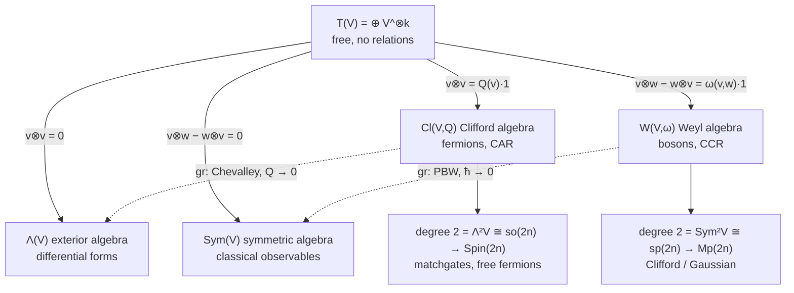

# Heisenberg-Weyl & Quantum Dynamics

## Quantum Harmonic Oscillator and Quantum Operators

* **Quantum Harmonic Oscillator as Source of All Operators (Physics Basis)**
  * **Analytically:** Every smooth potential near a local minimum approximates a parabola (Taylor expansion $V(x) \approx \frac{1}{2}k x^2$). Consequently, the QHO $\hat H \propto \hat P^2 + \hat Q^2 = \hbar\omega\left(\hat a^\dagger\hat a + \tfrac12\right) = \hbar\omega(\hat n + \tfrac12)$ serves as the universal local model of any bound physical system.
  * **Algebraically:** $\hat Q^2 + \hat P^2$ is the canonical degree-2 element of the Weyl algebra ($\mathrm{Sym}^2 V \cong \mathfrak{sp}$) — the bosonic counterpart of the Dirac operator. All quantum gates and dynamical evolutions derive from this single generator evaluated at different polynomial degrees.
  * **Every quantum gate is a time evolution** $U = e^{-i\hat Ht}$. **Time evolution as phase rotation:** In $\hat U(t) = e^{-i\hat Ht/\hbar}$, the exponent is dimensionless: time is fundamentally an angle. Quantum states do not travel along classical trajectories; their phase rotates (in an energy eigenstate at angular frequency $\omega = E/\hbar$).
  * **Kinetic $\leftrightarrow$ potential swap:** At $t=0$, the state resides in $Q$; after a quarter period $t = \frac{\pi}{2\omega}$, it has rotated $90^\circ$ into $P$. **This quarter turn is Quantum Fourier Transform.**
  * **Two Fundamental State Families (States, Not Gates)** *Coherent states $`\vert{}\alpha\rangle = \hat D(\alpha)\vert{}0\rangle`$:* Eigenstates of the annihilation operator $\hat a$; overcomplete, generated as degree-1 displacement outputs. *Fock states $`\vert{}n\rangle`$:* Orthonormal eigenstates of the number operator $\hat n = \hat a^\dagger\hat a$; form the eigenbasis of the quadratic degree-2 generator.
  * **Phase Space & Why Complex Numbers**: Complex amplitude $\hat a \propto \hat Q + i\hat P$: The real axis represents position, the imaginary axis represents momentum, and unitary rotation $e^{i\omega t}$ describes time evolution. Two real canonical coordinates merge into a single complex amplitude $\alpha = x + ip$, whose magnitude is preserved under unitary phase rotations.
  * **Position basis = Computational basis:** The basis states $\vert{}k\rangle$ are eigenstates of $\hat Q$. Consequently, $Z$ (diagonal phase) is a function of position, whereas $X$ (permutation / shift) is a function of momentum.
* **Exponentiation**
  * Exponentiation generates Gates: $\hat U = e^{-i\hat G\theta}$. The factor $e^{-i\theta}$ guarantees unitarity, $\hat G$ is the Hermitian generator of the transformation, and $\theta$ scales it. When $\hat G = \hat H$, then $\theta = t/\hbar$, meaning $\hat H$ *is* time evolution itself.
  * The generator is constructed directly from $\hat Q, \hat P$ for continuous variables (CV) or from $X, Z \pmod d$ for discrete qudits, grounded in the canonical commutation relations (CCR) $[\hat x, \hat p] = i\hbar$.
  * **Gaussian (linear):** Generators of degree $\leq 2$. "Linear" refers strictly to the Heisenberg action $U^\dagger \hat r U = S\hat r + d$, not to the generator itself. Symplectic phase-space structure is preserved.
  * **Non-Gaussian (nonlinear):** Generators of degree $\geq 3$. The Heisenberg action becomes nonlinear (e.g., $\hat p \to \hat p - 3\gamma t \hat q^2$), and the Wigner quasi-probability distribution develops negative regions.
  * **From energy term to gate.** The physical energy terms are quadratic, but the **elementary gates** exponentiate the *linear* field operators $\hat P$ and $\hat Q$.
* **Conjugation**
  * An operator generates translations of its canonically conjugate variable. This mechanism enables reciprocal basis changes $X \leftrightarrow Z$ via the Fourier transform ($X = \mathrm{DFT}^\dagger \, Z \, \mathrm{DFT}$) and underlies the Weyl displacement operator: $D_{q,p} = \tau^{qp} X^q Z^p$
  * **Commutation relations:** Continuous: $[\hat x, \hat p] = i\hbar$. Discrete: Weyl relation $ZX = \zeta_d XZ$.
  * **Notation:** $\zeta_d = e^{2\pi i/d}$ is the primitive $d$-th root of unity; $\tau = e^{i\pi/d}$ is the half-phase satisfying $\tau^2 = \zeta_d$. While many texts write $\omega$ for $\zeta_d$, here $\omega$ is reserved exclusively for oscillator frequency and the symplectic form.
  * **Synthesizing elementary gates:** Physical Hamiltonian terms are quadratic ($\hat P^2, \hat Q^2$), but elementary gates exponentiate the *linear* field operators:
    * Momentum operator $\hat P$ represents momentum but generates a **position shift**: $D_{q,0} \sim X^q \implies X \approx e^{-i\hat P\delta}$ (Shift / bit-flip).
    * Position operator $\hat Q$ represents position but generates a **momentum kick**: $D_{0,p} \sim Z^p \implies Z \approx e^{i\hat Q\delta}$ (Clock / phase-flip).
  * $`X = \mathrm{DFT}^\dagger\, Z\, \mathrm{DFT}`$ - In the momentum basis, the spatial shift operator becomes diagonal and acts identically to clock operator.
* **Kinetic Energy ($\hat P^2$ / Momentum & Shifts)** - Exponentiation $X \approx e^{-i\hat P\delta}$
  * **Continuous-Variable (CV) Observable:** $\hat P = \frac{i}{\sqrt{2}}(\hat a^\dagger - \hat a)$, representing the differential derivative operator $\approx i(X^\dagger - X)$. **Lattice Term:** Corresponds to hopping / kinetic kinetic energy or the discrete Laplacian $\approx X + X^\dagger$ (as probed in OTOC experiments).
  * **Qudit Gate (Shift):** $X^a\vert{}j\rangle = \vert{}j+a \bmod d\rangle$, acting as an off-diagonal permutation of basis states with eigenvalues given by powers of $\zeta_d$. **Qubit Gate (Bit-Flip):** Pauli $X$, which flips computational basis states ($\vert{}0\rangle \leftrightarrow \vert{}1\rangle$) with root of unity $\zeta_2 = -1$.
  * **Matrix Representation:** Real, off-diagonal permutation matrix.
  * **Conjugation Relation:** While $X$ physically *represents* momentum, it *generates* a spatial translation/position shift ($D_{q,0} \sim X^q$).
  * **Fourier Dual Representation:** $X = \mathrm{DFT}^\dagger \, Z \, \mathrm{DFT}$ — transformed into the momentum basis via the discrete Fourier transform, the spatial shift operator becomes diagonal and acts identically to the clock operator.
* **Potential Energy ($\hat Q^2$ / Position & Clocks)** - Exponentiation $Z \approx e^{i\hat Q\delta}$.
  * **Continuous-Variable (CV) Observable:** $\hat Q = \frac{1}{\sqrt{2}}(\hat a + \hat a^\dagger)$, possessing continuous real eigenvalues corresponding directly to spatial position ($k$). **Lattice Term:** On-site potential (diagonal energy landscape).
  * **Qudit Gate (Clock):** $Z^b\vert{}k\rangle = \zeta_d^{bk}\vert{}k\rangle$, applying a diagonal phase gradient along the unit circle; unitary for all $d$, but non-Hermitian when $d > 2$. **Qubit Gate (Phase-Flip):** Pauli $Z$, mapping $\vert{}j\rangle \mapsto (-1)^j\vert{}j\rangle$; strictly both unitary *and* Hermitian, making it directly measurable as a physical observable.
  * **Matrix Representation:** Diagonal matrix composed of complex phase factors.
  * **Conjugation Relation:** While $Z$ physically *represents* position, it *generates* a momentum translation/kick ($D_{0,p} \sim Z^p$).

The physical and information-theoretic complexity of the gate is determined by the **polynomial degree of the generator $\hat H$ in the phase-space operators $\hat Q, \hat P$**, and the criterion behind the ladder is whether that degree still **closes under the commutator**. Degree 1: displacements (Pauli / Heisenberg-Weyl). Degree 2: Gaussian / Clifford, classically simulable. Degree $\geq 3$: non-Gaussian / non-Clifford, universal, quantum advantage.

| Property | Degree 1: Translations (Displacements) | Degree 2: Gaussian / Clifford | Degree $\geq 3$: Non-Gaussian / Non-Clifford |
| --- | --- | --- | --- |
| **Generators ($\hat{H}$)** | Linear: $q\hat{P} - p\hat{Q}$, $\hat{a}$, $\hat{a}^\dagger$ | Purely quadratic: $\hat{Q}^2+\hat{P}^2$, $\hat{Q}^2-\hat{P}^2$, $\hat{Q}_1\hat{P}_2$ | Nonlinear: $\hat{Q}^3$, $\hat{n}^2$, many-body interactions ($n_\uparrow n_\downarrow$) |
| **Lie Algebra Closure** | Closes in $\mathfrak{h}_n$ (Heisenberg algebra, $\dim = 2n+1$); $[\hat{Q},\hat{P}]$ is central | Closes in $\mathfrak{sp}(2n,\mathbb{R})$ (symplectic); with degree 1: $\mathfrak{sp}(2n) \ltimes \mathfrak{h}_n$ | **Does not close:** $[\hat{Q}^3, \hat{P}^2] \sim \hat{Q}^2\hat{P} \implies$ generates an infinite-dimensional Lie algebra |
| **Action on Phase Space** | Rigid shift vector $(q, p)$; no change of shape or volume | Linear symplectic map: $U^\dagger \hat{r} U = S\hat{r}$ ($`S \in \mathrm{Sp}(2n)`$); shear, squeezing, rotation | Bends phase space nonlinearly; the Wigner function develops negative regions |
| **Continuous-Variable (CV) Gates** | **Displacement operator:** $\hat{D}(\alpha) = e^{\alpha\hat{a}^\dagger - \alpha^*\hat{a}}$ | **Rotator:** $R(\theta) = e^{-i\theta\hat{n}}$ **Squeezer:** $\hat{S}(r) = e^{\frac{r}{2}(\hat{a}^2 - \hat{a}^{\dagger 2})}$ **Beamsplitter:** $\hat{B}(\theta) = e^{\theta(\hat{a}_1^\dagger\hat{a}_2 - \hat{a}_1\hat{a}_2^\dagger)}$ | **Cubic phase gate:** $e^{i\gamma\hat{Q}^3}$ **Kerr nonlinearity:** $e^{i\chi\hat{n}^2}$ (basis for cat states / bosonic QEC) |
| **Discrete Qudit/Qubit Gates** | **Pauli Group $\mathcal{P}$ / HW:** • $X$ (shift / bit flip) • $Z$ (clock / phase flip) • $Y = iXZ$ is not a new generator, but the lattice point $(1,1)$ | **Clifford Group $\mathcal{C}$:** • **QFT / Hadamard ($H$):** Discrete phase rotation ($90^\circ$) • **Phase ($`S`$):** Corresponds to a shear ($P \to P+Q$) • **CNOT / C-SUM:** Two-mode entanglement ($e^{-i\hat{Q}_1\hat{P}_2}$) | **Non-Clifford:** • $T$ gate ($e^{-i\frac{\pi}{8}Z}$, discrete cubic phase) • Qudit $T_d$ ($\vert{}k\rangle \mapsto \zeta_d^{k^3}\vert{}k\rangle$) • Toffoli, Controlled-$`S`$ (CS) |
| **Classification & Clifford Hierarchy** | **Level $\mathcal{C}_1$:** $\mathcal{C}_1 = \mathcal{P}$ (forms an orthogonal operator basis of the state space) | **Level $\mathcal{C}_2$:** Normalizer of the Pauli group ($`\mathcal{C}/\mathcal{P} \cong \mathrm{Sp}(2n, \mathbb{Z}_d)`$) | **Level $\mathcal{C}_k$ ($k \geq 3$):** $`\mathcal{C}_k = \{U : U\mathcal{P}U^\dagger \subseteq \mathcal{C}_{k-1}\}`$. No longer groups; Clifford+$`T`$ is dense in $U(2^n)$ |
| **Classical Simulability** | Exactly and efficiently simulable | **Gottesman-Knill theorem:** Polynomial in $n$ via a $2n \times 2n$ symplectic tableau / CHP algorithm | Exponential cost: Scales with the stabilizer rank $\chi \approx 2^{0.396 t}$ ($t$ = number of $T$ gates) or the Wigner negativity |
| **Fermionic Counterpart** | **None:** Parity superselection forbids odd fermionic Hamiltonians | **Matchgates / Free Fermions:** Lie algebra $\mathfrak{so}(2n) \to \mathrm{Spin}(2n)$ | **Degree 3 is missing:** Non-simulability starts strictly at **degree 4** (e.g. Hubbard interaction $U n_\uparrow n_\downarrow$) |

---

**The Gottesman-Knill Principle (Degree 2)**
* An $n$-qubit stabilizer state is determined by $n$ independent, commuting Pauli operators.
* It is represented by an $n \times 2n$ binary tableau; gate updates cost $\mathcal{O}(n)$, measurements $\mathcal{O}(n^2)$.
* The Clifford group modulo Paulis is strictly finite: $\vert{}\mathcal{C}_n / \mathcal{P}_n\vert{} = \vert{}\mathrm{Sp}(2n, \mathbb{Z}_2)\vert{} \approx 2^{2n^2+n}$. The polynomial space of this manifold explains the efficient classical simulability compared with the doubly exponential full space $U(2^n)$.

**The Origin of Quantum Advantage (Degree $\geq 3$)**
* *Operator branching:* Every gate from $\mathcal{C}_3$ (such as the $T$ gate) can formally be written as a sum of Pauli matrices, but under iterated conjugation the number of terms explodes exponentially.
* *Stabilizer rank & magic simulation:* The classical runtime scales polynomially in the number of qubits $n$, but exponentially in the number of non-Clifford gates: $\chi(\vert{}T\rangle^{\otimes t}) \lesssim 2^{0.396 t}$
* *Magic state distillation:* Universal fault-tolerant computation produces non-Clifford resources via quantum teleportation and transversal Clifford filters. The **$T$-count** thus serves as the universal currency for algorithmic computational cost.

 
 

# Tensor Algebra $T(V)$

Tensor Algebra is the basis for Exterior, Symmetric, Clifford and Weyl algebra. The recipe: quotient the tensor algebra by a two-sided ideal generated in degree 2. The knob: the **parity of the bilinear form** in that ideal (symmetric $`Q`$ or antisymmetric $`\omega`$), plus whether you switch its value on at all.

Allgemein enthält die Tensoralgebra $T(V) = \bigoplus_k V^{\otimes k}$ alle Wörter in den Basisvektoren $e_i$ eines Raums $V$, ohne Regeln. Setzt man die Elemente $e_ie_j - s\,e_je_i - B_{ij}$ gleich null (man teilt durch das Ideal, das sie erzeugen), entstehen vier Algebren, je nach Vorzeichen $s$ und Form $B$:

| | $B = 0$ (klassisch) | $B \neq 0$ (quantisiert) |
|---|---|---|
| $s = +1$, $B$ antisymmetrisch | $\mathrm{Sym}(V)$: Polynome, die Observablen der klassischen Mechanik | Weyl-Algebra: Bosonen, $[\hat q, \hat p] = i\hbar$ |
| $s = -1$, $B$ symmetrisch | $\Lambda(V)$: Differentialformen | Clifford-Algebra: Fermionen, $\gamma_i\gamma_j + \gamma_j\gamma_i = 2\delta_{ij}$ |

*Solid arrows: quotient by the ideal on the label (upper two homogeneous, lower two inhomogeneous, i.e. quantized). Dashed arrows: the associated-graded functor, dequantization. Note the parity crossing: the symmetric form lands in the exterior square, the antisymmetric form in the symmetric square.*

|  | **Symmetric form $`Q`$** | **Antisymmetric form $`\omega`$** |
| --- | --- | --- |
| **Form off** (classical) | $\Lambda(V)$, exterior | $\mathrm{Sym}(V)$, symmetric |
| **Form on** (quantized) | $\mathrm{Cl}(V,Q)$, **fermions**, CAR | $W(V,\omega)$, **bosons**, CCR |

 

**Step 0, the source.** $T(V) = \bigoplus_k V^{\otimes k}$: 
* associative, non-commutative, no relations. Every relation below is introduced by hand as the generator of an ideal; 
* all four algebras are $T(V)/I$ and differ only in the ideal $I$.

**Step 1, homogeneous ideal (degree 2 $= 0$).**
* $\Lambda(V) = T(V)/\langle v\otimes v\rangle \implies v\wedge w = -w\wedge v$: differential forms, cohomology.
* $\mathrm{Sym}(V) = T(V)/\langle v\otimes w - w\otimes v\rangle \implies vw = wv$: polynomials, classical observables on phase space.
* The $\mathbb{Z}$-grading survives; these correspond to $\mathrm{Cl}$ with $Q=0$ and $W$ with $\omega = 0$.

**Step 2, switch the form on (the right-hand side becomes a number: this is quantization).**
* $\mathrm{Cl}(V,Q) = T(V)/\langle v\otimes v - Q(v)\mathbf{1}\rangle \implies vw + wv = 2Q(v,w)$: a vector squares to its length.
* $W(V,\omega) = T(V)/\langle v\otimes w - w\otimes v - \omega(v,w)\mathbf{1}\rangle \implies [v,w] = \omega(v,w)$: the commutator is a number, $[\hat q,\hat p] = i\hbar\mathbf{1}$.
* The ideal is now **inhomogeneous** (degree 2 mixed with degree 0), so the $\mathbb{Z}$-grading collapses to a **filtration**: *grading $`\to`$ filtration is what quantization means algebraically.*
* The deformation changes the product, not the space: $\Lambda(\mathbb{R}^2)$ and $\mathrm{Cl}(\mathbb{R}^2,Q)$ share the vector space basis $`\{1, e_1, e_2, e_1e_2\}`$ with different multiplication tables; PBW monomials $\hat q^a\hat p^b$ form a common basis of both $\mathrm{Sym}$ and $W$.
* **The twist: parity flips between input and output.**
* A symmetric input $g$ builds $\mathrm{Cl}(V,g)$, whose degree-2 part is the **exterior** square $\mathfrak{so} \cong \Lambda^2 V$ (via $\frac14[e_i,e_j]$) $`\to`$ Spin $`\to`$ **fermions**.
* An antisymmetric input $`\omega`$ builds $W(V,\omega)$, whose degree-2 part is the **symmetric** square $\mathfrak{sp} \cong \mathrm{Sym}^2 V$ (via $`\frac12\{\hat r_i,\hat r_j\}`$) $`\to`$ metaplectic $`\to`$ **bosons**.
* The labels cross. In supersymmetry both unify into one single construction on $\mathbb{Z}_2$-graded spaces.

**Step 3, the way back ($\mathrm{gr}$).** 
* Dequantization keeps only the top-degree part of each relation: $`\mathrm{gr}\,\mathrm{Cl}(V,Q) \cong \Lambda(V)`$ (**Chevalley**, $Q \to 0$) and $`\mathrm{gr}\,W(V,\omega) \cong \mathrm{Sym}(V)`$ (**PBW**, $\hbar \to 0$). These are **one theorem**: super-PBW on $\mathbb{Z}_2$-graded spaces *is* Chevalley.
* **Second road, the Lie route.** $U(\mathfrak{g}) = T(\mathfrak{g})/\langle x\otimes y - y\otimes x - [x,y]\rangle$ has the identical shape of ideal (hence "PBW deformation").
* Bosonic: $A_n = U(\mathfrak{h}_n)/(Z-1)$, where the universal enveloping algebra $U(\mathfrak{h}_n)$ supplies the products that the Lie algebra $\mathfrak{h}_n$ alone lacks.
* Fermionic: $\mathrm{Cl}(V,Q) = U(\mathfrak{h}^{\mathrm{super}})/(Z-1)$ with anticommutator bracket.

The QC bridge is **structurally one theorem**, once for $SO$/Spin, once for $Sp$/Mp. The size asymmetry is the sharpest physical difference: bosons require unbounded operators on infinite-dimensional Hilbert spaces, while fermions act naturally on a finite spinor space.

| Property | Fermions: $\mathrm{Cl}(V,Q)$ | Bosons: $W(V,\omega)$ |
| --- | --- | --- |
| **Statistics** | CAR $`\{a_i,a_j^\dagger\} = \delta_{ij}`$, $`\{\gamma_\mu,\gamma_\nu\} = 2g_{\mu\nu}`$ | CCR $[a_i,a_j^\dagger] = \delta_{ij}$, $[\hat x,\hat p] = i\hbar$ |
| **Size** | $\dim = 2^n$, the relation truncates powers | $\dim = \infty$, nothing truncates. **No finite-dimensional rep**: $\mathrm{tr}[A,B] = 0$ but $\mathrm{tr}(i\hbar\mathbf{1}) \neq 0$ |
| **Uniqueness** | Unique spinor module | **Stone–von Neumann** |
| **Canonical degree-2 square** | Dirac $\nabla = d + \delta$, $\nabla^2 = \Delta$ | Oscillator $H = \frac12(\hat p^2 + \hat q^2)$; Moyal star product |
| **Symmetry tower** | $\mathrm{O}(V,g) \supset \mathfrak{so}(n)$, $\dim \frac{n(n-1)}{2}$, Cartan types $B_n/D_n$, cover $\mathrm{Spin}(n)$ | $\mathrm{Sp}(2n) \supset \mathfrak{sp}(2n)$, $\dim n(2n+1)$, Cartan type $C_n$, cover $\mathrm{Mp}(2n)$ |
| **QC bridge** | Matchgates / free fermions = rotor in $\mathrm{Spin}(2n)$; non-free from **degree 4** | Clifford / Gaussian = symplectic action; magic from **degree 3** |

### From Weyl Algebra to Heisenberg-Weyl (How Bosons Reach Actual Qubits / Qudits)

Exponentiating rescues what the additive box forbids: trace vs. determinant. At the group level the test uses $\det$: $\det(ZXZ^{-1}X^{-1}) = 1$ must equal $\det(\zeta_d\mathbf{1}) = \zeta_d^d = 1$ ✓. The additive constraint is *unsatisfiable* in finite dimensions, but the multiplicative one is *automatically satisfied*. That is why the discrete Weyl relation $ZX = \zeta_d XZ$ exists in exact $d\times d$ complex matrices, providing the complete pathway from the continuous Weyl algebra to the discrete Heisenberg-Weyl algebra.

| Level | Continuous | Discrete |
| --- | --- | --- |
| **Additive** (Lie bracket) | Weyl algebra $A_n = W(V,\omega)$: all polynomials in $\hat q,\hat p$, home of Hamiltonians and the degree filter | **Does not exist.** Trace argument: $\mathrm{Tr}([\hat q,\hat p]) = 0$ but $\mathrm{Tr}(i\hbar\mathbf{1}) = i\hbar d \neq 0$ |
| **Multiplicative** (operator product) | Heisenberg group $H_n$ / CCR $C^*$-algebra: $W(z)W(z') = e^{-\frac{i}{2}\omega(z,z')}W(z+z')$, linked to $A_n$ by Stone–von Neumann | HW algebra $M_d(\mathbb{C}) \cong \mathbb{C}_\omega[\mathbb{Z}_d \times \mathbb{Z}_d]$, spanned by the $d^2$ matrices $X^qZ^p$ |

* **Up:** $\mathfrak{h}_n \xrightarrow{\exp} H_n$ (BCH series terminates cleanly because $[\hat Q,\hat P]$ is central; the additive Lie bracket maps into a multiplicative phase factor).
* **Down:** Differentiate at the identity along one-parameter subgroups.
* **Sideways:** $G \xrightarrow{\mathrm{span}} M_d(\mathbb{C})$ via the group algebra (linear span of group elements, *not* by $\exp$; algebras themselves are not exponentiated).
* **Limit:** The asymptotic regime $d \to \infty$ turns $ZX = \zeta_d XZ$ continuously back into $[\hat Q,\hat P] = i\hbar\mathbf{1}$.

**Stone–von Neumann, stated.** Every irreducible, strongly continuous unitary representation of the Weyl relations $W(z)W(z') = e^{-\frac i2\omega(z,z')}W(z+z')$ for *finitely many* degrees of freedom is unitarily equivalent to the Schrödinger representation on $L^2(\mathbb{R}^n)$. Consequences:
1. Position and momentum representations describe identical physics in different coordinates, with the Fourier transform serving as the intertwining operator.
2. The discrete analogue is unique in precisely the same way: $M_d(\mathbb{C})$ has, up to unitary equivalence, exactly one irreducible representation of $ZX = \zeta_d XZ$, explaining why "the" qudit clock and shift operators are canonical.
3. The theorem **fails** for infinitely many degrees of freedom (quantum field theory, thermodynamic limit): inequivalent representations exist, which is Haag's theorem and the structural origin of superselection sectors. Finite-$`n`$ uniqueness is what makes phase-space methods and the operator degree ladder unambiguous.

### Symplectic Form

A **form** evaluates to a scalar: 
* $0$-form = scalar function, 
* $1$-form = covector field, 
* $2$-form = bilinear form.

Differential forms $\Omega^k(M) = \Gamma(\Lambda^k T^*M)$ integrate intrinsically over oriented submanifolds without coordinate choices ($1$-forms over curves yield work; $2$-forms over surfaces yield flux). The **symplectic form $`\omega`$** is a differential $2$-form defined by three properties:

* **Alternating:** Pointwise antisymmetric, $\omega(u,v) = -\omega(v,u)$.
* **Closed:** $d\omega = 0$, guaranteeing the absence of local curvature invariants (Darboux's theorem).
* **Non-degenerate:** Forces an **even dimension** $2n$ (coordinates naturally pair into positions $q_i$ and momenta $p_i$) and produces the nowhere-vanishing **Liouville volume form** $\omega^n$.
* **Darboux's Theorem:** Locally, every symplectic manifold is symplectomorphic to standard phase space $(\mathbb{R}^{2n}, \sum_{i=1}^n dq_i \wedge dp_i)$. Because there are no local invariants, the only geometric structure a Gaussian/Clifford operation can preserve is $`\omega`$ itself. This is why $\mathrm{Sp}(2n)$ (continuous) and $\mathrm{Sp}(2n,\mathbb{Z}_d)$ (discrete, with symplectic product $\omega(z,z') = qp' - q'p \pmod d$) act as the universal structure groups of degree 2.
* **Liouville's Theorem:** The phase-space volume $\omega^n$ is invariant under Hamiltonian flows, and its quantum shadow is unitarity. The Wigner function utilized in quantum learning is precisely a quasi-probability density evaluated against this Liouville volume form, and Hudson's theorem dictates that dynamics generated by Hamiltonians of degree $\leq 2$ preserve the non-negativity of Gaussian Wigner distributions.

 
 

# Quantum Simulation & Quantum Dynamics

## Quantum Simulation

Every simulation method in physics and chemistry can be classified along three axes:
* **Model**: **Classical:** Neglects electrons; atoms are approximated as point masses connected by springs (empirical force fields). **Quantum:** Explicitly accounts for electrons, orbitals, and many-body correlation.
* **Computing**: Computation runs either on classical hardware (CPU/GPU/supercomputer) or on qubit processors.
* **Type**: **Static (ground state / eigenvalue problem):** $\hat{H}\vert{}\psi\rangle = E\vert{}\psi\rangle$. Energy optimization: For eigenstates, $\Psi(t) = \psi e^{-iEt/\hbar}$; probability densities $\vert{}\Psi(t)\vert{}^2$ are time-invariant. Solution approach: Search for global minima on energy hypersurfaces via the Rayleigh-Ritz variational principle or VQE. **Dynamic (time evolution):** $i\hbar\,\partial_t\Psi = \hat{H}\Psi$. Propagation: No general variational principle, no forward-in-time shortcut theorem. Required for non-equilibrium chemistry, bond breaking in collisions, non-adiabatic excitations, and quantum chaos. 

Core axiom: For static problems, QC stores information. In dynamical evolution, QC is the physical Hilbert space.

| Model | Computing | **Static** (optimization via variational principle, states) | **Dynamic** (explicit time propagation, time evolution) |
| --- | --- | --- | --- |
| **Classical Model** | **Classical Hardware** | **Docking, Energy Minimization:** Geometric fitting (AutoDock, Rosetta) | **Molecular Dynamics (MD):** $F = ma$, classical trajectories via force fields (GROMACS, NAMD, AMBER) |
| **Classical Model** | **Quantum Hardware** | Discrete combinatorial optimization (e.g. conformational search via QAOA / annealing) | **Linear PDE Solvers:** Navier-Stokes via the HHL algorithm, flow and weather models |
| **Quantum Model** | **Classical Hardware** | **HF, DFT, Post-HF:** $\hat{H}\vert{}\psi\rangle = E\vert{}\psi\rangle$ • HF ignores correlation • DFT approximates via the electron density $\rho$ • Post-HF (CC, CI) exact, but exponential in $N$ | **TD-DFT & Wave Packet Dynamics:** Excitations, spectra, fluorescence. • Exact propagation $e^{-i\hat{H}t/\hbar}\vert{}\Psi(0)\rangle$ scales exponentially in $N$ |
| **Quantum Model** | **Quantum Hardware** | **VQE (NISQ) & QPE (Fault-Tolerant):** Determination of the correlation energy via parametrized entanglement / phase measurement | **Hamiltonian Simulation:** Coherent time evolution $e^{-iHt}\vert{}\psi(0)\rangle$ in the $2^n$-dimensional Hilbert space via Trotter, QSVT, or Shadow Simulation |

<table>
  <thead>
    <tr>
      <th>Model</th>
      <th>Computing</th>
      <th><b>Static</b> (optimization via variational principle, states)</th>
      <th><b>Dynamic</b> (explicit time propagation, time evolution)</th>
    </tr>
  </thead>
  <tbody>
    <tr>
      <td rowspan="2"><b>Classical Model</b></td>
      <td><b>Classical Hardware</b></td>
      <td><b>Docking, Energy Minimization:</b> Geometric fitting (AutoDock, Rosetta)</td>
      <td><b>Molecular Dynamics (MD):</b> $F = ma$, classical trajectories via force fields (GROMACS, NAMD, AMBER)</td>
    </tr>
    <tr>
      <td><b>Quantum Hardware</b></td>
      <td>Discrete combinatorial optimization (e.g. conformational search via QAOA / annealing)</td>
      <td><b>Linear PDE Solvers:</b> Navier-Stokes via the HHL algorithm, flow and weather models</td>
    </tr>
    <tr>
      <td rowspan="2"><b>Quantum Model</b></td>
      <td><b>Classical Hardware</b></td>
      <td><b>HF, DFT, Post-HF:</b> $\hat{H}\vert\psi\rangle = E\vert\psi\rangle$ • HF ignores correlation • DFT approximates via the electron density $\rho$ • Post-HF (CC, CI) exact, but exponential in $N$</td>
      <td><b>TD-DFT &amp; Wave Packet Dynamics:</b> Excitations, spectra, fluorescence. • Exact propagation $e^{-i\hat{H}t/\hbar}\vert\Psi(0)\rangle$ scales exponentially in $N$</td>
    </tr>
    <tr>
      <td><b>Quantum Hardware</b></td>
      <td><b>VQE (NISQ) &amp; QPE (Fault-Tolerant):</b> Determination of the correlation energy via parametrized entanglement / phase measurement</td>
      <td><b>Hamiltonian Simulation:</b> Coherent time evolution $e^{-iHt}\vert\psi(0)\rangle$ in the $2^n$-dimensional Hilbert space via Trotter, QSVT, or Shadow Simulation</td>
    </tr>
  </tbody>
</table>

### Static Quantum Chemistry

* **Correlation Problem**: 
  * Only the 1-electron hydrogen atom is analytically solvable; from two electrons on, the Coulomb repulsion forces approximation methods. 
  * *Born-Oppenheimer approximation:* Nuclei are treated as fixed on electronic timescales $\implies$ potential energy surface (PES). 
  * *Rayleigh-Ritz principle:* $\langle\psi\vert{}H\vert{}\psi\rangle \geq E_0$ yields upper bounds for the ground state.
* **Strategies for static quantum chemistry**
  * **Hartree–Fock (HF)**. Treatment of Electron Correlation: Mean field; neglects correlation entirely. Scaling: Cheap: Polynomial ($O(N^4)$ to $`O(N^3)`$)
  * **Density Functional Theory (DFT)**. Treatment of Electron Correlation: Approximated via exchange-correlation functionals of the density $\rho$. Scaling: Cheap: Favorable polynomial scaling
  * **Post-HF (Coupled Cluster, CI)**. Treatment of Electron Correlation: Systematically exact treatment of correlation. Scaling: Exponential in $N$; FCI scales combinatorially with $\binom{M}{N}$
  * **Variational Quantum Eigensolver (VQE)**. Treatment of Electron Correlation: Directly on the qubit register via many-body entanglement. Scaling: NISQ heuristic; target: strongly correlated molecules
* **Chemical Accuracy & Scaling Limits**
  * *Target precision:* $1\text{ kcal/mol} \approx 1.6\text{ mHa} \approx 43\text{ meV}$ (needed for reaction rates at room temperature to within an order of magnitude).
  * *Limits of classical methods:* The gold standard $\text{CCSD(T)}$ scales as $O(N^7)$ and fails for strong static correlation (multireference systems, transition-metal catalysis such as FeMoco).
* **Fault-Tolerant Quantum Phase Estimation (QPE)**
  * Replaces VQE on fault-tolerant hardware; uses block-encoded Hamiltonians.
  * Achieves Heisenberg-limited precision with respect to oracle queries.
  * **The Overlap Bottleneck:** If the overlap between the classical initial state $\vert{}\phi\rangle$ and the ground state $\vert{}\psi_0\rangle$ is exponentially small ($\vert{}\langle\phi\vert{}\psi_0\rangle\vert{}^2 \leq 2^{-\Omega(n)}$), QPE requires exponentially many repetitions (Guided Local Hamiltonian Problem).

### Dynamic Simulation on Quantum Computers

* **Fundamental Problem**
  * Nature switches on all terms simultaneously; quantum gates run sequentially.
  * Since terms do not commute ($[A, B] \neq 0$), we have: $e^{-i(A+B)t} \neq e^{-iAt}e^{-iBt}$.
* **Propagation Strategies**
  * **Trotter-Suzuki** (and qDRIFT) to Discretize Time. Decomposed Element: Physical time $t$ split into $r$ time steps. Ideal for **NISQ** (low depth, no ancillas).
  * **Qubitization** (and QSVT) to transform the Spectrum*. Decomposed Element: Continuous energy spectrum mapped to rotation angles ($E_k = \lambda\cos\theta_k$). Ideal for **Fault-Tolerant** (ancilla register, block encoding).
  * **Shadow Simulation** to reduce the space. Decomposed Element: Full state space ($2^n$) projected onto $M$ observable expectation values. Ideal for **NISQ & Fault-Tolerant** (requires algebraic closure).
* **Bounds & Fast-Forwarding**
  * *No-fast-forwarding theorem:* The linear dependence of the runtime on the time $t$ is strictly optimal for generic Hamiltonians; additive term $\log(1/\epsilon)$ for function approximations.
  * *Exceptions:* Fast-forwarding ($t \ll \Vert{}H\Vert{}t$) is only possible for special structures (e.g. commuting terms, quadratic fermionic systems).
**Open Quantum Systems: Non-Unitary Dynamics**
* **From Unitaries to Quantum Channels**
  * Isolated systems: Unitary evolution via the Schrödinger equation ($U^\dagger U = \mathbb{1}$, reversibility, purity is preserved).
  * Coupled systems (bath, measurement, dissipation): Non-unitary; described by **CPTP maps** (completely positive, trace-preserving maps).
  * *Kraus representation:* $\mathcal{E}(\rho) = \sum_k K_k \rho K_k^\dagger$ with $\sum_k K_k^\dagger K_k = \mathbb{1}$.
  * *Stinespring dilation:* Embeds any CPTP dynamics unitarily into a larger total space (system + ancilla environment).
* **GKSL-Lindblad Master Equation (Markovian Regime)** $\frac{d\rho}{dt} = -i[H,\rho] + \sum_k \gamma_k \left( L_k \rho L_k^\dagger - \frac{1}{2}\{L_k^\dagger L_k, \rho\} \right)$
  * *Coherent term ($`-i[H,\rho]`$):* Unitary evolution generated by the system Hamiltonian.
  * *Dissipative term ($`L_k`$):* Lindblad jump operators model relaxation processes:
    * $T_1$ (energy relaxation / amplitude damping, e.g. spontaneous emission).
    * $T_2$ (phase damping / elastic scattering).
* **Hardware Realization of Open Dynamics**
  * *NISQ:* Quantum trajectories / Monte Carlo wavefunction (MCWF) with stochastic collapses and mid-circuit resets.
  * *Fault-Tolerant:* Block encoding of Kraus and Lindblad operators via LCU methods (Linear Combinations of Unitaries); scales in time as $\mathcal{O}(t\,\mathrm{polylog}(t/\epsilon))$.
  * *Non-Markovian dynamics:* Environments with memory effects and strong entanglement fall outside the Lindblad formalism and form a current research frontier.

 

## Quantum Dynamics (Chaos, Scrambling & OTOCs)

Classical chaos means that nearby trajectories separate exponentially. The Schrödinger equation is linear and unitary, so two quantum states never separate: their overlap stays constant in time. Quantum chaos therefore shows up elsewhere: in how fast simple operators become complicated, in how the energy levels are spaced, and in what the eigenstates look like. The terms below are sorted by these perspectives.

**Timescales** for a system with $N$ degrees of freedom, entropy $S$ and inverse temperature $\beta$:

| Time | Scale | What happens |
| --- | --- | --- |
| Thermalization time $t_d$ | $\mathcal{O}(1)$ in lattice units, $\sim\beta$ in strongly coupled systems | Two-point functions decay, local observables look thermal |
| Scrambling time $t_*$ | $\sim\lambda_L^{-1}\ln N$ (all-to-all), $\sim L/v_B$ (local chain of length $L$) | OTOCs decay, local information is spread over the whole system |
| Heisenberg time $t_H$ | $\sim 2\pi\hbar/\Delta \sim e^{S}$, with $\Delta$ the mean level spacing | The discreteness of the spectrum becomes visible, the spectral form factor reaches its plateau |
| Recurrence time | $\sim e^{e^{S}}$ | The state returns close to its initial state (Poincaré recurrence) |

### 1. Spreading: How Fast Can Information Move?

* **Lieb-Robinson bound:** For short-range interactions on a lattice, $`\Vert[A(t), B]\Vert \leq C e^{-\mu(d - v_{LR}t)}`$ for operators at distance $d$. Outside the light cone $d > v_{LR}t$ every signal is exponentially small, whatever the state. Consequence for hardware: a circuit of nearest-neighbour gates needs depth $\sim n$ in 1D, $\sim\sqrt{n}$ in 2D and $\sim\log n$ with all-to-all gates to entangle all $n$ qubits.
* **Quench:** A sudden change of the Hamiltonian, e.g. preparing the ground state of $H_0$ and evolving it with $H_1$. The standard way to drive a closed system out of equilibrium.
* **Quasiparticle picture:** After a quench, pairs of entangled quasiparticles fly apart ballistically and carry correlations and entanglement with them. This explains the linear light cones seen in correlation functions (Calabrese-Cardy).
* **Entanglement growth:** After a quench the half-chain entanglement entropy grows linearly, $S(t) = v_E t$, until it saturates at a volume law. The entanglement velocity obeys $v_E \leq v_B \leq v_{LR}$. In localized systems it grows only like $\log t$.

### 2. Operator Growth and Scrambling

* **Operator growth:** In the Heisenberg picture, $W(t) = e^{iHt}We^{-iHt}$ turns a local operator (e.g. a single Pauli $Z$) into a superposition of ever longer Pauli strings. Chaos means that this weight spreads over all strings.
* **Scrambling:** Local information is spread into non-local correlations among many degrees of freedom. Globally it is still there (the evolution is unitary and reversible), but no measurement on a small subsystem can recover it.
* **Out-of-time-order correlator (OTOC):** $F(t) = \langle W^\dagger(t)V^\dagger W(t)V\rangle$ for two operators that commute at $t = 0$. For unitary $W, V$ the squared commutator is $`C(t) = \langle [W(t),V]^\dagger [W(t),V] \rangle = 2(1 - \mathrm{Re}\,F(t))`$; it grows, and $F(t)$ decays, once the support of $W(t)$ reaches $V$. "Out of time order" because the time contour runs $0 \to t \to 0 \to t \to 0$; ordinary two-point functions decay already at $t_d$ and do not see scrambling.
* **Loschmidt echo:** The way to measure an OTOC. Evolve forward with $e^{-iHt}$, apply the "butterfly" perturbation $V$, evolve backward with $e^{+iHt}$ (on hardware by flipping the sign of $H$), then measure $W$. Only what fails to cancel because of non-commutation survives. OTOCs have been measured this way with NMR, trapped ions and superconducting qubits.
* **Quantum Lyapunov exponent $\lambda_L$:** The early-time growth rate, $C(t) \sim \frac{1}{N}e^{\lambda_L t}$, in systems with many degrees of freedom per site. Semiclassically $`C(t) \to \hbar^2\{x(t), p\}^2 \sim \hbar^2 e^{2\lambda_{\mathrm{cl}} t}`$, so $\lambda_L$ is the quantum analogue of the classical Lyapunov exponent. Spin-1/2 chains usually have no clean exponential window.
* **Butterfly velocity $v_B$:** The speed of the OTOC front, $C(t, x) \sim \frac{1}{N}\exp[\lambda_L(t - x/v_B)]$. Unlike $v_{LR}$ it depends on the state and the temperature, and $v_B \leq v_{LR}$. In 1D chains it is easier to measure than $\lambda_L$.
* **Mixed-field Ising chain:** The standard test model, $H = \sum_i Z_i Z_{i+1} + h_x \sum_i X_i + h_z \sum_i Z_i$. With $h_z = 0$ it maps to free fermions (integrable, ballistic quasiparticles, no scrambling); with both fields on, e.g. $h_x = 1.05$, $h_z = 0.5$, it is chaotic.
* **Random circuits:** A brickwork of random two-qubit gates, the minimal model of chaos without energy conservation. Operator fronts move at $v_B$ and broaden diffusively ($\propto\sqrt{t}$ in 1D); the fluctuations of entanglement growth follow KPZ scaling ($\propto t^{1/3}$).
* **Unitary $t$-design:** An ensemble of unitaries whose first $t$ moments equal those of the Haar measure (uniformly random unitaries). Deep random circuits become approximate designs; a 2-design already fixes OTOC averages and barren plateaus.
* **Krylov complexity:** The repeated commutators $W, [H,W], [H,[H,W]], \dots$ span the Krylov space. The Lanczos algorithm turns the Liouvillian $\mathcal{L} = [H,\cdot]$ into a tridiagonal hopping chain with coefficients $b_n$, and $`K(t) = \sum_n n\vert\varphi_n(t)\vert^2`$ is the mean position of the operator on that chain. It grows like $e^{2\alpha t}$ when $b_n \approx \alpha n$, more slowly otherwise.
* **Operator growth hypothesis:** In chaotic systems the Lanczos coefficients grow as fast as possible, linearly, $b_n \approx \alpha n$ (Parker et al. 2019). Then $\lambda_L \leq 2\alpha$, and at temperature $T$ one has $\alpha \leq \pi T$, which reproduces the MSS bound. Caveat: exponential Krylov growth also appears at unstable saddle points of integrable systems, so it is not a unique signature of chaos.

### 3. Spectral Statistics

* **Level repulsion:** In chaotic systems neighbouring energy levels avoid each other, the spacing distribution vanishes as $P(s) \propto s^\beta$ for small $s$ (Wigner-Dyson). In integrable systems the levels are uncorrelated and $P(s) = e^{-s}$ (Poisson, Berry-Tabor 1977).
* **BGS conjecture:** Quantum systems whose classical limit is chaotic have the level statistics of random matrices (Bohigas, Giannoni, Schmit 1984).
* **Random-matrix ensembles:** GOE ($\beta = 1$, time-reversal symmetric), GUE ($\beta = 2$, time reversal broken), GSE ($\beta = 4$, time reversal with half-integer spin). $\beta$ is the exponent of level repulsion.
* **Unfolding:** Rescaling the spectrum so that the mean level spacing is 1 everywhere, before comparing it with random matrices.
* **Gap ratio:** $`r_n = \min(s_n, s_{n+1})/\max(s_n, s_{n+1})`$ for consecutive spacings; needs no unfolding. Mean value $\langle r\rangle \approx 0.39$ (Poisson), $0.53$ (GOE), $0.60$ (GUE).
* **Symmetry resolution:** Levels from different symmetry sectors do not repel each other. Mixing sectors makes a chaotic spectrum look Poissonian, so all conserved quantities have to be resolved first.
* **Spectral form factor (SFF):** $K(t) = \langle\vert\mathrm{Tr}\,e^{-iHt}\vert^2\rangle$. It shows a dip (the smooth density of states decays), a linear ramp (long-range correlations between levels, the signature of random matrices) and a plateau after the Heisenberg time; it sees chaos long after the OTOCs have saturated.

### 4. Eigenstates and Thermalization

* **Thermalization in a closed system:** Local observables relax to the values of a thermal ensemble at the same energy, although the global state stays pure. The rest of the system acts as the bath.
* **Eigenstate thermalization hypothesis (ETH):** Matrix elements of local observables in energy eigenstates have the form $`A_{mn} = \mathcal{A}(\bar{E})\delta_{mn} + e^{-S(\bar{E})/2} f_A(\bar{E},\omega) R_{mn}`$. The diagonal part is the smooth thermal value, so a single eigenstate already looks thermal; the off-diagonal part is exponentially small and random and governs fluctuations and relaxation (Deutsch 1991, Srednicki 1994).
* **Typicality and Page value:** A random pure state is almost maximally entangled. For subsystems of dimension $m \leq n$ the average entanglement entropy is $S_A \approx \ln m - \frac{m}{2n}$ (Page 1993). Eigenstates in the middle of a chaotic spectrum have such volume-law entanglement.
* **Generalized Gibbs ensemble (GGE):** Integrable systems relax not to a Gibbs state but to $\rho \propto e^{-\sum_k \lambda_k I_k}$, one Lagrange multiplier for each conserved quantity $I_k$.
* **Prethermalization:** A long-lived quasi-stationary state before full thermalization, typical for nearly integrable systems and for fast periodic driving.

### 5. When Thermalization Fails

* **Integrability:** An extensive number of local conserved quantities (free fermions, Bethe-ansatz models). Consequences: Poisson level statistics, relaxation to a GGE, ballistic transport.
* **Anderson localization:** Disorder localizes single-particle wave functions exponentially, and transport stops.
* **Many-body localization (MBL):** Strong disorder plus interactions. Local integrals of motion ("l-bits") keep a memory of the initial state forever; eigenstates have area-law entanglement, the levels are Poissonian, and entanglement grows only like $\log t$. Whether MBL is stable in infinitely large systems is debated (avalanches).
* **Quantum many-body scars:** A few special non-thermal eigenstates inside an otherwise chaotic spectrum (weak violation of ETH). They cause long-lived revivals, first seen in Rydberg-atom arrays (PXP model).
* **Hilbert-space fragmentation:** Kinetic constraints, e.g. conservation of the dipole moment, split the Hilbert space into exponentially many disconnected sectors; states do not thermalize even without disorder.

### 6. Information and Gravity

* **MSS bound:** $\lambda_L \leq 2\pi k_B T/\hbar = 2\pi/\beta$ (Maldacena, Shenker, Stanford 2016). It follows from analyticity of the OTOC in the thermal strip $0 \leq \mathrm{Im}\,t \leq \beta$.
* **Fast scramblers:** Systems that scramble in $t_* \sim \log N$, the fastest possible. Black holes are conjectured to be the fastest scramblers in nature (Sekino-Susskind 2008).
* **SYK model:** $N$ Majorana fermions with random all-to-all four-body interactions (Sachdev-Ye, Kitaev). Solvable at large $N$, saturates the MSS bound and is dual to JT gravity in $\mathrm{AdS}_2$.
* **Hayden-Preskill protocol:** Information thrown into a black hole that is older than the Page time can be recovered from a few Hawking quanta after the scrambling time. The Yoshida-Kitaev decoder recovers it with a fidelity set by the OTOC.
* **Page curve:** If black-hole evaporation is unitary, the entanglement entropy of the Hawking radiation first rises and then falls back to zero; the turnover is the Page time, when half of the entropy has been emitted.

### 7. Measurement and Driving

* **Floquet systems:** Periodically driven, $H(t + T) = H(t)$; the one-period evolution defines an effective Floquet Hamiltonian, $U_F = e^{-iH_F T}$. Generic interacting Floquet systems absorb energy until they reach infinite temperature; MBL or fast driving (prethermalization) delay this.
* **Discrete time crystal:** A driven many-body system that responds at a multiple of the drive period (e.g. period doubling) and keeps doing so under perturbations. Needs MBL or prethermalization to avoid heating; observed on superconducting qubits, trapped ions and NV centres.
* **Measurement-induced phase transition:** Random circuits interrupted by measurements at rate $p$. Below a critical rate the individual trajectories have volume-law entanglement, above it area-law. The transition is visible only in single measurement records, which makes it hard to observe (post-selection problem).
* **Monitored dynamics:** Evolution conditioned on measurement outcomes, described by quantum trajectories instead of a single density matrix.

### 8. Scrambling in Quantum Computing

* **Scrambling vs. decoherence:** Both make OTOCs decay. Scrambling is unitary: the global state stays pure and the information can be recovered. Decoherence loses information irreversibly to an environment, raises the global entropy, and can mimic a false Lyapunov exponent. Echoes without the perturbation or teleportation-based protocols (Yoshida-Yao) separate the two.
* **Barren plateaus:** Deep, randomly initialized parametrized circuits approximate 2-designs, and their gradients vanish exponentially, $`\mathrm{Var}_\theta[\partial_\theta\langle H\rangle] \sim 2^{-n}`$ (McClean et al. 2018). Scrambling as an obstacle: such variational algorithms cannot be trained.
* **Random circuit sampling:** Scrambled circuits give output probabilities with Porter-Thomas statistics, $P(p) = D e^{-Dp}$ with $D = 2^n$. Scrambling as a resource: this is the basis of quantum-advantage experiments.
