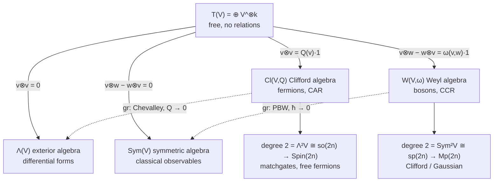

# Tensor Algebra $T(V)$

Tensor Algebra is the basis for Exterior, Symmetric, Clifford and Weyl algebra. The recipe: quotient the tensor algebra by a two-sided ideal generated in degree 2. The knob: the **parity of the bilinear form** in that ideal (symmetric $`Q`$ or antisymmetric $`\omega`$), plus whether you switch its value on at all.

*Solid arrows: quotient by the ideal on the label (upper two homogeneous, lower two inhomogeneous, i.e. quantized). Dashed arrows: the associated-graded functor, dequantization. Note the parity crossing: the symmetric form lands in the exterior square, the antisymmetric form in the symmetric square.*

|  | **Symmetric form $`Q`$** | **Antisymmetric form $`\omega`$** |
| --- | --- | --- |
| **Form off** (classical) | $\Lambda(V)$, exterior | $\mathrm{Sym}(V)$, symmetric |
| **Form on** (quantized) | $\mathrm{Cl}(V,Q)$, **fermions**, CAR | $W(V,\omega)$, **bosons**, CCR |

 

**Step 0, the source.** $T(V) = \bigoplus_k V^{\otimes k}$: 
* associative, non-commutative, no relations. Every relation below is introduced by hand as the generator of an ideal; 
* all four algebras are $T(V)/I$ and differ only in the ideal $I$.

**Step 1, homogeneous ideal (degree 2 $= 0$).**
* $\Lambda(V) = T(V)/\langle v\otimes v\rangle \implies v\wedge w = -w\wedge v$: differential forms, cohomology.
* $\mathrm{Sym}(V) = T(V)/\langle v\otimes w - w\otimes v\rangle \implies vw = wv$: polynomials, classical observables on phase space.
* The $\mathbb{Z}$-grading survives; these correspond to $\mathrm{Cl}$ with $Q=0$ and $W$ with $\omega = 0$.

**Step 2, switch the form on (the right-hand side becomes a number: this is quantization).**
* $\mathrm{Cl}(V,Q) = T(V)/\langle v\otimes v - Q(v)\mathbf{1}\rangle \implies vw + wv = 2Q(v,w)$: a vector squares to its length.
* $W(V,\omega) = T(V)/\langle v\otimes w - w\otimes v - \omega(v,w)\mathbf{1}\rangle \implies [v,w] = \omega(v,w)$: the commutator is a number, $[\hat q,\hat p] = i\hbar\mathbf{1}$.
* The ideal is now **inhomogeneous** (degree 2 mixed with degree 0), so the $\mathbb{Z}$-grading collapses to a **filtration**: *grading $`\to`$ filtration is what quantization means algebraically.*
* The deformation changes the product, not the space: $\Lambda(\mathbb{R}^2)$ and $\mathrm{Cl}(\mathbb{R}^2,Q)$ share the vector space basis $`\{1, e_1, e_2, e_1e_2\}`$ with different multiplication tables; PBW monomials $\hat q^a\hat p^b$ form a common basis of both $\mathrm{Sym}$ and $W$.
* **The twist: parity flips between input and output.**
* A symmetric input $g$ builds $\mathrm{Cl}(V,g)$, whose degree-2 part is the **exterior** square $\mathfrak{so} \cong \Lambda^2 V$ (via $\frac14[e_i,e_j]$) $`\to`$ Spin $`\to`$ **fermions**.
* An antisymmetric input $`\omega`$ builds $W(V,\omega)$, whose degree-2 part is the **symmetric** square $\mathfrak{sp} \cong \mathrm{Sym}^2 V$ (via $`\frac12\{\hat r_i,\hat r_j\}`$) $`\to`$ metaplectic $`\to`$ **bosons**.
* The labels cross. In supersymmetry both unify into one single construction on $\mathbb{Z}_2$-graded spaces.

**Step 3, the way back ($\mathrm{gr}$).** 
* Dequantization keeps only the top-degree part of each relation: $`\mathrm{gr}\,\mathrm{Cl}(V,Q) \cong \Lambda(V)`$ (**Chevalley**, $Q \to 0$) and $`\mathrm{gr}\,W(V,\omega) \cong \mathrm{Sym}(V)`$ (**PBW**, $\hbar \to 0$). These are **one theorem**: super-PBW on $\mathbb{Z}_2$-graded spaces *is* Chevalley.
* **Second road, the Lie route.** $U(\mathfrak{g}) = T(\mathfrak{g})/\langle x\otimes y - y\otimes x - [x,y]\rangle$ has the identical shape of ideal (hence "PBW deformation").
* Bosonic: $A_n = U(\mathfrak{h}_n)/(Z-1)$, where the universal enveloping algebra $U(\mathfrak{h}_n)$ supplies the products that the Lie algebra $\mathfrak{h}_n$ alone lacks.
* Fermionic: $\mathrm{Cl}(V,Q) = U(\mathfrak{h}^{\mathrm{super}})/(Z-1)$ with anticommutator bracket.

The QC bridge is **structurally one theorem**, once for $SO$/Spin, once for $Sp$/Mp. The size asymmetry is the sharpest physical difference: bosons require unbounded operators on infinite-dimensional Hilbert spaces, while fermions act naturally on a finite spinor space.

| Property | Fermions: $\mathrm{Cl}(V,Q)$ | Bosons: $W(V,\omega)$ |
| --- | --- | --- |
| **Statistics** | CAR $`\{a_i,a_j^\dagger\} = \delta_{ij}`$, $`\{\gamma_\mu,\gamma_\nu\} = 2g_{\mu\nu}`$ | CCR $[a_i,a_j^\dagger] = \delta_{ij}$, $[\hat x,\hat p] = i\hbar$ |
| **Size** | $\dim = 2^n$, the relation truncates powers | $\dim = \infty$, nothing truncates. **No finite-dimensional rep**: $\mathrm{tr}[A,B] = 0$ but $\mathrm{tr}(i\hbar\mathbf{1}) \neq 0$ |
| **Uniqueness** | Unique spinor module | **Stone–von Neumann** |
| **Canonical degree-2 square** | Dirac $\nabla = d + \delta$, $\nabla^2 = \Delta$ | Oscillator $H = \frac12(\hat p^2 + \hat q^2)$; Moyal star product |
| **Symmetry tower** | $\mathrm{O}(V,g) \supset \mathfrak{so}(n)$, $\dim \frac{n(n-1)}{2}$, Cartan types $B_n/D_n$, cover $\mathrm{Spin}(n)$ | $\mathrm{Sp}(2n) \supset \mathfrak{sp}(2n)$, $\dim n(2n+1)$, Cartan type $C_n$, cover $\mathrm{Mp}(2n)$ |
| **QC bridge** | Matchgates / free fermions = rotor in $\mathrm{Spin}(2n)$; non-free from **degree 4** | Clifford / Gaussian = symplectic action; magic from **degree 3** |

### From Weyl Algebra to Heisenberg-Weyl (How Bosons Reach Actual Qubits / Qudits)

Exponentiating rescues what the additive box forbids: trace vs. determinant. At the group level the test uses $\det$: $\det(ZXZ^{-1}X^{-1}) = 1$ must equal $\det(\zeta_d\mathbf{1}) = \zeta_d^d = 1$ ✓. The additive constraint is *unsatisfiable* in finite dimensions, but the multiplicative one is *automatically satisfied*. That is why the discrete Weyl relation $ZX = \zeta_d XZ$ exists in exact $d\times d$ complex matrices, providing the complete pathway from the continuous Weyl algebra to the discrete Heisenberg-Weyl algebra.

| Level | Continuous | Discrete |
| --- | --- | --- |
| **Additive** (Lie bracket) | Weyl algebra $A_n = W(V,\omega)$: all polynomials in $\hat q,\hat p$, home of Hamiltonians and the degree filter | **Does not exist.** Trace argument: $\mathrm{Tr}([\hat q,\hat p]) = 0$ but $\mathrm{Tr}(i\hbar\mathbf{1}) = i\hbar d \neq 0$ |
| **Multiplicative** (operator product) | Heisenberg group $H_n$ / CCR $C^*$-algebra: $W(z)W(z') = e^{-\frac{i}{2}\omega(z,z')}W(z+z')$, linked to $A_n$ by Stone–von Neumann | HW algebra $M_d(\mathbb{C}) \cong \mathbb{C}_\omega[\mathbb{Z}_d \times \mathbb{Z}_d]$, spanned by the $d^2$ matrices $X^qZ^p$ |

* **Up:** $\mathfrak{h}_n \xrightarrow{\exp} H_n$ (BCH series terminates cleanly because $[\hat Q,\hat P]$ is central; the additive Lie bracket maps into a multiplicative phase factor).
* **Down:** Differentiate at the identity along one-parameter subgroups.
* **Sideways:** $G \xrightarrow{\mathrm{span}} M_d(\mathbb{C})$ via the group algebra (linear span of group elements, *not* by $\exp$; algebras themselves are not exponentiated).
* **Limit:** The asymptotic regime $d \to \infty$ turns $ZX = \zeta_d XZ$ continuously back into $[\hat Q,\hat P] = i\hbar\mathbf{1}$.

**Stone–von Neumann, stated.** Every irreducible, strongly continuous unitary representation of the Weyl relations $W(z)W(z') = e^{-\frac i2\omega(z,z')}W(z+z')$ for *finitely many* degrees of freedom is unitarily equivalent to the Schrödinger representation on $L^2(\mathbb{R}^n)$. Consequences:
1. Position and momentum representations describe identical physics in different coordinates, with the Fourier transform serving as the intertwining operator.
2. The discrete analogue is unique in precisely the same way: $M_d(\mathbb{C})$ has, up to unitary equivalence, exactly one irreducible representation of $ZX = \zeta_d XZ$, explaining why "the" qudit clock and shift operators are canonical.
3. The theorem **fails** for infinitely many degrees of freedom (quantum field theory, thermodynamic limit): inequivalent representations exist, which is Haag's theorem and the structural origin of superselection sectors. Finite-$`n`$ uniqueness is what makes phase-space methods and the operator degree ladder unambiguous.

### Symplectic Form

A **form** evaluates to a scalar: 
* $0$-form = scalar function, 
* $1$-form = covector field, 
* $2$-form = bilinear form.

Differential forms $\Omega^k(M) = \Gamma(\Lambda^k T^*M)$ integrate intrinsically over oriented submanifolds without coordinate choices ($1$-forms over curves yield work; $2$-forms over surfaces yield flux). The **symplectic form $`\omega`$** is a differential $2$-form defined by three properties:

* **Alternating:** Pointwise antisymmetric, $\omega(u,v) = -\omega(v,u)$.
* **Closed:** $d\omega = 0$, guaranteeing the absence of local curvature invariants (Darboux's theorem).
* **Non-degenerate:** Forces an **even dimension** $2n$ (coordinates naturally pair into positions $q_i$ and momenta $p_i$) and produces the nowhere-vanishing **Liouville volume form** $\omega^n$.
* **Darboux's Theorem:** Locally, every symplectic manifold is symplectomorphic to standard phase space $(\mathbb{R}^{2n}, \sum_{i=1}^n dq_i \wedge dp_i)$. Because there are no local invariants, the only geometric structure a Gaussian/Clifford operation can preserve is $`\omega`$ itself. This is why $\mathrm{Sp}(2n)$ (continuous) and $\mathrm{Sp}(2n,\mathbb{Z}_d)$ (discrete, with symplectic product $\omega(z,z') = qp' - q'p \pmod d$) act as the universal structure groups of degree 2.
* **Liouville's Theorem:** The phase-space volume $\omega^n$ is invariant under Hamiltonian flows, and its quantum shadow is unitarity. The Wigner function utilized in quantum learning is precisely a quasi-probability density evaluated against this Liouville volume form, and Hudson's theorem dictates that dynamics generated by Hamiltonians of degree $\leq 2$ preserve the non-negativity of Gaussian Wigner distributions.

 
